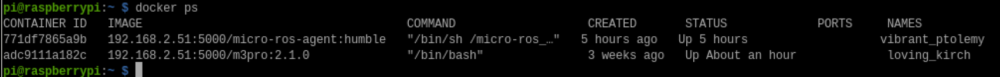
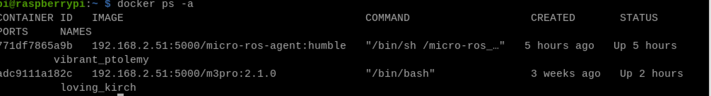
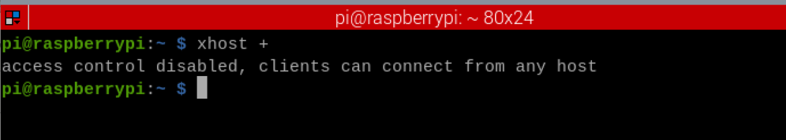

# **Enter the Docker**

This course is for Raspberry Pi 5 and Jetson-Nano boards. Orin boards do not require Docker.

Concept understanding:

We refer to the main Raspberry Pi/Jetson Nano environment as the host machine, and the Docker environment as Docker. All programs on the Raspberry Pi/Jetson Nano run within Docker, except for the communication agent, which runs within the host machine. The username displayed in the host terminal is "jetson/pi," while the username displayed in Docker is "root."

## **1. Enter Docker for the first time**

When the Raspberry Pi 5 and Jetson-Nano motherboard are powered on, they automatically start the Docker joystick startup program (Docker\_M3Pro\_Joy.sh) and mount the joystick connected to the USB port into Docker. To ensure the smooth operation of the joystick startup program, the voice module, myserial, and other devices are not mounted before this Docker is started. Therefore, this Docker cannot be used in subsequent program runs. You need to use a script to start a new Docker with multiple devices mounted.

Enter Docker (before entering, make sure the voice module and control board are connected to the main board/HUB board)

```
sh ~/Docker_M3Pro.sh
```

After entering the docker terminal, the current directory is /. Generally, we need to enter instructions in the /root directory. Therefore, enter in the docker terminal and press Enter to enter the /root directory to view the files. cd

#### **Multiple terminals enter the same container** :

Since the Docker that starts automatically at boot has only one terminal, it is impossible to enter other commands in one terminal at the same time. We need to know how to use multiple terminals to run in a container at the same time.

Enter the following command on the Raspberry Pi 5 and Jetson-Nano to query the information about the first entry into the container generated in Docker.

```
docker ps
```

As shown in the image above, two contents appear. The first container's image is 192.168.2.51:5000/micro-ros-agent:humble named . vibrant\_ptolemy This container connects to the agent and is not the Docker container we first entered. The second container's image is 192.168.2.51:5000/m3pro:2.1.0 , which matches the image name in Docker\_M3Pro.sh, indicating that this is sh Docker\_M3Pro.sh the container just generated. Its name is loving\_kirch . Each person generates a different name here, so the actual query should be based on the specific situation. As long as the image name matches, it will be sufficient. We will enter Docker based on this container name later.

Enter the following command in the host machine and enter this container at the same time,

```
docker exec -it loving_kirch /bin/bash
```

Modify loving\_kirch according to the actual generated container name. Press Enter to enter the Docker terminal. This is the terminal of the Docker container we first started. Subsequent program instructions need to be entered in the terminal of this Docker container.

## **2. Not the first entry**

### **2.1 Enter the previous docker container after restarting**

Sometimes, we modify the code in the Docker container we first entered and then restart or shut down. At this time, if we enter Docker the same way as the first time, we will find that the changes we made previously are no longer there. This is simply because we restarted a new Docker container, and naturally, the changes we made previously are not in it. If we need to re-enter the Docker container after shutting down, we need to follow the steps below to enter: **query the Docker container name** , **restart the Docker container, and enter the Docker container** .

Enter the following command to query the docker that you entered for the first time,

```
docker ps -a
```

Here we list all the containers, including those that are running or not running. We confirm which container to start based on the first time we enter the docker container. For example, I started the car docker three weeks ago, and here I found that the name of this container is loving\_kirch, as shown in the figure below.

Then enter the command in the terminal to restart the car docker container,

```
docker restart loving_kirch
```

loving\_kirch is modified according to the actual container name queried. This instruction **only needs to be started once after the car is restarted** .

Enter the following command in the terminal to enter the Docker container:

```
docker exec -it loving_kirch /bin/bash
```

Press Enter to enter the docker terminal. This is the terminal of the docker container we started for the first time. Subsequent program instructions need to be entered in the terminal of this docker container.

If you need to enter the terminal after restarting and the running program needs to display a graphical interface, you need to enter the following command in the terminal of the car,

```
xhost +
```

#### **2.2 Enter the new docker container**

\1. Make sure the existing Docker container is closed and run the following command to start a new container

```
sh ~/Docker_M3Pro.sh
```

\2. Run the above multi-terminal to enter the same container program to enter the same docker

---

## Extracted Images


### Page 1


[Image details](images/img_001.md)


### Page 2


[Image details](images/img_002.md)


### Page 3


[Image details](images/img_003.md)

