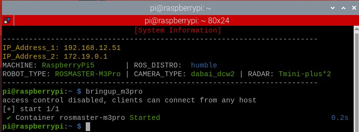
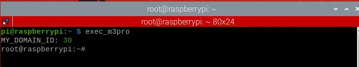
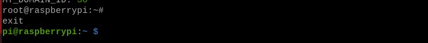
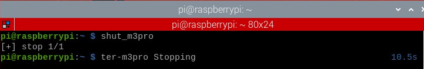
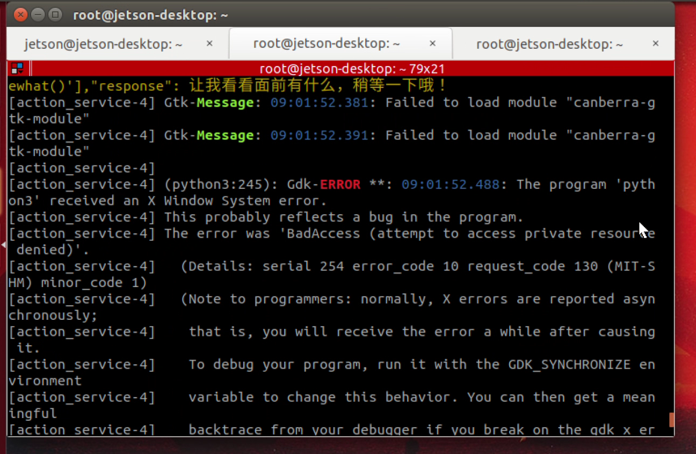
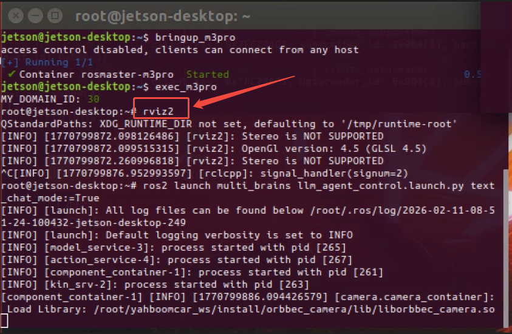

# **Entering the Car Docker**

### **Entering [the Car Docker](#page-0-0)**

- <span id="page-0-0"></span>[1. Course](#page-0-1) Content
- [2. Basic Operations](#page-0-2)
  - 2.1 [Launching](#page-0-3) the m3pro Container
  - 2.2 Accessing the m3pro [Container](#page-1-0) Terminal
  - 2.4 Issues [Encountered After](#page-2-0) Entering the Docker Container on Jetson Nano Versions of M3Pro, A1, M1, and M3 Robots

# **1. Course Content**

This lesson is only for users with **Raspberry Pi 5** and **Jetson-Nano** motherboards.

### [!NOTE]

- <span id="page-0-1"></span>Because the Raspberry Pi 5 and Jetson Nano system versions cannot directly install the ros2 humble environment, the ros2 humble environment is placed in Docker , and the host machine does not have a ROS2 environment.
- <span id="page-0-3"></span><span id="page-0-2"></span>After entering Docker with the Jetson Nano version, you need to open an rviz2 or rqt window before running the AI large-scale multimodal vision tutorial.

# **2. Basic Operations**

# **2.1 Launching the m3pro Container**

If you wish to run the example programs featured in this tutorial, you must first launch the m3pro Docker container.

### [!WARNING]

- **Important:** Ensure that you launch the m3pro Docker container *within* the VNC graphical interface; otherwise, visualization windows (such as RViz) may fail to display correctly.
- Regarding external peripherals—such as game controllers, AI voice modules, and other hardware devices—the Docker container will only load devices that were present at the moment the container was launched. If a hardware device is plugged in *after* the container has already started, it will not be automatically synchronized in real-time within the container. To recognize newly connected devices, you must stop and then restart the container.

### bringup\_m3pro

The message container rosmaster-m3pro Started indicates that the launch was successful.

## **2.2 Accessing the m3pro Container Terminal**

<span id="page-1-0"></span>The commands featured in the subsequent tutorials must be executed *inside* the container. To open the container terminal, use the following command:

```
exec_m3pro
```

To exit the container terminal, press Ctrl + D .

### [!IMPORTANT]

#### **Important**

- Unless explicitly stated otherwise, users of the Raspberry Pi and Jetson Nano platforms should assume that all subsequent program execution commands are to be performed *within* the **m3pro** container. You must first launch the container and then enter the commands within the container terminal. This requirement will not be reiterated in subsequent lessons. ### 2.3 Shutting Down the m3pro Container
- If you genuinely no longer require the m3pro container and need to shut it down manually (typically, manual shutdown is not necessary):

```
shut_m3pro
```

# **2.4 Issues Encountered After Entering the Docker Container on Jetson Nano Versions of M3Pro, A1, M1, and M3 Robots**

<span id="page-2-0"></span>On Jetson Nano versions, attempting to run the AI Large Model Vision examples immediately after entering the Docker container results in a "Permission Denied" error, as shown in the figure below.

Solution: First, open a window within the Docker container using commands such as rviz2 or rqt . After opening and then closing this window, you may proceed to run the AI Large Model Vision examples, as illustrated in the figure below.

---

## Extracted Images


### Page 2


[Image details](images/img_001.md)


[Image details](images/img_002.md)


[Image details](images/img_003.md)


[Image details](images/img_004.md)


### Page 3


[Image details](images/img_005.md)


[Image details](images/img_006.md)

