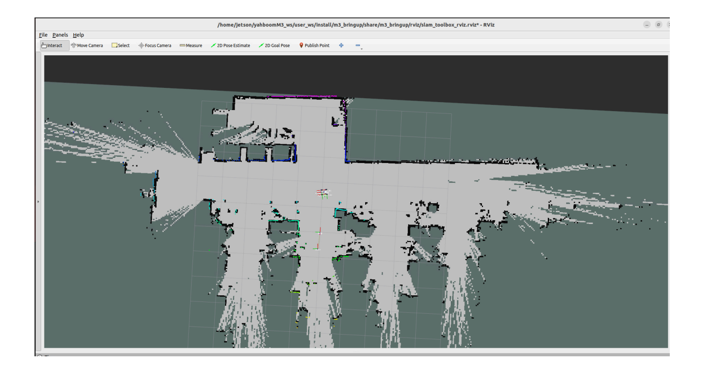
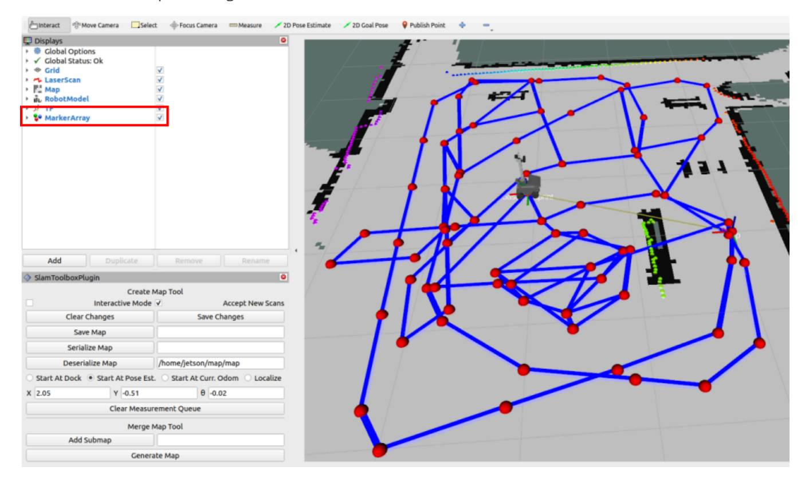
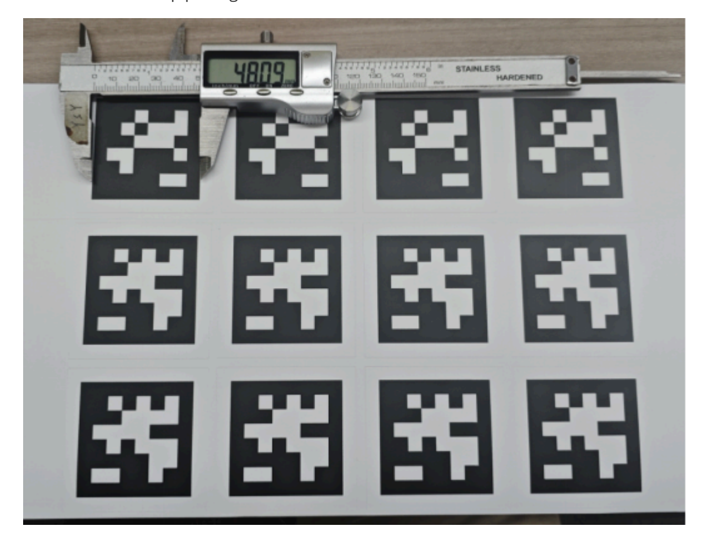
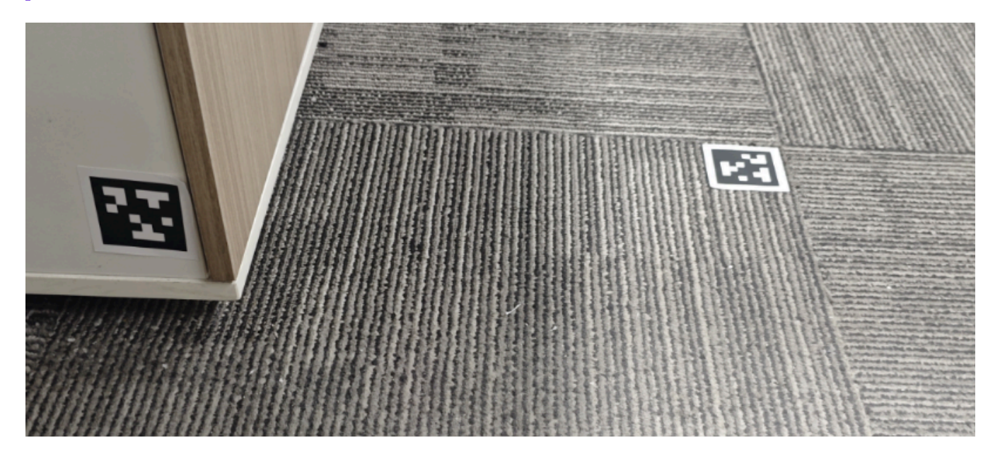
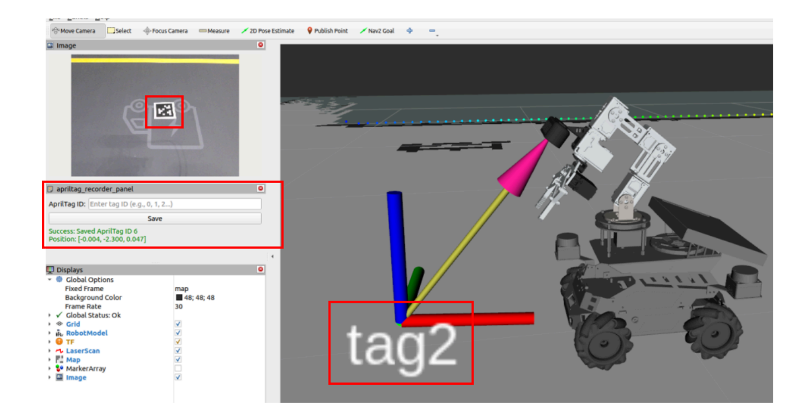
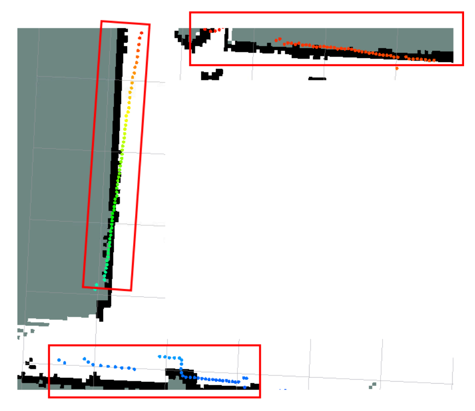
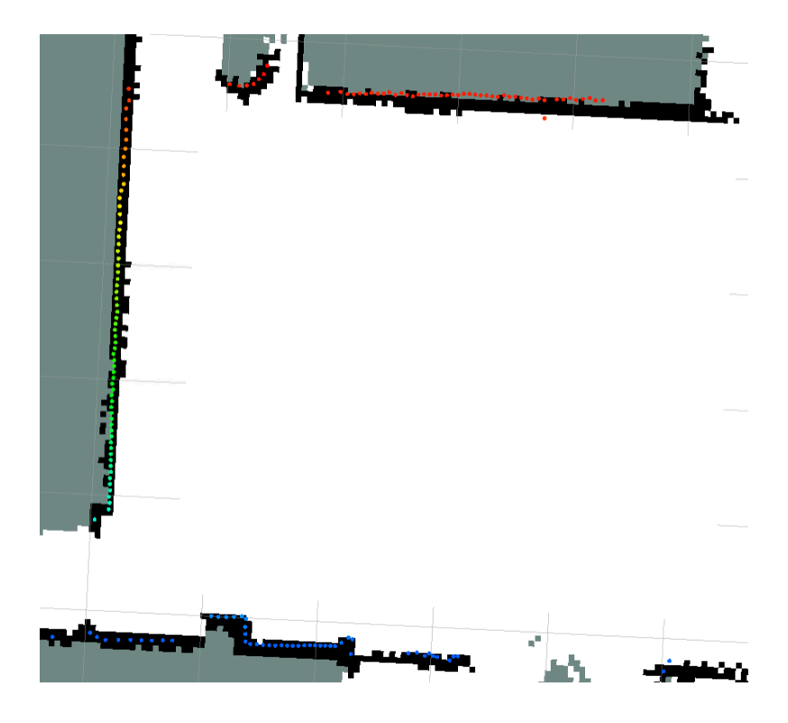
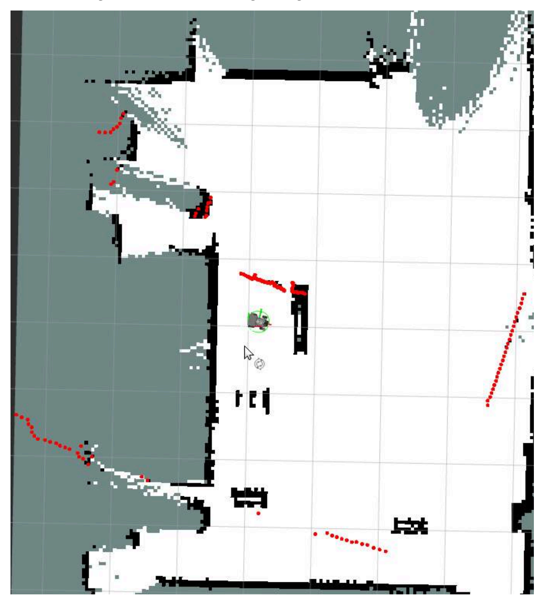
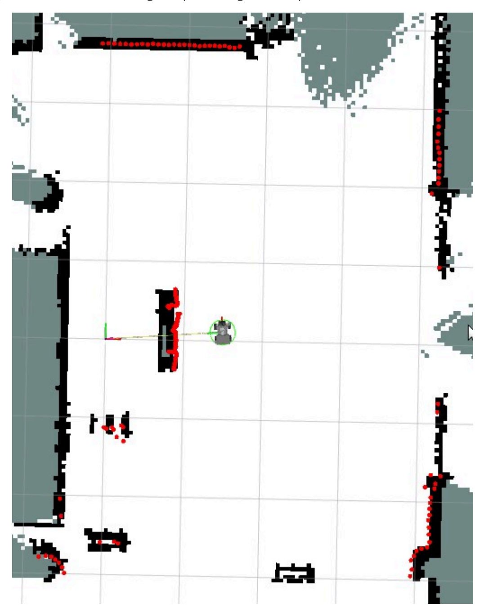
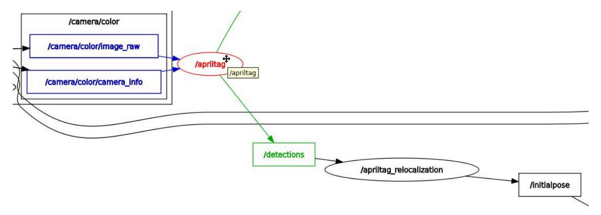

# **Pose Constrained Visual Relocalization Navigation**

#### **Pose Constrained [Visual Relocalization](#page-0-0) Navigation**

- <span id="page-0-0"></span>[1. Course](#page-0-1) Content
  - Learning [Objectives](#page-0-2)
- [2. Prerequisites](#page-0-3)
- 3. Building [Grid Map and Pose](#page-1-0) Map
- 4. Recording ArUco Tag [Map Coordinates](#page-4-0)
  - 4.1 [Preparing](#page-4-1) ArUco Tags
  - 4.2 [Deploying](#page-5-0) ArUco Tags
  - 4.3 Starting the Tag [Recording](#page-5-1) Node
- 5. Starting Visual [Relocalization](#page-8-0) Navigation Mode
  - 5.1 Verifying [Relocalization](#page-9-0) Function
  - 5.2 Service Control for Tag [Detection](#page-9-1)
- <span id="page-0-1"></span>[6. Source](#page-10-0) Code Analysis
  - 6.1 Tag [Recording](#page-10-1) Node Launch File
  - 6.2 [Relocalization](#page-12-0) Mode Navigation Launch File
  - 6.3 [aritag\\_relocation.yaml](#page-16-0) File Structure
  - 6.4 Visual [Relocalization](#page-17-0) Working Principle
  - 6.5 Tag [Configuration](#page-17-1) Parameters
  - 6.6 Inter-node [Communication](#page-19-0) Diagram

## **1. Course Content**

- Implement visual relocalization navigation using ArUco tags combined with pose constraints.
- <span id="page-0-2"></span>By deploying ArUco tags as spatial anchors, when robot localization is lost or cumulative error becomes too large, visual detection automatically triggers relocalization to correct the robot's global pose in the map, improving the robustness and reliability of the navigation system.

### **Learning Objectives**

- Master the preparation, deployment, and position recording methods for ArUco tags
- <span id="page-0-3"></span>Understand the working principles and applicable scenarios of visual relocalization
- Learn to use navigation mode with pose constraints combined with visual relocalization

## **2. Prerequisites**

Use the following command to start the microROS agent and connect to the chassis

sh start\_agent.sh

<span id="page-1-0"></span>Start basic nodes such as camera, robotic arm assistance, LiDAR fusion, etc.

```
ros2 launch m3pro_bringup car_base.launch.py
```

## **3. Building Grid Map and Pose Map**

Start the SLAM mapping node

```
ros2 launch slam_mapping slam_toolbox.launch.py
```

Control the vehicle to move using keyboard or gamepad to complete map building


[Image details](images/img_001.md)

Save the grid map

ros2 launch slam\_mapping save\_slamtoolbox\_map.launch.py

#### **Note**

The map will be saved in the \$HOME/map directory

**Check Pose Points**

Click the MarkerArray option in the Display panel of Rviz to view the pose points of the pose map. Ensure there are sufficient pose points evenly distributed in the map area for positioning during subsequent navigation.


[Image details](images/img_002.md)

Save the pose map

ros2 launch slam\_mapping save\_slamtoolbox\_map.launch.py map\_type:=posegraph

<span id="page-4-1"></span><span id="page-4-0"></span>After saving both the grid map and pose map, press **Ctrl+C** in the mapping node terminal to stop mapping

## **4. Recording ArUco Tag Map Coordinates**

## **4.1 Preparing ArUco Tags**

- You can obtain them through the following methods:
  - Tags from the sand table map package
  - Download and print tags from the attachment materials
- Determine the tag size
  - Measure the actual edge length of the tag using measuring tools. The edge length of tags from the sand table map package is 0.048m


[Image details](images/img_003.md)

Modify the ArUco detection configuration file

\$HOME/M3Pro\_ws/src/m3pro\_bringup/config/common.yaml

Modify the size to the actual measurement. If you are using tags from the sand table map package, the factory default size is 0.048 and no modification is needed

```
...
apriltag: # node name
 ros__parameters:
   image_transport: raw # image format: "raw" or "compressed"
   family: 36h11 # tag family name: 16h5, 25h9, 36h11
   size: 0.048 # default tag edge size in meter
...
```

### **4.2 Deploying ArUco Tags**

<span id="page-5-0"></span>Place ArUco tags at desired locations on the map. They can be placed at any position visible to the camera, such as the floor, wall, or any other location.

#### **Important**

#### **Placement Tips**

- It is recommended to place them near the starting or ending points of frequent navigation routes to trigger relocalization before the vehicle departs or after it reaches the target
- It is not recommended to place them during movement because when the vehicle is moving, the robotic arm may cause mechanical vibration, leading to frequent camera frame shaking and inaccurate vehicle position calculation


[Image details](images/img_004.md)

### **4.3 Starting the Tag Recording Node**

<span id="page-5-1"></span>ros2 launch m3pro\_bringup record\_tag.launch.py

- Use the keyboard or gamepad to control the vehicle to move near the tag that needs to be recorded, so that the tag appears in the camera's field of view
- In the **ArUco ID** field of the **aritag\_recorder\_panel** panel, enter the tag ID that needs to be recorded, then click **Save** (ensure the vehicle positioning is accurate before recording)


[Image details](images/img_005.md)

Before recording the tag position, if you find that the laser contour deviates significantly from the environmental edge features, as shown in the figure below, it indicates a positioning error. At this point, you need to first use the **2D Estimate** tool for manual relocalization before recording the position


[Image details](images/img_006.md)

The figure below shows accurate positioning with high matching between the laser contour and environmental edge features


[Image details](images/img_007.md)

Repeat the above steps to complete recording all tag positions. The recording file path is:

\$HOME/M3Pro\_ws/src/m3pro\_bringup/config/aritag\_relocation.yaml

After recording tag positions, press **Ctrl+C** to close the recording node

## **5. Starting Visual Relocalization Navigation Mode**

<span id="page-8-0"></span>ros2 launch M3Pro\_navigation toolbox\_location\_nav.launch.py relocation:=True detection\_enabled:=True

After starting, the interface is the same as regular navigation


[Image details](images/img_008.md)

## **5.1 Verifying Relocalization Function**

- You can manually move the robot's position (simulating severe odometer error or positioning confusion, as shown in the figure above)
- When a tag from the map appears in the camera's field of view, relocalization will be automatically triggered to correct the robot's global positioning in the map

<span id="page-9-0"></span>
[Image details](images/img_009.md)

## **5.2 Service Control for Tag Detection**

- <span id="page-9-1"></span>Since the aritag detection node occupies CPU at high frequency, you can disable the detection state when detection is not needed. The node provides the control\_detection service to control whether tag detection is performed
- Query status

ros2 service call /control\_detection apriltag\_localization/srv/ControlDetection "{command: 0}"

Enable detection

ros2 service call /control\_detection apriltag\_localization/srv/ControlDetection "{command: 1}"

Disable detection (reduce CPU usage)

ros2 service call /control\_detection apriltag\_localization/srv/ControlDetection "{command: 2}"

<span id="page-10-0"></span>

## **6. Source Code Analysis**

### **6.1 Tag Recording Node Launch File**

<span id="page-10-1"></span>\$HOME/M3Pro\_ws/src/m3pro\_bringup/launch/record\_tag.launch.py

```
import os
from ament_index_python.packages import get_package_share_directory
from launch import LaunchDescription
from launch.substitutions import LaunchConfiguration
from launch_ros.actions import Node
from launch.actions import DeclareLaunchArgument,IncludeLaunchDescription, TimerAction,
ExecuteProcess
from launch.launch_description_sources import PythonLaunchDescriptionSource
def generate_launch_description():
```

```
# Step 1: Declare output file path parameter
    output_file_path_arg = DeclareLaunchArgument(
        'output_file_path',
 default_value=os.path.join(get_package_share_directory("m3pro_bringup"),"config","aritag_re
location.yaml"),
        description='Path to the output YAML file for saving AprilTag poses'
    )
    # Step 2: Declare target coordinate frame parameter
    target_frame_arg = DeclareLaunchArgument(
        'target_frame',
        default_value='map',
        description='Target coordinate frame for recording AprilTag poses'
    )
    # Step 3: Create ArUco recorder node
    apriltag_recorder_node = Node(
        package='apriltag_localization',
        executable='apriltag_recorder',
        name='apriltag_recorder',
        output='screen',
        parameters=[{
            'output_file_path': LaunchConfiguration('output_file_path'),
            'target_frame': LaunchConfiguration('target_frame'),
        }]
    )
    # Step 4: Start navigation and SLAM toolbox
    navigation_launch = IncludeLaunchDescription(
        PythonLaunchDescriptionSource([os.path.join(
            get_package_share_directory('M3Pro_navigation'),
            'launch',
            'toolbox_location_nav.launch.py'
        )]),
        launch_arguments={
            "rviz_config": os.path.join(
                get_package_share_directory('m3pro_bringup'),
                'rviz',
                'aritag_record.rviz'
            ),
            "log_level": "info",
        }.items()
    )
    # Step 5: Enable ArUco detection service after 8 seconds delay
    call_detection_service = TimerAction(
        period=8.0,
        actions=[
            ExecuteProcess(
                cmd=['ros2', 'service', 'call', '/control_detection',
                     'apriltag_localization/srv/ControlDetection',
                     '{command: 1}'],
```

```
output='screen'
        )
    ]
)
return LaunchDescription([
    output_file_path_arg,
    target_frame_arg,
    apriltag_recorder_node,
    navigation_launch,
    call_detection_service
])
```

#### **Code Explanation**:

#### 1. **Parameter Declaration**:

- output\_file\_path : Specifies the YAML file path for saving ArUco tag positions, default is aritag\_relocation.yaml
- target\_frame : Target coordinate frame, default is map (map coordinate system)

#### 2. **apriltag\_recorder Node**:

- Function: Listens for ArUco tags in the camera's field of view and saves their poses in the map coordinate system to a YAML file
- Input: Camera image topic, tf coordinate transformation
- Output: aritag\_relocation.yaml configuration file

#### 3. **navigation\_launch**:

- Starts the SLAM toolbox navigation system to provide accurate robot poses
- Loads the dedicated RViz configuration file aritag\_record.rviz , which includes the aritag\_recorder\_panel

#### 4. **call\_detection\_service**:

- Uses TimerAction to call the /control\_detection service after an 8-second delay
- Enables ArUco detection (command: 1 means enable)
- <span id="page-12-0"></span>The delay is to wait for the system to fully start before enabling detection, avoiding resource conflicts

## **6.2 Relocalization Mode Navigation Launch File**

```
$HOME/M3Pro_ws/src/M3Pro_navigation/launch/toolbox_location_nav.launch.py
```

This launch file is the core entry point for visual relocalization navigation, coordinating the startup of chassis, localization, navigation and other modules. Below is a detailed explanation:

```
def generate_launch_description():
    #Map folder and file detection
    map_folder_dir = os.path.join(os.path.expanduser('~'), 'map')
```

```
# Declare arguments
    declared_arguments = []
    m3pronav_dir=os.path.join(get_package_share_directory('M3Pro_navigation'))
    #Map file
    declared_arguments.append(
        DeclareLaunchArgument(
            "map",
            default_value="map.yaml",
            description="map name",
        )
    )
    declared_arguments.append(
        DeclareLaunchArgument(
            "gui",
            default_value='True',
            description="if rviz is used, set to True. If False, rviz will not be
launched.",
        )
    )
    #slam_toolbox pose map file
    declared_arguments.append(
        DeclareLaunchArgument(
            "pose_map",
            default_value="map",
            description="",
        )
    )
    declared_arguments.append(
        DeclareLaunchArgument(
            'relocation',
            default_value='false'
        )
    )
    declared_arguments.append(
        DeclareLaunchArgument(
            'detection_enabled',
            default_value='false'
        )
    )
    #Navigation parameter file
    declared_arguments.append(
        DeclareLaunchArgument(
        "params_file",
        default_value= os.path.join(get_package_share_directory("M3Pro_navigation"),
"param", "yahboom_M3Pro.yaml"),
            description="Full path to param file to load",
        )
    )
```

```
declared_arguments.append(
        DeclareLaunchArgument(
            "use_sim_time",
            default_value="False",
            description="Use simulation (Gazebo) clock if true",
        )
    )
    declared_arguments.append(
        DeclareLaunchArgument(
            "rviz_config",
            default_value=os.path.join(m3pronav_dir,'rviz','nav2.rviz')
        )
    )
    declared_arguments.append(
        DeclareLaunchArgument(
            "log_level",
            default_value="info",
            description="log level"
        )
    )
    # Initialize Arguments
    map = LaunchConfiguration("map")
    map_dir=PathJoinSubstitution([map_folder_dir, map])
    pose_map=PathJoinSubstitution([map_folder_dir, LaunchConfiguration("pose_map")])
    params_file=LaunchConfiguration("params_file")
    use_sim_time=LaunchConfiguration("use_sim_time",default="false")
    rviz_config=LaunchConfiguration("rviz_config")
    log_level=LaunchConfiguration("log_level")
    carbase_launch=IncludeLaunchDescription(
 PythonLaunchDescriptionSource(os.path.join(get_package_share_directory('m3pro_bringup'),'la
unch','car_base.launch.py')),
                launch_arguments={'log_level': log_level,
                                   'relocation': LaunchConfiguration('relocation'),
                                   'detection_enabled':
LaunchConfiguration('detection_enabled'),
                                  }.items())
    #navigation2 modified launch file, blocking AMCL positioning function
    nav2_launch_mod = os.path.join(m3pronav_dir,
                                     'launch',
                                     'bringup_mod.launch.py'
                                    )
    # slamtoolbox positioning algorithm startup file
 slamtoolbox_localization_launch_file=os.path.join(get_package_share_directory('slam_mapping
'),'launch','localization_launch.py')
```

```
#slamtoolbox positioning navigation
   slamtoolbox_localization_nav = GroupAction(
       actions=[
           # Start navigation2 navigation file (no global positioning)
           IncludeLaunchDescription(
               PythonLaunchDescriptionSource(nav2_launch_mod),
               launch_arguments={
                               "map": map_dir,
                               "params_file": params_file,
                               "use_sim_time":use_sim_time,
                               "log_level": log_level,
                               }.items()),
           #Start slamtoolbox positioning node
           IncludeLaunchDescription(
               PythonLaunchDescriptionSource(slamtoolbox_localization_launch_file),
               launch_arguments={
                   "pose_map": pose_map,
                   "use_sim_time":use_sim_time,
               }.items(),
           ),
           #Log Printing
           LogInfo(msg=['====================Robot-M3Pro Navigation Start with SlamToolbox
localization===================='])
       ]
   )
   #rviz node
   rviz_node = Node(
       package = 'rviz2',
       executable = 'rviz2',
       name='rviz2',
       arguments=['-d', rviz_config],
       parameters=[{'use_sim_time': use_sim_time}],
       output='screen',
       condition=IfCondition(LaunchConfiguration('gui'))
   )
   return LaunchDescription(
       [
           *declared_arguments, #Declare arguments
           rviz_node, #rviz node
           carbase_launch,
           slamtoolbox_localization_nav #slamtoolbox positioning navigation
       ]
   )
```

#### **Code Explanation**:

#### 1. **carbase\_launch**:

Starts chassis basic nodes, including camera, robotic arm assistance, LiDAR fusion, etc.

Passes relocation and detection\_enabled parameters to control whether visual relocalization is enabled

#### 2. **nav2\_launch\_mod**:

- Uses the modified Nav2 launch file ( bringup\_mod.launch.py )
- This version blocks the AMCL positioning function because the system uses SlamToolbox for positioning

#### 3. **slamtoolbox\_localization\_nav**:

- This is a GroupAction containing multiple cooperating components:
  - Starts the modified Nav2 navigation stack (path planning, costmap, controller, etc.)
  - Starts the SlamToolbox positioning node and loads the pose map to achieve constrained positioning
  - Prints startup log information

#### 4. **rviz\_node**:

- Starts RViz2 visualization tool
- <span id="page-16-0"></span>Uses IfCondition to only start when gui=True
- Loads the specified RViz configuration file containing navigation-related display panels

### **6.3 aritag\_relocation.yaml File Structure**

The structure of the generated aritag\_relocation.yaml file after recording is as follows:

```
tags:
 - id: 0 # ArUco tag ID
   position: # Position coordinates (relative to map coordinate system)
    x: 1.234 # X coordinate (meters)
    y: 0.567 # Y coordinate (meters)
    z: 0.0 # Z coordinate (meters, usually 0 for floor height)
   orientation: # Attitude (quaternion)
    x: 0.0
    y: 0.0
    z: 0.123
    w: 0.987
 - id: 1
   position:
    x: 2.345
    y: 1.234
    z: 0.0
   orientation:
    x: 0.0
    y: 0.0
    z: 0.456
    w: 0.890
```

#### **Field Description**:

| Field               | Type  | Description                                                        |
|---------------------|-------|--------------------------------------------------------------------|
| id                  | int   | Unique identifier ID of the ArUco tag                              |
| position.x          | float | X coordinate of the tag in map coordinates (meters)                |
| position.y          | float | Y coordinate of the tag in map coordinates (meters)                |
| position.z          | float | Z coordinate of the tag in map coordinates (meters)                |
| orientation.x/y/z/w | float | Attitude quaternion of the tag, representing the tag's orientation |

## **6.4 Visual Relocalization Working Principle**

- <span id="page-17-0"></span>1. **Detect ArUco Tags**: Camera continuously detects ArUco tags within its field of view
- 2. **Match Global Coordinates**: If a tag is detected, read its global coordinates from aritag\_relocation.yaml
- 3. **Calculate Deviation**: Compare the current odometer estimated position with the actual position provided by ArUco
- 4. **Correct Pose**: Use ArUco's position to correct the robot's global pose

#### **Relocalization Advantages**:

- ✅ **Eliminate Cumulative Error**: Odometer accumulates error over time, and ArUco provides absolute position reference
- ✅ **Solve Degenerate Scenarios**: In long corridors or areas with similar features, laser SLAM may have positioning confusion, and ArUco provides reliable anchors

#### **Precautions**:

⚠️ Before recording tag positions, ensure laser positioning is accurate (laser contour matches environmental edges)

⚠️ If tag positions change, you need to re-record their global coordinates

## **6.5 Tag Configuration Parameters**

<span id="page-17-1"></span>Configuration parameter file path for the tag node

\$HOME/M3Pro\_ws/src/m3pro\_bringup/config/common.yaml

#### **Parameter Description**:

| Parameter       | Description                                                                   | Default<br>Value |
|-----------------|-------------------------------------------------------------------------------|------------------|
| image_transport | Image transport format, raw for raw image, compressed<br>for compressed image | raw              |

| Parameter              | Description                                                                          | Default<br>Value |
|------------------------|--------------------------------------------------------------------------------------|------------------|
| family                 | ArUco tag family type, different families have different<br>encoding methods         | 36h11            |
| size                   | Physical edge length of the tag (unit: meters), must match<br>actual size            | 0.048            |
| profile                | Whether to output performance analysis information                                   | false            |
| max_hamming            | Maximum allowed hamming distance (error correction<br>bits), 0 means no correction   | 0                |
| detector.threads       | Number of detection threads                                                          | 1                |
| detector.decimate      | Pyramid downsampling rate, larger value means faster<br>detection but lower accuracy | 2.0              |
| detector.blur          | Gaussian blur sigma value for quadrilateral detection                                | 0.0              |
| detector.refine        | Whether to enable edge sharpening for precise<br>positioning                         | true             |
| detector.sharpening    | Decoded image sharpening intensity                                                   | 0.25             |
| detector.debug         | Whether to output debug images to the current working<br>directory                   | false            |
| pose_estimation_method | Pose estimation method, pnp means using PnP algorithm                                | pnp              |
| tag.ids                | List of tag IDs to detect, only tags in the list will be<br>detected                 | [1-20]           |
| tag.frames             | List of corresponding TF coordinate frame names for the<br>IDs                       | [tag1-<br>tag20] |

#### **Important Parameter Tuning Suggestions**:

- size : Must be accurately measured and set. Errors will cause pose calculation errors
- family : Must match the tag family being used, otherwise detection will fail
- tag.ids : Only list the actually used tag IDs to reduce unnecessary TF publishing

```
...
apriltag: # node name
 ros__parameters:
   image_transport: raw # image format: "raw" or "compressed"
   family: 36h11 # tag family name: 16h5, 25h9, 36h11
   size: 0.048 # default tag edge size in meter
   profile: false # print profiling information to stdout
   # tuning of detection (defaults)
   max_hamming: 0 # maximum allowed hamming distance (corrected bits)
   detector:
```

```
threads: 1 # number of threads
     decimate: 2.0 # decimate resolution for quad detection
     blur: 0.0 # sigma of Gaussian blur for quad detection
     refine: true # snap to strong gradients
     sharpening: 0.25 # sharpening of decoded images
     debug: false # write additional debugging images to current working
directory
   pose_estimation_method: "pnp" # method for estimating the tag pose
   tag:
     ids: [1, 2, 3, 4,5,6,7,8,9,10,11,12,13,14,15,16,17,18,19,20] # tag IDs for
which to publish transform
     frames: [tag1, tag2, tag3, tag4, tag5, tag6, tag7, tag8, tag9, tag10, tag11, tag12,
tag13, tag14, tag15, tag16, tag17, tag18, tag19, tag20]
...
```

### **6.6 Inter-node Communication Diagram**

<span id="page-19-0"></span>Start during relocalization navigation operation:

```
ros2 run rqt_graph rqt_graph
```

The apriltag node subscribes to the camera topic to detect tags and publishes the /detections topic. The relocalization node apriltag\_relocation subscribes to /detections . When a tag is detected, it calculates the vehicle's base\_link position in the map coordinate system based on the recorded map anchor coordinates of the tag, and publishes to /initialpose to trigger the slam\_toolbox node's positioning function to calculate the precise vehicle coordinates in the map from the pose constraint graph.


[Image details](images/img_010.md)