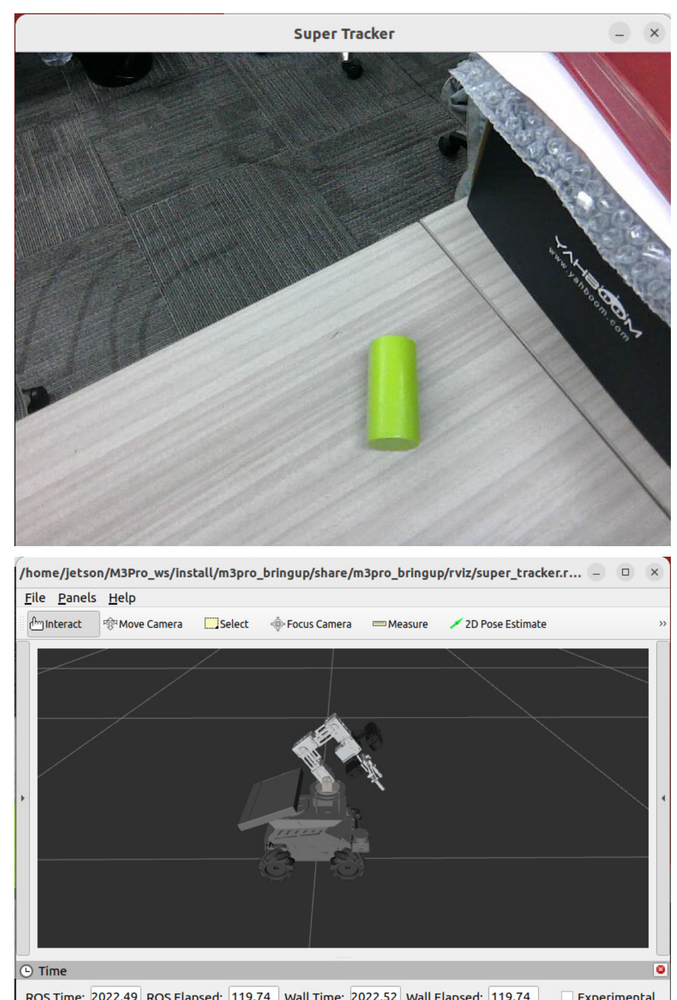
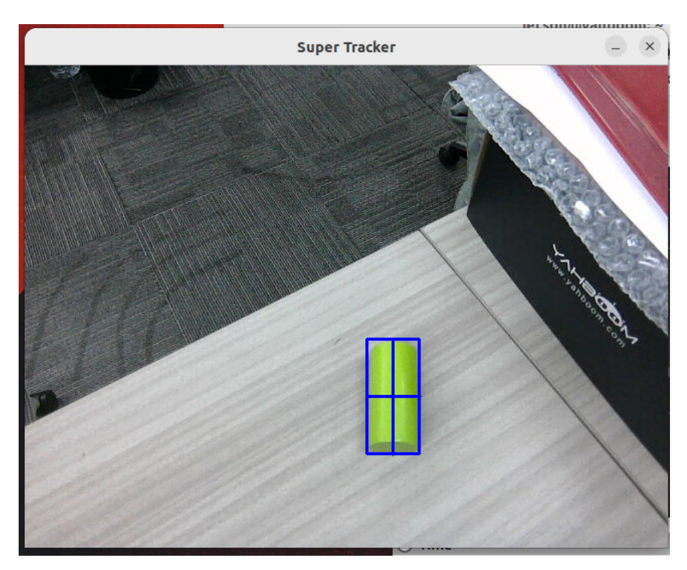
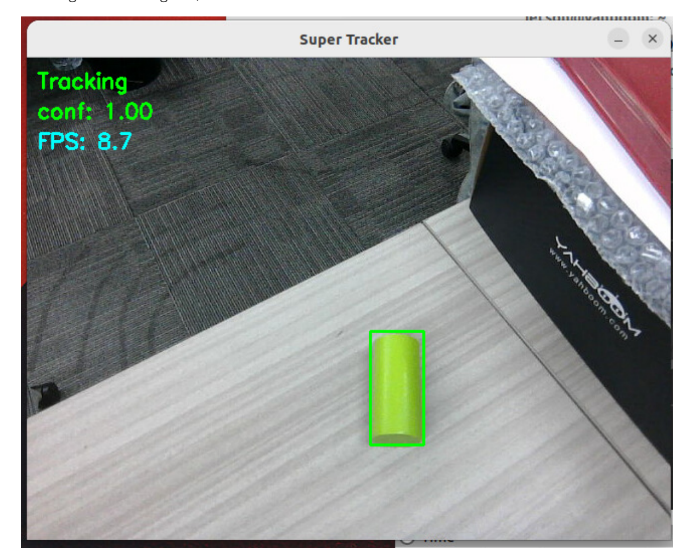
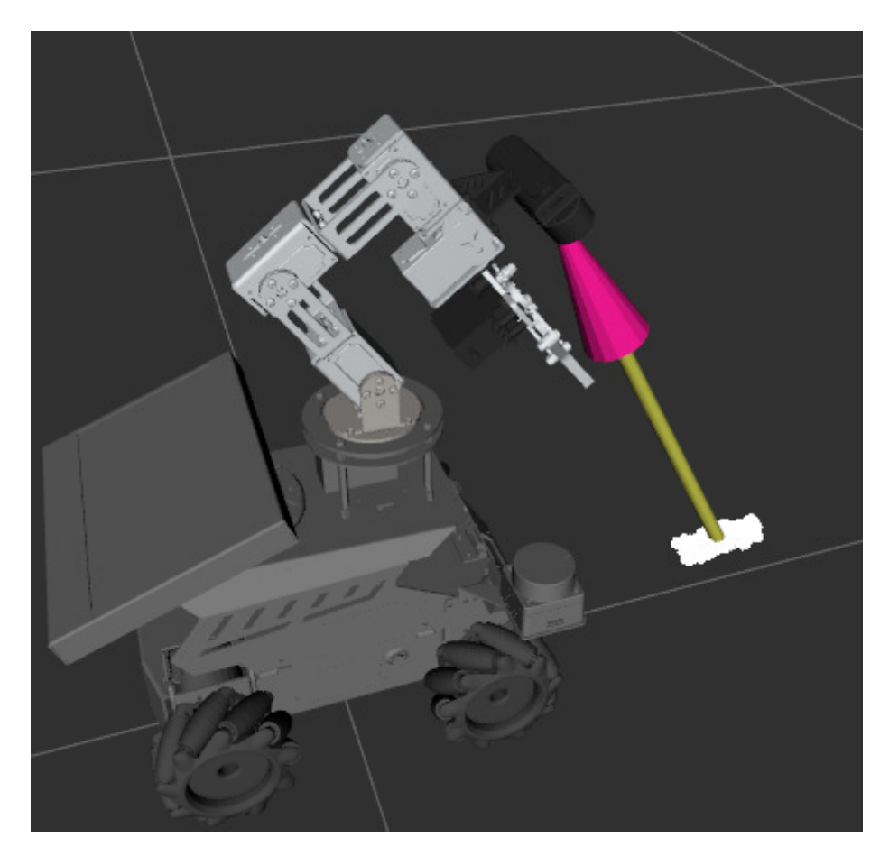
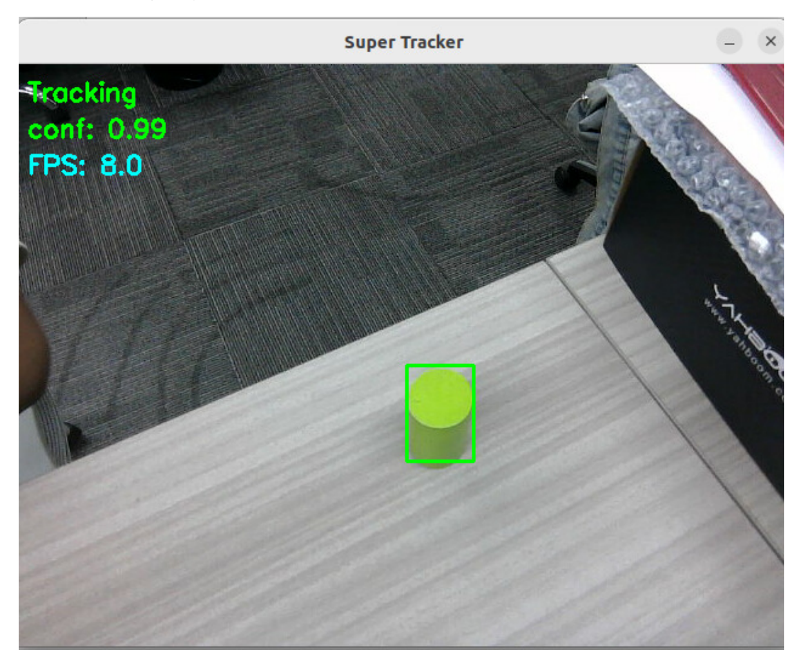
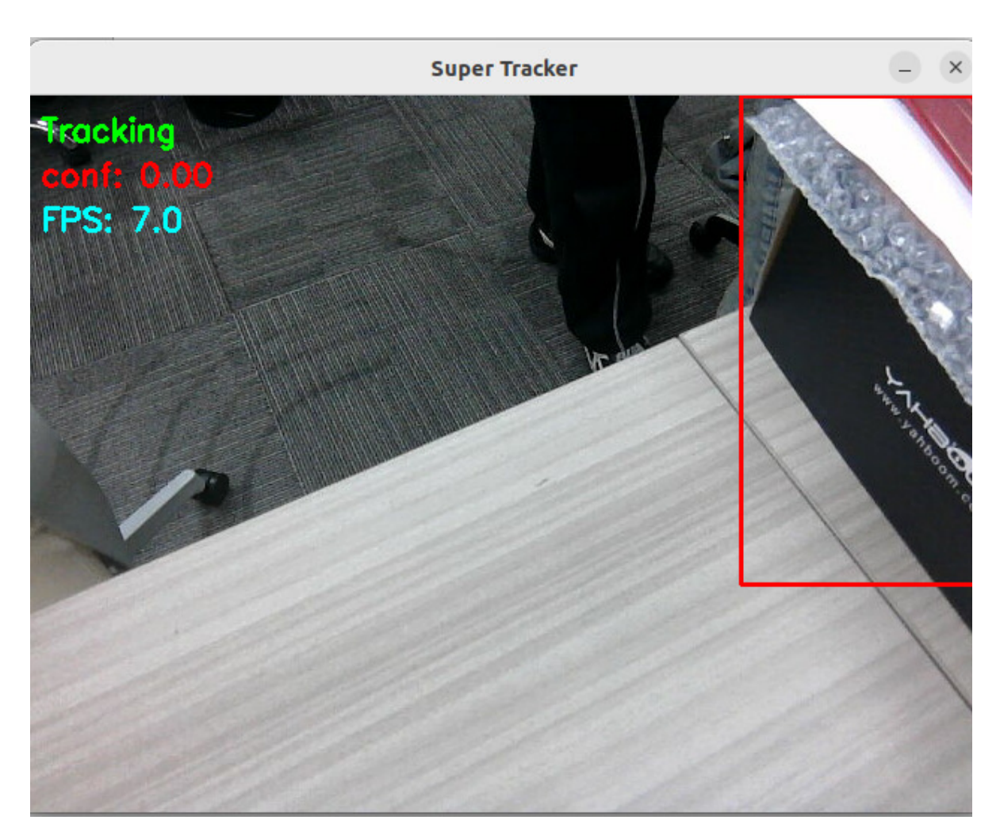
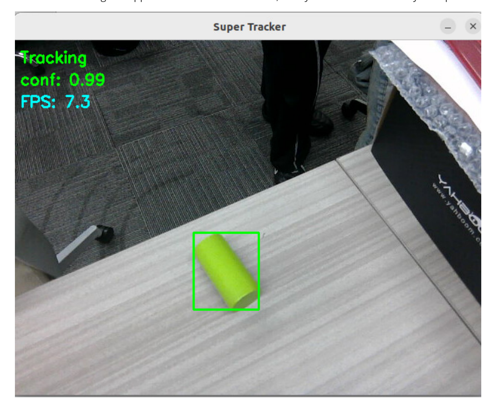

# **Transformer Model Tracking Algorithm**

#### **[Transformer Model Tracking](#page-0-0) Algorithm**

- <span id="page-0-0"></span>[1. Course](#page-0-1) Content
- [2. Preparation](#page-0-2)
- [3. Starting](#page-0-3) the Tracking Case
- [4. Source](#page-6-0) Code Analysis
- <span id="page-0-1"></span>[5. Attachments](#page-7-0)

#### **1. Course Content**

<span id="page-0-2"></span>Learn about Transformer deep learning for target tracking

### **2. Preparation**

Start the microROS agent and connect to the chassis using the following command:

```
sh start_agent.sh
```

Start basic nodes such as camera, robotic arm assistance, and radar fusion:

```
ros2 launch m3pro_bringup car_base.launch.py
```

### **3. Starting the Tracking Case**

```
ros2 launch m3pro_bringup super_tracker.launch.py
```

After the program starts, \*\*Super Tracker window and rviz2 interface


[Image details](images/img_001.md)

In the Super Tracker window, press 'c' to enter selection mode. Use the mouse to select the target object you want to track, and press Enter to confirm.


[Image details](images/img_002.md)

Then it will enter tracking mode. In tracking mode, the point cloud of the target object will be segmented using PCL, which can be viewed in RViz.


[Image details](images/img_003.md)


[Image details](images/img_004.md)

When the camera's perspective relative to the tracked object changes, the tracking bounding box will adaptively deform to match.


[Image details](images/img_005.md)

If the target's confidence score drops too low during tracking, the bounding box will turn red, and the system will begin searching for the target.


[Image details](images/img_006.md)

When the target reappears within the field of view, the system will automatically reacquire it.


[Image details](images/img_007.md)

During the tracking process, the node publishes the ROI bounding box coordinates and confidence score of the target object to the /tracking\_bbox topic. You can view this data using the following command:

ros2 topic echo /tracking\_bbox

If you need to obtain the coordinates of the target object's point cloud centroid—specifically within the vehicle's base\_link coordinate frame—you can query them using the following command:

```
ros2 run tf2_ros tf2_echo base_link roi_object
```

In the output, "Translation" represents the x, y, and z coordinates of the target object's point cloud centroid within the base\_link coordinate frame.

When you need to stop tracking an object, you can do so by making a service request:

```
ros2 service call /cancel_track smart_tracker/srv/CancelTrack "{}"
```

#### [!IMPORTANT]

<span id="page-6-0"></span>In the **[OpenClaw Embodied Intelligence in Action]** chapter, the deep learning-based tracking module discussed here will be utilized for robotic arm target tracking and object grasping tasks.

## **4. Source Code Analysis**

Path to the super\_tracker launch file:

\$HOME/M3Pro\_ws/src/m3pro\_bringup/launch/super\_tracker.launch.py

```
import os
from launch import LaunchDescription
from launch.actions import DeclareLaunchArgument
from launch.substitutions import LaunchConfiguration
from launch_ros.actions import Node
from ament_index_python.packages import get_package_share_directory
def generate_launch_description():
commom_param_file=os.path.join(get_package_share_directory('m3pro_bringup'),'con
fig','common.yaml')
super_track_model=os.path.join(os.path.expanduser('~'),'MODELS','tracker','super
_track_sim.onnx')
rviz_config=os.path.join(get_package_share_directory('m3pro_bringup'),'rviz','su
per_tracker.rviz')
declared_arguments = []
declared_arguments.append(
DeclareLaunchArgument(
"display_windows_only_track",
default_value='false',
description="",
)
)
declared_arguments.append(
DeclareLaunchArgument(
"display_windows",
default_value='true',
description="",
)
)
```

```
# tracker node
tracker_node = Node(
package='smart_tracker',
executable='super_tracker',
name='super_tracker',
parameters=[{
'display_windows_only_track': LaunchConfiguration('display_windows_only_track'),
'display_windows': LaunchConfiguration('display_windows'),
'model_path': super_track_model,
}],
remappings=[('/image_raw', '/camera/color/image_raw') ],
output='screen'
# prefix='gdb -ex run --args'
)
# PCL segmentation node for ROI point cloud segmentation
pclsegment_node = Node(
package='smart_tracker',
executable='pcl_segment',
name='pcl_segment',
parameters=[commom_param_file],
output='screen'
)
rviz_node = Node(
package = 'rviz2',
executable = 'rviz2',
name='rviz2',
arguments=['-d', rviz_config],
output='screen',
)
# Create launch description
return LaunchDescription([
*declared_arguments,
tracker_node,
pclsegment_node,
rviz_node
])
```

# **5. Attachments**

- <span id="page-7-0"></span>The .deb package required for the super\_tracker functionality (**Annex — .deb Functional Package**) and the ONNX model file (**Annex — Model File**) can be found in the tutorial attachments.
- Functional Package: ros-humble-smart-tracker\_0.0.0-0jammy\_arm64.deb (Install using apt install )
- Model File: super\_track.onnx