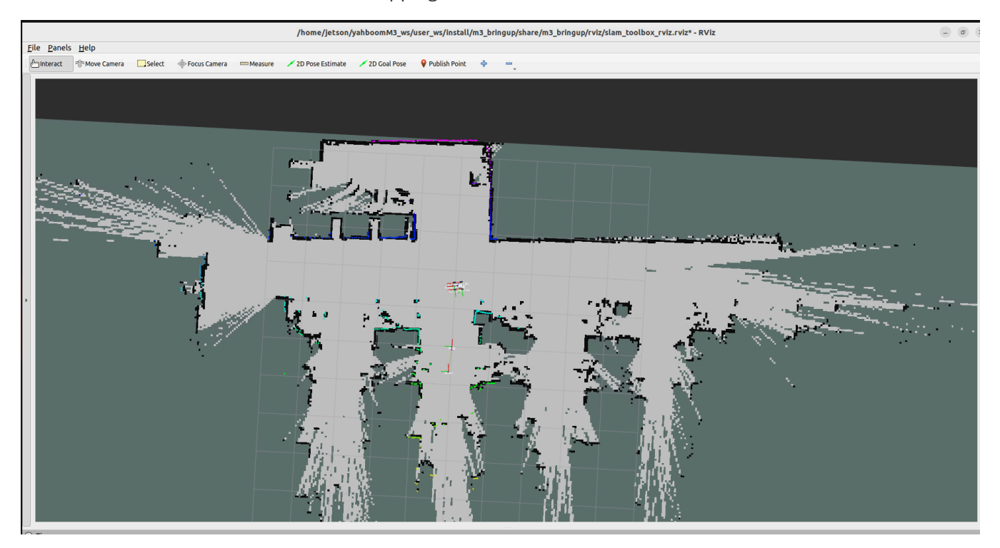
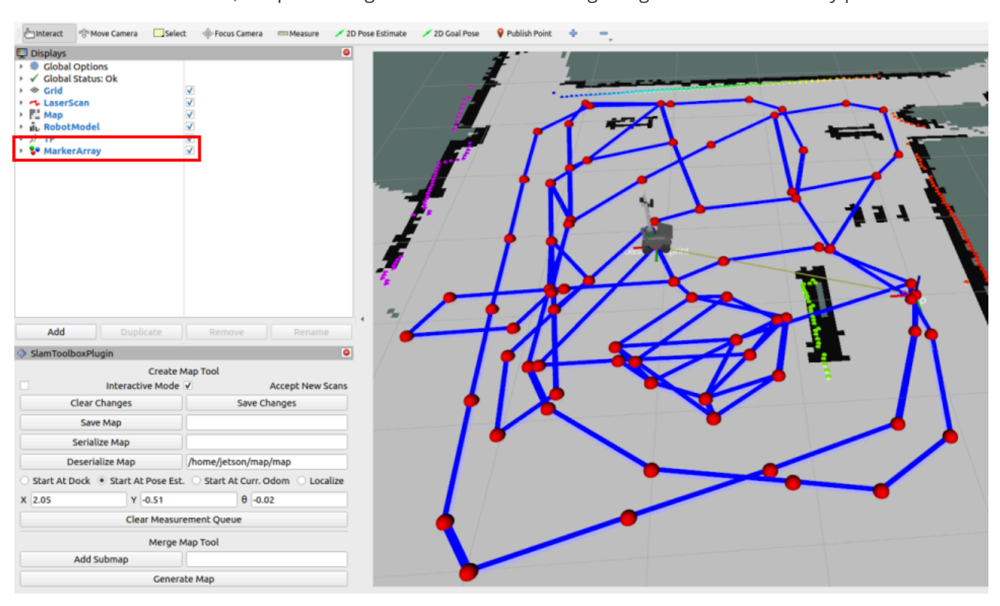
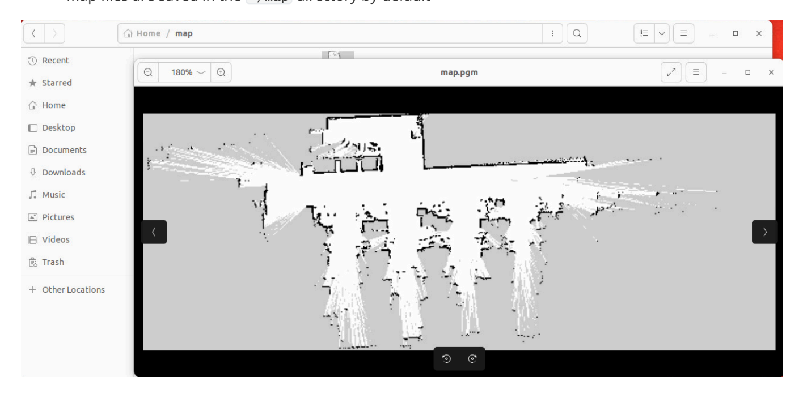

# **Build A Pose Map**

#### **Build A [Pose Map](#page-0-0)**

- [1. Course](#page-0-1) Content
- [2. Building](#page-0-2) a Grid Map

# **1. Course Content**

1. Use slam\_toolbox to build grid maps and pose maps

### **Note**

- At least one grid map is required before marking the road network .geojson file
- The pose map enables fast relocalization when marking waypoints and navigating, improving global localization accuracy and enhancing waypoint marking accuracy

# **2. Building a Grid Map**

If the chassis mircoROS agent communication is not started, first start the agent. If already started, no need to restart

sh start\_agent.sh

Enter the command in the terminal

ros2 launch slam\_mapping slam\_toolbox.launch.py

Then start the keyboard control node (you can also use a gamepad)

ros2 run teleop\_twist\_keyboard teleop\_twist\_keyboard

Control the robot movement for mapping

[Image details](images/img_001.md)

Save the Grid Map

ros2 launch slam\_mapping save\_slamtoolbox\_map.launch.py

#### **Tip**

map\_name is used to specify the **map name** of the grid map to be saved. If no launch parameter is added, the default map name is map , and all map files are saved in the ~/map directory,

The terminal prompt Map saved sucessfully confirms the map was saved successfully

### **Check pose point quantity (Important)**

Click the MarkerArray option in the Display panel of Rviz to view the pose points of the pose map. Ensure there are sufficient pose points in the map area. If there are too few or no pose points in a certain area, the positioning effect in that area during navigation will be relatively poor.

[Image details](images/img_002.md)

## **Tip**

map\_type Save map type, defaults to gridmap for saving grid maps. When posegraph is selected, the slam\_toolbox pose map is saved

The terminal prompt slam\_toolbox.srv.SerializePoseGraph\_Response(result=0) confirms the pose map has been saved

Map files are saved in the ~/map directory by default

[Image details](images/img_003.md)