# **Road Network Annotation Description**

#### **Road [Network Annotation](#page-0-0) Description**

- <span id="page-0-0"></span>[1. Course](#page-0-1) Contents
- [2. Prerequisites](#page-0-2)
  - 2.1 Start [Agent](#page-0-3)
  - 2.2 [Modify](#page-1-0) DDS
  - 2.3 Start [Road Network Container](#page-2-0)
- [3. Road Network Annotation](#page-2-1)
  - 3.1 Start [Road Network Annotation](#page-2-2) Node
  - 3.2 [Add Waypoints](#page-3-0)
  - 3.3 [Add Edges](#page-7-0)
- 4. Save [Road Network Description](#page-9-0) File
- <span id="page-0-1"></span>5. Load and Modify [Road Network Description](#page-11-0)
  - 5.1 [Load Road Network Description](#page-11-1) File
  - 5.2 Edit [Road Network](#page-12-0)

## **1. Course Contents**

<span id="page-0-3"></span><span id="page-0-2"></span>1. Use the route\_tool tool to annotate .geojson format files describing road networks

# **2. Prerequisites**

### **2.1 Start Agent**

Start the microROS agent and connect to the chassis. If already started, no need to restart

sh start\_agent.sh

### **2.2 Modify DDS**

Modify the ROS communication middleware DDS to use cyclonedds. Only modify when using road network features

roadnet DDS on

Check DDS status

roadnet DDS status

#### **Refresh Environment Variables**

Orin board

source ~/.bashrc

Raspberry Pi board, restart container

```
shut_m3pro
bringup_m3pro
```

### **2.3 Start Road Network Container**

roadnet start

# **3. Road Network Annotation**

When annotating road networks, we need to know the exact position of the vehicle on the map. Therefore, we need to start the navigation node on the host machine first. The position can be known through the base\_footprint coordinate system (PI5 users should start in the m3pro container )

ros2 launch M3Pro\_navigation toolbox\_location\_nav.launch.py gui:=False

#### **Note**

Startup Parameter Description

<span id="page-2-2"></span>**gui** Whether to start rviz. Here we choose not to start; it will be started in the docker container later

### **3.1 Start Road Network Annotation Node**

Start in the roadnet container terminal

roadnet bash

ros2 launch road\_net\_route route\_tool.launch.py yaml\_filename:=map.yaml

#### **Note**

The map on the host machine is saved by default in the ~/map path, which is automatically mounted to the /root/map directory inside the roadnet container. Therefore, map files saved on the host machine can be used directly in the roadnet container

In rviz, the map and two coordinate frames will be displayed. The map is the map coordinate frame, and base\_footprint is the coordinate frame of the projection point of the vehicle chassis center on the ground. Through base\_footprint, we can know the exact position of the vehicle on the map in real-time

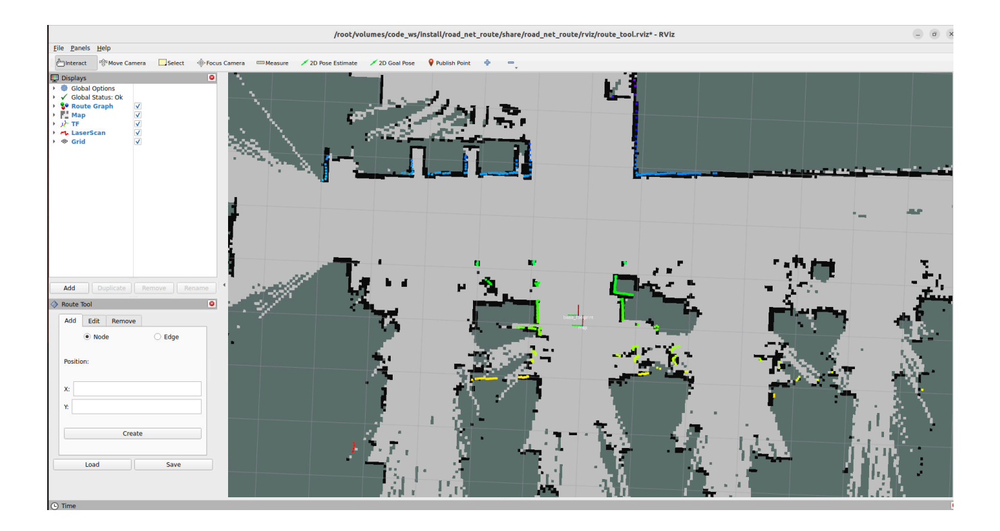
[Image details](images/img_001.md)

### **3.2 Add Waypoints**

<span id="page-3-0"></span>Click the Publish Point tool in the rviz toolbar to enter waypoint selection mode

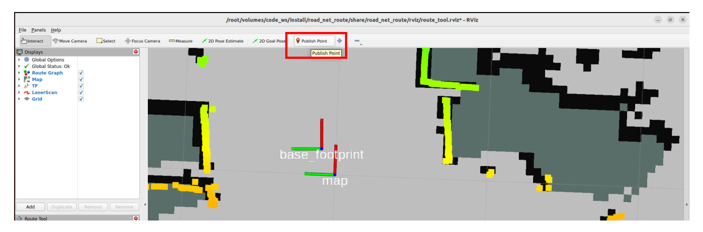
[Image details](images/img_002.md)

Then click the left mouse button on the blue dot at the center of the base\_footprint coordinate frame. The position in the Route Tool tab at the bottom left will automatically fill in the current point's coordinates. Then click Create to create a waypoint

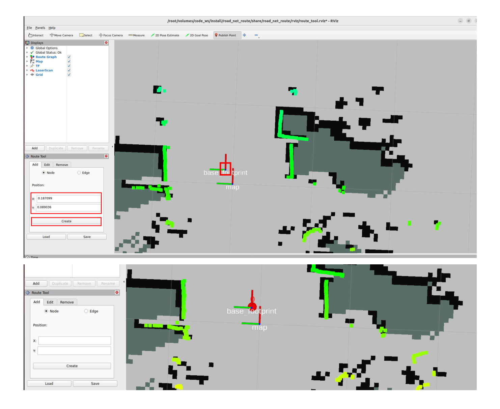
[Image details](images/img_003.md)

Next, move the vehicle to the next position where a waypoint needs to be annotated. In this example, the vehicle is directly moved to the next position where a waypoint needs to be marked

#### **Tip**

The vehicle can be moved through keyboard control, gamepad control, 2D Goal Pose navigation in rviz, or even by directly physically moving the vehicle to the next position where a waypoint needs to be marked. Since there is a pose map, the vehicle's global position can be quickly and accurately located

As you can see, directly moving the vehicle causes the global localization to be lost, and the laser outline no longer matches the map environmental features. Here we can use the pose map for rapid relocalization

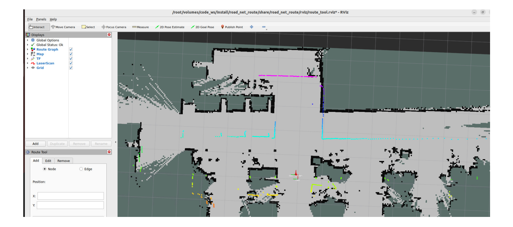
[Image details](images/img_004.md)

Click the 2D Pose Estimate tool in the rviz toolbar

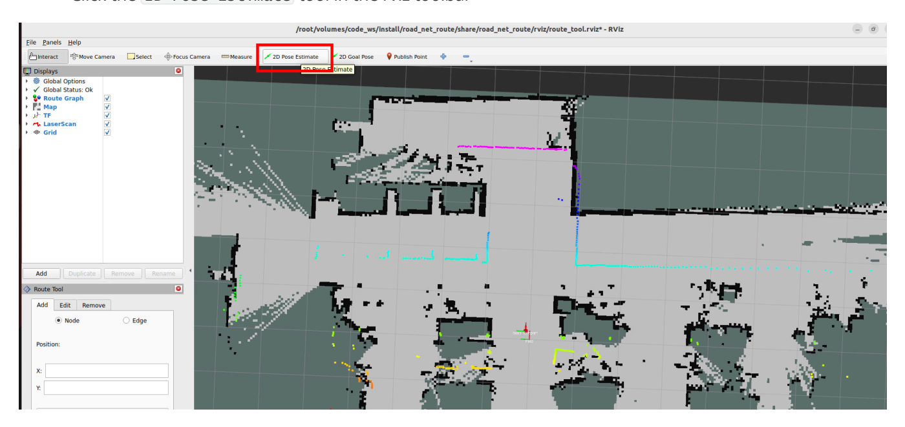
[Image details](images/img_005.md)

Then provide an estimated position near the approximate location of the vehicle

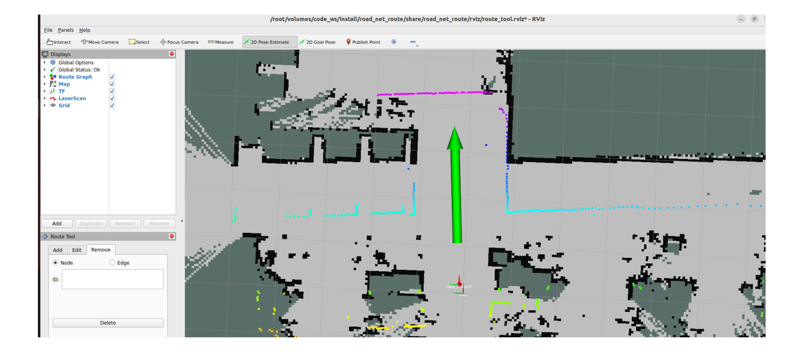
[Image details](images/img_006.md)

After this, the vehicle's accurate position in the global map will be immediately restored

#### **Tip**

- The rapid relocalization principle here is to use slam\_toolbox pure localization and pose map for rapid scan-map matching
- **Note:** When observing **deviation between the laser outline and map environmental features** during subsequent waypoint annotation (due to cumulative odometry errors, wheel slippage, manual movement, or other factors causing local localization errors), this method can be used to quickly restore the vehicle's accurate position.

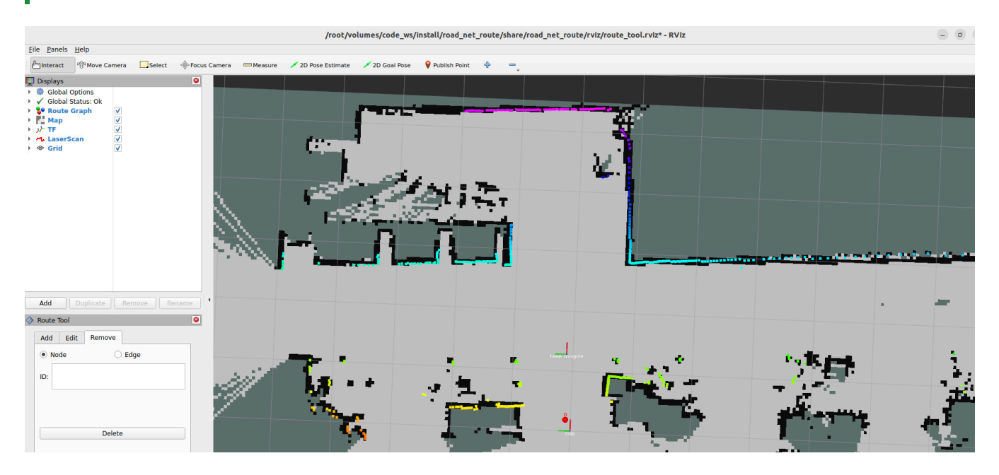
[Image details](images/img_007.md)

- Repeat the above steps until all waypoints that need to be annotated are completed (annotate waypoints according to your actual needs)
- After annotation is complete, you can first close the left TF and LaserScan to inspect the waypoints

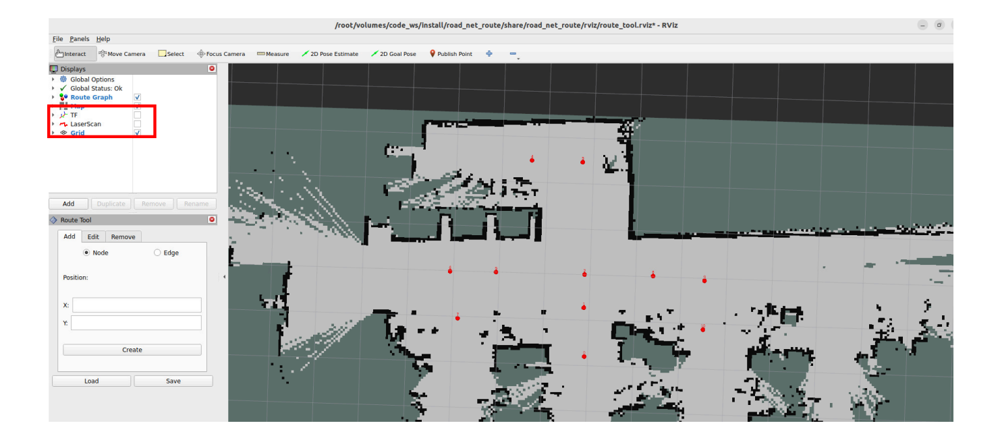
[Image details](images/img_008.md)

### **3.3 Add Edges**

<span id="page-7-0"></span>Select Edge in the Route Tool tab

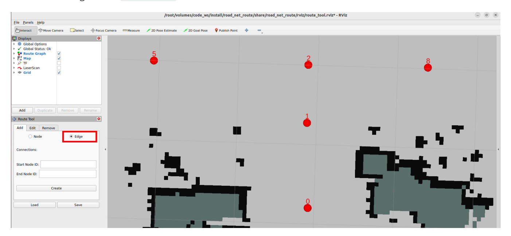
[Image details](images/img_009.md)

Fill in the starting waypoint in Start Node ID , fill in the ending waypoint in End Node ID , and then click Create to create an edge between waypoints

#### **Important**

#### **Attention!!!**

**The road network is a topological structure composed of points and edges. Edges have direction.**

For example, creating an edge 0---->1 here is unidirectional. If bidirectional edges are needed, you also need to create edge 1---->0.

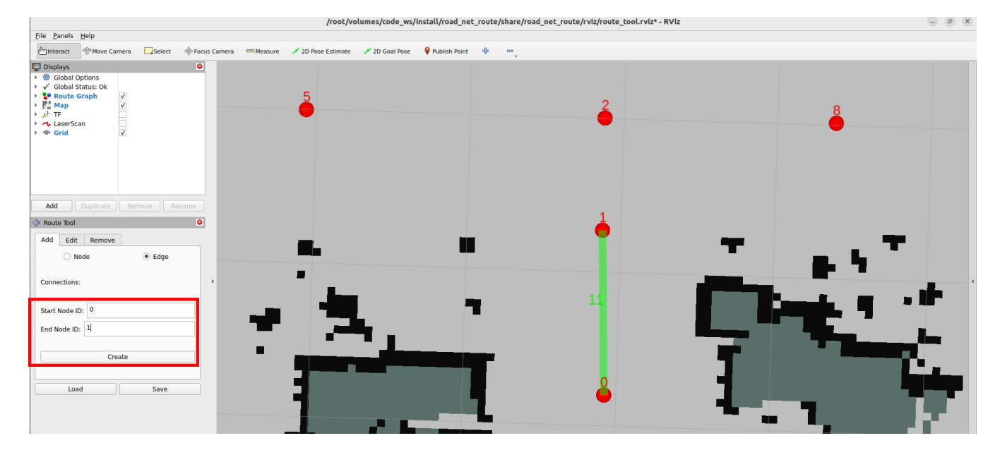
[Image details](images/img_010.md)

Next, we create the 1-0 edge so that waypoints 0 and 1 can travel bidirectionally

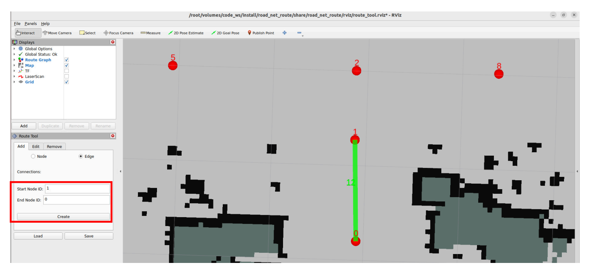
[Image details](images/img_011.md)

Repeat the above steps to complete all edge creation (whether to create unidirectional or bidirectional edges depends on the actual scenario requirements)

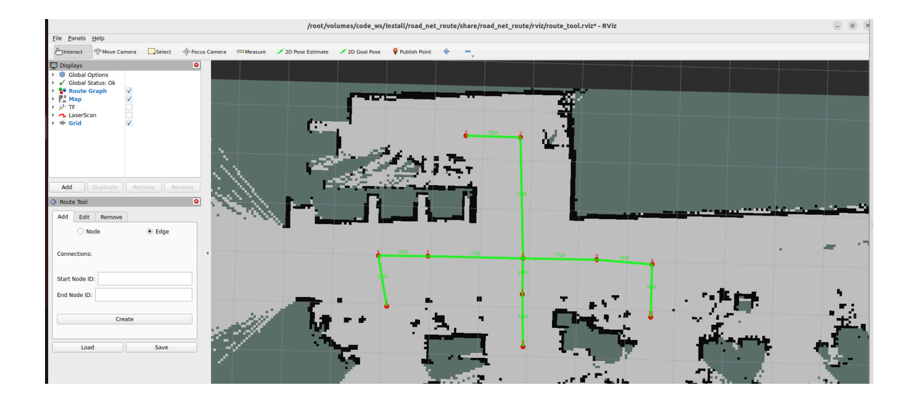
[Image details](images/img_012.md)

# **4. Save Road Network Description File**

<span id="page-9-0"></span>Click save in the Route Tool tab, then select the file path in the pop-up window. Here we select the /root/map path because this path is bound to the host machine's ~/map path. Later, you can directly view the saved file on the host machine

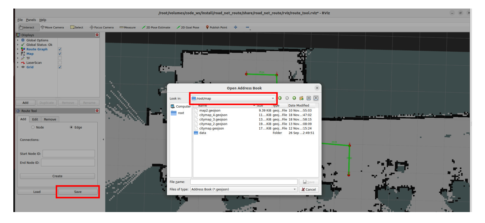
[Image details](images/img_013.md)

Then fill in the file name in File name. It is recommended to keep the same name as the raster map for easy identification. The file suffix must be **.geojson**. Finally, click save to save the road network description file

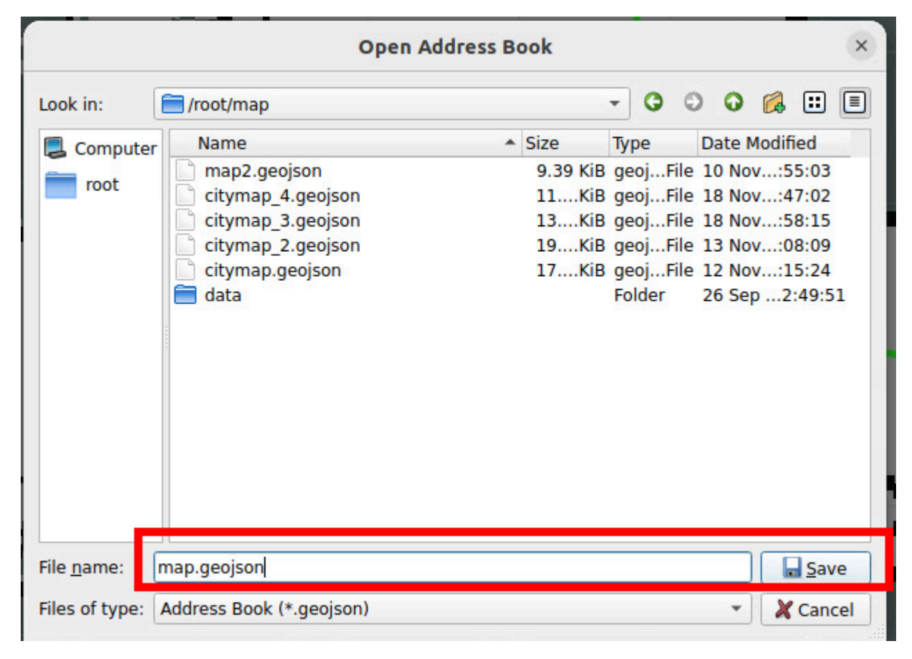
[Image details](images/img_014.md)

After successful save, the terminal will print a prompt

Afterwards, we can directly view the map.geojson road network description file from the host machine's ~/map path. The file contains a json format description of waypoint and edge information

# **5. Load and Modify Road Network Description**

### **5.1 Load Road Network Description File**

- <span id="page-11-1"></span><span id="page-11-0"></span>If you need to modify a previous road network description file later, such as adding, removing, editing points or edges, you can load the previous road network description file for editing
- Start in the roadnet container terminal

ros2 launch road\_net\_route route\_tool.launch.py yaml\_filename:=map.yaml

**yaml\_filename** Parameter is the raster map file path of the road network to be annotated

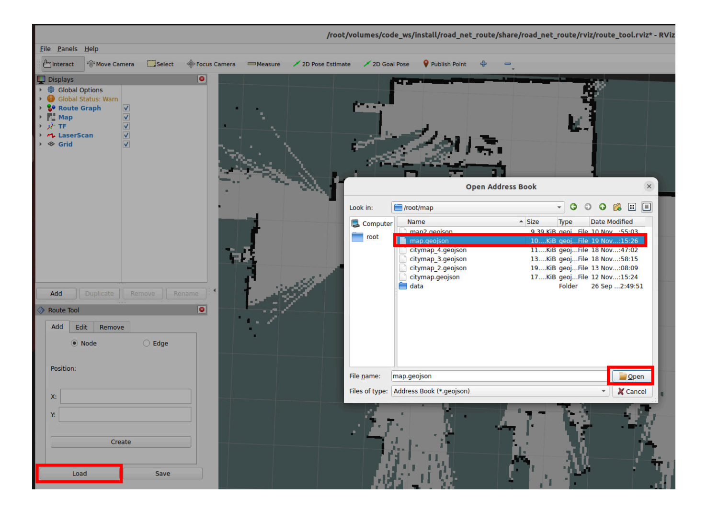
[Image details](images/img_015.md)

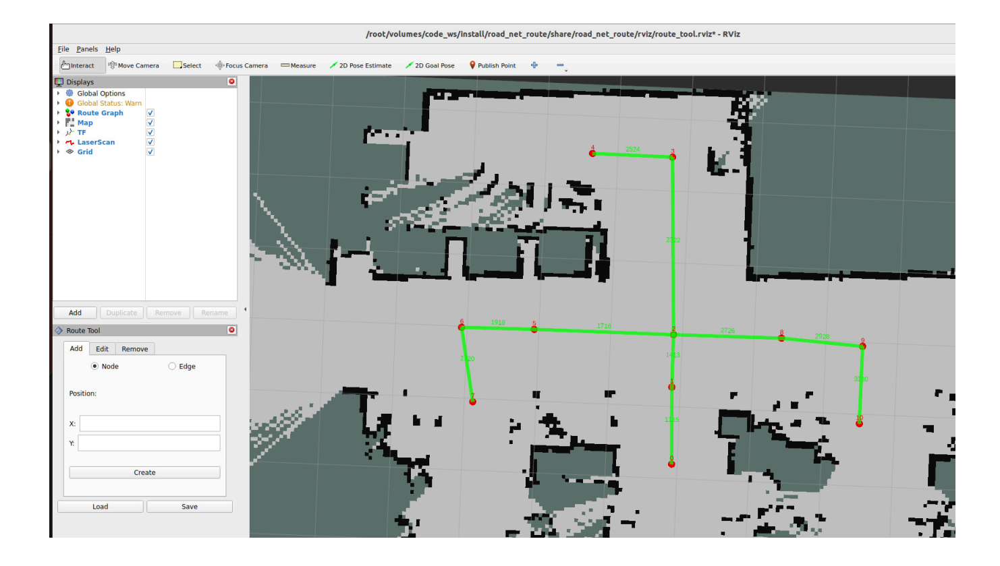
[Image details](images/img_016.md)

### **5.2 Edit Road Network**

- If you need to add new waypoints and edges, the operation is the same as the previous steps
- Click Edit to re-edit information for existing waypoints or edges

<span id="page-12-0"></span>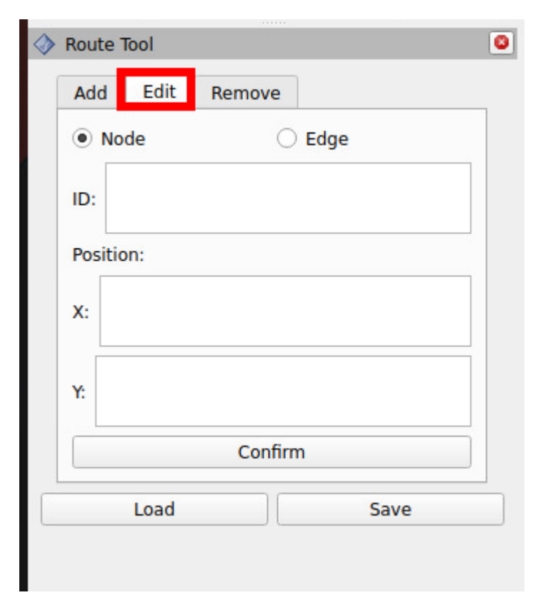
[Image details](images/img_017.md)

Click Remove to remove existing waypoints or edges

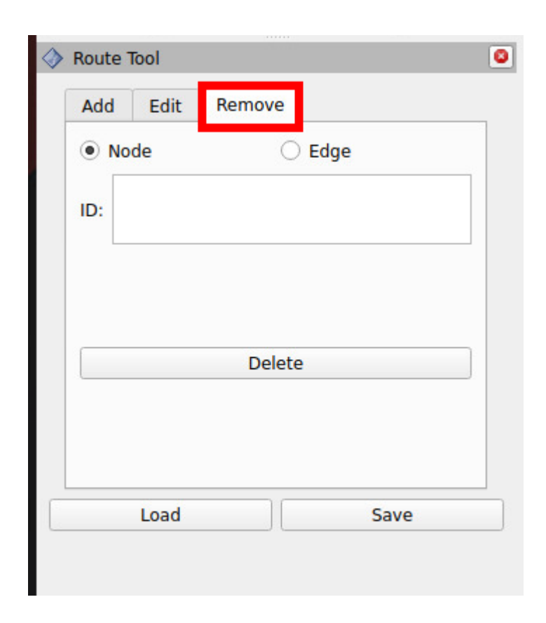
[Image details](images/img_018.md)