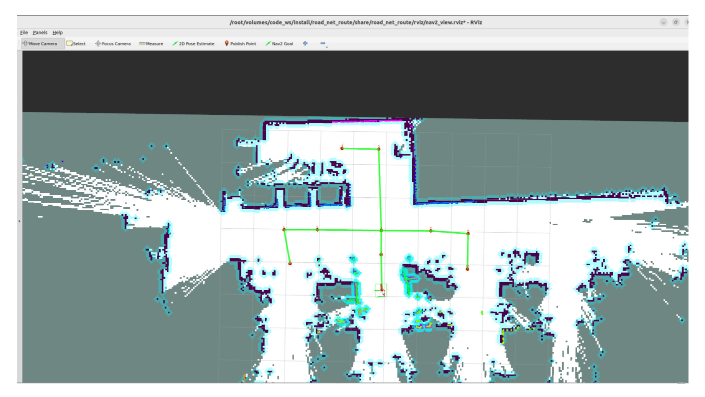
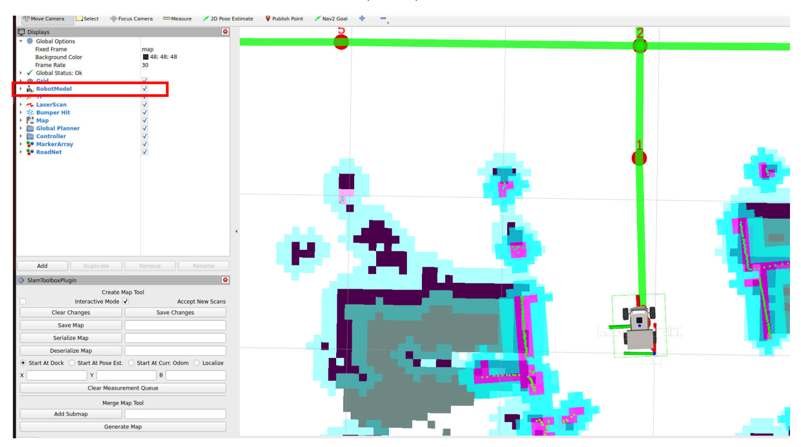
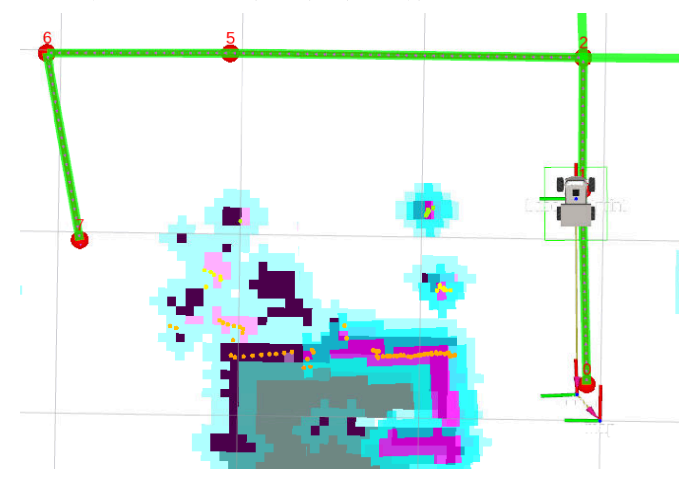
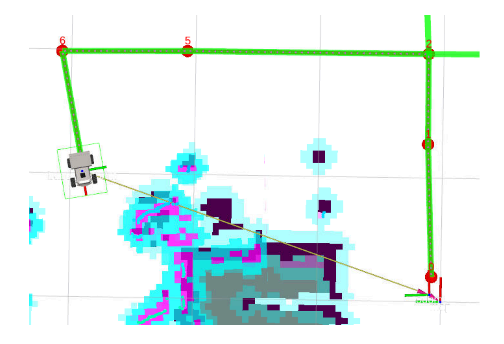
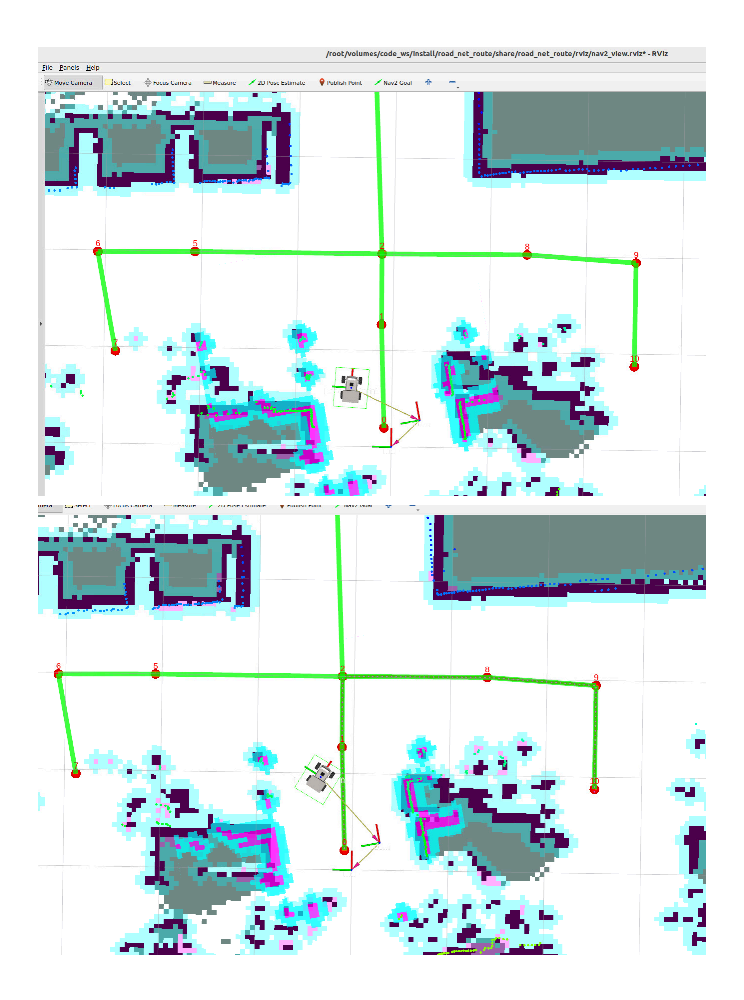
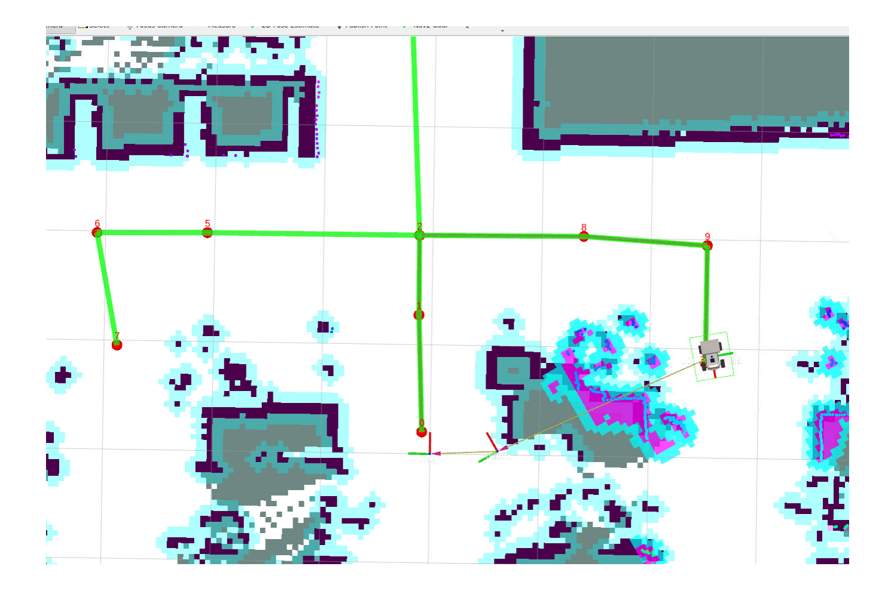

# **Planning And Navigation Between Waypoints**

#### **Planning And [Navigation](#page-0-0) Between Waypoints**

- <span id="page-0-0"></span>[1. Course](#page-0-1) Content
- [2. Prerequisites](#page-0-2)
- [3. Navigation](#page-2-0) Between Waypoints
  - 3.1 Navigation When Starting Position is Not on the [Road Network](#page-4-0)
- 4 Source Code [Analysis](#page-6-0)
  - 4.1 [route\\_bridge.py](#page-6-1) Analysis
  - 4.2 [conver\\_speed.py](#page-8-0) Analysis
- <span id="page-0-1"></span>[5. Navigation](#page-9-0) Parameter Debugging
  - 5.1 Navigation Controller [Debugging](#page-10-0)
  - 5.2 Obstacle Avoidance [and Costmap Debugging](#page-13-0)

# **1. Course Content**

Basic: Use the marked road network file for navigation between road networks on the map

Advanced: Master the debugging methods for navigation parameter files

# **2. Prerequisites**

<span id="page-0-2"></span>Use the following command to start the mircoROS agent and connect to the chassis

sh start\_agent.sh

Start the road network container

roadnet start

Start the LiDAR fusion node and odometry fusion for the robot on the host machine (PI5 users start in the m3pro container )

```
ros2 launch m3pro_bringup car_base.launch.py
```

Start the road network planning navigation node (inside the roadnet container)

```
roadnet bash
```

```
ros2 launch road_net_route roadnet_nav2.launch.py
rviz_config_file:=/root/volumes/code_ws/src/road_net_route/rviz/nav2_relocaton.rviz
```


[Image details](images/img_001.md)

To improve the rviz startup speed, the robot model is not loaded by default. If you need to display the robot model, check RobotModel in the left options panel.


[Image details](images/img_002.md)

# **3. Navigation Between Waypoints**

<span id="page-2-0"></span>Here we use road network navigation by publishing to the /road\_net\_nav\_id topic in the terminal. For example, if our robot is near waypoint 0 and we need to navigate to waypoint 7

ros2 topic pub -1 /road\_net\_nav\_id std\_msgs/msg/Int16MultiArray "{data: [0, 7]}"

Then you can see in rviz that the planned global path is only planned within the road network


[Image details](images/img_003.md)


[Image details](images/img_004.md)

### **3.1 Navigation When Starting Position is Not on the Road Network**

<span id="page-4-0"></span>If the starting position is not on a road network node or edge, when executing road network navigation, the robot will automatically enter the nearest road network edge first, then move along the road network. For example, in the situation below, the robot is not in the road network. We observe that the nearest waypoint is 0, and we plan to go to waypoint 10. Then publish the start and end point topic

ros2 topic pub -1 /road\_net\_nav\_id std\_msgs/msg/Int16MultiArray "{data: [0, 10]}"


[Image details](images/img_005.md)


[Image details](images/img_006.md)

## **4 Source Code Analysis**

<span id="page-6-1"></span><span id="page-6-0"></span>Implementation source code path:

\$HOME/M3Pro\_ws/RoadNetwork/volumes/code\_ws/src/road\_net\_route/road\_net\_route/route\_bridge.py

\$HOME/M3Pro\_ws/RoadNetwork/volumes/code\_ws/src/road\_net\_route/road\_net\_route/conver\_speed.py

### **4.1 route\_bridge.py Analysis**

- In the Route\_Bridge class initialization function, a road\_net\_nav\_id topic subscriber is created to receive Int16MultiArray data (format [start\_id, goal\_id] ) from the road\_net\_nav\_id topic, and directly calls getAndTrackRoute to initiate road network navigation:
- Input validation: If data length is not 2, report error; if [-1, -1] , cancel navigation.
- Navigation execution: Call self.navigator.getAndTrackRoute(start\_id, goal\_id) , return navigation task handle.
- Feedback processing: Loop to get navigation feedback, monitor node switching ( last\_node\_id / next\_node\_id ) and rerouting ( rerouted ) events. If rerouted, call followPath to update the local path.
- Result processing: Output logs according to TaskResult (success/cancel/failed), and publish results via /action\_feedback .

```
self.road_net_nav_ID_sub= self.create_subscription(Int16MultiArray, "road_net_nav_id",
self.id_nav_callback, 10)
```

```
def id_nav_callback(self, msg:Int16MultiArray):
        ''' Callback function for navigation route messages using IDs '''
        if len(msg.data) != 2:
            self.get_logger().error(Fore.RED+"Invalid ID navigation message
received."+Fore.RESET)
            return
        if msg.data[0]==-1 and msg.data[1]==-1 :
            self.navigator.cancelTask()
            self.get_logger().info(Fore.YELLOW+"navigation task canceled via
message."+Fore.RESET)
            return
        route_tracking_task = self.navigator.getAndTrackRoute(msg.data[0], msg.data[1])
        task_canceled = False
        last_feedback = None
        follow_path_task = RunningTask.NONE
        while not self.navigator.isTaskComplete(task=route_tracking_task):
            feedback = self.navigator.getFeedback(task=route_tracking_task)
            while feedback is not None:
                if not last_feedback or (feedback.last_node_id != last_feedback.last_node_id
or feedback.next_node_id != last_feedback.next_node_id):
                    self.get_logger().info('Passed node ' + str(feedback.last_node_id) +
                          to next node ' + str(feedback.next_node_id) +
                          along edge ' + str(feedback.current_edge_id) + '.')
                last_feedback = feedback
                if feedback.rerouted: # or follow_path_task == RunningTask.None
                    self.get_logger().info('Passing new route to controller!')
                    follow_path_task = self.navigator.followPath(feedback.path)
                feedback = self.navigator.getFeedback(task=route_tracking_task)
            if self.navigator.isTaskComplete(task=follow_path_task):
                self.get_logger().info('Controller or waypoint follower server completed its
task!')
                self.navigator.cancelTask()
                task_canceled = True
        while not self.navigator.isTaskComplete(task=follow_path_task) and not
task_canceled:
            time.sleep(0.1)
        result = self.navigator.getResult()
        if result == TaskResult.SUCCEEDED:
            self.get_logger().info(Fore.GREEN+"navigation task completed."+Fore.RESET)
            self.action_feedback_pub.publish(String(data="road_net_nav_succeeded"))
        elif result == TaskResult.CANCELED:
            self.get_logger().info(Fore.YELLOW+"navigation task canceled."+Fore.RESET)
        elif result == TaskResult.FAILED:
            self.get_logger().info(Fore.RED+"navigation task failed."+Fore.RESET)
            self.action_feedback_pub.publish(String(data="road_net_nav_failed"))
        else:
            self.get_logger().info(Fore.RED+"navigation task failed."+Fore.RESET)
            self.action_feedback_pub.publish(String(data="road_net_nav_failed"))
```

#### **4.2 conver\_speed.py Analysis**

<span id="page-8-0"></span>Since navigation2 in the roadnet container publishes velocity topics in TwistStamped format, while the ROSMASTER-M3Pro chassis mircoROS node accepts Twist format velocity topics for chassis control, the two cannot communicate directly. A bridge is needed to convert the velocity message format.

We can view the difference between the two message types using the following commands. The main difference is std\_msgs/Header header

TwistStamped format velocity topic

ros2 interface show geometry\_msgs/msg/TwistStamped

```
# A twist with reference coordinate frame and timestamp
std_msgs/Header header
        builtin_interfaces/Time stamp
                int32 sec
                uint32 nanosec
        string frame_id
Twist twist
        Vector3 linear
                float64 x
                float64 y
                float64 z
        Vector3 angular
                float64 x
                float64 y
                float64 z
```

Twist format velocity topic

```
ros2 interface show geometry_msgs/msg/Twist
```

```
# This expresses velocity in free space broken into its linear and angular parts.
Vector3 linear
        float64 x
        float64 y
        float64 z
Vector3 angular
        float64 x
        float64 y
        float64 z
```

In the TwistStampedToTwist class initialization function, a TwistStamped format velocity topic subscriber is defined. Then in the callback function, the TwistStamped format velocity is converted to Twist format velocity topic and published.

```
#!/usr/bin/env python3
import rclpy
from rclpy.node import Node
from geometry_msgs.msg import TwistStamped, Twist
from colorama import Fore
class TwistStampedToTwist(Node):
    def __init__(self):
        super().__init__('conver_speed')
        self.sub = self.create_subscription(
            TwistStamped,
            '/cmd_vel',
            self.callback,
            5
        )
        self.pub = self.publisher(
            Twist,
            '/cmd_vel',
            5
        )
        self.get_logger().info(Fore.GREEN + "TwistStamped → Twist The converter has been
started."+Fore.RESET)
    def callback(self, msg:TwistStamped):
        t = Twist()
        t.linear = msg.twist.linear
        t.angular = msg.twist.angular
        self.pub.publish(t)
def main():
    rclpy.init()
    node = TwistStampedToTwist()
    rclpy.spin(node)
    node.destroy_node()
    rclpy.shutdown()
if __name__ == '__main__':
    main()
```

# <span id="page-9-0"></span>**5. Navigation Parameter Debugging**

Road network navigation parameter file path:

\$HOME/M3Pro\_ws/RoadNetwork/volumes/code\_ws/src/road\_net\_route/config/nav2\_roadnet.yaml

#### **5.1 Navigation Controller Debugging**

**Tip**

#### **Parameter Adjustment Guide**

- <span id="page-10-0"></span>If you need to adjust the movement speed and rotational angular velocity during navigation, adjust desired\_linear\_vel and max\_angular\_accel
- If you need to adjust the accuracy of reaching the target point, adjust xy\_goal\_tolerance and yaw\_goal\_tolerance
- See comments below for other parameter adjustments

```
controller_server:
  ros__parameters:
    # ===================== Controller Core Global Parameters =====================
    # Controller main loop frequency (Hz), determines local path planning and velocity
command publishing frequency, should match hardware execution frequency
    controller_frequency: 20.0
    # Costmap update timeout (seconds), if costmap is not updated within this time,
controller stops outputting velocity commands to avoid planning based on expired maps
    costmap_update_timeout: 0.30
    # X direction (forward/backward) minimum velocity threshold (m/s), velocity commands
below this value are considered invalid, used to filter tiny vibrations
    min_x_velocity_threshold: 0.001
    # Y direction (lateral movement) minimum velocity threshold (m/s), only applicable to
omnidirectional mobile robots (like Mecanum wheels), differential drive robots can set a
larger value (like 0.5) to disable lateral movement
    min_y_velocity_threshold: 0.5
    # Rotation direction minimum velocity threshold (rad/s), rotation commands below this
value are considered invalid, filter tiny rotation vibrations
    min_theta_velocity_threshold: 0.001
    # Controller failure tolerance (m), when local planned path deviation exceeds this
value, controller execution is considered failed, triggering replanning
    failure_tolerance: 0.3
    # Progress checker plugin list, used to monitor if robot is moving toward the goal
    progress_checker_plugins: ["progress_checker"]
    # Goal checker plugin list, used to determine if robot has reached the target pose
    goal_checker_plugins: ["general_goal_checker"]
    # Controller plugin list, core is local path tracking algorithm, here using pure pursuit
controller corresponding to FollowPath
    controller_plugins: ["FollowPath"]
    # Whether to use real-time priority scheduling for controller thread
    use_realtime_priority: false
    # Speed limit topic name, controller subscribes to velocity commands on this topic,
dynamically adjusts max linear/angular velocity (like speed reduction during obstacle
avoidance)
    speed_limit_topic: "speed_limit"
    # ===================== Progress Checker Parameters (SimpleProgressChecker)
=====================
    progress_checker:
```

```
# Progress checker plugin type, SimpleProgressChecker is basic implementation,
monitors robot movement distance and time
      plugin: "nav2_controller::SimpleProgressChecker"
      # Minimum movement distance threshold (m), if robot does not move more than this
distance within movement_time_allowance, considered no progress
      required_movement_radius: 0.05
      # Maximum allowed no-progress time (s), if still not meeting required_movement_radius
after this time, controller aborts task (error code 105)
      movement_time_allowance: 10.0
    # ===================== Goal Checker Parameters (SimpleGoalChecker)
=====================
    general_goal_checker:
      # Whether to use stateful checker, when set to True, continuously monitors target pose
until tolerance is met; False is single check only
      stateful: True
      # Goal checker plugin type, SimpleGoalChecker is basic implementation, determines if
position and angle are within tolerance
      plugin: "nav2_controller::SimpleGoalChecker"
      # XY plane position tolerance (m), robot position deviation from target less than this
value indicates position arrival
      xy_goal_tolerance: 0.08
      # Heading angle tolerance (radians), robot heading deviation from target less than
this value indicates angle arrival
      yaw_goal_tolerance: 0.03
    # ===================== Pure Pursuit Controller Parameters
(RegulatedPurePursuitController) =====================
    FollowPath:
      # Local path tracking plugin type, RegulatedPurePursuitController is a speed-regulated
pure pursuit algorithm, suitable for differential drive robots
      plugin: "nav2_regulated_pure_pursuit_controller::RegulatedPurePursuitController"
      # Desired linear velocity (m/s), target linear velocity for normal robot driving,
dynamically scaled by obstacle avoidance/curvature regulation
      desired_linear_vel: 0.2
      # Lookahead distance (m), core parameter of pure pursuit algorithm, determines the
distance of path points the robot tracks, should match robot speed
      lookahead_dist: 0.5
      # Minimum lookahead distance (m), prevents robot frequent turns due to too small
lookahead distance
      min_lookahead_dist: 0.05
      # Maximum lookahead distance (m), prevents robot sluggishness due to too large
lookahead distance
      max_lookahead_dist: 0.9
      # Lookahead time (s), when use_velocity_scaled_lookahead_dist is enabled, lookahead
distance = desired_linear_vel * lookahead_time
      lookahead_time: 1.5
      # Angular velocity for rotating to target heading (rad/s), robot's rotation speed when
adjusting heading after reaching position
      rotate_to_heading_angular_vel: 1.3
      # TF transform tolerance (s), allows maximum deviation between robot pose timestamp
and current time, solves TF delay problem
      transform_tolerance: 0.5
```

```
# Whether to use velocity scaled lookahead distance, when True, lookahead distance
dynamically changes with robot speed (faster speed, farther lookahead)
      use_velocity_scaled_lookahead_dist: false
      # Minimum linear velocity when approaching target (m/s), when robot is close to
target, slow down to this value to avoid overshooting target
      min_approach_linear_velocity: 0.05
      # Approach velocity scaling distance (m), when robot distance to target is less than
this value, start linear deceleration (from desired_linear_vel to
min_approach_linear_velocity)
      approach_velocity_scaling_dist: 1.0
      # Whether to enable collision detection, when True, controller checks for collisions
on the lookahead path to avoid robot hitting obstacles
      use_collision_detection: false
      # Maximum allowed time to collision up to carrot (s), only effective when
use_collision_detection is True, used to determine collision risk
      max_allowed_time_to_collision_up_to_carrot: 1.0
      # Whether to enable linear velocity regulation based on path curvature, when True,
smaller turning radius results in lower linear velocity
      use_regulated_linear_velocity_scaling: true
      # Whether to enable linear velocity regulation based on costmap, when True, closer
obstacles result in lower linear velocity
      use_cost_regulated_linear_velocity_scaling: false
      # Minimum turning radius to trigger curvature regulation (m), when path curvature
corresponding turning radius is less than this value, start deceleration
      regulated_linear_scaling_min_radius: 0.05
      # Minimum speed for curvature regulation (m/s), even if turning radius is extremely
small, linear velocity will not be lower than this value
      regulated_linear_scaling_min_speed: 0.25
      # Whether to use fixed curvature lookahead distance, when True, lookahead distance is
determined by curvature_lookahead_dist
      use_fixed_curvature_lookahead: false
      # Curvature lookahead distance (m), only effective when use_fixed_curvature_lookahead
is True
      curvature_lookahead_dist: 1.0
      # Whether to enable "rotate to heading then move first", when True, if robot heading
deviates too much from path direction, rotate first then move
      use_rotate_to_heading: true
      # Minimum angle to trigger rotate to heading (radians), when robot heading deviation
from path direction exceeds this value, start rotation adjustment
      rotate_to_heading_min_angle: 0.785 # approximately 45 degrees
      # Maximum angular acceleration (rad/s²), limits robot rotation acceleration, avoids
sudden turns causing hardware damage
      max_angular_accel: 1.2
      # Maximum search distance for robot pose (m), when controller cannot find matching
robot pose on path, search path points within this distance
      max_robot_pose_search_dist: 10.0
      # Whether to interpolate curvature after goal point, when True, path after goal point
interpolates curvature to avoid robot sudden stop after reaching goal
      interpolate_curvature_after_goal: false
      # Cost scaling distance (m), only effective when
use_cost_regulated_linear_velocity_scaling is True, used to calculate obstacle avoidance
deceleration weight
      cost_scaling_dist: 0.08
```

```
# Cost scaling gain, only effective when use_cost_regulated_linear_velocity_scaling is
True, higher gain makes obstacle avoidance deceleration more obvious
      cost_scaling_gain: 1.0
      # Inflation cost scaling factor, used to convert inflation layer cost in costmap to
velocity scaling coefficient, higher value makes obstacle avoidance in inflation area more
sensitive
      inflation_cost_scaling_factor: 3.0
```

### **5.2 Obstacle Avoidance and Costmap Debugging**

#### **Tip**

- <span id="page-13-0"></span>If the robot gets too close to obstacles in the map during navigation, you can adjust the inflation area to keep the robot away from obstacles. Increase inflation\_radius (inflation radius) and cost\_scaling\_factor (scaling factor, higher value makes robot less likely to approach obstacles) in local\_costmap and global\_costmap
- See comments below for other parameter adjustments

```
# Local costmap configuration: used for robot real-time obstacle avoidance short-term
costmap, rolls and updates as robot moves
local_costmap:
  local_costmap:
    ros__parameters:
      # ===================== Costmap Core Global Parameters =====================
      # Costmap update frequency (Hz), determines local map refresh speed, should match
sensor frequency
      update_frequency: 5.0
      # Costmap publishing frequency (Hz), frequency for publishing maps to visualization
tools like RViz, lower than update frequency can reduce bandwidth
      publish_frequency: 2.0
      # Global frame for costmap, local map uses odom frame
      global_frame: odom
      # Robot base frame, should match robot center coordinate system in hardware
configuration
      robot_base_frame: base_link
      # Whether to enable rolling window mode, core feature of local map: map rolls as robot
moves, only keeps map of area around robot
      rolling_window: true
      # Rolling window width (m), lateral range of local map
      width: 3
      # Rolling window height (m), longitudinal range of local map
      height: 3
      # Costmap resolution (m/pixel), represents actual distance per pixel, 0.05 means
5cm/pixel
      resolution: 0.05
      # Robot footprint (polygon), coordinate list representing robot's actual shape
      footprint: "[[0.14,0.11], [0.14,-0.11], [-0.14,-0.11], [-0.14,0.11]]"
```

```
# Robot footprint padding (m), additional safety distance outside actual footprint,
used as buffer for obstacle avoidance
      footprint_padding: 0.0616
      # Costmap layer plugin list, loaded in order (voxel_layer: voxel obstacle layer;
inflation_layer: inflation layer)
      plugins: ["voxel_layer", "inflation_layer"]
      # Costmap filter plugin list, used for post-processing maps (keepout_filter: keepout
zone filter)
      filters: ["keepout_filter"]
      # Whether to always publish complete costmap, when True publishes full map on every
update, False publishes only changed areas (reduces bandwidth)
      always_send_full_costmap: True
      # Service introspection mode, disabled means service introspection is disabled,可选
enabled/verbose
      service_introspection_mode: "disabled"
      # ===================== Filter Plugin: Keepout Filter (KeepoutFilter)
=====================
      keepout_filter:
        # Filter plugin type, KeepoutFilter is used to mark keepout zones in costmap
        plugin: "nav2_costmap_2d::KeepoutFilter"
        # Whether to enable keepout filtering, KEEPOUT_ZONE_ENABLED is an external parameter
(needs to be assigned true/false at startup)
        enabled: KEEPOUT_ZONE_ENABLED
        # Subscription topic for keepout zone information, receives geometric shape and
position information of keepout zones (like PolygonStamped)
        filter_info_topic: "keepout_costmap_filter_info"
        # Whether to override lethal cost of keepout zones, when True uses custom cost
instead of default lethal cost (255)
        override_lethal_cost: True
        # Custom lethal cost for keepout zones, 200 means lower than default lethal cost
(255) but still a high-cost keepout zone
        lethal_override_cost: 200
      # ===================== Layer Plugin: Inflation Layer (InflationLayer)
=====================
      inflation_layer:
        # Layer plugin type, InflationLayer is used to generate inflation area around
obstacles to avoid robot collisions
        plugin: "nav2_costmap_2d::InflationLayer"
        # Cost scaling factor, controls inflation area cost decay rate (higher value means
faster cost decay, smaller inflation area)
        cost_scaling_factor: 3.0
        # Inflation radius (m), inflation range around obstacles, minimum safe distance from
robot footprint to obstacle
        inflation_radius: 0.1
# Global costmap configuration: used for robot global path planning long-term costmap,
covers entire environment
global_costmap:
  global_costmap:
    ros__parameters:
      # ===================== Costmap Core Global Parameters =====================
```

```
# Costmap update frequency (Hz), global map doesn't need high-frequency updates, 1-2Hz
is sufficient
      update_frequency: 1.0
      # Costmap publishing frequency (Hz), same as update frequency
      publish_frequency: 1.0
      # Global frame for costmap, global map uses map frame (globally consistent, suitable
for path planning)
      global_frame: map
      # Robot base frame, consistent with local map
      robot_base_frame: base_link
      # Robot radius (replaced by footprint, commented out)
      # robot_radius: 0.22
      # Robot footprint (consistent with local map)
      footprint: "[[0.14,0.11], [0.14,-0.11], [-0.14,-0.11], [-0.14,0.11]]"
      # Robot footprint padding (consistent with local map)
      footprint_padding: 0.0616
      # Costmap resolution (consistent with local map to ensure coordinate matching)
      resolution: 0.05
      # Whether to track unknown space, when True, unexplored areas are marked in map (used
for SLAM and unknown environment planning)
      track_unknown_space: true
      # Costmap layer plugin list (static_layer: static layer; obstacle_layer: 2D obstacle
layer; inflation_layer: inflation layer)
      plugins: ["static_layer", "obstacle_layer", "inflation_layer"]
      # Costmap filter plugin list (keepout_filter: keepout zone filter; speed_filter: speed
limit filter)
      filters: ["keepout_filter", "speed_filter"]
      # Whether to always publish complete costmap
      always_send_full_costmap: True
      # Service introspection mode
      service_introspection_mode: "disabled"
      inflation_layer:
        # Layer plugin type, InflationLayer is used to generate inflation area around
obstacles to avoid robot collisions
        plugin: "nav2_costmap_2d::InflationLayer"
        # Cost scaling factor, controls inflation area cost decay rate (higher value means
faster cost decay, smaller inflation area)
        cost_scaling_factor: 3.0
        # Inflation radius (m), inflation range around obstacles, minimum safe distance from
robot footprint to obstacle
        inflation_radius: 0.1
```