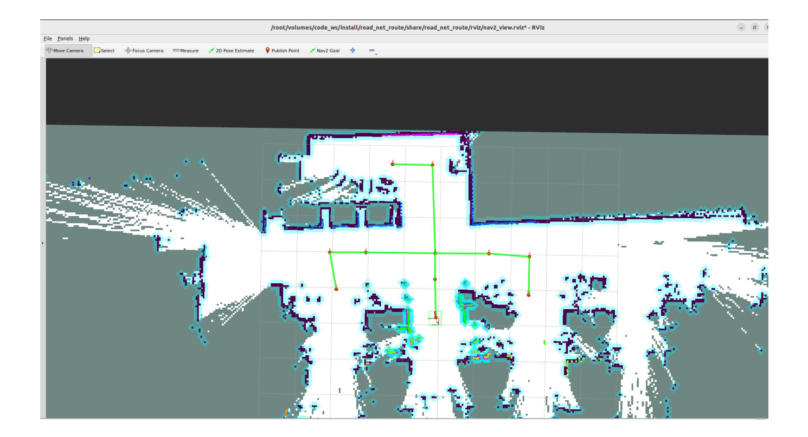
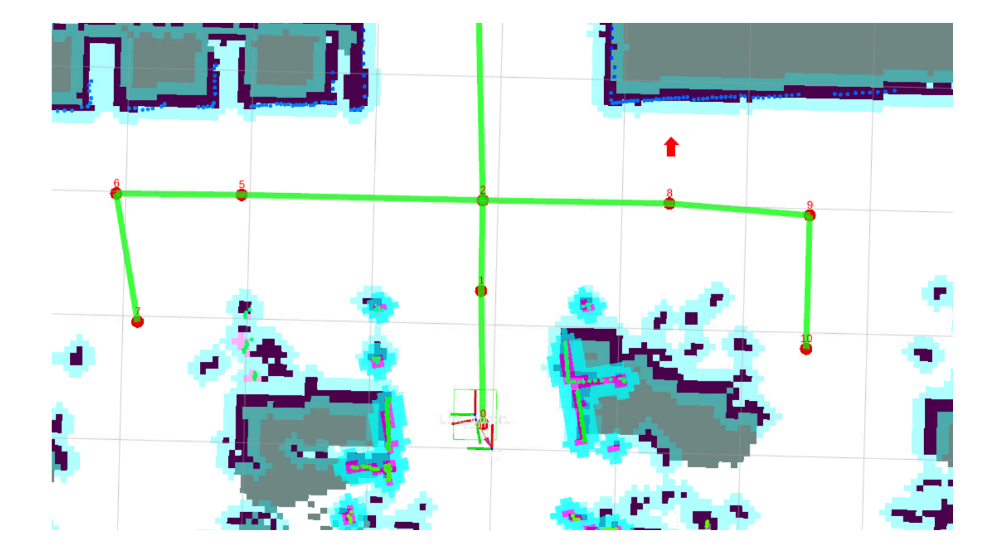
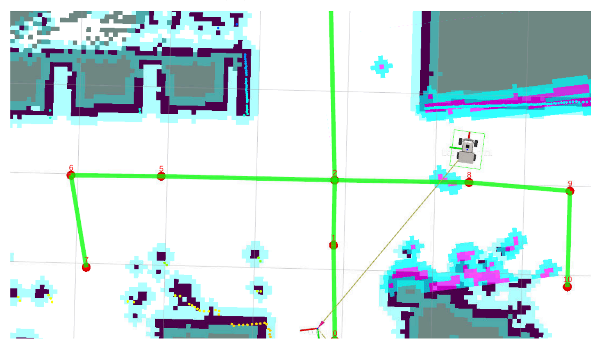
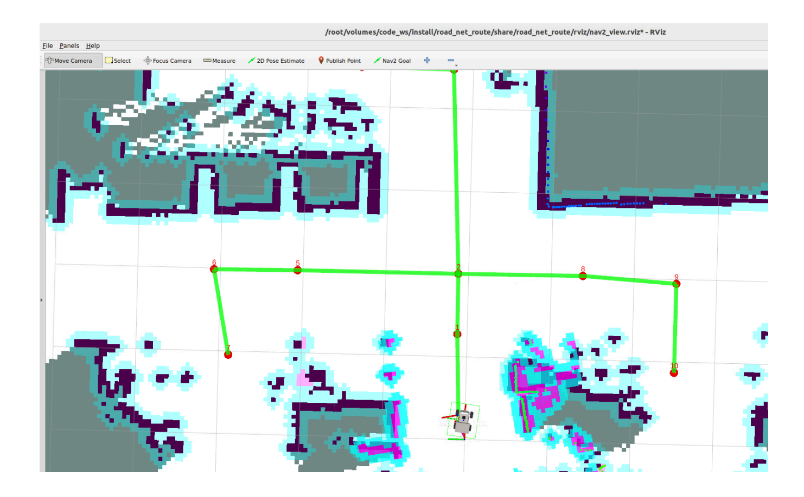
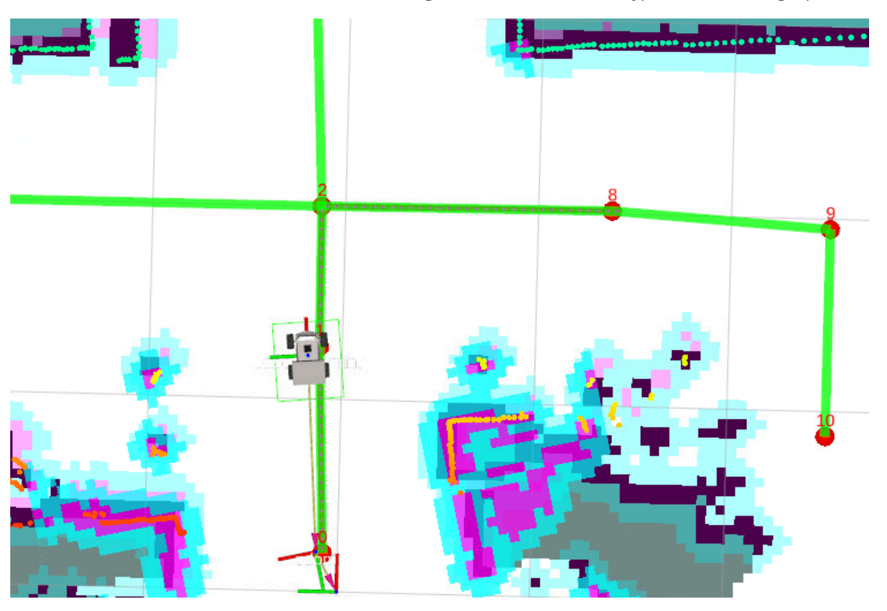
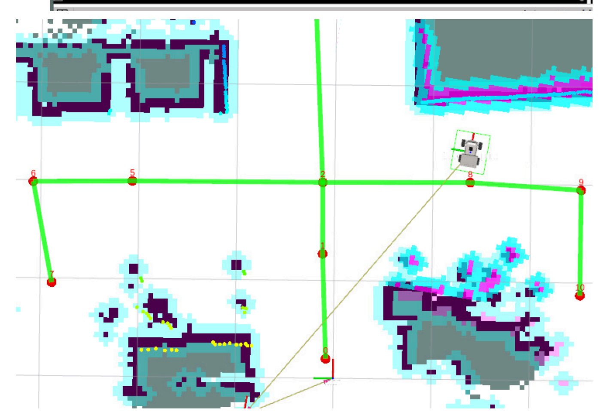

# **Road Network Navigation In Any Pose**

#### **Road [Network Navigation](#page-0-0) In Any Pose**

- <span id="page-0-0"></span>[1. Course](#page-0-1) Content
- [2. Prerequisites](#page-0-2)
- [3. Road Network Planning](#page-2-0) Navigation for Any Pose
  - 3.1 [Application](#page-2-1) Example
- <span id="page-0-1"></span>[4. Source](#page-6-0) Code Analysis
  - 4.1 [route\\_bridge.py](#page-6-1) Analysis

### **1. Course Content**

Based on navigation between waypoints, combined with road network planning navigation functionality, to achieve navigation to any pose.

#### **Note**

When navigation2's route\_server performs road network navigation, it can only achieve fixed-pose navigation. After arriving at the target waypoint, the robot always faces the direction of the edge in the road network. In practical applications, we often need the robot to face a specified pose after arriving at the target point to complete specific tasks. We only use road network planning navigation as the intermediate global path.

## **2. Prerequisites**

<span id="page-0-2"></span>Use the following command to start the microROS agent and connect to the chassis:

sh start\_agent.sh

Start the road network container:

```
roadnet start
```

Open a terminal on the host machine to start the LiDAR fusion node and odometry fusion on the vehicle (PI5 users should start in the m3pro container ):

```
ros2 launch m3pro_bringup car_base.launch.py
```

Start the road network planning navigation node (inside the roadnet container):

```
roadnet bash
```

```
ros2 launch road_net_route roadnet_nav2.launch.py
rviz_config_file:=/root/volumes/code_ws/src/road_net_route/rviz/nav2_relocaton.rviz
```


[Image details](images/img_001.md)

# **3. Road Network Planning Navigation for Any Pose**

<span id="page-2-0"></span>Here we use road network navigation by publishing to the /road\_net\_nav topic in the terminal. This topic accepts a PoseStamped target pose, travels along the road network to the vicinity of the target pose, and then accurately adjusts to the target pose. The topic publishing format is as follows:

```
ros2 topic pub -1 /road_net_nav geometry_msgs/PoseStamped "{
    pose: {
      position: {x: xx, y: xx, z: 0.0},
      orientation: {x: 0.0, y: 0.0, z: xx, w: xx}
  }
}"
```

#### **Note**

A pose consists of position and orientation. For ground mobile robots, the position only includes planar x, y coordinates, and the orientation only includes rotation around its own z-axis. In the pose:

- **position: {x: xx, y: xx, z: 0.0}** is the position information
- <span id="page-2-1"></span>**orientation: {x: 0.0, y: 0.0, z: xx, w: xx}** is the robot rotation described by a quaternion

### **3.1 Application Example**

For example, if we need the robot vehicle to travel only along the road network and then navigate to the position above waypoint 8 on the map with a specified orientation (the orientation direction is as shown by the arrow), we first need to know the coordinates of this pose point in the global map.


[Image details](images/img_002.md)

First, let the robot move to this target pose:


[Image details](images/img_003.md)

Use the following command to get the current robot's coordinates in the map:

ros2 run tf2\_ros tf2\_echo map base\_footprint

The Translation and Rotation are the robot vehicle's pose in the global map.

Then let the robot return to its starting position, and publish the target pose in the terminal:

```
ros2 topic pub -1 /road_net_nav geometry_msgs/PoseStamped "{
  header: {frame_id: 'map'},
    pose: {
      position: {x: 2.383, y: -1.352, z: 0.0},
      orientation: {x: 0.0, y: 0.0, z: -0.052, w: 0.999}
  }
}"
```


[Image details](images/img_004.md)

After that, the robot vehicle will first travel along the road network to a waypoint near the target point:


[Image details](images/img_005.md)

Finally, it will adjust to the target pose, and the terminal will display navigation task completed :


[Image details](images/img_006.md)

# **4. Source Code Analysis**

<span id="page-6-1"></span><span id="page-6-0"></span>Implementation source code path:

\$HOME/M3Pro\_ws/RoadNetwork/volumes/code\_ws/src/road\_net\_route/road\_net\_route/route\_bridge.py

### **4.1 route\_bridge.py Analysis**

In the Route\_Bridge class initialization function, a road\_net\_nav topic subscriber is created to receive PoseStamped data from the road\_net\_nav topic (format: [start\_id, goal\_id] ), and directly calls getAndTrackRoute to initiate road network navigation:

self.road\_net\_nav\_sub= self.create\_subscription(PoseStamped, "road\_net\_nav", self.nav\_callback, 10)

- PoseStamped : Message type, containing target position and orientation information.
- "road\_net\_nav" : Topic name, used to issue navigation target poses through this topic.

- self.nav\_callback : Callback function, handling the core logic of navigation commands.
- 10 : Message queue size. If callback processing is slow, up to 10 messages are cached to avoid message loss.
- Step 1: Get the robot's current pose (TF transform): Using tf2\_ros ' Buffer and TransformListener , obtain the coordinate transformation from the robot's base coordinate system ( base\_footprint ) to the global map coordinate system ( map ), thereby getting the robot's current pose in the map.
- Step 2: Construct the robot's current pose: Encapsulate the TF transform result (translation + rotation) as a PoseStamped type start\_pose , serving as the **starting pose** for navigation.
- Step 3: Convert pose to road network waypoint ID: This is the **core transformation logic for road network navigation**:
  - Call the \_\_find\_nearest\_node method to match both the **starting pose** and **target pose** to the nearest node ID in the road network (via KDTree nearest neighbor search).
  - Call the BasicNavigator 's getAndTrackRoute interface, passing in the starting node ID and target node ID, to initiate navigation based on road network nodes.
- Step 4: Final pose adjustment: Road network navigation only ensures the robot arrives at a waypoint near the target pose. The goToPose interface is used to let the robot precisely adjust to the target pose.

```
def nav_callback(self, msg:PoseStamped):
        ''' 任意位姿路网导航回调函数Arbitrary Pose Road Network Navigation Callback Function'''
        transform = self.tf_buffer.lookup_transform("map", "base_footprint",
rclpy.time.Time(),rclpy.duration.Duration(seconds=5.0))
        if transform is None:
            self.get_logger().info(Fore.RED+"Failed to get TF transform "+Fore.RESET)
            return
        else:
            start_pose = PoseStamped()
            start_pose.header = transform.header
            start_pose.pose.position.x = transform.transform.translation.x
            start_pose.pose.position.y = transform.transform.translation.y
            start_pose.pose.orientation = transform.transform.rotation
            self.get_logger().info(Fore.CYAN + f"current:
{transform.transform.translation}"+Fore.RESET)
            if self.replace2id:
                nearest_start_node_id, nearest_start_distance =
self.__find_nearest_node(start_pose.pose.position.x, start_pose.pose.position.y)
                nearest_goal_node_id, nearest_goal_distance =
self.__find_nearest_node(msg.pose.position.x, msg.pose.position.y)
                self.get_logger().info(Fore.CYAN + f"nearest_start_node_id:
{nearest_start_node_id}, distance:{nearest_start_distance}"
                                       f"\nnearest_goal_node_id:{nearest_goal_node_id},
distance:{nearest_goal_distance}"
                                       +Fore.RESET)
                route_tracking_task =
self.navigator.getAndTrackRoute(start=nearest_start_node_id,goal=nearest_goal_node_id)
```

```
else:
                route_tracking_task =
self.navigator.getAndTrackRoute(start=start_pose,goal=msg,use_start=False)
            task_canceled = False
            last_feedback = None
            follow_path_task = RunningTask.NONE
            while not self.navigator.isTaskComplete(task=route_tracking_task):
                feedback = self.navigator.getFeedback(task=route_tracking_task)
                while feedback is not None:
                    if not last_feedback or (feedback.last_node_id !=
last_feedback.last_node_id or feedback.next_node_id != last_feedback.next_node_id):
                        self.get_logger().info('Passed node ' + str(feedback.last_node_id) +
                              to next node ' + str(feedback.next_node_id) +
                              along edge ' + str(feedback.current_edge_id) + '.')
                    last_feedback = feedback
                    if feedback.rerouted: # or follow_path_task == RunningTask.None
                        self.get_logger().info('Passing new route to controller!')
                        follow_path_task = self.navigator.followPath(feedback.path)
                    feedback = self.navigator.getFeedback(task=route_tracking_task)
                if self.navigator.isTaskComplete(task=follow_path_task):
                    self.get_logger().info('Controller or waypoint follower server completed
its task!')
                    self.navigator.cancelTask()
                    task_canceled = True
            while not self.navigator.isTaskComplete(task=follow_path_task) and not
task_canceled:
                time.sleep(0.1)
            result = self.navigator.getResult()
            if result == TaskResult.SUCCEEDED:
                if self.__adjust_pose(msg):
                    self.get_logger().info(Fore.GREEN+"navigation task
completed."+Fore.RESET)
                    self.action_feedback_pub.publish(String(data="road_net_nav_succeeded"))
            elif result == TaskResult.CANCELED:
                self.get_logger().info(Fore.YELLOW+"navigation task canceled."+Fore.RESET)
            elif result == TaskResult.FAILED:
                self.get_logger().info(Fore.RED+"navigation task failed."+Fore.RESET)
                self.action_feedback_pub.publish(String(data="road_net_nav_failed"))
            else:
                self.get_logger().info(Fore.RED+"navigation task failed."+Fore.RESET)
                self.action_feedback_pub.publish(String(data="road_net_nav_failed"))
    def __adjust_pose(self,final_pose)->bool:
        '''调整到目标姿态Adjust to target posture'''
        self.get_logger().info("adjusting final orientation...")
        final_orientation_task = self.navigator.goToPose(final_pose)
        while not self.navigator.isTaskComplete(task=final_orientation_task):
            time.sleep(0.1)
        orientation_result = self.navigator.getResult()
        if orientation_result == TaskResult.SUCCEEDED:
            return True
```

```
else:
        self.get_logger().info("final orientation adjustment failed.")
        return False
def __find_nearest_node(self, x, y):
    '''使用KDTree查找最近节点Use KDTree to find the nearest node'''
    distance, index = self.tree.query([x, y])
    nearest_node_id = self.node_ids[index]
    return nearest_node_id, distance
```

The \_\_load\_roadnet\_nodes method is used during program initialization to parse the **GeoJSON format** road network file, extract Point type nodes (topological nodes of the road network), store node coordinates and IDs, and build a KDTree index.

```
def __load_roadnet_nodes(self):
    '''加载路网节点用于KDTree搜索Load road network nodes for KDTree search'''
   with open(self.road_net_file, 'r') as f:
       data = json.load(f)
   self.node_coords = [] # [[x, y], ...]
   self.node_ids = [] # Corresponding node IDs
   for feat in data['features']:
       if feat['geometry']['type'] == 'Point':
           x, y = feat['geometry']['coordinates']
           self.node_coords.append([x, y])
           self.node_ids.append(feat['properties'].get("id", None))
   self.tree = KDTree(self.node_coords)
   self.get_logger().info(f"Loaded {len(self.node_coords)} nodes into KDTree")
```