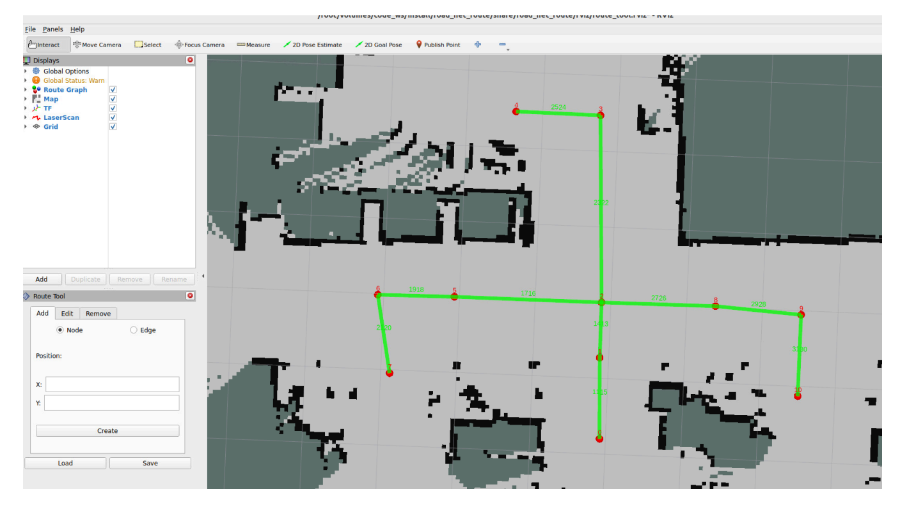
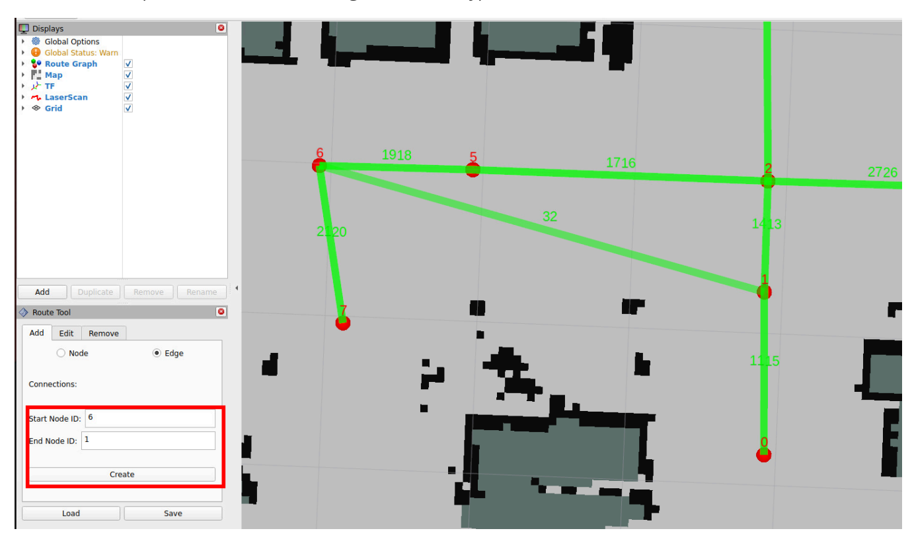
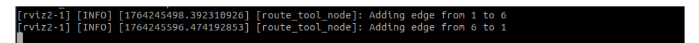
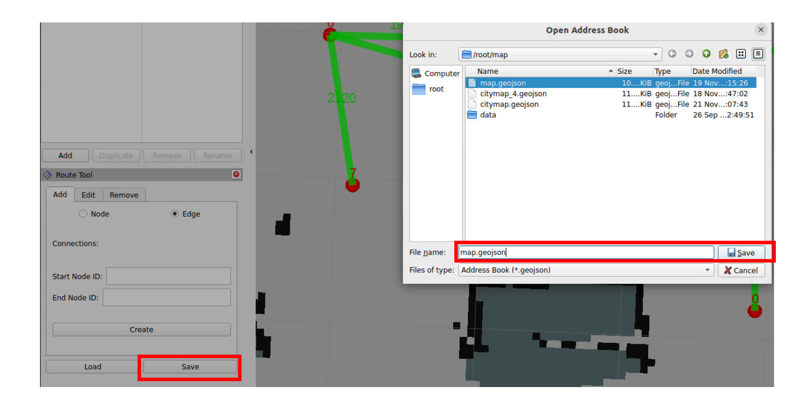
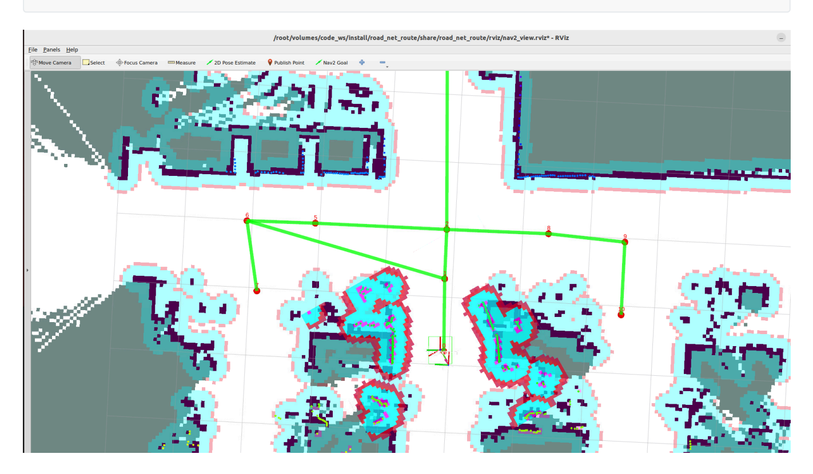
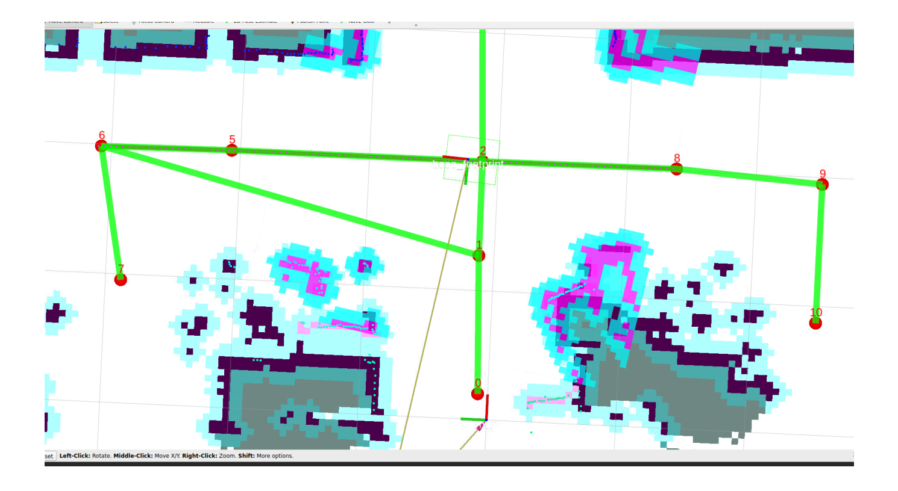
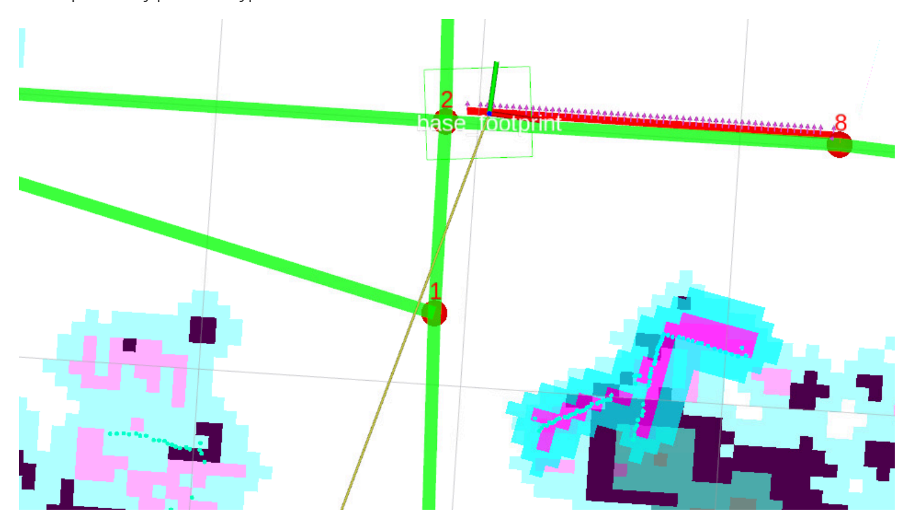
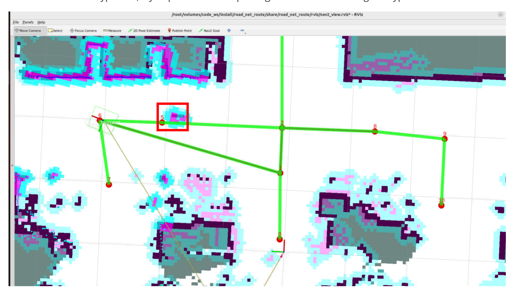
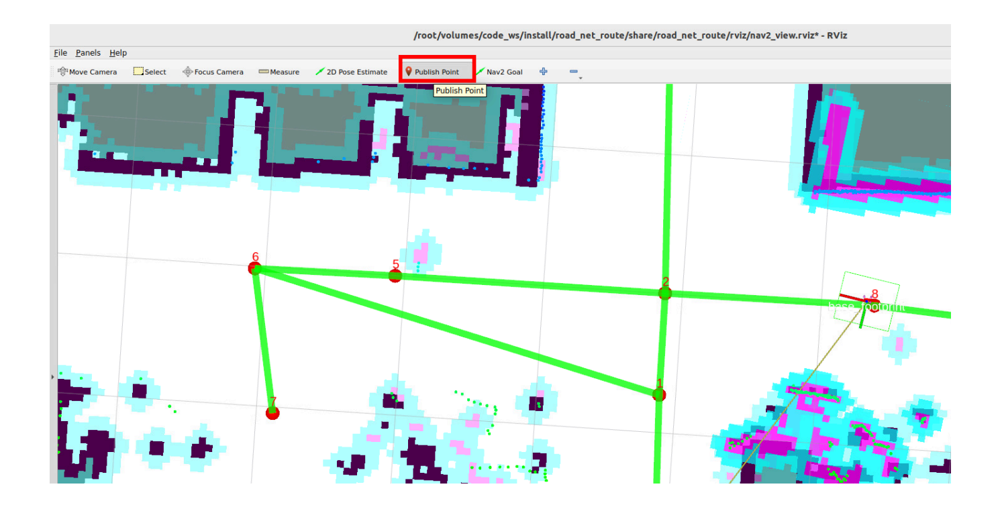
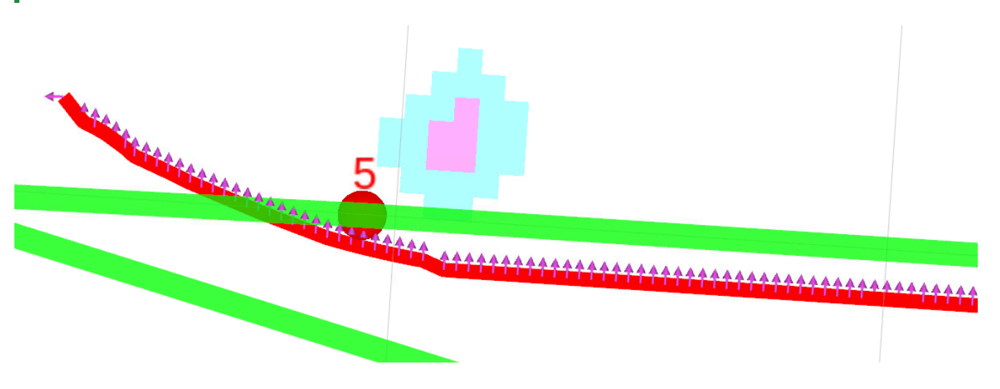

# **Path Re-planning**

### **Path [Re-planning](#page-0-0)**

- <span id="page-0-0"></span>[1. Course](#page-0-1) Content
- 2 Editing the [Road Network](#page-0-2)
- 3. Running the Path [Re-planning](#page-2-0) Case
  - 3.1 Start the [Agent](#page-2-1)
- [4. Querying](#page-5-0) Obstacle Cost Threshold
  - 4.1 Viewing [Obstacle](#page-5-1) Cost Values
  - 4.2 Modifying the [Threshold for](#page-6-0) Triggering Re-planning
- <span id="page-0-1"></span>[5. Source](#page-7-0) Code Analysis
  - 5.1 Obstacle Detection [and Re-planning](#page-7-1) Strategy
  - 5.2 Query Map Cost Value [Implementation](#page-11-0) Method

## **1. Course Content**

Basic

Run the sample program. Based on the road network planning and navigation, if an obstacle is detected on the traveling path during operation, re-planning will be triggered to find a new path in the road network.

- <span id="page-0-2"></span>Advanced
- 1. Understand the implementation method of re-planning and how to modify re-planning strategies (the strategy is not unique and can be implemented according to your needs).
  - 2. Adjust the obstacle detection threshold based on the queried cost value.

# **2 Editing the Road Network**

To demonstrate the re-planning function, we add some edges to the sample road network from the previous course. For the operation tutorial on loading and editing the road network, refer to: **03-Road Network Annotation**: **Loading and Modifying Road Network Description** section.


[Image details](images/img_001.md)

For example, add a bidirectional edge between waypoint 1 and 6


[Image details](images/img_002.md)

All operations will have corresponding records in the terminal


[Image details](images/img_003.md)

Then save the file


[Image details](images/img_004.md)

# **3. Running the Path Re-planning Case**

### **3.1 Start the Agent**

<span id="page-2-1"></span><span id="page-2-0"></span>Use the following command to start the microROS agent and connect to the chassis

```
sh start_agent.sh
```

Start the road network container

#### roadnet start

Open a terminal on the host machine to start the LiDAR fusion node and odometry fusion (PI5 users should start in the m3pro container )

ros2 launch m3pro\_bringup car\_base.launch.py

Start the road network route planning and navigation node (inside the roadnet container)

roadnet bash

ros2 launch road\_net\_route roadnet\_nav2.launch.py rviz\_config\_file:=/root/volumes/code\_ws/src/road\_net\_route/rviz/nav2\_relocaton.rviz


[Image details](images/img_005.md)

The test scenario here is: travel from waypoint 8 to waypoint 6 along the road network, then place an obstacle on the planned path to trigger the re-planning strategy

ros2 topic pub -1 /road\_net\_nav\_id std\_msgs/msg/Int16MultiArray "{data: [8, 6]}"


[Image details](images/img_006.md)

Here you can see the terminal will prompt that there is an obstacle on the path, then trigger re-planning

Here, after detecting an obstacle on the path, the path is impassable, and it retreats back to the previously passed waypoint 8


[Image details](images/img_007.md)

Then from waypoint 8, try to plan a drivable path again and reach the target waypoint 6


[Image details](images/img_008.md)

# **4. Querying Obstacle Cost Threshold**

<span id="page-5-0"></span>The obstacle detection on the path is determined by detecting the cost value on the global path and the number of high-cost points on the global path. The threshold for triggering re-planning can be set by yourself.

### **Note**

- The obstacle detection threshold is generally set to the factory default!!!
- If there are special scenario requirements, you can refer to this part of the tutorial to adjust the threshold for triggering re-planning.
- <span id="page-5-1"></span>The cost value is the value used in the costmap to describe the area occupied by obstacles. The closer to the obstacle, the higher the cost value.

## **4.1 Viewing Obstacle Cost Values**

Click the Publish Point tool, then use the left mouse button to click on the location on the map where you want to view the cost value.


[Image details](images/img_009.md)

<span id="page-6-0"></span>You can see that areas without obstacles have a cost value of 0, and the cost value at the center of the obstacle is 99-100

# **4.2 Modifying the Threshold for Triggering Re-planning**

Configuration file path

\$HOME/M3Pro\_ws/RoadNetwork/volumes/code\_ws/src/road\_net\_route/config/nav2\_roadnet.yaml

Find the route\_bridge node configuration parameters in the configuration file, where COST\_THRESHOLD and PATH\_OBSTACLES\_THRESHOLD together determine the triggering threshold.

```
route_bridge:
  ros__parameters:
    roadnet_file: '/root/map/map.geojson'
    COST_THRESHOLD: 60
    replace2id: True
    PATH_OBSTACLES_THRESHOLD: 5
```

- The specific obstacle detection logic is as follows:
- The global path planned by the road network function is the nav\_msgs/msg/Path message type in ROS, which consists of multiple pose points. When performing road network navigation, all pose points on the global path are checked whether they have high-cost values in the global costmap.
  - If the cost value of a pose point on the path exceeds the **COST\_THRESHOLD**, that point on the

- path is marked as a high-cost pose point.
- Finally, calculate how many pose points on the global path are high-cost pose points.
- If the total number of high-cost pose points is greater than **PATH\_OBSTACLES\_THRESHOLD**, the path is considered impassable and re-planning needs to be performed.

### **Tip**

If obstacle detection is not sensitive enough, you can increase **COST\_THRESHOLD** and **PATH\_OBSTACLES\_THRESHOLD**. If it is too sensitive, you can decrease these two values or adjust the obstacle inflation radius (for modifying the obstacle inflation radius, refer to 04-Road Network Route Planning and Navigation section 4.1 Navigation Controller Debugging).


[Image details](images/img_010.md)

# **5. Source Code Analysis**

<span id="page-7-1"></span><span id="page-7-0"></span>Implementation source code path:

\$HOME/M3Pro\_ws/RoadNetwork/volumes/code\_ws/src/road\_net\_route/road\_net\_route/route\_bridge.py

### **5.1 Obstacle Detection and Re-planning Strategy**

- Iterate through each pose point of the global path, check whether there are obstacles exceeding the threshold on the path through the global costmap, and return a boolean value indicating whether the path is blocked.
- **World coordinates to map coordinates**: Call the costmap's worldToMapValidated method to convert world coordinates (wx, wy) to grid coordinates (mx, my) of the costmap (the costmap is a 2D grid map, each grid corresponds to a cost value).
- **Coordinate validity check**: If the converted grid coordinates are None , it means that path point is outside the global costmap range, a warning log is printed, and that point is skipped.
- **Parameters**: path:Path → ROS2's nav\_msgs/msg/Path message type, storing the robot's global

planned path, containing a series of poses ( poses ).

**Return value**: bool → True means the number of obstacles on the path exceeds the threshold, False means the path is feasible.

```
def __check_path_obstacles(self, path:Path)->bool:
    """Check for obstacles on the global path."""
    pose_array=[]
    for pose in path.poses:
        wx=pose.pose.position.x
        wy=pose.pose.position.y
        mx, my = self.global_costmap.worldToMapValidated(wx,wy )
        if mx is None or my is None:
            self.get_logger().warn(f"Path point ({wx}, {wy}) is outside global costmap")
            continue
        cost = self.global_costmap.getCostXY(int(mx),int(my))
        if cost > self.COST_THRESHOLD:
            pose_array.append(pose)
    if len(pose_array) >self.PATH_OBSTACLES_THRESHOLD:
        self.get_logger().info(f"Path contains {len(pose_array)} potential obstacles.")
        return True
    return False
```

After detecting obstacles on the global path, let the robot **retreat to the previous waypoint** and replan the path.

```
def __reroute_strategy_1(self,last_id):
    '''Replanning Strategy 1: Go back to the previous waypoint and replan the drivable
path.'''
    navigator= BasicNavigator()
    goal_x,goal_y=self.__get_node_coordinates(last_id)
    if goal_x is not None and goal_y is not None:
        goal_pose = PoseStamped()
        goal_pose.header.frame_id = "map"
        goal_pose.pose.position.x = goal_x
        goal_pose.pose.position.y = goal_y
        back_lastid = navigator.goToPose(goal_pose)
        while not navigator.isTaskComplete(task=back_lastid):
            time.sleep(0.1)
        if navigator.getResult() == TaskResult.SUCCEEDED:
            self.get_logger().info("back to last id success.")
        else:
            self.get_logger().info("back to last id failed.")
```

handle\_id\_navigation and handle\_pose\_navigation are the core code responsible for road network

planning and navigation. The following parts in these two functions contain the logic for detecting paths and triggering re-planning.

When the path is detected to be infeasible, call **Re-planning Strategy 1**: let the robot **retreat to the previous waypoint** (the coordinates corresponding to last\_node\_id ). The core logic of this method has been explained earlier: initialize the navigator → get the coordinates of last\_node\_id → send a navigation task of "retreat to this waypoint" → wait for the task to complete and print the result. Withdraw the robot from the current obstacle area to a **safe predefined waypoint**, providing a stable starting point for subsequent path re-planning.

The complete flow is as follows:

- 1. The robot normally executes path tracking, obtaining navigation feedback in real-time.
- 2. Check whether there are obstacles in the path from feedback :
  - If no obstacles: continue executing the original path, no processing needed.
    - If there are obstacles: trigger the re-planning logic.
- 3. The robot retreats to the previous safe waypoint ( last\_node\_id ).
- 4. Using this waypoint as the starting point, re-plan the path to the target waypoint ( goal\_id ).
- 5. Obtain feedback from the new path and let the robot continue moving while tracking the new path.

```
if feedback is not None and self.__check_path_obstacles(feedback.path):
    self.__reroute_strategy_1(last_node_id)
    route_task = self.navigator.getAndTrackRoute(last_node_id, goal_id)
    feedback = self.navigator.getFeedback(task=route_task)
    follow_path_task = self.navigator.followPath(feedback.path)
```

```
def handle_id_navigation(self, start_id:int, goal_id:int):
        '''Road network ID navigation'''
        route_task = self.navigator.getAndTrackRoute(start_id, goal_id)
        feedback=None
        follow_path_task=RunningTask.NONE
        last_feedback = None
        last_node_id =999
        while not self.navigator.isTaskComplete(task=route_task):
            feedback = self.navigator.getFeedback(task=route_task)
            if feedback is not None and self.__check_path_obstacles(feedback.path):
                self.__reroute_strategy_1(last_node_id)
                route_task = self.navigator.getAndTrackRoute(last_node_id, goal_id)
                feedback = self.navigator.getFeedback(task=route_task)
                follow_path_task = self.navigator.followPath(feedback.path)
            while feedback is not None:
                if last_feedback is not None and (feedback.last_node_id !=
last_feedback.last_node_id or feedback.next_node_id != last_feedback.next_node_id):
                    self.get_logger().info(f'id:{feedback.last_node_id} ------> id:
{feedback.next_node_id} edge:{feedback.current_edge_id}')
                last_feedback = feedback
```

```
last_node_id=feedback.last_node_id
                if feedback.rerouted :
                    self.get_logger().info('reroute a new path to follow!')
                    follow_path_task = self.navigator.followPath(feedback.path)
                feedback = self.navigator.getFeedback(task=route_task)
            if self.navigator.isTaskComplete(task=follow_path_task):
                print(follow_path_task)
                self.get_logger().info('Controller completed its task!')
                if follow_path_task != RunningTask.NONE :
                    self.navigator.cancelTask()
        result = self.navigator.getResult()
        if result == TaskResult.SUCCEEDED:
            self.get_logger().info(Fore.GREEN+"navigation task completed."+Fore.RESET)
            self.action_feedback_pub.publish(String(data="road_net_nav_succeeded"))
        elif result == TaskResult.CANCELED:
            self.get_logger().warn("Navigation task canceled.")
        elif result == TaskResult.FAILED:
            self.get_logger().error("Navigation task failed.")
            self.action_feedback_pub.publish(String(data="road_net_nav_failed"))
    def handle_pose_navigation(self, goal_pose:PoseStamped):
        '''Arbitrary pose navigation'''
        transform = self.tf_buffer.lookup_transform("map", "base_footprint",
rclpy.time.Time(),rclpy.duration.Duration(seconds=5.0))
        if transform is None:
            self.get_logger().info(Fore.RED+"Failed to get TF transform "+Fore.RESET)
            return
        else:
            start_pose = PoseStamped()
            start_pose.header = transform.header
            start_pose.pose.position.x = transform.transform.translation.x
            start_pose.pose.position.y = transform.transform.translation.y
            start_pose.pose.orientation = transform.transform.rotation
            self.get_logger().info(Fore.CYAN + f"current:
{transform.transform.translation}"+Fore.RESET)
            nearest_start_node_id, nearest_start_distance =
self.__find_nearest_node(start_pose.pose.position.x, start_pose.pose.position.y)
            nearest_goal_node_id, nearest_goal_distance =
self.__find_nearest_node(goal_pose.pose.position.x, goal_pose.pose.position.y)
            if self.replace2id:
                self.get_logger().info(Fore.CYAN + f"nearest_start_node_id:
{nearest_start_node_id}, distance:{nearest_start_distance}"
                                    f"\nnearest_goal_node_id:{nearest_goal_node_id},
distance:{nearest_goal_distance}"+Fore.RESET)
                route_task =
self.navigator.getAndTrackRoute(start=nearest_start_node_id,goal=nearest_goal_node_id)
            else:
                route_task =
self.navigator.getAndTrackRoute(start=start_pose,goal=goal_pose,use_start=True)
```

```
feedback=None
            follow_path_task=RunningTask.NONE
            last_feedback = None
            last_node_id =999
            while not self.navigator.isTaskComplete(task=route_task):
                feedback = self.navigator.getFeedback(task=route_task)
                if feedback is not None and self.__check_path_obstacles(feedback.path):
                    self.__reroute_strategy_1(last_node_id)
                    route_task = self.navigator.getAndTrackRoute(last_node_id,
nearest_goal_node_id)
                    feedback = self.navigator.getFeedback(task=route_task)
                    follow_path_task = self.navigator.followPath(feedback.path)
                while feedback is not None:
                    if last_feedback is not None and (feedback.last_node_id !=
last_feedback.last_node_id or feedback.next_node_id != last_feedback.next_node_id):
                        self.get_logger().info(f'id:{feedback.last_node_id} ------> id:
{feedback.next_node_id} edge:{feedback.current_edge_id}')
                    last_feedback = feedback
                    last_node_id=feedback.last_node_id
                    if feedback.rerouted :
                        self.get_logger().info('reroute a new path to follow!')
                        follow_path_task = self.navigator.followPath(feedback.path)
                    feedback = self.navigator.getFeedback(task=route_task)
                if self.navigator.isTaskComplete(task=follow_path_task):
                    self.get_logger().info('Controller completed its task!')
                    if follow_path_task != RunningTask.NONE :
                        self.navigator.cancelTask()
            result = self.navigator.getResult()
            if result == TaskResult.SUCCEEDED:
                if self.__adjust_pose(goal_pose):
                    self.get_logger().info(Fore.GREEN+"navigation task
completed."+Fore.RESET)
                    self.action_feedback_pub.publish(String(data="road_net_nav_succeeded"))
            elif result == TaskResult.CANCELED:
                self.get_logger().info(Fore.YELLOW+"navigation task canceled."+Fore.RESET)
            elif result == TaskResult.FAILED:
                self.get_logger().info(Fore.RED+"navigation task failed."+Fore.RESET)
                self.action_feedback_pub.publish(String(data="road_net_nav_failed"))
```

### **5.2 Query Map Cost Value Implementation Method**

- <span id="page-11-0"></span>Call the global costmap's worldToMapValidated method to convert **world coordinates** (x, y) **to grid coordinates** (mx, my) **of the costmap**.
- The costmap is a **2D grid map** (each grid corresponds to a small area in the real world, 0.05m×0.05m). worldToMapValidated is a safe conversion method: if the coordinates are outside the costmap range, it returns None , avoiding boundary errors caused by direct conversion.

**Obtain cost value**: Call the costmap's getCostXY method, passing the integer form of the grid coordinates (grid coordinates are discrete integers, avoiding errors caused by floating-point input), to obtain the **cost value** cost of that grid.

```
def get_costmap_value(self, msg:PointStamped):
    '''In RViz, you can click to view the cost of a point on the global cost map.'''
    x=msg.point.x
    y=msg.point.y
    mx, my = self.global_costmap.worldToMapValidated(x, y)
    if mx is None or my is None:
        self.get_logger().warn(f"Path point ({x}, {y}) is outside local costmap")
        return
    cost = self.global_costmap.getCostXY(int(mx),int(my))
    self.get_logger().info(f"clicked_point in global_costmap cost:{cost}")
```