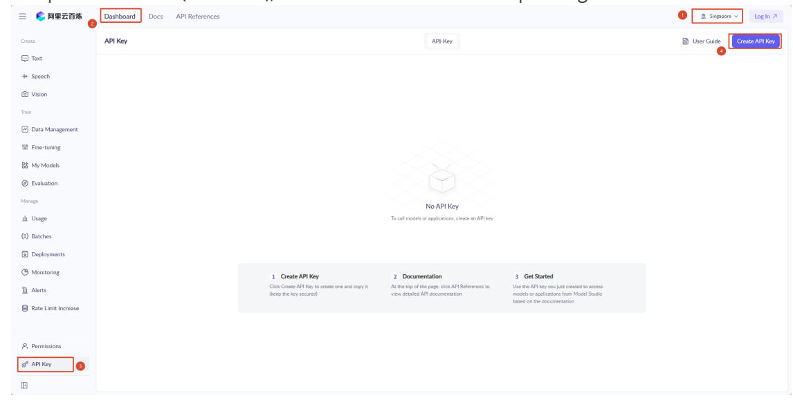
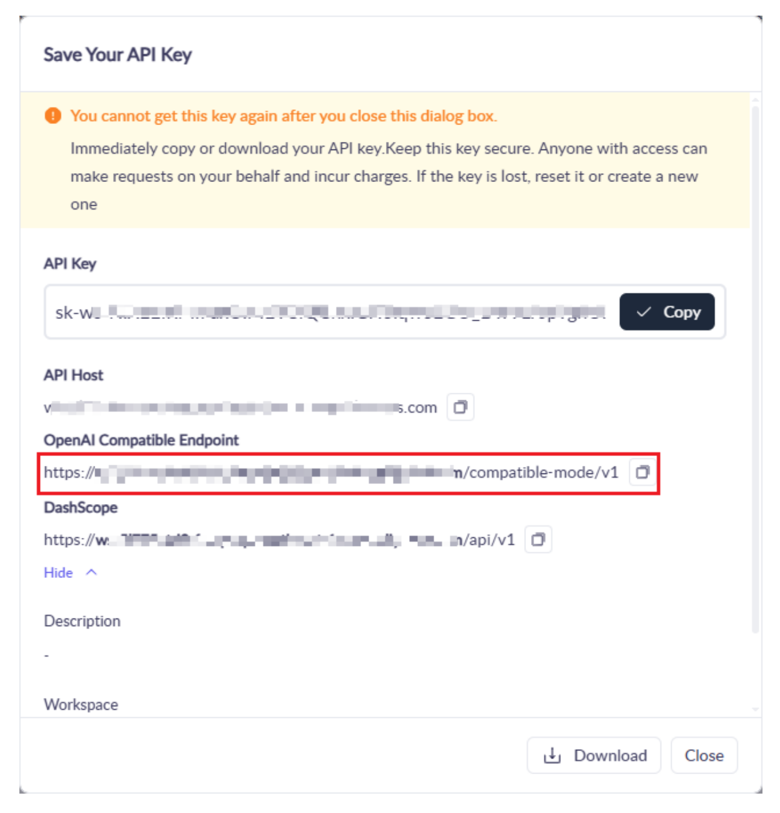
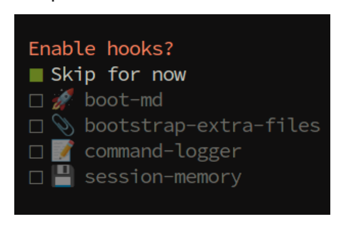

# **OpenClaw API-KEY Configuration**

### **OpenClaw API-KEY [Configuration](#page-0-0)**

- <span id="page-0-0"></span>[1. Course](#page-0-1) Overview
  - 1.1 Course [Content](#page-0-2)
- 2. API-KEY [Application](#page-0-3)
  - 2.1 [Recommended Model](#page-0-4) Service Providers
- [3. Configuring](#page-1-0) OpenClaw API-KEY
  - 3.1 [Configuration](#page-1-1) Methods
  - 3.2 [Quick Configuration](#page-1-2)
    - 3.2.1 [Configure](#page-1-3) baseUrl
    - 3.2.2 Fill in apiKey [and baseUrl](#page-2-0)
- 4. Viewing [Connected Model](#page-2-1) Status
  - 4.1 View [Configured Model](#page-2-2) List
  - 4.2 Verify [Configuration](#page-3-0) Success
- 5. Other [Connection](#page-3-1) Methods (Advanced)
  - 5.1 CLI [Command Configuration](#page-3-2) API-KEY (Suitable for Beginners)
  - 5.2 Modify Configuration File [\(Recommended Method\)](#page-7-0)

[Configuration](#page-7-1) File Location

<span id="page-0-1"></span>Edit [Configuration](#page-7-2) File

- 6. Common Issues [and Solutions](#page-11-0)
  - 6.1 [Invalid API-KEY](#page-11-1) or Error
  - 6.2 [Cannot](#page-11-2) Access Model Service
- 7. Course [Summary](#page-11-3)

# **1. Course Overview**

This course will detail how to configure API-KEYs for AI models in OpenClaw, including the API-KEY application process, two configuration methods (CLI command configuration and configuration file modification), and how to verify if the configuration is successful. After completing this course, you will be able to successfully connect and use various AI model service providers.

# **1.1 Course Content**

- Understand the types of model service providers supported by OpenClaw
- <span id="page-0-2"></span>Master the API-KEY application method
- <span id="page-0-3"></span>Learn how to view and verify the status of connected models

# **2. API-KEY Application**

# **2.1 Recommended Model Service Providers**

- <span id="page-0-4"></span>Refer to the accompanying tutorial [2. AI Large Model Development] — [01-Register for model service provider account] for API-KEY application reference
- OpenClaw supports many model service providers, including:
  - **OpenAI** GPT series (API + Codex)
  - **Anthropic** Claude series (API + Claude Code)
  - **Google** Gemini series
  - **Alibaba Cloud** Qwen Cloud, Tongyi Qianwen
  - **DeepSeek** DeepSeek models

- **Zhipu AI** GLM models
- **Moonshot** Kimi + Kimi Coding
- **Ollama** Local models (Cloud + Local)
- <span id="page-1-1"></span><span id="page-1-0"></span>And many other service providers
- You can freely choose a model service provider based on your actual needs and local network policies, and register and apply for an API-KEY on the corresponding official website

# **3. Configuring OpenClaw API-KEY**

# **3.1 Configuration Methods**

OpenClaw provides two methods to configure API-KEY:

- 1. **CLI Command Configuration** (Suitable for beginners)
- 2. **Direct Configuration File Modification** (Suitable for developers)
  - Configuration file path: \$HOME/.openclaw/openclaw.json

# **3.2 Quick Configuration**

- <span id="page-1-2"></span>Suitable for users who want to quickly get started and experience the service. You need to first register for an Alibaba Cloud Bailian large model account and create an API-KEY (refer to the accompanying tutorial [12.AI Model Development] — [01.Register a model service provider account])
- The factory preset configuration file has already configured the Bailian model parameters. Simply fill in your API-KEY and baseUrl to start using it directly.
- Open the OpenClaw configuration file:

nano \$HOME/.openclaw/openclaw.json

# **3.2.1 Configure baseUrl**

Users need to configure the tongyi\_base\_url corresponding to their account. Go to the [Model Service Platform Bailian Console](https://bailian.console.alibabacloud.com/?tab=doc#/doc/?type=model&url=https%3A%2F%2Fwww.alibabacloud.com%2Fhelp%2Fen%2Fdoc-detail%2F2840914.html&renderType=component) to apply for an API key. Copy the API key and OpenAIcompatible address (Base URL), then fill them into the corresponding fields.

<span id="page-1-3"></span>
[Image details](images/img_001.md)


[Image details](images/img_002.md)

### **3.2.2 Fill in apiKey and baseUrl**

<span id="page-2-2"></span><span id="page-2-1"></span>After filling in, press Ctrl+X , then press Y to confirm saving, and press Enter to exit

# **4. Viewing Connected Model Status**

# **4.1 View Configured Model List**

After configuration, you can use the following command to view the connected models:

```
openclaw models list
```

| Model                                      | Input      | Ctx  | Local | Auth | Tags               |
|--------------------------------------------|------------|------|-------|------|--------------------|
| custom-dashscope-aliyuncs-com/MiniMax-M2.5 | text       | 16k  | no    | yes  | default,configured |
| bailian/qwen3.5-plus                       | text+image | 977k | no    | yes  | configured         |
| bailian/qwen3.6-plus                       | text+image | 977k | no    | yes  | configured         |
| bailian/qwen3-max-2026-01-23               | text       | 977k | no    | yes  | configured         |
| bailian/qwen3-coder-next                   | text       | 256k | no    | yes  | configured         |
| bailian/qwen3-coder-plus                   | text       | 977k | no    | yes  | configured         |
| bailian/MiniMax-M2.5                       | text       | 192k | no    | yes  | configured         |
| bailian/glm-5                              | text       | 198k | no    | yes  | configured         |
| bailian/glm-4.7                            | text       | 198k | no    | yes  | configured         |
| bailian/kimi-k2.5                          | text+image | 256k | no    | yes  | configured         |

# **4.2 Verify Configuration Success**

1. **Test Conversation**

```
openclaw tui
```

Start the TUI interface and send a test message (such as "Hello") to confirm the model can respond normally.

# **5. Other Connection Methods (Advanced)**

<span id="page-3-1"></span>If you have your own model provider or need to connect additional model providers later, refer to the following tutorials

# **5.1 CLI Command Configuration API-KEY (Suitable for Beginners)**

1. **Start Configuration Wizard**

```
openclaw onboard
```

Select 【Yes】 and press Enter

Select QuickStart for configuration mode and press Enter

### 2. **Select Model Service Provider**

- Use the up and down arrow keys to select the service provider for which you have applied for an API-KEY, and press Enter to confirm. Here, we take the Alibaba Cloud Bailian model provider as an example. The configuration method for other model providers is the same.
- Here, select custom provider **【Custom Provider】**

Fill in the base\_url of the model provider

- 3. Enter API-KEY
- After selecting a service provider, the system will prompt you to enter the corresponding API-KEY

Paste or enter your applied API-KEY and press Enter to confirm

Select **OpenAI-compatible** for the interface protocol

4. Fill in the model name. Here, we take MiniMax as an example

**Endpoint ID** is the model provider identifier and can be freely filled in

Leave **Model alias (optional)** blank

- 5. **Other Configuration**
- For other configuration items, select skip as shown in the figure below. No configuration needed.

```
Select channel (QuickStart)
Search:
o Google Chat (Chat API)
○ iMessage (imsg)
IRC (Server + Nick)
LINE (Messaging API)
Matrix (plugin)
Mattermost (plugin)
Microsoft Teams (Teams SDK)
Nextcloud Talk (self-hosted)
Nostr (NIP-04 DMs)
o openclaw-weixin
○ QQ Bot (Official API)
○ Signal (signal-cli)

    Slack (Socket Mode)

Synology Chat (Webhook)
○ Telegram (Bot API)
Tlon (Urbit)
o Twitch (Chat)
○ WeCom(企业微信)
WhatsApp (QR link)
○ Zalo (Bot API)
Zalo (Personal Account)
• Skip for now (You can add channels
```

# Search provider Search: Brave Search Exa Search Firecrawl Search Gemini (Google Search) Grok (xAI) Kimi (Moonshot) Ollama Web Search Perplexity Search SearXNG Search Tavily Search Skip for now (Configure later with openclaw configure --section web)

Press space to select **Skip for now** for Enable Hooks


[Image details](images/img_003.md)

Select Restart to restart the gateway and apply the configuration

# **5.2 Modify Configuration File (Recommended Method)**

### **Configuration File Location**

The configuration file is located at: \$HOME/.openclaw/openclaw.json

### **Edit Configuration File**

```
nano $HOME/.openclaw/openclaw.json
# Or use your favorite editor, such as vim, code, etc.
```

### 1. **Add Model Provider Configuration**

Add or modify the models.providers section in the configuration file:

```
{
```

```
"models": {
    "providers": {
      "openai": {
        "apiKey": "OPENAI_API_KEY"
      },
      "anthropic": {
        "apiKey": "ANTHROPIC_API_KEY"
      },
      "google": {
        "apiKey": "GOOGLE_API_KEY"
      }
    }
  },
  "agents": {
    "defaults": {
      "model": {
        "primary": "openai/gpt-4"
      }
    }
  }
}
```

### 3. **Configuration Notes**

- models.providers : Configure API-KEYs for various model service providers
  - openai.apiKey : OpenAI's API-KEY
  - anthropic.apiKey : Anthropic's API-KEY
  - google.apiKey : Google's API-KEY
- agents.defaults.model.primary : Set the default model to use
  - Format is provider/model name , such as openai/gpt-4 , anthropic/claude-3 , google/gemini-pro

### 4. **Save and Exit**

- Press Ctrl+O to save, Ctrl+X to exit (nano editor)
- 5. **Factory Default Bailian Configuration (Can be directly modified or referenced)**

```
"bailian": {
  "baseUrl": "https://dashscope.aliyuncs.com/compatible-mode/v1",
  "apiKey": "sk-a87e1137b17b4a35af13aaxxxxxxx",
  "api": "openai-completions",
  "models": [
    {
      "id": "qwen3.5-plus",
      "name": "qwen3.5-plus",
      "api": "openai-completions",
      "reasoning": false,
      "input": [
        "text",
        "image"
      ],
      "cost": {
        "input": 0,
        "output": 0,
        "cacheRead": 0,
```

```
"cacheWrite": 0
  },
  "contextWindow": 1000000,
  "maxTokens": 65536
},
{
  "id": "qwen3.6-plus",
  "name": "qwen3.6-plus",
  "api": "openai-completions",
  "reasoning": false,
  "input": [
    "text",
    "image"
  ],
  "cost": {
    "input": 0,
    "output": 0,
    "cacheRead": 0,
    "cacheWrite": 0
  },
  "contextWindow": 1000000,
  "maxTokens": 65536
},
{
  "id": "qwen3-coder-next",
  "name": "qwen3-coder-next",
  "api": "openai-completions",
  "reasoning": false,
  "input": [
    "text"
  ],
  "cost": {
    "input": 0,
    "output": 0,
    "cacheRead": 0,
    "cacheWrite": 0
  },
  "contextWindow": 262144,
  "maxTokens": 65536
},
{
  "id": "MiniMax-M2.5",
  "name": "MiniMax-M2.5",
  "api": "openai-completions",
  "reasoning": false,
  "input": [
    "text"
  ],
  "cost": {
    "input": 0,
    "output": 0,
    "cacheRead": 0,
    "cacheWrite": 0
  },
  "contextWindow": 196608,
  "maxTokens": 32768
},
{
```

```
"id": "glm-5",
  "name": "glm-5",
  "api": "openai-completions",
  "reasoning": false,
  "input": [
    "text"
  ],
  "cost": {
    "input": 0,
    "output": 0,
    "cacheRead": 0,
    "cacheWrite": 0
  },
  "contextWindow": 202752,
  "maxTokens": 16384,
  "compat": {
    "thinkingFormat": "qwen"
  }
},
{
  "id": "glm-4.7",
  "name": "glm-4.7",
  "api": "openai-completions",
  "reasoning": false,
  "input": [
    "text"
  ],
  "cost": {
    "input": 0,
    "output": 0,
    "cacheRead": 0,
    "cacheWrite": 0
  },
  "contextWindow": 202752,
  "maxTokens": 16384,
  "compat": {
    "thinkingFormat": "qwen"
  }
},
{
  "id": "kimi-k2.5",
  "name": "kimi-k2.5",
  "api": "openai-completions",
  "reasoning": false,
  "input": [
    "text",
    "image"
  ],
  "cost": {
    "input": 0,
    "output": 0,
    "cacheRead": 0,
    "cacheWrite": 0
  },
  "contextWindow": 262144,
  "maxTokens": 32768,
  "compat": {
    "thinkingFormat": "qwen"
```

```
}
     }
  ]
}
```

# <span id="page-11-0"></span>**6. Common Issues and Solutions**

## **6.1 Invalid API-KEY or Error**

**Problem**: Prompt showing API-KEY is invalid or authentication failed after configuration

### **Solution**:

- <span id="page-11-1"></span>1. Confirm whether the API-KEY is correct (be careful not to have extra spaces)
- 2. Check if the API-KEY has expired or been disabled
- <span id="page-11-2"></span>3. Confirm if the account balance is sufficient (some service providers require prepaid balance)

# **6.2 Cannot Access Model Service**

**Problem**: Cannot connect to model service even with correct configuration

### **Solution**:

- 1. Check if the network connection is normal
- 2. Confirm if the network in your area can access the service provider (some services may require special network configuration)
- <span id="page-11-3"></span>3. Try switching to another model service provider for testing

# **7. Course Summary**

Through this course, you have mastered:

- ✅ Types of model service providers supported by OpenClaw
- ✅ API-KEY application methods and precautions
- ✅ CLI command configuration method (suitable for beginners)
- ✅ Configuration file modification method (suitable for developers)
- ✅ Methods for viewing and verifying model configuration status
- ✅ Troubleshooting and solutions for common issues