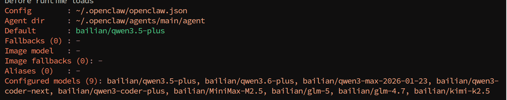
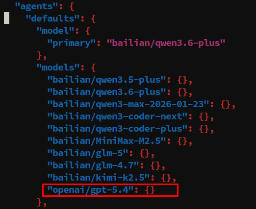

# **OpenClaw Switch Models**

#### **[OpenClaw](#page-0-0) Switch Models**

- <span id="page-0-0"></span>[1. Course](#page-0-1) Content
- [2. Temporarily](#page-0-2) Switch Session Model
  - 2.1 Open TUI [Session](#page-0-3)
  - 2.2 Use /model to Switch [Session](#page-0-4) Model
- [3. Switch](#page-0-5) Default Model
  - 3.1 [Switch](#page-0-6) via CLI
  - 3.2 Switch via [Configuration](#page-1-0) File
- [4. Add Model](#page-1-1) Option List
  - 4.1 Add Models via [Configuration](#page-2-0) File
  - 4.2 Add Agent Model List via CLI [Command](#page-2-1)
  - 4.3 Model Reference Format [Specification](#page-3-0)
- <span id="page-0-1"></span>5. Appendix: CLI [Command Quick Reference](#page-3-1)

### **1. Course Content**

This course systematically introduces OpenClaw's model selection working mechanism and three model switching operation methods.

### **2. Temporarily Switch Session Model**

#### **2.1 Open TUI Session**

<span id="page-0-3"></span><span id="page-0-2"></span>Enter in terminal

<span id="page-0-4"></span>openclaw tui

#### **2.2 Use /model to Switch Session Model**

| Command | Description                                         |
|---------|-----------------------------------------------------|
| /model  | View available model list, select and switch models |

<span id="page-0-5"></span>Enter /model in the session box. For example, here select to switch to bailian/qwen3.5 plus , use the up/down arrow keys to select the model, then press Enter

## **3. Switch Default Model**

#### **3.1 Switch via CLI**

The simplest way is to use the CLI command to directly set the default model:

<span id="page-0-6"></span>Here, switching to the bailian/qwen3.6-plus model is used as an example

openclaw models set bailian/qwen3.6-plus

#### **3.2 Switch via Configuration File**

Edit the openclaw.json configuration file to modify the Agent's default model

```
nano $HOME/.openclaw/openclaw.json
# Or use your preferred editor, such as vim, code, etc.
```

In openclaw.json , specify the default primary model through the agents.defaults.model.primary configuration item:

```
{
  "agents": {
    "defaults": {
      "model": {
        "primary": "bailian/qwen3.5-plus"
      }
    }
  }
}
```

Verify if the configuration has taken effect:

```
openclaw models status
```

## **4. Add Model Option List**

<span id="page-1-1"></span>agents.defaults.models is an **allow list/directory** in OpenClaw that controls the range of available models. Once this configuration item is set, users can only use models included in the list. This list simultaneously serves as the model range control basis for the /model command and session overrides.

### <span id="page-2-0"></span>**4.1 Add Models via Configuration File**

Configure agents.defaults.models in openclaw.json to add the models you need to use to the allow list:

```
{
  "agents": {
    "defaults": {
      "model": {
        "primary": "bailian/qwen3.5-plus"
      },
      "models": {
        "bailian/qwen3.5-plus": {},
        "bailian/qwen3.6-plus": {},
        "bailian/qwen3-max-2026-01-23": {},
        "bailian/qwen3-coder-next": {},
        "bailian/qwen3-coder-plus": {},
        "bailian/MiniMax-M2.5": {},
        "bailian/glm-5": {},
        "bailian/glm-4.7": {},
        "bailian/kimi-k2.5": {}
      }
    }
  }
}
```

### <span id="page-2-1"></span>**4.2 Add Agent Model List via CLI Command**

Use the openclaw config set command to safely edit the allow list without manually modifying the JSON file:

```
openclaw config set agents.defaults.models.bailian/qwen3-plus '{}'
```

#### <span id="page-3-0"></span>**4.3 Model Reference Format Specification**

In OpenClaw, all model references use a unified format:

```
provider/model-id
```

#### Examples:

| Model Reference               | Description                                     |
|-------------------------------|-------------------------------------------------|
| anthropic/claude-opus-4-6     | Anthropic Claude Opus model                     |
| anthropic/claude-sonnet-4-6   | Anthropic Claude Sonnet model                   |
| openai/gpt-5.4                | OpenAI GPT-5.4 model                            |
| openrouter/moonshotai/kimi-k2 | Case where the model ID itself contains a slash |

<span id="page-3-1"></span>**Note**: If the model ID itself contains / (such as moonshotai/kimi-k2 ), the full openrouter/moonshotai/kimi-k2 format must be provided for the reference.

### **5. Appendix: CLI Command Quick Reference**

| Command                                                        | Usage                                                           |
|----------------------------------------------------------------|-----------------------------------------------------------------|
| openclaw onboard                                               | New user guide, helps quickly complete<br>initial configuration |
| openclaw models list                                           | View all configured model lists                                 |
| openclaw models status                                         | View current model configuration status<br>details              |
| openclaw config set<br>agents.defaults.models ' <json>'</json> | Safely add models to the allow list                             |
| /model                                                         | View available model list in chat                               |
| /model status                                                  | View current model status details in chat                       |

---

## Extracted Images


### Page 2


[Image details](images/img_001.md)


[Image details](images/img_002.md)


[Image details](images/img_003.md)


### Page 3


[Image details](images/img_004.md)


### Page 4


[Image details](images/img_005.md)

