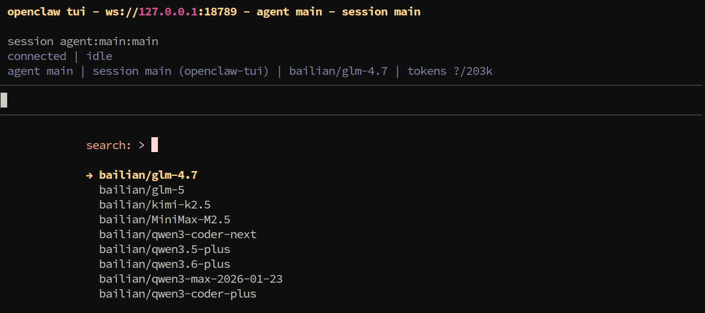
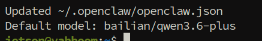
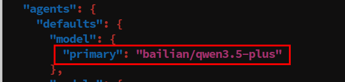
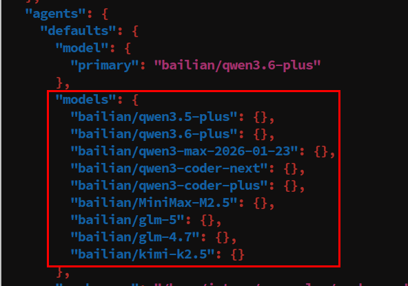

# **OpenClaw Switch Models**

#### **[OpenClaw](#page-0-0) Switch Models**

- <span id="page-0-0"></span>[1. Course](#page-0-1) Content
- [2. Temporarily](#page-0-2) Switch Session Model
  - 2.1 Open TUI [Session](#page-0-3)
  - 2.2 Use /model to Switch [Session](#page-0-4) Model
- [3. Switch](#page-1-0) Default Model
  - 3.1 [Switch](#page-1-1) via CLI
  - 3.2 Switch via [Configuration](#page-1-2) File
- [4. Add Model](#page-2-0) Options List
  - 4.1 Add Models via [Configuration](#page-2-1) File
  - 4.2 [Add Models](#page-3-0) via CLI Command
  - 4.3 Model Reference Format [Specification](#page-4-0)
- <span id="page-0-2"></span><span id="page-0-1"></span>5. Appendix: CLI [Command Quick Reference](#page-5-0)

### **1. Course Content**

This course will systematically introduce OpenClaw's model selection working mechanism and three model switching operation methods.

## **2. Temporarily Switch Session Model**

#### **2.1 Open TUI Session**

<span id="page-0-4"></span><span id="page-0-3"></span>Enter in terminal

openclaw tui

#### **2.2 Use /model to Switch Session Model**

| Command | Description                                        |
|---------|----------------------------------------------------|
| /model  | View available model list, select and switch model |

Enter /model in the conversation box, for example, select and switch to bailian/qwen3.5-plus , use the up and down arrow keys on the keyboard to select a model, then press Enter

# **3. Switch Default Model**

#### **3.1 Switch via CLI**

The simplest way is to use the CLI command to set the default model directly:

Here, take switching to bailian/qwen3.6-plus model as an example

```
openclaw models set bailian/qwen3.6-plus
```

### **3.2 Switch via Configuration File**

Edit the openclaw.json configuration file to modify the Agent's default model

```
nano $HOME/.openclaw/openclaw.json
# Or use your favorite editor, such as vim, code, etc.
```

In openclaw.json , specify the default primary model through the agents.defaults.model.primary configuration item:

```
{
  "agents": {
    "defaults": {
      "model": {
        "primary": "bailian/qwen3.5-plus"
      }
    }
  }
}
```

Verify if the configuration takes effect:

```
openclaw models status
```

### **4. Add Model Options List**

<span id="page-2-1"></span><span id="page-2-0"></span>agents.defaults.models is the **allowlist/directory** that controls the usable model range in OpenClaw. When this configuration item is set, users can only use models included in the list. This list serves as the basis for model range control for both the /model command and session overrides.

#### **4.1 Add Models via Configuration File**

Configure agents.defaults.models in openclaw.json and add models that need to be used to the allowlist:

```
{
  "agents": {
    "defaults": {
      "model": {
        "primary": "bailian/qwen3.5-plus"
      },
      "models": {
        "bailian/qwen3.5-plus": {},
```

```
"bailian/qwen3.6-plus": {},
        "bailian/qwen3-max-2026-01-23": {},
        "bailian/qwen3-coder-next": {},
        "bailian/qwen3-coder-plus": {},
        "bailian/MiniMax-M2.5": {},
        "bailian/glm-5": {},
        "bailian/glm-4.7": {},
        "bailian/kimi-k2.5": {}
      }
    }
  }
}
```

### <span id="page-3-0"></span>**4.2 Add Models via CLI Command**

Using the openclaw config set command can safely edit the allowlist without manually modifying the JSON file:

```
openclaw config set agents.defaults.models '{"openai/gpt-5.4":{}}' --strict-json --merge
```

#### **Parameter Description**:

- --strict-json : Strict JSON mode, ensuring correct input format
- --merge : Merge mode, merging new configuration with existing configuration instead of completely overwriting

#### <span id="page-4-0"></span>**4.3 Model Reference Format Specification**

In OpenClaw, all model references use a unified format:

```
Provider/Model ID
```

#### Examples:

| Model Reference               | Description                                     |
|-------------------------------|-------------------------------------------------|
| anthropic/claude-opus-4-6     | Anthropic's Claude Opus model                   |
| anthropic/claude-sonnet-4-6   | Anthropic's Claude Sonnet model                 |
| openai/gpt-5.4                | OpenAI's GPT-5.4 model                          |
| openrouter/moonshotai/kimi-k2 | Case where the model ID itself contains a slash |

**Note**: If the model ID itself contains / (such as moonshotai/kimi-k2 ), you must provide the complete reference in the format openrouter/moonshotai/kimi-k2 .

# <span id="page-5-0"></span>**5. Appendix: CLI Command Quick Reference**

| Command                                                                          | Purpose                                                              |
|----------------------------------------------------------------------------------|----------------------------------------------------------------------|
| openclaw onboard                                                                 | Beginner guide, helping to quickly<br>complete initial configuration |
| openclaw models list                                                             | View all configured model lists                                      |
| openclaw models status                                                           | View current model configuration status<br>details                   |
| openclaw config set agents.defaults.models ' <json>'<br/>strict-jsonmerge</json> | Safely add models to the allowlist                                   |
| /model                                                                           | View available model list in chat                                    |
| /model status                                                                    | View current model status details in chat                            |

---

## Extracted Images


### Page 2


[Image details](images/img_001.md)


[Image details](images/img_002.md)


### Page 3


[Image details](images/img_003.md)


[Image details](images/img_004.md)


### Page 4


[Image details](images/img_005.md)


### Page 5


[Image details](images/img_006.md)

