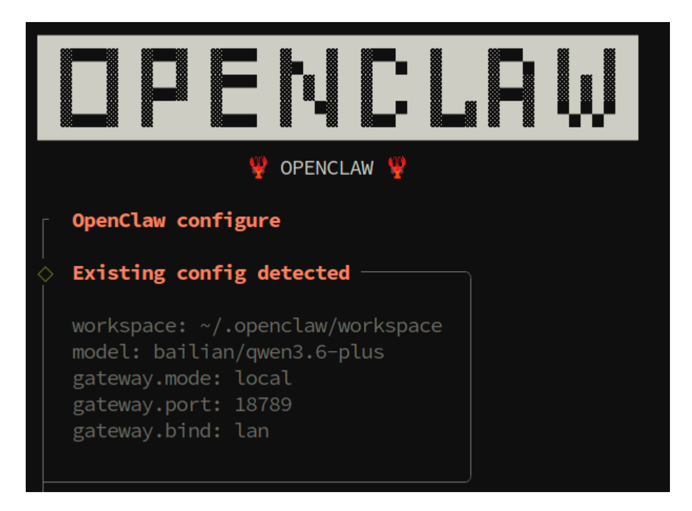
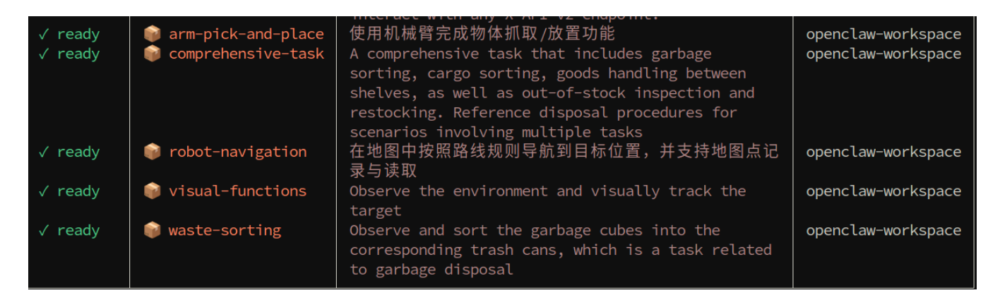

# **OpenClaw Common CLI Commands**

#### **OpenClaw Common CLI [Commands](#page-0-0)**

[1. Course](#page-0-1) Content

<span id="page-0-0"></span>Course [Overview](#page-0-2)

- 2. Initial [Configuration](#page-0-3)
  - 2.1 configure —— [Configuration](#page-0-4) Wizard
  - 2.2 View [OpenClaw](#page-1-0) Version
  - 2.3 View [Help Information](#page-1-1) for All Available Commands
- 3. Gateway [Management](#page-2-0)
- 4. Model [Management](#page-2-1)
  - 4.1 View Model List [and Status](#page-2-2)
  - 4.2 Set [Default](#page-2-3) Model
- 5. Skills and Plugin [Management](#page-3-0)
  - 5.1 Skills [Basic Operations](#page-3-1)
  - 5.2 Plugin [Management](#page-3-2)
- <span id="page-0-2"></span><span id="page-0-1"></span>[6. Configuration,](#page-3-3) Logs, and Other Practical Commands
  - 6.1 [View](#page-3-4) Logs
  - 6.2 Session [Management](#page-4-0)
  - 6.3 [Communication](#page-4-1) Channel Management

## **1. Course Content**

#### **Course Overview**

OpenClaw CLI is the command-line management tool provided by the OpenClaw robot system. This section will introduce some of the most frequently used CLI commands.

## **2. Initial Configuration**

openclaw onboard is OpenClaw's interactive beginner guide command, which has been explained in the API-KEY configuration chapter:

- <span id="page-0-3"></span>Configure API Key and model access information
- Set Gateway running parameters
- <span id="page-0-4"></span>Select Skills to enable

openclaw onboard

## **2.1 configure —— Configuration Wizard**

If you need to adjust parameters after the initial guide, you can use the configure command to re-enter the interactive configuration interface:

openclaw configure


[Image details](images/img_001.md)

#### **2.2 View OpenClaw Version**

<span id="page-1-1"></span><span id="page-1-0"></span>openclaw --version

## **2.3 View Help Information for All Available Commands**

openclaw --help

## **3. Gateway Management**

<span id="page-2-0"></span>OpenClaw's default gateway is set to start automatically on boot

```
openclaw gateway start # Start Gateway
openclaw gateway stop # Stop Gateway
openclaw gateway restart # Restart Gateway
```

View detailed running status of the Gateway, including runtime, connection count, and other information:

```
openclaw gateway status
```

## **4. Model Management**

#### **4.1 View Model List and Status**

<span id="page-2-2"></span><span id="page-2-1"></span>List all configured models and their basic information:

<span id="page-2-3"></span>View the status of all current models, including connection status, latency, availability, etc.:

```
openclaw models status
```

openclaw models list

#### **4.2 Set Default Model**

Set a certain model as the system default model, which will be used for subsequent conversations:

```
openclaw models set gpt-4o
```

**Note:** The model name must exactly match the identifier in the configuration. You can view available model names through openclaw models list .

## <span id="page-3-1"></span><span id="page-3-0"></span>**5. Skills and Plugin Management**

#### **5.1 Skills Basic Operations**

List all currently installed Skills:

openclaw skills list


[Image details](images/img_002.md)

## <span id="page-3-2"></span>**5.2 Plugin Management**

List all currently installed plugins:

```
openclaw plugins list
```

Enable or disable a certain plugin:

```
openclaw plugins enable plugin-id # Enable plugin
openclaw plugins disable plugin-id # Disable plugin
```

| @openclaw/<br>feishu | feishu              | disabled | <pre>global:feishu/index.ts OpenClaw Feishu/Lark channel plugin (community maintained by @m1heng)</pre> | 2026.3.13 |
|----------------------|---------------------|----------|---------------------------------------------------------------------------------------------------------|-----------|
| Weixin               | openclaw<br>-weixin | loaded   | global:openclaw-weixin/index.ts Weixin channel (getUpdates long-poll + sendMessage)                     | 1.0.3     |
| Reply Bridge         | reply-<br>bridge    | loaded   | global:reply-bridge/index.ts<br>Bridge OpenClaw replies to robot_control TTS                            | 1.0.0     |
| Robot<br>Control     | robot-<br>control   | loaded   | global:robot-control/index.ts Robot arm, mobile chassis and visual function control tools               | 1.0.0     |

## <span id="page-3-4"></span><span id="page-3-3"></span>**6. Configuration, Logs, and Other Practical Commands**

### **6.1 View Logs**

```
openclaw logs --follow
```

Using the --follow parameter will continuously output logs to the terminal. Press Ctrl+C to exit tracking mode.

#### **6.2 Session Management**

View a list of all currently active sessions:

<span id="page-4-0"></span>openclaw sessions

#### **6.3 Communication Channel Management**

<span id="page-4-1"></span>View all available communication channels (Feishu, WeChat, etc.)

openclaw channels list