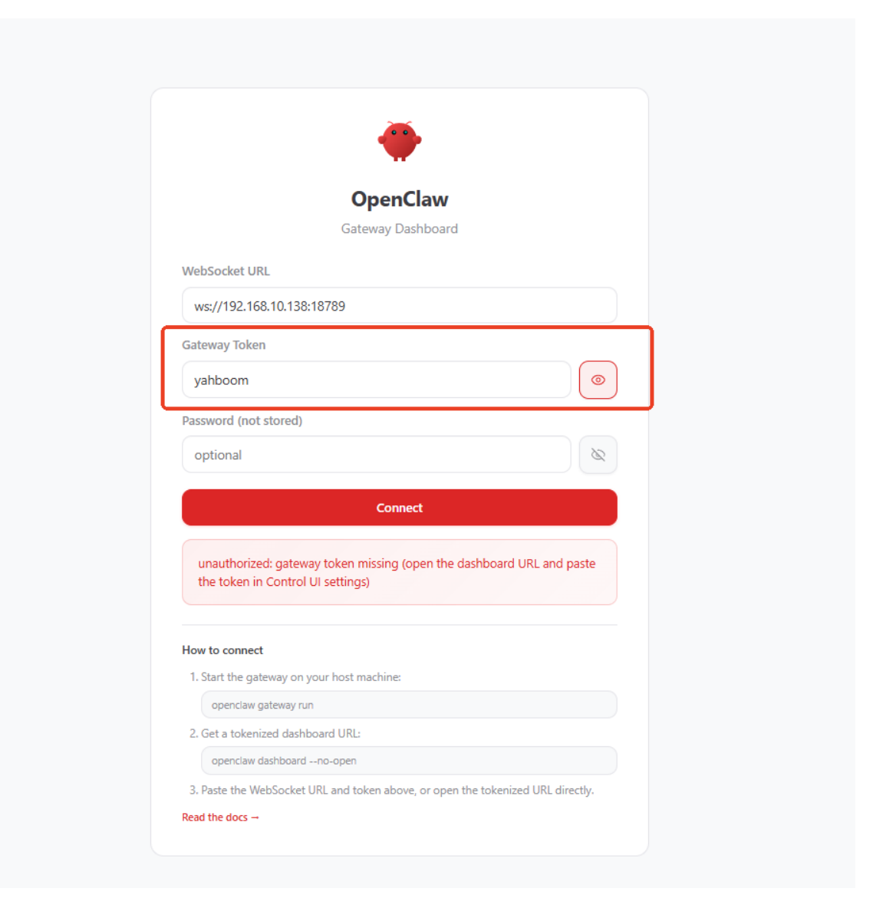
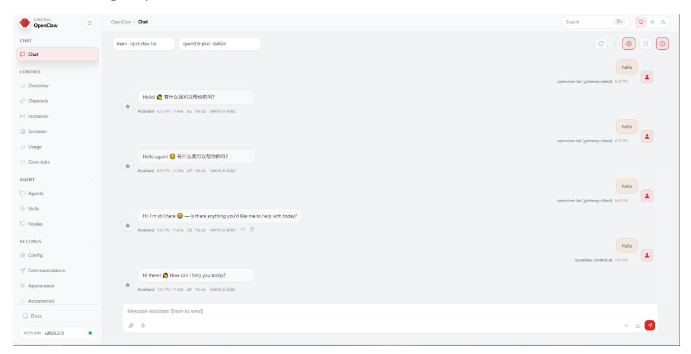
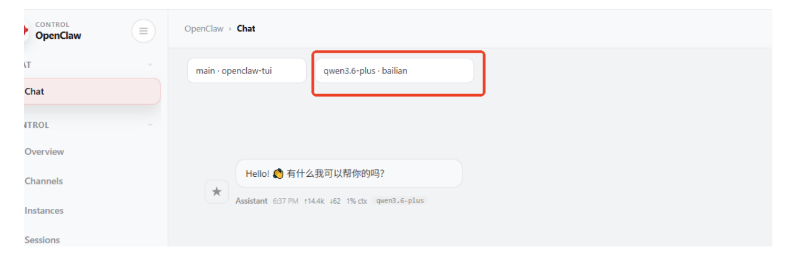
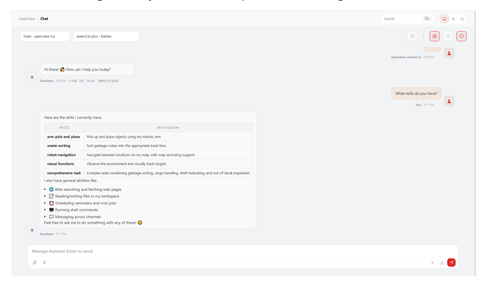

# **OpenClaw Webchat Interaction**

#### **OpenClaw Webchat [Interaction](#page-0-0)**

- <span id="page-0-0"></span>[1. Course](#page-0-1) Content
  - Course [Overview](#page-0-2)
  - Learning [Objectives](#page-0-3)
- 2. Adding [Allowed Addresses](#page-0-4)
- [3. Accessing](#page-1-0) Web UI
- 4. Model Switching [and Dialogue](#page-2-0)
- [5. Common](#page-3-0) Chat Commands
- <span id="page-0-1"></span>6. Common Errors [and Solutions](#page-4-0)
  - 6.1 Cannot Open [Web Page](#page-4-1)
  - 6.2 Token [Verification](#page-4-2) Failed
  - 6.3 No [Response](#page-5-0) or Model Loading Failed
  - 6.4 [Allowed Address](#page-5-1) Configuration Not Taking Effect

## **1. Course Content**

#### <span id="page-0-2"></span>**Course Overview**

OpenClaw WebChat is a browser-based web interaction interface. You don't need to install any client software - simply enter the address in your computer's browser to communicate with the robot. This course will introduce in detail how to interact with OpenClaw through WebChat.

### **Learning Objectives**

- <span id="page-0-3"></span>Learn to configure WebChat's allowed addresses (Allowed Origins)
- Master the method to access OpenClaw Web UI through browser
- <span id="page-0-4"></span>Be able to perform model switching and dialogue in the web interface
- Understand common issues and solutions during WebChat usage

### **2. Adding Allowed Addresses**

Set the address whitelist for accessing WebChat in the OpenClaw configuration file:

```
nano $HOME/.openclaw/openclaw.json
# Or use your favorite editor, such as vim, code, etc.
```

- Find the gateway.controlUi.allowedOrigins configuration item and enter the robot IP address + :18789
- If your robot has multiple IP addresses, separate them with commas

You can check the robot IP address in various ways, for example by opening a new terminal

**Save and exit**

<span id="page-1-0"></span>Press Ctrl+O to save, Ctrl+X to exit (nano editor)

Restart the gateway to apply the configuration

```
openclaw gateway restart
```

### **3. Accessing Web UI**

- Open a browser on a computer in the same network segment as the robot, enter robot IP:18789 in the address bar, and the page will redirect to the gateway dashboard interface
- Enter yahboom in the gateway token field, then click Connect


[Image details](images/img_001.md)

Then you will enter OpenClaw's Web interface, where you can chat with OpenClaw, monitor and configure parameters, etc.


[Image details](images/img_002.md)

### **4. Model Switching and Dialogue**

<span id="page-2-0"></span>In the model selection box at the top of the Web interface, you can select a configured model to temporarily switch the current session model


[Image details](images/img_003.md)

After selecting a model, you can chat with OpenClaw in the dialogue box


[Image details](images/img_004.md)

## <span id="page-3-0"></span>**5. Common Chat Commands**

In the WebChat dialogue box, besides directly typing text to chat with OpenClaw, you can also use slash commands starting with / to perform various operations. Here are some common chat commands:

| Command                | Description                                             | Example                |
|------------------------|---------------------------------------------------------|------------------------|
| /model [model<br>name] | Switch the model for current session                    | /model gpt-4o          |
| /stop                  | Stop the currently generating response                  | Just type /stop        |
| /new                   | Start a new session (clear current dialogue<br>history) | Just type /new         |
| /reset                 | Reset the current session (alias for /new )             | Just type /reset       |
| /compact               | Compact session context to save Tokens                  | /compact               |
| /fast [on/off]         | Toggle fast mode (disable thought chain<br>output)      | /fast on               |
| /status                | View current running status and execution<br>info       | Just type /status      |
| /help                  | Show brief help information                             | Just type /help        |
| /commands              | View complete directory of all available<br>commands    | Just type<br>/commands |
| /think [level]         | Set the output level of thought chain                   | /think off             |

<span id="page-4-1"></span><span id="page-4-0"></span>**Note:** Slash commands must be sent as **standalone messages** (i.e., only the command itself in the dialogue box), and cannot be mixed with regular chat text.

## **6. Common Errors and Solutions**

#### **6.1 Cannot Open Web Page**

**Phenomenon:** The browser shows unable to access or connection timeout after entering the address.

#### **Possible Causes and Solutions:**

- **Gateway not running** Make sure OpenClaw Gateway is started, execute openclaw gateway status to check status
- **Network unreachable** Confirm computer and robot are on the same LAN, use ping robot IP to test connectivity
- **Port not open** Confirm the access address is robot IP:18789 , check if port number is correct
- <span id="page-4-2"></span>**Firewall blocking** — Check if the robot firewall has allowed port 18789

## **6.2 Token Verification Failed**

**Phenomenon:** After entering the token, the prompt shows authentication failed and cannot connect.

#### **Possible Causes and Solutions:**

**Incorrect token entered** — Make sure what you entered in the token field is yahboom (note case sensitivity)

<span id="page-5-0"></span>**Token configuration modified** — Check if the value of gateway.controlUi.authToken in openclaw.json matches what you entered

#### **6.3 No Response or Model Loading Failed**

**Phenomenon:** Successfully entered the Web interface, but OpenClaw doesn't reply after sending a message.

#### **Possible Causes and Solutions:**

- **Model not properly configured** Execute openclaw models list and openclaw models status in terminal to check if the model is configured and available
- **API-KEY not set or expired** Refer to the API-KEY configuration section to reconfigure
- **Model switch abnormal** Try reselecting the model using the /model command in the dialogue box
- <span id="page-5-1"></span>**Gateway connection disconnected** — Restart the gateway: openclaw gateway restart

#### **6.4 Allowed Address Configuration Not Taking Effect**

**Phenomenon:** Filled in allowedOrigins but still cannot access.

#### **Possible Causes and Solutions:**

- **Gateway not restarted** After modifying the configuration file, you must execute openclaw gateway restart to take effect
- **IP address filled incorrectly** Use ip a or ifconfig to confirm the actual IP address of the robot
- **Configuration item location incorrect** Confirm allowedOrigins is under the gateway.controlUi node, not somewhere else