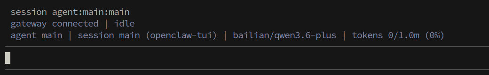
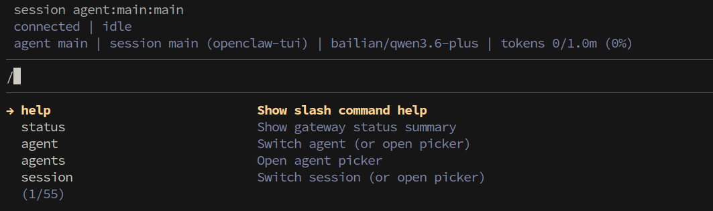

# **OpenClaw Tui Interaction**

#### **OpenClaw [Tui Interaction](#page-0-0)**

- <span id="page-0-0"></span>[1. Course](#page-0-1) Content
  - Course [Overview](#page-0-2)
  - Learning [Objectives](#page-0-3)
- [2. Opening](#page-0-4) TUI Dialogue
  - [Applicable](#page-0-5) Scenarios
- [3. Common](#page-1-0) TUI Terminal Chat Commands
- <span id="page-0-1"></span>4. Common Errors [and Solutions](#page-1-1)
  - 4.1 [Invalid API](#page-1-2)
  - 4.2 Model Quota [Exceeded](#page-1-3)
  - 4.3 [Gateway](#page-2-0) Not Running
  - 4.4 Session [Exception](#page-2-1) or Freezing

## **1. Course Content**

#### <span id="page-0-2"></span>**Course Overview**

OpenClaw TUI (Terminal User Interface) is a terminal-based text interaction interface. Without a graphical desktop environment, you can directly chat with the OpenClaw robot in the command line. TUI interaction is especially suitable for scenarios where you connect to the robot remotely via SSH and perform pure text interaction in the terminal.

### **Learning Objectives**

- <span id="page-0-3"></span>Master the method to start a terminal interaction session via the openclaw tui command
- Learn advanced usage of starting TUI with parameters
- Be familiar with common chat commands (slash commands) in TUI terminal
- <span id="page-0-5"></span><span id="page-0-4"></span>Be able to troubleshoot and resolve common errors during TUI usage

## **2. Opening TUI Dialogue**

## **Applicable Scenarios**

TUI dialogue is mainly applicable to the following scenarios:

- **SSH Remote Connection** After logging into the robot remotely via SSH, you can directly perform text interaction with OpenClaw in the terminal
- **Lightweight Interaction** Compared with Web UI, TUI uses fewer resources and starts faster, suitable for quick debugging and daily use

Enter the following command directly in the terminal to start the TUI dialogue interface:

openclaw tui

- You can chat with the robot by typing text like in WebChat
- <span id="page-1-0"></span>As long as the session ID is the same, dialogue history is synchronized between WebChat and TUI

## **3. Common TUI Terminal Chat Commands**

Chat commands in TUI terminal are exactly the same as slash commands in WebChat, and the usage method is also identical. All commands must start with / and be sent as **standalone messages**

## <span id="page-1-2"></span><span id="page-1-1"></span>**4. Common Errors and Solutions**

### **4.1 Invalid API**

**Phenomenon:** After sending a message, the robot prompts API-KEY invalid, authentication failed, or returns 401 error.

#### **Possible Causes and Solutions:**

- **API-KEY configuration error** Check if the API-KEY configuration item in openclaw.json is correct, restart the gateway after reconfiguring
- **API-KEY expired** Go to the model service provider's platform to check if the API-KEY has expired, regenerate a new KEY and update the configuration
- **Model service provider address error** Confirm the API address (base URL) corresponding to the model in openclaw models list is filled correctly

```
# View current model configuration
openclaw models list
# View model status
openclaw models status
```

### <span id="page-1-3"></span>**4.2 Model Quota Exceeded**

**Phenomenon:** After sending a message, the prompt shows model call quota limit reached (Rate Limit / Quota Exceeded), or returns 429 status code.

#### **Possible Causes and Solutions:**

- **Quota exhausted** Model service providers have daily/hourly call frequency or Token limits for free/trial accounts, please check account quota status
- **Multi-session concurrent consumption** Having multiple sessions open simultaneously for parallel conversations will accelerate quota consumption,建议减少并发会话数量
- **Switch model** If the current model quota is limited, you can use the /model command to switch to another configured model to continue the conversation

### **4.3 Gateway Not Running**

<span id="page-2-0"></span>**Phenomenon:** After executing openclaw tui , the prompt shows unable to connect to Gateway, connection refused, or stuck in connecting state for a long time.

#### **Possible Causes and Solutions:**

**Gateway not started** — Start the Gateway service first:

```
openclaw gateway start
# Or use foreground running mode
openclaw gateway run
```

**Gateway stopped or crashed** — Check Gateway running status and restart:

```
openclaw gateway status
openclaw gateway restart
```

**Port occupied** — The default Gateway port is occupied by another program, check port occupancy:

```
# Check if default port 18789 is occupied
lsof -i :18789
```

### **4.4 Session Exception or Freezing**

**Phenomenon:** TUI interface not responding, no return after sending a message for a long time, or interface displaying abnormally.

#### **Possible Causes and Solutions:**

- **Model response timeout** Use the /stop command to stop the currently generating response, then resend the message
- **Terminal window size issue** Adjust the terminal window size and re-execute the command, some terminal windows may cause display issues if too small
- **Session context too long** Use /compact to compact session context and release Token space
- **Restart TUI** Press Ctrl+C to exit TUI, then re-execute openclaw tui to start

---

## Extracted Images


### Page 1


[Image details](images/img_001.md)


### Page 2


[Image details](images/img_002.md)

