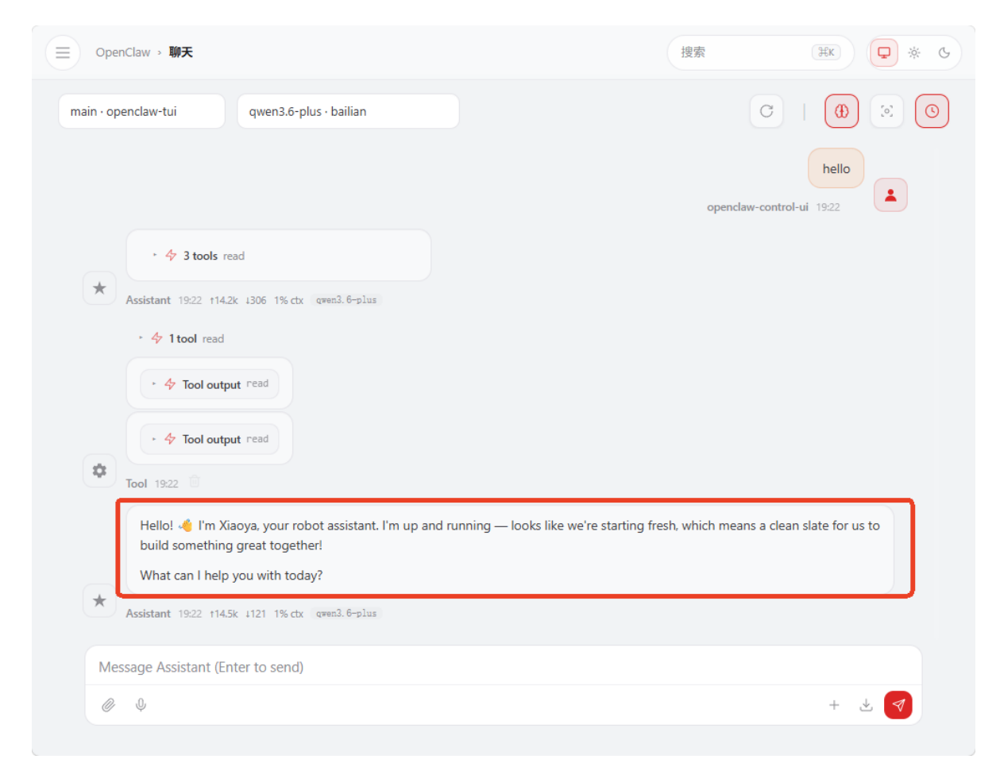

## **OpenClaw Voice Dialogue Interaction**

#### **OpenClaw [Voice Dialogue Interaction](#page-0-0)**

- <span id="page-0-0"></span>[1. Course](#page-0-1) Content
  - Course [Overview](#page-0-2)
  - Learning [Objectives](#page-0-3)
- 2. Enabling [and Disabling](#page-0-4) Voice Tags
- [3. Configuring](#page-2-0) Voice Model Parameter Files
  - 3.1 Selecting [Configuration](#page-2-1) Parameter Files
    - 3.2 [Configuring](#page-2-2) Voice Model API-KEY
- 4. Starting Voice Node [Program and MCP](#page-3-0) Service
- 5. Voice [Dialogue](#page-4-0)
- 6. Common Problems [and Solutions](#page-4-1)
- [7. Function](#page-4-2) Q&A
  - 1. What are the hidden files [.multi\\_brains\\_pre\\_example\\_en.yaml](#page-4-3) and .multi\_brains\_pre\_example\_zh.yaml in the config directory under the m3pro\_bringup package?
  - 2. I don't want [OpenClaw](#page-5-0) to output voice reply tags. How to disable it?
  - 3. How to set online voice recognition instead of using local voice [recognition?](#page-5-1)
  - 4. How to view the complete parameters of [multi\\_brains\\_pre\\_setting.yaml](#page-6-0) and their meanings?
  - 5. How to disable voice reply during [wake-up?](#page-8-0)
  - 6. How to disable the voice synthesis function of the [openclaw\\_bridge](#page-8-1) node, and not perform voice synthesis?
  - 7. Do I need to recompile the [m3pro\\_bringup package](#page-9-0) after modifying configuration parameters?
  - 8. Why can't asr\_detect [and openclaw\\_bridge](#page-9-1) be started in a launch file, and need to be started separately?
  - 9. Why are [OpenClaw](#page-9-2) text replies very long, but voice replies are short?
  - 10. There's no voice tag in [OpenClaw's](#page-9-3) reply, no voice reply? How to make the voice reply all content?
  - 11. Can I directly modify the [multi\\_brains\\_pre\\_setting.yaml](#page-9-4) file instead of using the robot\_config command to set parameters?

#### <span id="page-0-1"></span>**1. Course Content**

#### <span id="page-0-2"></span>**Course Overview**

This section is a practical tutorial explaining how to use the voice dialogue interaction feature of the OpenClaw framework on the ROSMASTER-M3Pro robot.

#### **Learning Objectives**

- <span id="page-0-3"></span>Master the method to enable and disable OpenClaw voice reply tags
- Master the steps to configure voice model parameter files and API-KEY
- Master the process to start MCP service and multi\_brains\_pre voice node program
- Master the operation method for voice dialogue through wake-up words

### **2. Enabling and Disabling Voice Tags**

#### [!NOTE]

<span id="page-0-4"></span>ROSMASTER-M3Pro has the OpenClaw voice reply tag disabled by default from the factory. When you need to use the voice function, enable and disable it through the robot\_config command.

Enable voice tag (run in the host terminal on Raspberry Pi motherboard as well):

robot\_config voice-tag add

Verify if the modification was successful:

robot\_config voice-tag status

The prompt "Voice Tag ON" proves the voice tag is enabled

Restart the OpenClaw gateway to apply the configuration:

openclaw gateway restart

- Test the reply:
  - Here we test on the web page. First, use the /clear command to clear dialogue history to avoid interference from previously loaded old AGENTS.md. Enter the test statement.
  - You can see the reply contains <tts>...</tts> tags. OpenClaw's reply-bridge plugin will automatically parse this tag, then call the MCP interface for speech synthesis and playback.


[Image details](images/img_001.md)

#### **3. Configuring Voice Model Parameter Files**

<span id="page-2-0"></span>ROSMASTER-M3Pro uses offline streaming voice recognition engine by default from the factory. Online voice synthesis uses Alibaba Cloud Bailian (中国大陆地区参数默认使用阿里云百 炼语音合成) in mainland China regions, and iFlytek voice synthesis in international regions.

#### **3.1 Selecting Configuration Parameter Files**

<span id="page-2-1"></span>**Configuration for international users only**, mainland China users skip this step 3.1 (configuration files use Chinese by default from the factory)

```
cd $HOME/M3Pro_ws/src/m3pro_bringup/config
cp .multi_brains_pre_example_en.yaml multi_brains_pre_setting.yaml
```

#### **3.2 Configuring Voice Model API-KEY**

- <span id="page-2-2"></span>If you (mainland China users) need to use Alibaba Cloud Bailian's online voice recognition and voice synthesis model services, refer to this step.
- Only mainland China users configure Alibaba Bailian voice API-KEY (international Bailian does not provide voice services yet, international users use iFlytek online voice service by default)

robot\_config multi\_brains\_pre set ALIYUN\_API\_KEY <API-KEY>

For example:

Verify parameters:

#### **4. Starting Voice Node Program and MCP Service**

<span id="page-3-0"></span>OpenClaw's interaction with the robot relies on the MCP service, so you need to start the MCP service node first.

ros2 launch m3pro\_bringup mcp\_service.launch.py

Start the voice recognition node:

```
ros2 run multi_brains_pre asr_detect
```

After starting, the log will prompt the loaded voice recognition model. The factory default uses the offline streaming voice recognition engine.

Start the voice playback node and openclaw\_bridge:

```
ros2 run multi_brains_pre openclaw_bridge
```

After starting, the log will prompt the loaded voice synthesis model engine.

#### **5. Voice Dialogue**

- <span id="page-4-0"></span>Use the wake-up word "Hi,yahboom" to wake up the robot and start the dialogue.
  - The factory default provides two wake-up methods: voice module wake-up and keyboard wake-up. Keyboard wake-up is done via the spacebar.
- If using the local voice recognition engine, it will perform streaming voice recognition.

The openclaw\_bridge node will display OpenClaw's text reply and perform speech synthesis and playback for the content within the voice tags.

## **6. Common Problems and Solutions**

<span id="page-4-3"></span><span id="page-4-2"></span><span id="page-4-1"></span>See this chapter's [Common Errors and Solutions] for details.

#### **7. Function Q&A**

#### **1. What are the hidden files**

```
.multi_brains_pre_example_en.yaml and
.multi_brains_pre_example_zh.yaml in the config
directory under the m3pro_bringup package?
```

**Answer:** These two files are configuration parameter template files for the multi\_brains\_pre voice module:

- .multi\_brains\_pre\_example\_zh.yaml is the Chinese configuration template (used by default from the factory)
- .multi\_brains\_pre\_example\_en.yaml is the English configuration template (for international users)

When using, you need to copy the corresponding template file and rename it to multi\_brains\_pre\_setting.yaml before it takes effect. See Section 3.1 of this article for specific operation steps.

#### **2. I don't want OpenClaw to output voice reply tags. How to disable it?**

**Answer:** Remove the voice reply tag through the following command to disable it:

1. Remove the voice tag:

```
robot_config voice-tag remove
```

2. Verify the removal result (displaying "Voice Tag OFF" means it's disabled):

```
robot_config voice-tag status
```

#### **3. How to set online voice recognition instead of using local voice recognition?**

**Answer:** Use the robot\_config multi\_brains\_pre set command to set the USE\_ONLINE\_ASR parameter to True to enable online voice recognition:

```
robot_config multi_brains_pre set USE_ONLINE_ASR True
```

After completing the settings, run the following command to verify if the parameters took effect:

```
robot_config multi_brains_pre status
```

Additional notes: Other parameters in multi\_brains\_pre\_setting.yaml (such as ASR supplier, voice model, etc.) can also be modified via robot\_config multi\_brains\_pre set <parameter name> <value> .

# <span id="page-6-0"></span>4. How to view the complete parameters of multi\_brains\_pre\_setting.yaml and their meanings?

**Answer:** You can directly view the contents of the <code>multi\_brains\_pre\_setting.yaml</code> file. Each parameter has detailed comments explaining its purpose and value range:

```
cat $HOME/M3Pro_ws/src/m3pro_bringup/config/multi_brains_pre_setting.yaml
```

The complete configuration file content and the meanings of each parameter are as follows:

```
#####################
#General Settings
####################
ALIYUN_API_KEY: 'sk-a87e1137b17b4a35af13aa4a12ac3473'
                                                                          #Aliyun
API_KEY
LANGUAGE: 'zh'
#Language
####################
# OPENCLAW Configuration Options
####################
OPENCLAW_BASE_URL: 'http://127.0.0.1:18789/v1'
OPENCLAW_API_KEY: 'yahboom'
OPENCLAW_SESSION: 'robot-session-001'
OPENCLAW_MODEL: 'default'
####################
# dify Configuration Options
####################
DIFY_BASE_URL: "http://localhost/v1"
                                                                           #dify
Server Address
DIFY_API_KEY: "app-ob8wT8ubS6Gik7M6uQOdOyI5"
                                                                           #dify
Application API
####################
#Voice Recognition Function Settings
####################
USE_ONLINE_ASR : True
#whether to use online voice recognition
ASR_SUPPLIER : 'aliyun'
                                                                           #Voice
recognition model supplier: aliyun, xunfei
ONLINE ASR MODEL: 'paraformer-realtime-v2'
 #Voice recognition model
SAMPLE RATE: 16000
                                                                           #Voice
recognition audio sample rate, resampled by the program
NO_SPEECH_TIMEOUT: 5.0
#Timeout after wake-up, exit wake-up state if no voice activity within
NO SPEECH TIMEOUT after wake-up
ASR THRESHOLD : 3
                                                                          #ASR
recognition result threshold, unit: characters
TRAILING_SOUND: 1.5
#Trailing sound detection duration, unit: seconds
######################
#Local Voice Recognition Settings
####################
```

```
STREAMING_ASR: True
#Whether to start streaming voice recognition, only effective for offline voice
recognition
NUM_THREADS: 2
#Offline model inference CPU threads: 2
####################
#Voice Synthesis Function Settings
####################
USE_ONLINE_TTS : True
#Whether to use online voice synthesis
TTS_SUPPLIER : 'aliyun' #Voice
synthesis model supplier: aliyun, xunfei, baidu
####################
#Baidu Voice Synthesis
####################
BAIDU_API_KEY : 'lQ3ybx9UsPMCvpqZKpgxxx' #Baidu
Qianfan API_KEY
BAIDU_SECRET_KEY : 'KBT3iWvMu1QXUVUL0CeNrKDhc129xxxx' #Baidu
Qianfan SECRET_KEY
PER : 4
#Speaker
PIT : 5
#Pitch, 0-15, default 5
VOL : 5
#Volume, 0-9, default 5
CUID : 'IN7dAbz1thDJKVhLdypkpB6sDVGxxx'
#Device Identifier
####################
#Bailian (Tongyi) Voice Synthesis
####################
TONGYI_TTS_MODEL : "cosyvoice-v2" #Voice
model name
VOICE_TONE : "longwan_v2"
#Speaker: Longwan, other voice colors refer to Bailian voice synthesis
documentation
####################
#MCP Function Settings
####################
MCP_PORT: 8000 #MCP
port
MCP_HOST: "0.0.0.0"
#Listening network segment
MCP_TRANSPORT: "streamable-http"
#Communication protocol
####################
#System Configuration Items (Modify with caution)
####################
DEVICE_SR_DEFAULT : 48000
#Microphone hardware sample rate, determined by hardware, cannot be modified
MIC_SERIAL_PORT : "/dev/mic"
#Microphone serial port alias
```

#### **5. How to disable voice reply during wake-up?**

**Answer:** Modify the enable\_wakeup\_voice parameter in the ROS node configuration file to False to disable voice reply during wake-up. Operation steps are as follows:

1. Edit the ROS node configuration file:

```
nano $HOME/M3Pro_ws/src/m3pro_bringup/config/common.yaml
```

2. Find the asr\_detect node configuration section and modify the parameters as follows:

```
asr_detect:
 ros__parameters:
   enable_wakeup_voice: False #Enable voice reply during wake-
up (set True to enable, False to disable)
   enable_keyboard_wakeup: True #Whether to enable keyboard
wake-up (spacebar)
   enable_kws_wakeup: True #Whether to enable voice module
wake-up ("Hi,yahboom")
```

3. When starting the asr\_detect node, you need to pass this configuration file to make the modifications take effect:

```
ros2 run multi_brains_pre asr_detect --ros-args --params-file
$HOME/M3Pro_ws/src/m3pro_bringup/config/common.yaml
```

#### **6. How to disable the voice synthesis function of the openclaw\_bridge node, and not perform voice synthesis?**

**Answer:** Modify the enable\_voice\_reply parameter in the ROS node configuration file to False to disable the voice synthesis function. Operation steps are as follows:

1. Edit the ROS node configuration file:

```
nano $HOME/M3Pro_ws/src/m3pro_bringup/config/common.yaml
```

2. Find the openclaw\_bridge node configuration section and modify enable\_voice\_reply to False :

```
openclaw_bridge:
 ros__parameters:
   enable_voice_reply: False #Enable voice synthesis reply (set False
to disable)
```

3. When starting the openclaw\_bridge node, you need to pass this configuration file to make the modifications take effect:

```
ros2 run multi_brains_pre openclaw_bridge --ros-args --params-file
$HOME/M3Pro_ws/src/m3pro_bringup/config/common.yaml
```

#### <span id="page-9-0"></span>**7. Do I need to recompile the m3pro\_bringup package after modifying configuration parameters?**

**Answer:** No, recompilation is not required. The m3pro\_bringup package was built using colcon build --symlink-install --packages-select m3pro\_bringup for symlink installation. Files in the installation directory are symbolically linked to the source directory. Therefore, modifications to configuration files take effect directly without recompilation.

#### <span id="page-9-1"></span>**8. Why can't asr\_detect and openclaw\_bridge be started in a launch file, and need to be started separately?**

**Answer:** The asr\_detect and openclaw\_bridge nodes need to output streaming content in the terminal (displaying real-time text content during the voice recognition process and dialogue results). ROS 2's launch system runs nodes in the background, blocking the real-time display of standard output streams, which prevents users from seeing the streaming text content. Therefore, these two nodes need to be started in separate terminal windows respectively.

#### <span id="page-9-2"></span>**9. Why are OpenClaw text replies very long, but voice replies are short?**

**Answer:** Voice replies are concise summaries of text, only replying with key information. The robot will only broadcast the text within the <tts>...</tts> tags. The design reasons are as follows:

- Reduce the time consumption of voice synthesis. Too long text will significantly increase the time required for voice synthesis
- Too long voice synthesis will increase the token consumption cost of the voice model
- <span id="page-9-3"></span>In most scenarios, only short voice replies are needed. Text replies are already detailed enough.

#### **10. There's no voice tag in OpenClaw's reply, no voice reply? How to make the voice reply all content?**

- You can ask OpenClaw to must perform voice reply during the conversation
- <span id="page-9-4"></span>If you need the voice to reply all complete content, you can ask OpenClaw during the conversation

#### **11. Can I directly modify the multi\_brains\_pre\_setting.yaml file instead of using the robot\_config command to set parameters?**

Yes, robot\_config essentially modifies the parameter key-value pairs in \$HOME/M3Pro\_ws/src/m3pro\_bringup/config/multi\_brains\_pre\_setting.yaml