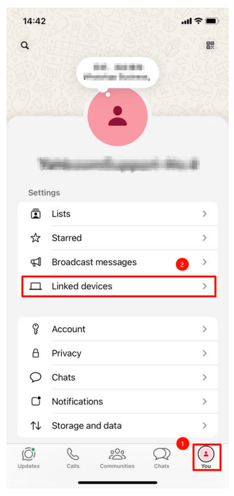
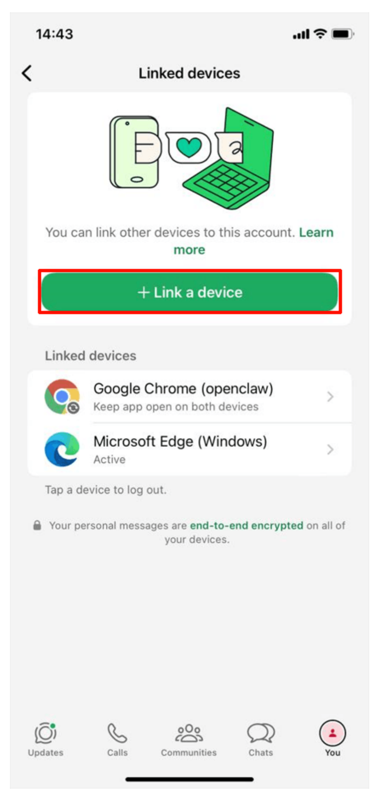
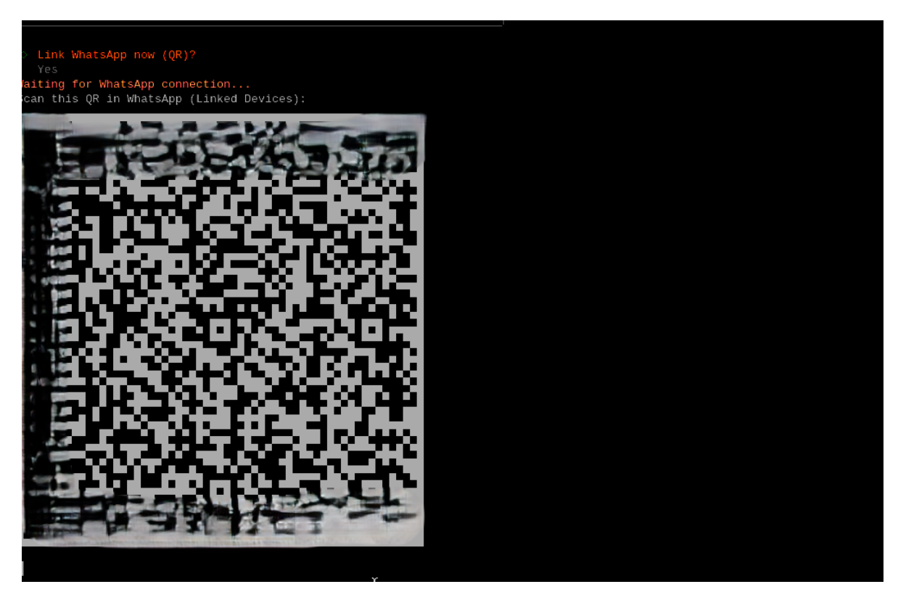
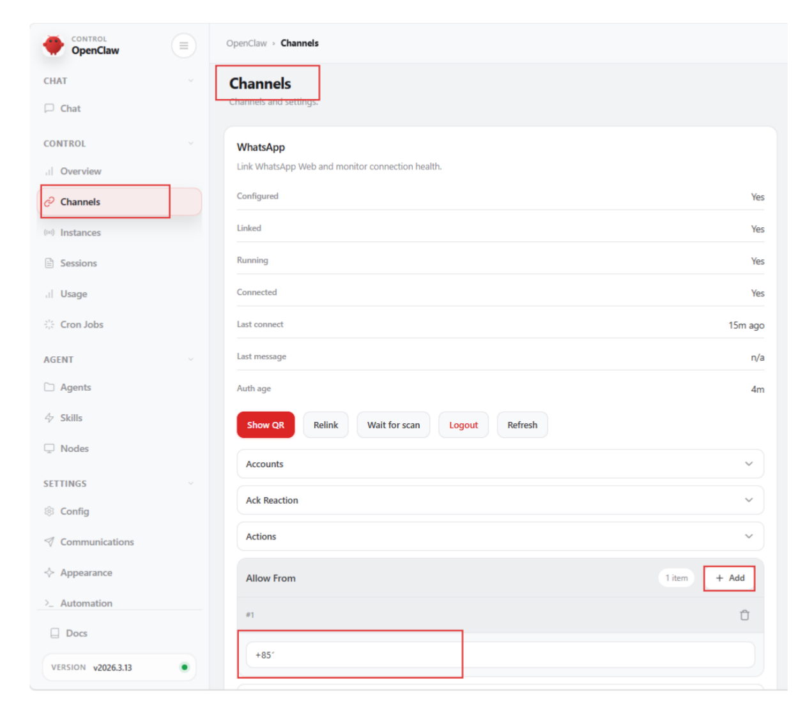
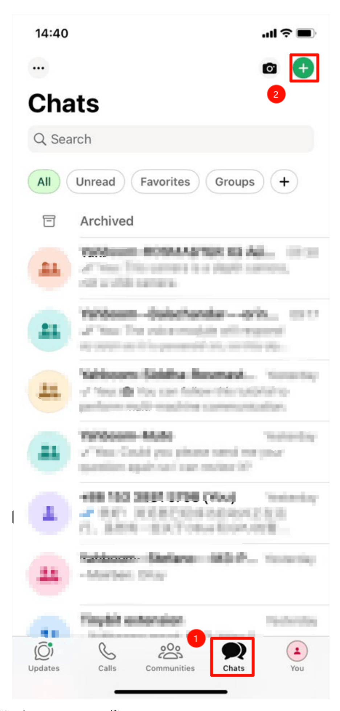
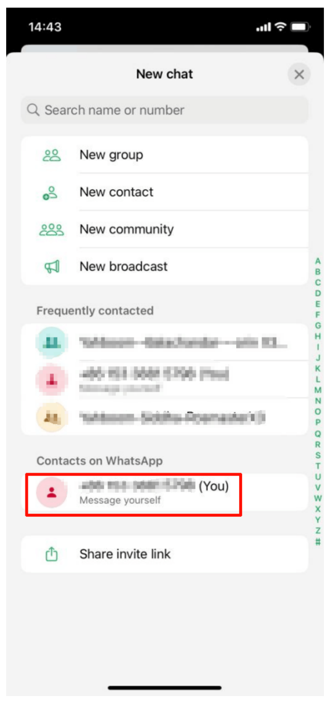
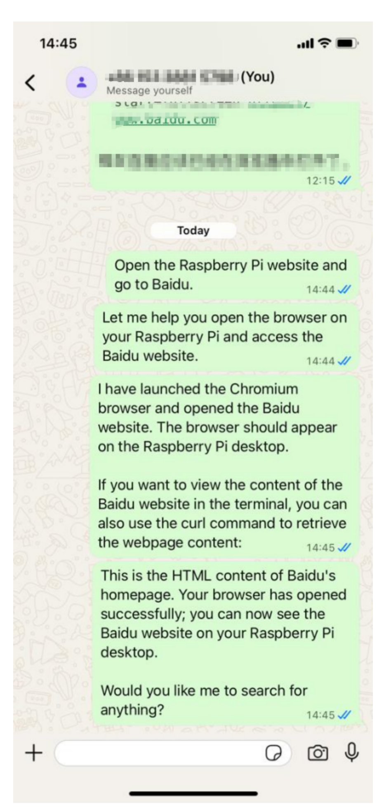

# **OpenClaw WhatsApp Interaction**

#### **OpenClaw WhatsApp [Interaction](#page-0-0)**

- [1. Course](#page-0-1) Content Course [Overview](#page-0-2) Learning [Objectives](#page-0-3)
- 2. Binding [WhatsApp](#page-0-4)
- [3. Dialogue](#page-4-0) Interaction

# **1. Course Content**

### [!NOTE]

WhatsApp is suitable for international users. Users in China are recommended to use WeChat, Feishu, and other mobile communication channels.

### **Course Overview**

- WhatsApp is one of the mobile chat interaction methods supported by OpenClaw. After binding the WhatsApp channel, users can chat with the robot anytime and anywhere through their mobile phone.
- Supports sending text and voice messages to control the robot, suitable for international users.
- Combined with the Robot-Control plugin, you can remotely control the robot to perform various tasks through WhatsApp.

## **Learning Objectives**

- 1. Learn to bind WhatsApp channel and complete device association by scanning QR code.
- 2. Master the method to configure WhatsApp receiving number in OpenClaw WebChat.
- 3. Be able to chat with the robot through WhatsApp.

# **2. Binding WhatsApp**

Enter in terminal:

openclaw channels login --channel whatsapp

Open WhatsApp on your phone, click your profile → Linked Devices

[Image details](images/img_001.md)

Click "Link New Device", then scan OpenClaw's QR code

[Image details](images/img_002.md)

Scan the QR code on the phone to connect

[Image details](images/img_003.md)

"Linked after restart" appears, proving the connection is successful

Restart the OpenClaw gateway:

openclaw gateway restart

- Open the OpenClaw WebChat page:
  - For opening method, refer to [01-openclaw webchat interaction]
- Click in order: Channels → WhatsApp → Allow Form → + Add
  - Enter your phone number, configuration complete

[Image details](images/img_004.md)

# **3. Dialogue Interaction**

[Image details](images/img_005.md)

Click "Send message to yourself"

[Image details](images/img_006.md)

After that, you can chat with OpenClaw through WhatsApp

[Image details](images/img_007.md)