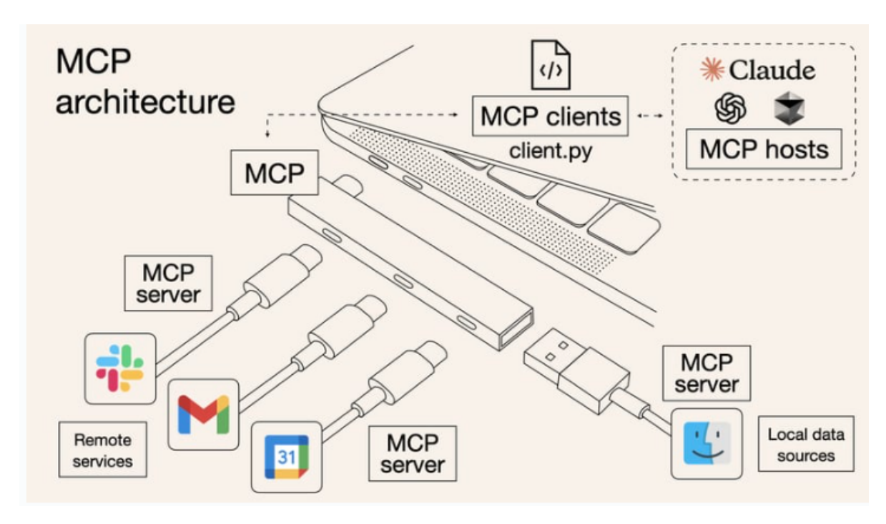
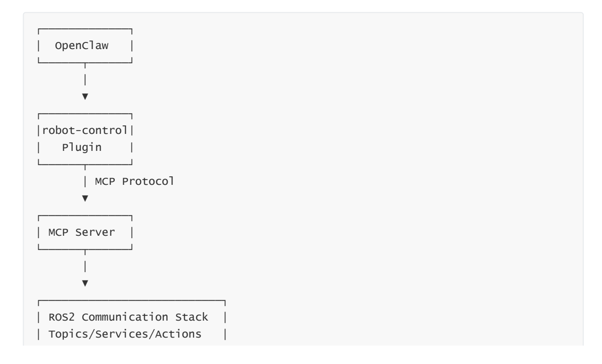
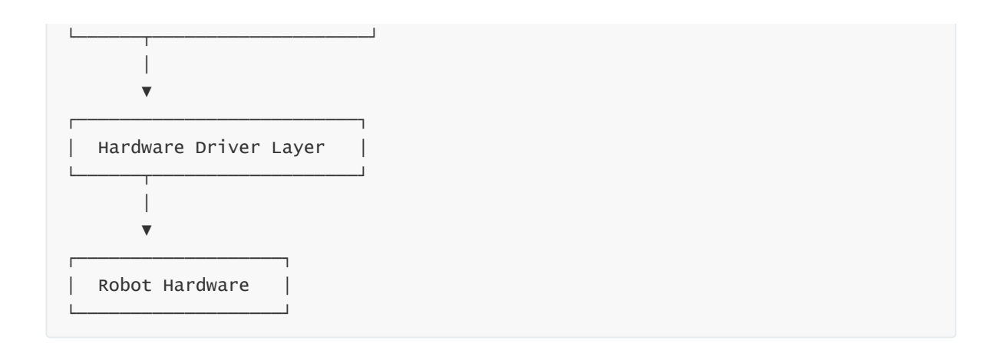
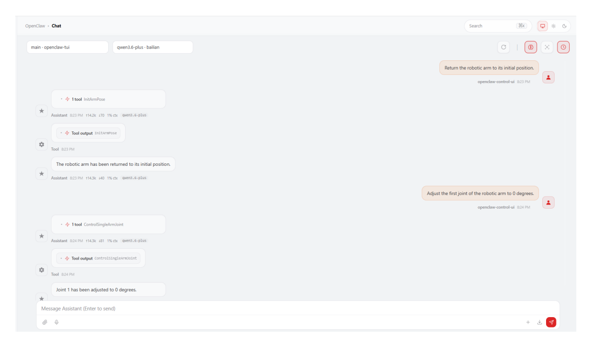

# **OpenClaw Integration with Robot MCP Interface**

#### **OpenClaw [Integration](#page-0-0) with Robot MCP Interface**

- <span id="page-0-0"></span>[1. Course](#page-0-1) Content
  - Course [Overview](#page-0-2)
  - Learning [Objectives](#page-0-3)
- [2. Preparation](#page-0-4)
- [3. Introduction](#page-0-5) to the MCP Protocol
- 4. OpenClaw Robot Control [Communication](#page-1-0) Architecture
- [5. Launching](#page-2-0) the MCP Service
- [6. Controlling](#page-2-1) the Robot with OpenClaw
- [7. Source](#page-3-0) Code Analysis
- <span id="page-0-1"></span>7.1 MCP [Service](#page-3-1)
  - 7.2 MCP [Tools](#page-4-0)
  - 7.3 MCP Message [Interface](#page-4-1)
- <span id="page-0-2"></span>[8. Summary](#page-5-0) of Robot MCP Functional Interfaces

## **1. Course Content**

### **Course Overview**

This lesson explains how to implement intelligent robot control using the OpenClaw framework and the MCP (Model Context Protocol) interface.

### **Learning Objectives**

- <span id="page-0-4"></span><span id="page-0-3"></span>1. Understand the basic principles of the MCP protocol.
- 2. Control the robot using OpenClaw.

## **2. Preparation**

Start the MicroROS chassis agent (if already started, no need to repeat the process)

sh start\_agent.sh

## **3. Introduction to the MCP Protocol**

- <span id="page-0-5"></span>MCP (Model Context Protocol) is an open protocol used to connect large language models with external tools and services. In this system, OpenClaw uses the MCP protocol to translate user natural language commands into specific robot operation commands.
- After the AI model parses the user's commands, it selects the corresponding MCP Tool for execution. The MCP service then translates the tool call into ROS2 Action commands, driving the robot chassis, robotic arm, and other hardware to perform actions.


[Image details](images/img_001.md)

<span id="page-1-0"></span>Through the ROSMASTER-M3Pro's MCP service interface, the robot can be connected to any AI model, agent, or AI tool that supports MCP, enabling robot control.

## **4. OpenClaw Robot Control Communication Architecture**

The communication architecture for the OpenClaw-controlled robot is divided into four layers:

- 1. **User Interaction Layer:** Sends natural language commands via interaction channels such as Web Chat, WeChat, Feishu, etc.
- 2. **AI Decision Layer:** The LLM within OpenClaw parses user intent and selects the corresponding MCP Tool.
- 3. **MCP Service Layer:** Operates based on the FastMCP framework; it registers over 20 tool functions—covering chassis movement, robotic arm control, visual recognition, etc.—and communicates with the robot hardware via ROS2 Actions, Topics, and Services.
- 4. **Robot Execution Layer:** The MicroROS chassis agent receives commands and drives the robot hardware—such as the chassis and robotic arm—to execute the specified actions.


[Image details](images/img_002.md)


[Image details](images/img_003.md)

## **5. Launching the MCP Service**

<span id="page-2-0"></span>Launch via Terminal

ros2 launch m3pro\_bringup mcp\_service.launch.py

## **6. Controlling the Robot with OpenClaw**

On your PC, open the Web Chat UI and log in while connected to the same local area network (LAN) as the robot's onboard computer.

#### [!NOTE]

- <span id="page-2-1"></span>For the interaction method with OpenClaw, you may select any of the options listed in the "02-openclaw Interaction Methods" section. For this demonstration, we will use the Web Chat interface as an example.
- Here, we will demonstrate and test OpenClaw's control capabilities using the robotic arm as an example:
- Return the robotic arm to its initial position.
- Adjust the first joint of the robotic arm to 0 degrees.


[Image details](images/img_004.md)

If you require the robot to provide spoken responses, you must also launch the openclaw\_bridge node and ensure that the OpenClaw voice tags feature is enabled.

ros2 run multi\_brains\_pre openclaw\_bridge

Once launched, the logs will indicate which speech synthesis model engine has been loaded.

## <span id="page-3-0"></span>**7. Source Code Analysis**

## **7.1 MCP Service**

Source Code Path:

<span id="page-3-1"></span>\$HOME/M3Pro\_ws/src/multi\_brains\_pre/multi\_brains\_pre/mcp\_service.py

mcp\_service.py serves as the entry point for the MCP service and primarily performs the following tasks:

- 1. Creates a FastMCP service instance, named "ROS-MCP-Service" .
- 2. Creates a ROS2 node via ROSContext and initiates background spinning.
- 3. Calls register\_actions() to register all robot control tools.
- 4. Starts the MCP service, listening on the specified host and port.

```
from fastmcp import FastMCP
from .action_controller import ROSContext
from .mcp_tools.mcp_action import register_actions
mcp_service = FastMCP(name="ROS-MCP-Service")
action_controller = ROSContext().create_node()
ROSContext.start_spin()
register_actions(mcp=mcp_service, action_controller=action_controller)
mcp_service.run(host=action_controller.MCP_HOST,
                port=action_controller.MCP_PORT,
                transport=action_controller.MCP_TRANSPORT)
```

## **7.2 MCP Tools**

Source Code Path:

```
$HOME/M3Pro_ws/src/multi_brains_pre/multi_brains_pre/mcp_tools/mcp_action.py
```

mcp\_action.py registers MCP Tools via the register\_actions() function.

All tools adhere to a unified registration pattern: they use the @mcp.tool() decorator to define their descriptions and timeout durations, employ Pydantic Fields to constrain parameter ranges, and return a common\_response dataclass. Let's take the chassis movement tool as an example:

```
@mcp.tool(description='''Control the robot's omnidirectional chassis
movement''', timeout=30.0)
def MoveWithSpeed(
    linear_x: float=Field(default=1.5, ge=-2.5, le=2.5),
    linear_y: float=Field(default=1.5, ge=-2.5, le=2.5),
    angular_z: float=Field(default=1.5, ge=-2.5, le=2.5),
    duration: float=Field(default=1.0)
) -> common_response:
    action_controller.set_cmdvel(linear_x, linear_y, angular_z, duration)
    return common_response(execution_result="success", reason="")
```

## **7.3 MCP Message Interface**

Source Code Path

```
$HOME/M3Pro_ws/src/multi_brains_pre/multi_brains_pre/message/mcp_message.py
```

mcp\_message.py uses Python dataclasses to define the request and response message formats for MCP Tools.

All MCP Tools consistently return a common\_response ; AI models determine whether an operation was successful based on the execution\_result field:

```
@dataclass
class common_response:
execution_result: str
reason: str
```

#### Other message types include:

- ArmJointAngles : The angles of the robot arm's 6 joints (arm\_joint\_1~5 + gripper)
- EndEffectorPose : The pose of the end effector (x, y, z, roll, pitch, yaw)
- BoxLocalization : Results of target detection bounding boxes
- PlacePoint : Coordinates and information regarding placement points
- <span id="page-5-0"></span>waste\_recognition\_result : Results of waste recognition detection

## **8. Summary of Robot MCP Functional Interfaces**

For details, please refer to the appendix located in this chapter's folder: **MCP Function Summary.md**