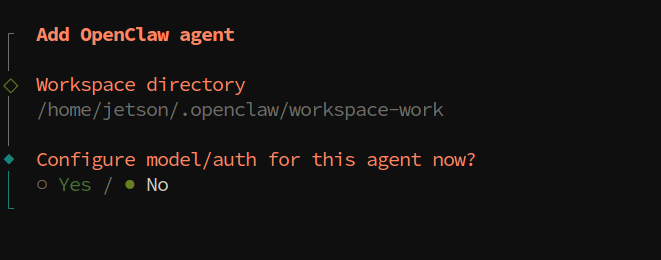
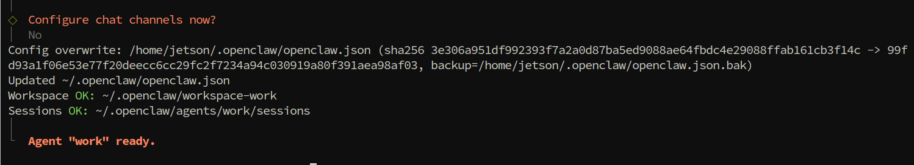
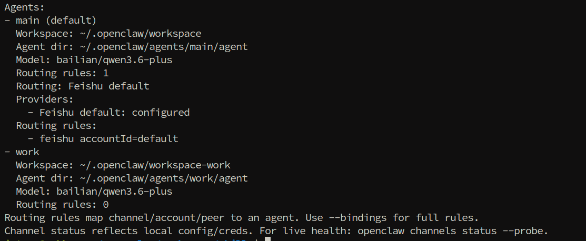
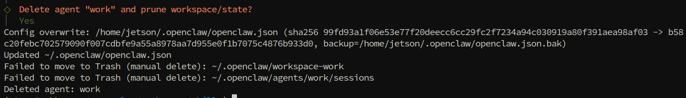

# **OpenClaw Multi-Agent Intelligent Agents**

### **OpenClaw [Multi-Agent](#page-0-0) Intelligent Agents**

- <span id="page-0-0"></span>[1. Course](#page-0-1) Content
  - Course [Overview](#page-0-2)
  - Learning [Objectives](#page-0-3)
- [2. Creating](#page-0-4) Agents
  - 2.1 [Creating](#page-1-0) Agents Using the CLI Wizard
  - 2.2 Agent [Directory](#page-1-1) Structure
  - 2.4 [Configuring](#page-2-0) Bindings
  - 2.5 Restarting the Gateway to Apply [Configuration](#page-3-0)
- [3. Editing](#page-3-1) Agent Prompts
  - 3.2 [Editing](#page-3-2) Steps
  - 3.3 Configuration [Example: Creating](#page-4-0) a Customer Support Bot Agent
- <span id="page-0-1"></span>[4. Deleting](#page-5-0) Agents
  - 4.1 Deleting via CLI [Commands](#page-5-1)
  - 4.2 Manually Cleaning Up Agent [Directories](#page-5-2)
  - 4.3 Cleaning Up Binding [Configurations](#page-5-3)

# **1. Course Content**

### **Course Overview**

- <span id="page-0-2"></span>OpenClaw's multi-agent intelligent agent feature allows multiple **isolated agents** to run within the same gateway. Each agent has its own independent workspace, state directory, and session history.
- The multi-agent architecture is suitable for scenarios with multiple roles, such as one agent responsible for programming development and another for social media operations, with data isolation and no interference between them.

# **Learning Objectives**

- <span id="page-0-3"></span>1. Understand the concept and applicable scenarios of OpenClaw multi-agent intelligent agents.
- 2. Master the creation of new agents using CLI commands.
- 3. Master the methods for editing agent prompt files (AGENTS.md / SOUL.md / IDENTITY.md, etc.).
- <span id="page-0-4"></span>4. Master the operation of deleting an agent.

# **2. Creating Agents**

OpenClaw runs one agent by default (agentId is main ). Additional isolated agents can be created using the following methods.

## <span id="page-1-0"></span>**2.1 Creating Agents Using the CLI Wizard**

OpenClaw provides the openclaw agents add command, which utilizes an interactive wizard to quickly create new agents:

```
openclaw agents add <agentId>
```

For example, to create a "work" agent named work :

```
openclaw agents add work
```

Upon execution, OpenClaw automatically performs the following actions:

- 1. Creates the agent directory: ~/.openclaw/agents/<agentId>/
- <span id="page-1-1"></span>2. Creates the workspace bootstrap files: including AGENTS.md , SOUL.md , IDENTITY.md , TOOLS.md , USER.md , etc.

# **2.2 Agent Directory Structure**

Once an agent is created, a complete file structure is generated within the ~/.openclaw/agents/<agentId>/ directory:

```
~/.openclaw/agents/<agentId>/
├── agent/
│ ├── auth-profiles.json # Authentication profiles
│ ├── config.json # Agent configuration
│ └── ...
└── sessions/ # Session history storage
   └── <SessionId>.jsonl
```

The agent's workspace files are located within their respective workspace directories, where you can edit the bootstrap files to define the agent's behavior and personality. ### 2.3 Verifying Agent Creation

Once creation is complete, you can view all agents and their binding statuses using the following command:

```
openclaw agents list --bindings
```

### **2.4 Configuring Bindings**

A *Binding* is a rule that routes messages from a channel account to a specific agent. Each binding consists of:

- <span id="page-2-0"></span>**agentId**: The ID of the target agent.
- **match**: The matching rule (based on channel, peer account, etc.).

Example Configuration ( openclaw.json ):

```
{
  "agents": {
    "list": [
      { "id": "main", "workspace": "~/.openclaw/workspace" },
      { "id": "work", "workspace": "~/.openclaw/workspace-work" }
    ]
  },
  "bindings": [
    {
      "agentId": "main",
      "match": { "channel": "whatsapp", "peer": { "kind": "direct", "id":
"+15551230001" } }
    },
    {
      "agentId": "work",
      "match": { "channel": "whatsapp", "peer": { "kind": "direct", "id":
"+15551230002" } }
    }
  ]
}
```

### <span id="page-3-0"></span>**2.5 Restarting the Gateway to Apply Configuration**

After creating agents or modifying binding configurations, you must restart the Gateway:

```
openclaw gateway restart
```

After restarting, verify the status of the agents and channels:

```
openclaw agents list --bindings
openclaw channels status --probe
```

# <span id="page-3-1"></span>**3. Editing Agent Prompts**

Each agent's personality, behavioral rules, and capabilities are defined through *Bootstrap Files* located within its workspace. By editing these files, you can customize the agent's prompts. ### 3.1 Introduction to Bootstrap Files

In the first turn of a new session, OpenClaw injects the following workspace files into the agent's context:

| File         | Purpose                                                                                     |
|--------------|---------------------------------------------------------------------------------------------|
| AGENTS.md    | Operational instructions and memory; defines the behavioral rules the<br>agent must follow. |
| SOUL.md      | Persona, boundaries, and tone; defines the agent's personality traits.                      |
| IDENTITY.md  | Agent name, vibe, and emoji identifier.                                                     |
| TOOLS.md     | User-maintained instructions and conventions for tool usage.                                |
| USER.md      | User profile and preferred forms of address.                                                |
| BOOTSTRAP.md | One-time initial setup ritual (can be deleted once completed).                              |

### **3.2 Editing Steps**

### **Step 1: Navigate to the Agent's Workspace Directory**

```
# Custom Agent Workspace (if a specific workspace was specified during creation)
cd ~/.openclaw/workspace-<agentId>
```

### **Step 2: Edit** SOUL.md **to Define the Agent's Personality**

### # Role Setting

You are a professional programming assistant, specializing in Python and ROS2 development.

### # Tone and Style

Maintain a professional and concise tone; respond in Chinese.

#### # Behavioral Boundaries

- Do not perform dangerous operations.
- Do not delete important user files.

### **Step 3: Edit** AGENTS.md **to Set Operational Instructions**

### # Operational Rules

- When answering questions, prioritize using the MCP Tool to retrieve the latest information.
- If you encounter uncertain information, proactively ask the user for confirmation.
- Before executing an action, first outline the steps you are about to perform.

### **Step 4: Edit** IDENTITY.md **to Define the Agent's Identity**

```
# Name
Code Assistant
# Emoji

# Bio
I am your dedicated programming assistant, ready to help you complete ROS2
development and Python programming tasks!
```

### **Step 5: Restart the Gateway to Apply Changes**

```
openclaw gateway restart
```

### [!TIP]

- The content of the bootstrap file is injected into the LLM context during the very first turn of a new session; therefore, you must start a new session to see the effects of any modifications.
- You can initiate a new session within the WebChat interface using the /new command.
- Empty files will be skipped and will not be injected into the context.
- <span id="page-4-0"></span>If a file is missing, OpenClaw will inject a placeholder line indicating "Missing File."

# **3.3 Configuration Example: Creating a Customer Support Bot Agent**

```
# SOUL.md
# Role Definition
You are a friendly customer support bot responsible for answering user inquiries
regarding robot products.
# Tone and Style
Enthusiastic, patient, and professional; respond in Chinese.
# Behavioral Boundaries
- Do not disclose internal system configuration information.
- Do not perform operations that compromise the security of the bot.
```

```
# AGENTS.md
# Operational Guidelines
- For product-related functional issues, first use `SeeWhat` to observe the
```

- current environment. - For technical issues, guide users to consult relevant tutorial documentation.
- <span id="page-5-1"></span><span id="page-5-0"></span>- For questions that cannot be answered, record the query and escalate it to technical personnel.

# **4. Deleting Agents**

# **4.1 Deleting via CLI Commands**

To delete an agent that is no longer needed, use the following command:

```
openclaw agents delete <agentId>
```

For example, to delete an agent named work :

```
openclaw agents delete work
```

### <span id="page-5-2"></span>**4.2 Manually Cleaning Up Agent Directories**

After executing the CLI command, it is recommended to also clean up the following residual data:

```
# Delete the agent's data directory
rm -rf ~/.openclaw/agents/<agentId>
# Delete the agent's workspace
rm -rf ~/.openclaw/workspace-<agentId>
```

# **4.3 Cleaning Up Binding Configurations**

After deleting an agent, you must also remove the corresponding binding records and agent list entries from the openclaw.json configuration file:

- <span id="page-5-3"></span>1. Open the configuration file: ~/.openclaw/openclaw.json
- 2. Remove the entry for the specific agent from agents.list .
- 3. Remove any binding rules related to that agent from bindings .
- 4. Save the file, then restart the gateway:

```
openclaw gateway restart
```

### [!WARNING]

Deleting an agent will **permanently remove** that agent's session history, authentication configurations, and all associated data.

- Before proceeding with the deletion, please ensure that you have backed up any important data.
- If the agent is currently running, it is recommended to first disable any associated channel bindings before performing the deletion.

---

## Extracted Images


### Page 2


[Image details](images/img_001.md)


[Image details](images/img_002.md)


### Page 3


[Image details](images/img_003.md)


### Page 6


[Image details](images/img_004.md)

