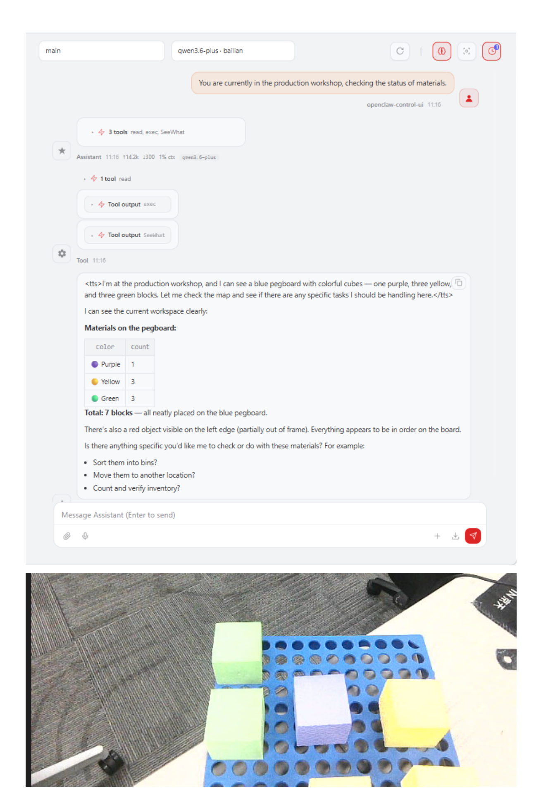

# **OpenClaw Active Interaction**

#### **OpenClaw [Active Interaction](#page-0-0)**

- <span id="page-0-0"></span>[1. Course](#page-0-1) Content
  - Course [Overview](#page-0-2)
  - [Preparation](#page-0-3)
- [2. Creating](#page-1-0) a New Skill
- [3. Creating](#page-2-0) a Skill for Handling Special Situations
- 4. Case [Demonstration](#page-2-1)
- <span id="page-0-1"></span>[5. Extended Applications](#page-3-0)
  - 5.1 Equipment Fault Pre-warning [and Handling](#page-4-0)
  - 5.2 [Environmental](#page-4-1) Safety Monitoring
  - 5.3 Production Progress Tracking [and Notifications](#page-5-0)
  - 5.4 [Multi-Condition](#page-5-1) Composite Trigger Strategy

### **1. Course Content**

#### **Course Overview**

- <span id="page-0-2"></span>Based on "skills," you will write response strategies for specific scenarios, enabling OpenClaw to actively provide solutions when encountering unexpected situations.
- This section is a course on solution design tailored to specific application scenarios; therefore, you must first master the prerequisite courses: [OpenClaw Basics], [OpenClaw Interaction Methods], and [OpenClaw Skills Development].

### **Preparation**

- <span id="page-0-3"></span>First, complete the [OpenClaw Skills Development] course section to master the process of creating new skills.
- Launch the MicroROS chassis agent (if it is already running, do not launch it again).

sh start\_agent.sh

Launch nodes such as the odometry, TF, manipulator assistance, and camera nodes.

```
ros2 launch m3pro_bringup car_base.launch.py
```

Launch the MCP service.

```
ros2 launch m3pro_bringup mcp_service.launch.py
```

If you require voice responses, you must additionally launch openclaw\_bridge ; otherwise, this step may be skipped.

```
ros2 run multi_brains_pre openclaw_bridge
```

### **2. Creating a New Skill**

<span id="page-1-0"></span>Refer to the content in [OpenClaw Skills Development].

### <span id="page-2-0"></span>**3. Creating a Skill for Handling Special Situations**

```
---
name: Production Line Material Shortage Handling Process
description: When performing inspection tasks, provides a preset handling process
for situations involving material shortages.
version: 1.0.1
---
## Production Workshop Colored Material Shortage Handling Plan
- Actively offers a solution to the user via a verbal inquiry; the corresponding
response strategy will be executed only after explicit confirmation from the
user.
## Option 1: Replenish from the raw material warehouse shelves
## Option 2: Proceed to the storage area and replenish using materials of the
same specifications but a different color
```

After creation is complete, restart the OpenClaw gateway for the changes to take effect

openclaw gateway restart

### **4. Case Demonstration**

[!NOTE]

<span id="page-2-1"></span>You may write the commands yourself according to your specific needs. The following serves as a case demonstration; you may choose any interaction method you prefer. Here, the WebChat interface is used as an example.


[Image details](images/img_001.md)

## **5. Extended Applications**

<span id="page-3-0"></span>OpenClaw's proactive interaction capabilities can be applied to a wide variety of scenarios. The following provides several reference examples for custom solutions:

#### **5.1 Equipment Fault Pre-warning and Handling**

<span id="page-4-0"></span>-- name: Equipment Anomaly Handling Process description: Proactively provides diagnostic and remedial suggestions when abnormal equipment operating parameters are detected version: 1.0.0 --- ## Proactive Equipment Anomaly Warning Solution - Monitors equipment operating status in real-time; proactively alerts the user when anomalies are detected - Provides tiered handling suggestions: notifications for minor anomalies, and recommendations for immediate shutdown in cases of severe anomalies - Corresponding handling strategies are executed only after explicit confirmation by the user ## Handling Option 1: Parameter Calibration - Verify the accuracy of sensor readings - Execute the equipment's self-diagnostic program - Calibrate deviation parameters ## Handling Option 2: Shutdown and Maintenance - Immediately halt equipment operation - Notify maintenance personnel to report to the site - Log fault details for subsequent analysis

#### **5.2 Environmental Safety Monitoring**

<span id="page-4-1"></span>-- name: Environmental Safety Monitoring Strategy description: Proactively implements safety measures when environmental parameters exceed safety thresholds version: 1.0.0 --- ## Proactive Environmental Safety Monitoring Solution - Continuously monitors environmental parameters such as temperature, humidity, and gas concentration levels - - Immediately issue an alert to the user upon detection of a hazardous situation - Provide emergency response protocols, requiring user confirmation before execution ## Emergency Protocol 1: Ventilation and Air Exchange - Activate the exhaust ventilation system - Open doors and windows to facilitate airflow - Continuously monitor air quality until normal levels are restored ## Emergency Protocol 2: Emergency Evacuation - Trigger the alarm system - Guide personnel to evacuate in an orderly manner - Contact professional emergency response agencies

#### **5.3 Production Progress Tracking and Notifications**

<span id="page-5-0"></span>-- name: Proactive Production Progress Notifications description: Periodically check the status of production tasks and proactively notify users at key milestones version: 1.0.0 --- ## Proactive Production Progress Tracking Strategy - Periodically query the completion status of tasks on the production line - Proactively notify users at key milestones (e.g., material shortages, schedule delays, task completion) - Provide recommendations for next steps/actions ## Notification Policies - Materials Nearing Depletion: Provide a replenishment reminder 2 hours in advance - Schedule Behind Plan: Analyze the root cause and offer recommendations for expediting work - Task Successfully Completed: Generate a completion report and notify relevant personnel

#### **5.4 Multi-Condition Composite Trigger Strategy**

<span id="page-5-1"></span>-- name: Intelligent Response to Composite Conditions description: Combine multi-dimensional conditions—such as time, environment, and equipment status—to provide intelligent, proactive services version: 1.0.0 --- ## Multi-Dimensional Condition Response Strategy - Comprehensively analyze data from various sensors alongside business logic - Proactively trigger a response when a specific combination of conditions is met - Provide personalized recommendations for handling the situation ## Trigger Condition Examples - Time Condition: During the night shift (22:00 – 06:00) - Environmental Condition: Temperature exceeds 35°C AND humidity falls below 30% - Equipment Condition: Continuous operation for more than 8 hours ## Response Policies - Proactively recommend equipment downtime for maintenance - Alert staff members to potential environmental safety risks - Automatically adjust equipment operating parameters to an energy-saving mode