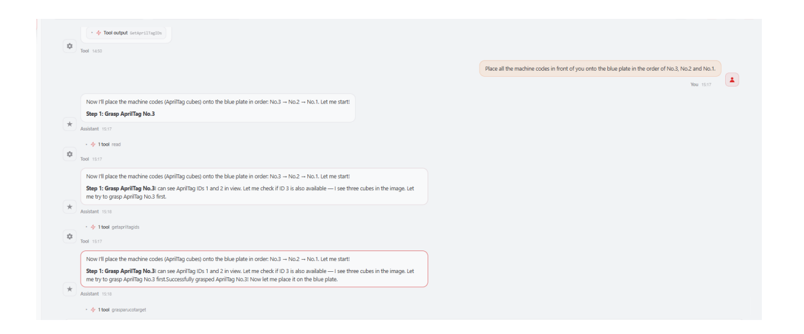
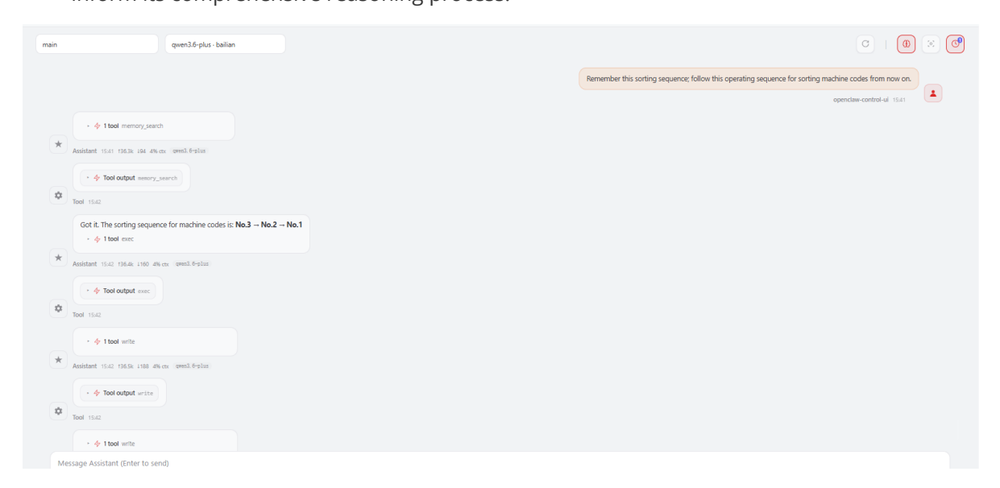

# **OpenClaw Vector Memory**

#### **OpenClaw [Vector Memory](#page-0-0)**

[1. Course](#page-0-1) Content

Course [Overview](#page-0-2)

<span id="page-0-0"></span>What is Vector [Memory?](#page-0-3)

How It [Works](#page-0-4)

Use [Cases](#page-1-0)

[Workflow](#page-1-1)

<span id="page-0-2"></span><span id="page-0-1"></span>[Features](#page-1-2)

- [2. Preparation](#page-1-3)
- 3. Memory Function [Demonstration](#page-2-0) Case
- [4. Retrieving](#page-3-0) Memories via Vector Search
  - 4.1 [Preparation](#page-4-0)
  - 4.2 Configuring the [Embeddings](#page-4-1) Model API Key
  - 4.3 [Verifying](#page-4-2) Vector Memory

## **1. Course Content**

### **Course Overview**

OpenClaw possesses powerful memory capabilities, enabling robots to remember important information during dialogue and intelligently retrieve and use this memory in subsequent interactions. This section introduces OpenClaw's Vector Memory (Semantic Memory) system, an intelligent memory retrieval mechanism based on semantic understanding.

#### **What is Vector Memory?**

Vector Memory is OpenClaw's built-in **semantic search memory system**. It achieves intelligent memory retrieval through the following core technologies:

- <span id="page-0-3"></span>**Vector Embeddings:** Converts memory documents into high-dimensional vector representations, enabling the computer to understand the semantic meaning of the text.
- **Semantic Retrieval:** Matches queries based on semantic similarity—rather than mere keyword matching—allowing it to understand synonyms and related concepts.

#### **How It Works**

#### <span id="page-0-4"></span>1. **Vectorization Processing**

- Converts the contents of MEMORY.md and files within the memory/\*.md directory into vector representations.
- Supports semantic understanding, going beyond simple keyword matching.

#### 2. **Semantic Retrieval**

- Matches queries based on their semantic meaning, rather than exact keywords.
- Returns the most relevant text snippets along with their location information.

#### <span id="page-1-0"></span>**Use Cases**

| Scenario                    | Example                                         |
|-----------------------------|-------------------------------------------------|
| Recalling Past Decisions    | "The previous decision regarding sorting order" |
| Finding Relevant Experience | "How to handle a robotic arm grasping failure"  |
| Task Context                | "The project the user mentioned last week"      |
| Personal Preferences        | "The user's preferred interaction style"        |

#### **Workflow**

```
User Query → memory_search(Semantic Query) → Return Relevant Snippets →
memory_get(Read Specific Location) → Generate Response
```

#### **Features**

- <span id="page-1-2"></span>**Intelligent Matching:** Understands synonyms and related concepts.
- **Automatic Referencing:** Search results include the file path and line number.
- **Complements File Memory:** Vector Memory is used for retrieval, while File Memory is used for persistent storage.

## **2. Preparation**

- <span id="page-1-3"></span>First, study the [OpenClaw Skills Development] section to master the process of creating new skills.
- Start the MicroROS chassis agent (if it is already running, do not restart it).

```
sh start_agent.sh
```

Launch nodes such as the odometry, TF, robotic arm assistance, and camera nodes.

ros2 launch m3pro\_bringup car\_base.launch.py

Launch the MCP Service

ros2 launch m3pro\_bringup mcp\_service.launch.py

If you require voice responses, you must additionally launch openclaw\_bridge ; otherwise, this step can be omitted.

ros2 run multi\_brains\_pre openclaw\_bridge

## **3. Memory Function Demonstration Case**

[!TIP]

<span id="page-2-0"></span>The case presented here serves solely as a demonstration reference; you are free to engage in conversations according to your own specific needs. The following illustrates a demonstration scenario, using WebChat as an example.


[Image details](images/img_001.md)

In this example, we instruct the robot to memorize the current sorting workflow. Subsequently, during future conversations, we can request that the robot execute sorting tasks based on this previously established workflow. Alternatively, when encountering similar tasks, the robot will retrieve relevant memory fragments from its memory bank to inform its comprehensive reasoning process.


[Image details](images/img_002.md)

OpenClaw's memory content is stored in a file located at the following path; you can inspect this file to view the specific content memorized during the case demonstrated above:

```
cat $HOME/.openclaw/workspace/MEMORY.md
```

## **4. Retrieving Memories via Vector Search**

<span id="page-3-0"></span>OpenClaw supports the slicing and retrieval of memory documents using vector-based methods. This approach is particularly well-suited for performing semantic searches within large-scale memory archives.

#### [!TIP]

OpenClaw's built-in default method is **full-text search mode**, which is suitable for the vast majority of use cases. If you have higher requirements regarding memory capabilities, you can refer to the tutorial below to enable **vector memory mode** by integrating an external **embeddings** model.

## **4.1 Preparation**

<span id="page-4-0"></span>You need to register an account with a provider that offers **embeddings** models. The demonstration below uses the **OpenRouter** platform as an example; for account registration and API key application instructions, please refer to the tutorial: [AI Large Model Development — Registering Model Service Accounts — 3. OpenRouter Platform Account].

## **4.2 Configuring the Embeddings Model API Key**

<span id="page-4-1"></span>Set the model provider (using the OpenAI API protocol):

openclaw config set agents.defaults.memorySearch.provider "openai"

Set the baseUrl . Here, OpenRouter is used as an example; if you are using an **embeddings** model from a different provider, replace this with the actual baseUrl for that provider:

openclaw config set agents.defaults.memorySearch.remote.baseUrl "https://openrouter.ai/api/v1"

Set the **embeddings** model name. Here, "openai/text-embedding-3-small" is used as an example; if you are using a different **embeddings** model, replace this with the actual model name:

openclaw config set agents.defaults.memorySearch.model "openai/text-embedding-3 small"

Set the **embeddings** model's API Key:

openclaw config set agents.defaults.memorySearch.remote.apiKey "sk-or-v1- 133949f96bec556343539a587f53d077xxxxxxxxxxxxxxxx"

Restart the OpenClaw gateway for the changes to take effect:

openclaw gateway restart

## **4.3 Verifying Vector Memory**

<span id="page-4-2"></span>Check the status of the vector memory configuration to ensure it is active. If the output appears as shown below, the configuration was successful (the "Vector" field indicates the file path of the data slices):

openclaw memory status --deep

After completing the initial configuration, you may manually update the index once:

```
openclaw memory index --force
```

Test whether the memory retrieval function can successfully retrieve the memory snippets from the demonstration case described above.

```
openclaw memory search "Machine Code"
```

Here, 0.415 represents the semantic relevance score; a higher score indicates a higher degree of semantic similarity. Typically, results with a score greater than 0.3 are considered to have good relevance.