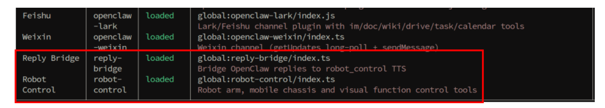
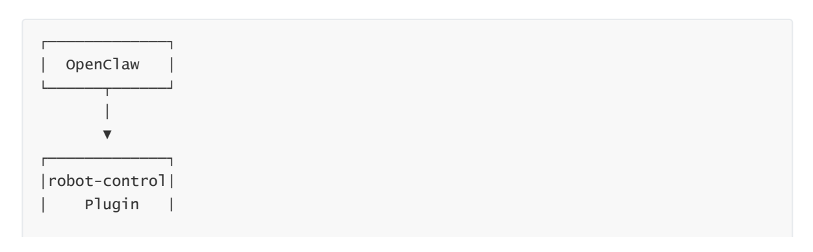
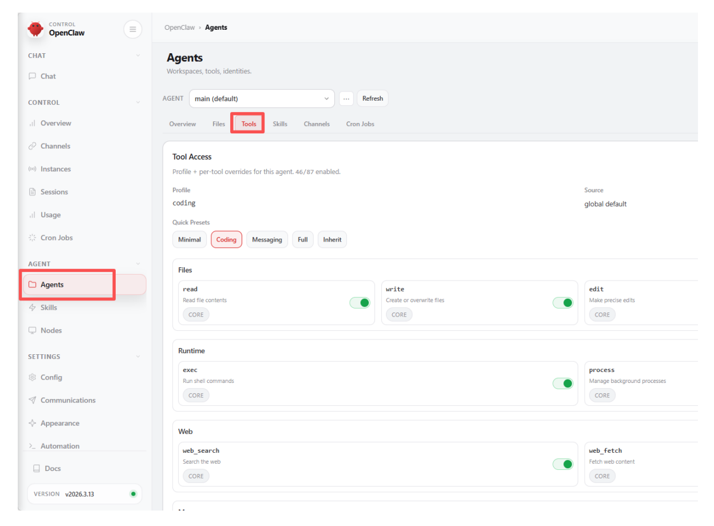
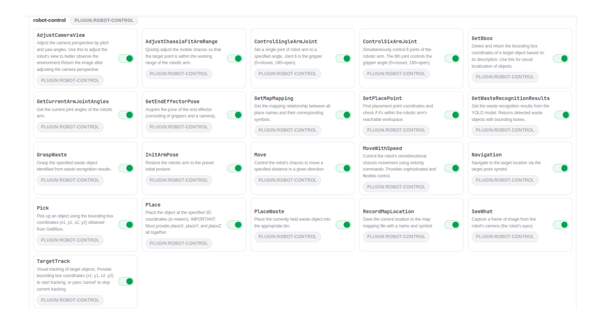
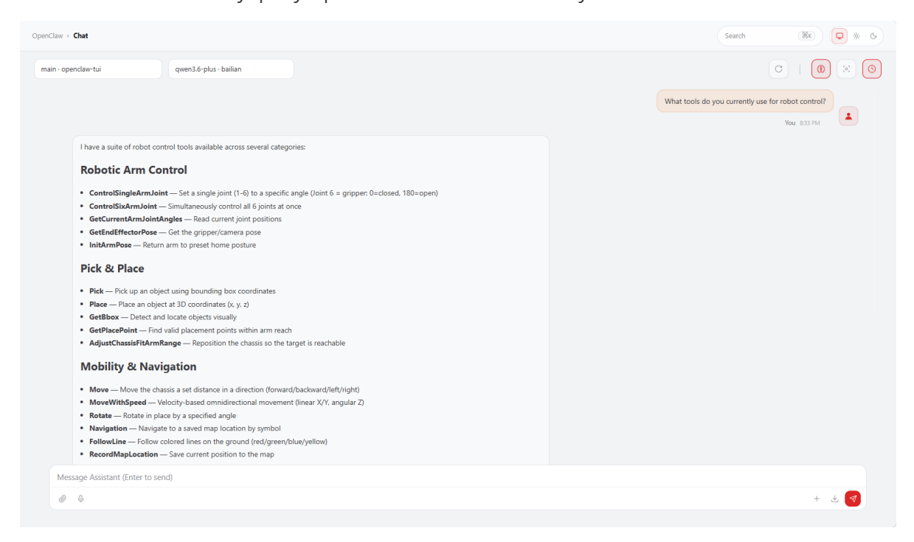

# **Robot-Control Plugin Tool**

#### **[Robot-Control Plugin](#page-0-0) Tool**

- <span id="page-0-0"></span>[1. Course](#page-0-1) Content
  - Course [Overview](#page-0-2)
  - Learning [Objectives](#page-0-3)
- [2. Preparation](#page-0-4)
- [3. OpenClaw](#page-1-0) Plugins
- [4. Introduction](#page-1-1) to the robot-control Plugin
- 5. Plugin Tool [Management](#page-2-0)
- <span id="page-0-1"></span>[6. Source](#page-3-0) Code Analysis
  - 6.1 Plugin Entry Point and Tool [Registration](#page-3-1)
  - 6.2 MCP Client [Communication](#page-4-0)

### **1. Course Content**

#### **Course Overview**

- <span id="page-0-2"></span>The robot-control plugin is the core plugin for OpenClaw robot control. It acts as a bridge between OpenClaw AI and robot hardware, translating user's natural language commands into specific robot operation commands via the MCP protocol.
- The plugin encapsulates over 20 robot control
- tools, including chassis movement, robotic arm control, vision recognition, navigation and positioning, and waste sorting, providing a unified management interface and API.

#### **Learning Objectives**

- <span id="page-0-3"></span>1. Understand the role and function of the robot-control plugin within the OpenClaw framework.
- 2. Master the installation, viewing, and basic management operations of the plugin.
- 3. Understand the working principle of the plugin communicating with the robot via the MCP protocol.
- <span id="page-0-4"></span>4. Be able to manage and call robot control tools through the OpenClaw WebChat interface.

# **2. Preparation**

Start the MicroROS chassis agent (if already started, no need to start again)

sh start\_agent.sh

Start the odometry, tf, robotic arm assistance, camera nodes, etc.

ros2 launch m3pro\_bringup car\_base.launch.py

Start the MCP service

ros2 launch m3pro\_bringup mcp\_service.launch.py

# **3. OpenClaw Plugins**

<span id="page-1-0"></span>Introduction to Plugin Functionality

The OpenClaw plugin system is part of the OpenClaw... The platform's functionality extension mechanism allows OpenClaw to add various capabilities by installing different plugins. Currently, the core plugins related to robot control include:

- **Robot-Control Plugin**: The core plugin for robot control, providing a comprehensive suite of robot operation functions such as chassis movement, robotic arm control, visual recognition, and navigation/localization.
- **Reply-Bridge Plugin**: A speech synthesis bridging plugin used to parse OpenClaw's speech tags, automatically performing speech synthesis and broadcasting the output.
- View Installed Plugins

```
openclaw plugins list
```


[Image details](images/img_001.md)

<span id="page-1-1"></span>In the plugin list, "Robot-Control" is the plugin used by OpenClaw to control the robot, while the "Reply-Bridge" plugin is used to parse OpenClaw's speech tags and automatically handle speech synthesis and broadcasting.

# **4. Introduction to the robot-control Plugin**

The robot-control plugin is the core robot control plugin officially provided by OpenClaw. Its operational mechanism is as follows:

- **Communication Mechanism**: After the LLM within OpenClaw parses a user's natural language instruction, it utilizes the robot-control plugin to invoke the MCP protocol interface. This passes the instruction to the MCP server, which then uses the ROS2 communication stack to control the robot's hardware and execute the requested action.
- **Toolset**: The plugin registers over 20 "MCP Tools" that correspond exactly to the available CLI command tools, covering functions such as chassis movement, robotic arm control, visual recognition, navigation/localization, waste sorting, and voice broadcasting.
- **Extensibility**: When paired with the Reply-Bridge plugin, it enables speech synthesis and broadcasting capabilities, thereby endowing the robot with the ability to engage in voicebased interactions.

The plugin's communication architecture is illustrated below:


[Image details](images/img_002.md)

```
└──────┬──────┘
       │ MCP Protocol
       ▼
┌─────────────┐
│ MCP Server │
└──────┬──────┘
```

# **5. Plugin Tool Management**

<span id="page-2-0"></span>Log in to the OpenClaw WebChat interface, then navigate to **Agent** > **Tools**.


[Image details](images/img_003.md)

- Scroll down to locate the robot-control plugin tool list; here, you can view and manage all available plugin tools.
- By default (out of the box), all plugin functions within robot-control are enabled (these functions correspond to the MCP and CLI interfaces).
- If you need to manually disable a specific tool, simply click to toggle it off; then, click **Save** to save the changes and restart the OpenClaw gateway.


[Image details](images/img_004.md)

You can also directly query OpenClaw to view the currently available robot control tools.


[Image details](images/img_005.md)

### <span id="page-3-0"></span>**6. Source Code Analysis**

### **6.1 Plugin Entry Point and Tool Registration**

Source Code Directory:

<span id="page-3-1"></span>\$HOME/.openclaw/extensions/robot-control/index.ts

The plugin source code is located in the index.ts file within the plugin directory. It utilizes the registerRobotControlTools function as its entry point to register all robot control tools using the OpenClaw Plugin SDK. Let's take the Move (Chassis Movement) tool as an example:

```
export default function registerRobotControlTools(api: OpenClawPluginApi) {
  // Load SeeWhat channel configuration at startup
  void loadSeeWhatConfig(api.config as Record<string, unknown> | undefined);
  api.registerTool(
    {
      name: "Move",
      label: "Move",
      description: "Control the robot's chassis to move a specified distance.",
      parameters: MoveSchema,
      async execute(_toolCallId, params) {
        try {
          const args = buildArgs({ "distance": params.distance, "direction":
params.direction });
          const result = await callRobotControl("Move", args);
          return json(result);
        } catch (err) {
          return json({ error: err instanceof Error ? err.message : String(err)
});
        }
      },
    },
    { name: "Move" },
  );
  // ... Other tool registrations
}
```

#### Code Explanation:

- 1. api.registerTool() : The tool registration method provided by the SDK, used to pass the tool definition (including name , description , parameters Schema, and the execute function) along with associated metadata.
- 2. **Parameters Schema**: Defines the parameter structure and constraints using Type.Object() from the @sinclair/typebox library.
- <span id="page-4-0"></span>3. **Execution Function**: The buildArgs function converts the parameters into a CLIcompatible format, and callRobotControl is then used to invoke the robot control interface.

#### **6.2 MCP Client Communication**

Internally, the plugin encapsulates an McpClient class to facilitate JSON-RPC communication with the MCP server over the HTTP protocol:

```
const MCP_ENDPOINT = "http://localhost:8000/mcp";
class McpClient {
  private sessionId: string | null = null;
  private initialized = false;
  async ensureInitialized(): Promise<void> {
    if (this.initialized) return;
```

```
await this.sendRequest("initialize", {
      protocolVersion: "2025-03-26",
      capabilities: {},
      clientInfo: { name: "openclaw-plugin", version: "1.0.0" },
    });
    await this.sendNotification("notifications/initialized");
    this.initialized = true;
  }
  async callTool(name: string, args: Record<string, unknown>) {
    await this.ensureInitialized();
    return await this.sendRequest("tools/call", { name, arguments: args });
  }
}
```

#### Code Description:

- 1. McpClient : Maintains the MCP session state; it automatically initializes upon the first invocation and sends tool call requests via the JSON-RPC protocol.
- 2. callRobotControl **Helper Function**: Encapsulates the complete tool calling workflow, translating CLI-style arguments into the MCP parameter format. It prioritizes direct invocation via MCP but automatically falls back to CLI command execution in the event of a failure, thereby ensuring high availability.
- 3. **Dual-Channel Fault Tolerance**: Automatically falls back to the robot\_control CLI command if the direct HTTP call to MCP fails, thereby ensuring the reliability of tool invocations.