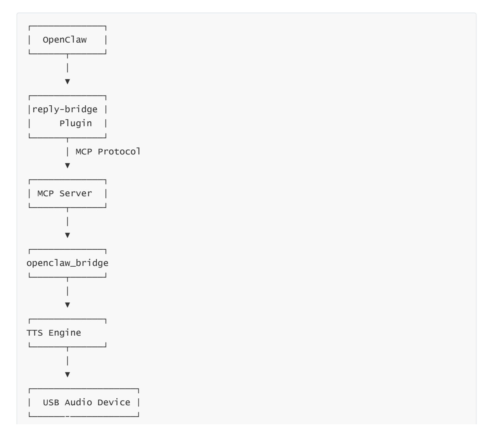

# **Reply-Bridge Plugin Tool**

#### **[Reply-Bridge Plugin](#page-0-0) Tool**

- <span id="page-0-0"></span>[1. Course](#page-0-1) Content
  - Course [Overview](#page-0-2) Learning [Objectives](#page-0-3)
- [2. Prerequisites](#page-0-4)
- [3. Introduction](#page-1-0) to the reply-bridge Plugin
- [4. Demonstration](#page-2-0) Case
- <span id="page-0-1"></span>[5. Source](#page-2-1) Code Analysis
  - 5.1 Plugin Entry Point [and Hook Registration](#page-2-2)

### **1. Course Content**

#### **Course Overview**

- <span id="page-0-2"></span>The Reply-Bridge plugin is a speech synthesis bridging plugin for OpenClaw. It listens to OpenClaw's AI reply messages, parses the <tts>...</tts> speech tags, automatically calls the MCP server's TTS tool for speech synthesis, and plays the speech through a USB audio device.
- When used in conjunction with the robot-control plugin, this enables voice-based conversational interaction for the robot, allowing it to "speak."

### **Learning Objectives**

- <span id="page-0-3"></span>1. Understand the functionality of the reply-bridge plugin.
- 2. Master the installation, inspection, and basic management operations for the plugin.
- 3. Comprehend the underlying principles of how the plugin utilizes the MCP protocol to invoke TTS (Text-to-Speech) synthesis.
- <span id="page-0-4"></span>4. Be able to implement voice broadcasting capabilities within OpenClaw interaction scenarios using the <tts> tag.

# **2. Prerequisites**

Launch the MicroROS chassis agent (if already running, do not launch again).

sh start\_agent.sh

Launch the MCP service.

ros2 launch m3pro\_bringup mcp\_service.launch.py

Launch the openclaw-bridge node.

ros2 run multi\_brains\_pre openclaw\_bridge

# **3. Introduction to the** reply**-**bridge **Plugin**

The reply-bridge plugin is an official OpenClaw plugin designed to bridge text-to-speech synthesis. Its operational mechanism is as follows:

- <span id="page-1-0"></span>**Listening Mechanism:** The plugin registers two hooks— before\_message\_write and message\_sending —to monitor for <tts>...</tts> tags within AI response messages.
- **Text Extraction:** When an AI response contains the format <tts>tagged text</tts> , the plugin automatically extracts the text content enclosed within the tags.
- **Speech Synthesis:** Utilizing its built-in MCP client, the plugin invokes the TTS tool on the MCP server to convert the extracted text into speech.
- **Audio Broadcasting:** The MCP server calls the TTS engine via the openclaw\_bridge node, ultimately broadcasting the synthesized speech through a USB audio device.
- **Deduplication Mechanism:** The plugin features a built-in session-level deduplication mechanism to prevent the repetition of identical TTS segments. Text content is not repeated during a conversation, thereby avoiding speech redundancy.

The plugin communication architecture is as follows:


[Image details](images/img_001.md)

### **4. Demonstration Case**

<span id="page-2-2"></span><span id="page-2-1"></span><span id="page-2-0"></span>Refer to the sections: [02-openclaw Interaction Methods] — [03-openclaw Voice Conversation Interaction]

# **5. Source Code Analysis**

### **5.1 Plugin Entry Point and Hook Registration**

Source Code Directory:

```
$HOME/.openclaw/extensions/reply-bridge/index.ts
```

The plugin's source code is located at index.ts within the plugin directory. It utilizes the registerReplyBridge function as its entry point to register event-listening hooks via the OpenClaw Plugin API. The core code is as follows:

```
export default function registerReplyBridge(api: OpenClawPluginApi) {
  // Hook: before_message_write — Triggered whenever a message is written to the
session log.
  api.on("before_message_write", (event, ctx) => {
    const message = event.message as AgentMessage;
    const sessionId = ctx.sessionId;
    // Process messages from the 'assistant' role only.
    if (message.role !== "assistant") return;
    const text = extractTextFromAgentMessage(message);
    if (!text) return;
    const ttsTexts = extractTtsTags(text);
    if (ttsTexts.length === 0) return;
    api.logger.info(`[reply-bridge] extracted ${ttsTexts.length} TTS
segment(s)`);
    sendTtsTextsFireAndForget(ttsTexts, sessionId, (msg) =>
api.logger.info(msg));
  });
  api.logger.info("reply-bridge: Plugin registered (hooks: before_message_write,
message_sending)");
}
```

#### Code Explanation:

- 1. **Registration Entry Point**: export default function registerReplyBridge(api) serves as the plugin's default export function; OpenClaw automatically invokes this function during plugin loading, passing in an instance of OpenClawPluginApi .
- 2. api.on("before\_message\_write") : Registers a hook that triggers *before* a message is written. This fires when the AI generates a response and writes it to the conversation history, serving as the primary channel for TTS processing.
- 3. **Role Filtering**: The condition message.role !== "assistant" ensures that only response messages from the AI assistant are processed, while user messages are ignored.

- 4. **Extraction Workflow**: extractTextFromAgentMessage → extractTtsTags → sendTtsTextsFireAndForget . These three steps complete the entire pipeline, spanning from the initial message text to the final TTS playback.
- 5. **"Fire-and-Forget" Mode**: The TTS invocation employs a "fire-and-forget" pattern; it does not block the message-writing process, thereby ensuring a smooth user experience.

#### **5.2 TTS Tag Extraction and Deduplication Mechanism**

The code responsible for extracting the content of <tts> tags from the AI's response text is as follows:

```
/**
 * Extracts plain text fragments wrapped within `<tts>...</tts>` tags.
 * Uses `indexOf` instead of regular expressions to avoid boundary issues
associated with pattern matching.
 */
function extractTtsTags(content: string): string[] {
  const matches: string[] = [];
  const openTag = "<tts>";
  const closeTag = "</tts>";
  let start = 0;
  while (true) {
    const openIdx = content.indexOf(openTag, start);
    if (openIdx === -1) break;
    const closeIdx = content.indexOf(closeTag, openIdx + openTag.length);
    if (closeIdx === -1) break;
    const text = content.slice(openIdx + openTag.length, closeIdx).trim();
    if (text) matches.push(text);
    start = closeIdx + closeTag.length;
  }
  return matches;
}
```

#### Code Explanation:

- 1. extractTtsTags() : Scans the text segment by segment using indexOf to extract all content enclosed within <tts>...</tts> tags. indexOf was chosen over regular expressions to avoid edge cases related to special characters and nested pattern matching, thereby enhancing parsing stability.
- 2. **Deduplication Mechanism**: Utilizes sentTtsTexts ( Map<string, Set<string>> ) to track the text segments that have already been spoken within each session; this ensures that the same text is not repeated during a single session, thereby preventing speech redundancy.