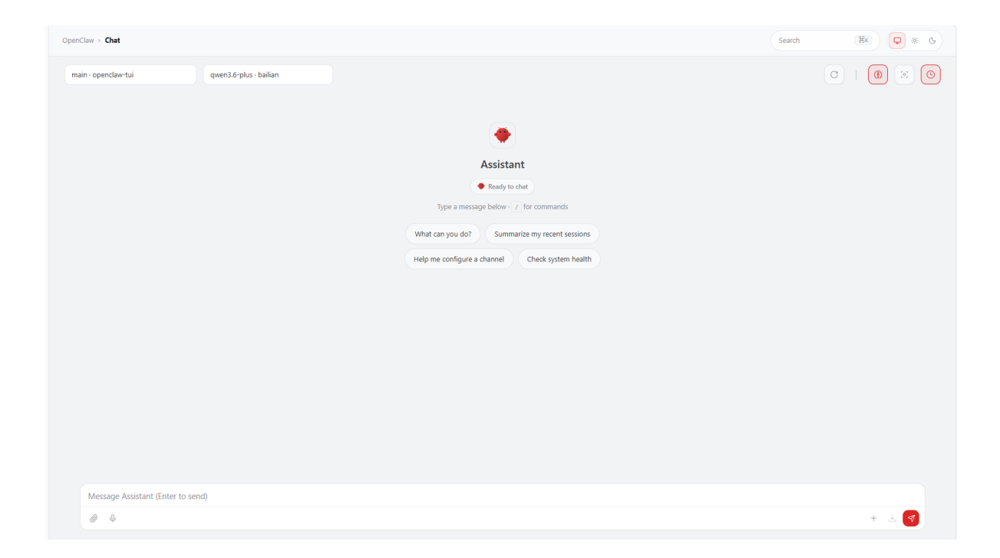
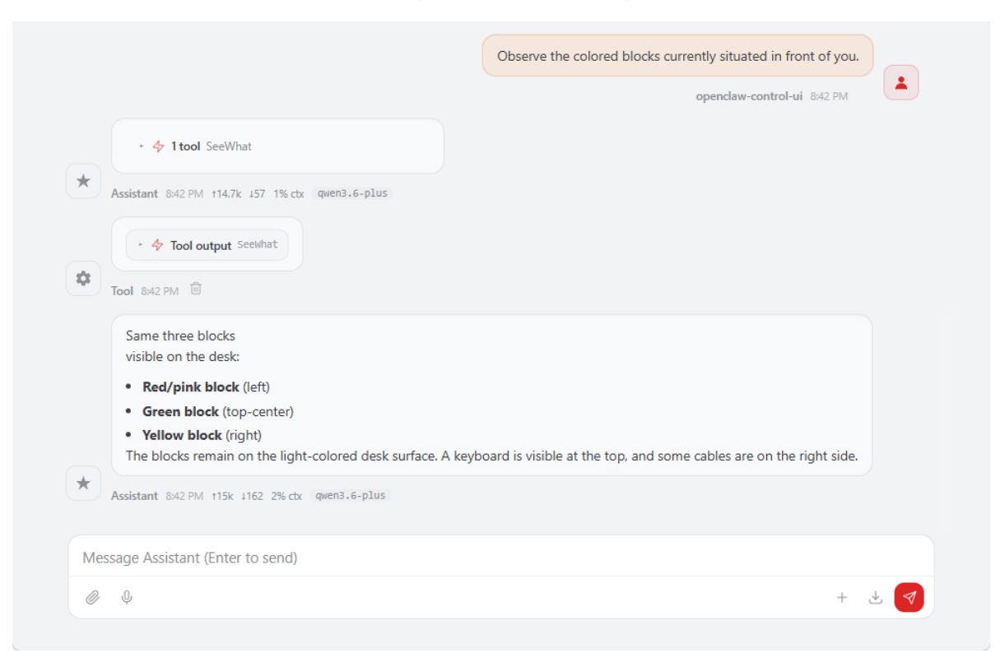
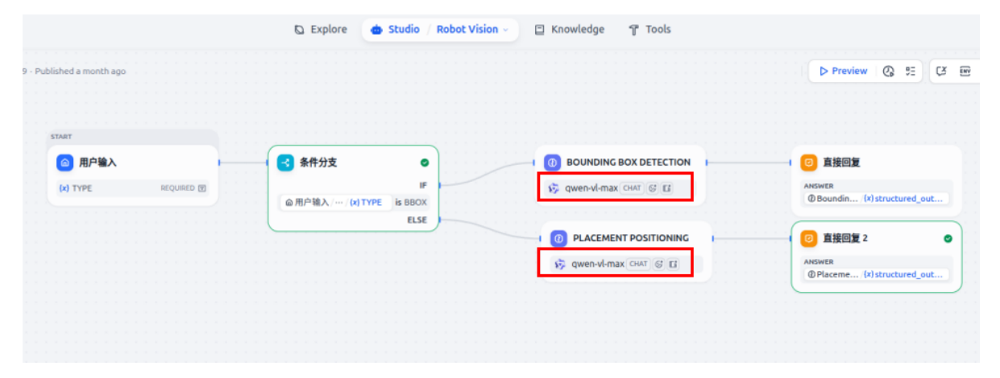

# **OpenClaw Multimodal Vision**

#### **OpenClaw [Multimodal Vision](#page-0-0)**

- <span id="page-0-0"></span>[1. Course](#page-0-1) Content
  - Course [Overview](#page-0-2)
  - Learning [Objectives](#page-0-3)
- [2. Preparation](#page-0-4)
- [3. Vision-related control](#page-1-0) interfaces
- 4. Case [Demonstration](#page-1-1)
  - 4.1 Initiating OpenClaw [Interaction](#page-1-2)
  - 4.2 Visual Observation [and Comprehension](#page-2-0)
  - 4.3 Configuring SeeWhat's [Automatic Sending](#page-3-0) Channels
    - 4.3.1 Configuring the [WhatsApp Channel](#page-3-1)
  - 4.4 Retrieving Target Bounding Box [Coordinates](#page-4-0)
  - 4.5 Obtaining Placement Point [Coordinates](#page-5-0)
- [5. Source](#page-5-1) Code Analysis
  - 5.1 SeeWhat() [Capturing](#page-5-2) Camera Images
  - 5.2 GetBbox() Retrieving Target Bounding Box [Coordinates](#page-6-0)
  - 5.3 [GetPlacePoint\(\)](#page-7-0) Get Placement Point Coordinates
  - 5.4 [\\_request\\_dify\\_agent\(\)](#page-8-0) Dify Agent communication (internal method)
- [6. Functional](#page-9-0) Q&A
  - 6.1 What should I do if the visual model fails to [accurately](#page-9-1) select the target object?
- <span id="page-0-2"></span><span id="page-0-1"></span>7. Common Issues [and Solutions](#page-9-2)

## **1. Course Content**

### **Course Overview**

- OpenClaw multimodal vision provides visual perception capabilities through the MCP interface, enabling robots to "understand" their surroundings.
- Covers 3 core vision tools: SeeWhat (capture images), GetBbox (detect bounding boxes), and GetPlacePoint (obtain placement point coordinates).
- Supports configuring SeeWhat automatic sending channels to automatically push images observed by the robot to communication channels such as Lark, WeChat, and WhatsApp.

#### **Learning Objectives**

- <span id="page-0-3"></span>1. Understand the functions and uses of the 3 vision control interfaces provided by OpenClaw.
- 2. Master the configuration method of SeeWhat automatic sending channels.
- 3. Master the method of directly calling vision tools through CLI.
- <span id="page-0-4"></span>4. Understand the role of vision tools in the robotic arm grasping process.

## **2. Preparation**

- The API-KEY of the model supplier in Dify has been configured.
- The Dify service has been started and can be accessed normally.
- Start the MicroROS chassis agent (if it's already running, no need to repeat the process)

Start the odometry, TF, robotic arm assistance, camera nodes, etc.

ros2 launch m3pro\_bringup car\_base.launch.py

Start the MCP service

ros2 launch m3pro\_bringup mcp\_service.launch.py

If you need voice response, you need to start openclaw\_bridge separately; otherwise, you can omit this step.

ros2 run multi\_brains\_pre openclaw\_bridge

## **3. Vision-related control interfaces**

[!NOTE]

<span id="page-1-0"></span>For detailed functions, parameters, and usage of the interfaces, please refer to the tutorials 【01-Openclaw Access to Robot MCP Interface】 and 【02-Robot CLI Command Tools】

| Number | Tool Name     | Function Description                                        |
|--------|---------------|-------------------------------------------------------------|
| 1      | SeeWhat       | Capture camera image and return save path                   |
| 2      | GetBbox       | Detect bounding box coordinates of target object            |
| 3      | GetPlacePoint | Retrieve Placement Point Coordinates and Check Reachability |

## **4. Case Demonstration**

### **4.1 Initiating OpenClaw Interaction**

<span id="page-1-2"></span><span id="page-1-1"></span>Use any available interaction method to converse with OpenClaw; this demonstration uses Web Chat.


[Image details](images/img_001.md)

#### [!TIP]

<span id="page-2-0"></span>You may formulate your conversational prompts according to your specific needs; the following serves as a case demonstration.

#### **4.2 Visual Observation and Comprehension**

Observe the colored blocks currently situated in front of you.


[Image details](images/img_002.md)

When the SeeWhat tool on the MCP server is invoked, it automatically saves an image to allow for a review of the observed content. The image path is:

\$HOME/M3Pro\_ws/multi\_brains\_file/image.png

You can also invoke SeeWhat directly via the robot\_control CLI:

```
robot_control call-tool SeeWhat
```

### **4.3 Configuring SeeWhat's Automatic Sending Channels**

- <span id="page-3-0"></span>This feature enables the robot to automatically transmit images from its observation viewpoint to designated mobile communication channels whenever it invokes SeeWhat to observe its environment.
- Configuration Parameter Path: \$HOME/.openclaw/openclaw.json . You may either modify the configuration file directly or configure it using CLI commands; the following example demonstrates configuration via CLI commands.

#### [!IMPORTANT]

SeeWhat\_channels specifies the channels designated for automatic transmission; images will only be sent to the channels listed within this array.

```
...
"robot-control": {
"enabled": true,
"config": {
"SeeWhat_channels": [
"whatsapp",
"feishu",
"weixin"
],
"feishu_chat_id": "oc_c10ce0aa182cb3f6162d003cxxxxxxx",
"weixin_user_id": "o9cq80xtFjBWHAEzyxxxxxxx@im.wechat",
"whatsapp_number": "+8615338xxxxxxx"
}
}
...
```

#### **4.3.1 Configuring the WhatsApp Channel**

```
openclaw config set plugins.entries.robot-control.config.SeeWhat_channels
'["feishu","weixin","whatsapp"]'
```

<span id="page-3-1"></span>Set the phone number for the SeeWhat\_channels WhatsApp configuration.

```
openclaw config set plugins.entries.robot-control.config.whatsapp_number
"+861533xxxxx"
```

Restart the gateway for the changes to take effect.

```
openclaw gateway restart
```

Upon restart, the OpenClaw logs will indicate the channel used for automatic messaging.

#### [!NOTE]

<span id="page-4-0"></span>You can now converse with OpenClaw; whenever vision-related functions are invoked, images will be automatically sent to the configured communication channel.

### **4.4 Retrieving Target Bounding Box Coordinates**

- Retrieves the bounding box of a target object. This function is automatically invoked when the robotic arm is performing object grasping or target tracking tasks. The GetBbox tool provides the capability to retrieve target bounding box coordinates based on natural language descriptions.
- You can directly invoke GetBbox via the robot\_control CLI:

```
robot_control call-tool GetBbox --query "The yellow square on the table"
```

If the target object is present within the camera's field of view, the system will return the bounding box coordinates as well as the file path to an image annotated with the bounding box. These bounding box coordinates are subsequently used by the OpenClaw tool to determine the next course of action.

The path to the automatically saved image is:

```
$HOME/M3Pro_ws/multi_brains_file/verify_image.png
```

You can use the image containing the bounding boxes (shown here) to verify whether the vision model has accurately identified and boxed the target object.

#### [!IMPORTANT]

The accuracy of the visual bounding box selection depends on the capabilities of the vision model; this directly impacts the robotic arm's grasping and visual tracking functions. If the vision model frequently fails to select targets accurately, please refer to **6. Function Troubleshooting** to modify the vision model within the **Robot Vision** application in Dify.

### **4.5 Obtaining Placement Point Coordinates**

- <span id="page-5-0"></span>This tool is used to determine the spatial coordinates of a target placement point—based on a natural language description—when the robotic arm needs to place an object at a specific location. It also verifies whether the specified point lies within the robotic arm's operational workspace.
- You can directly invoke the GetPlacePoint tool via the robot\_control CLI:

```
robot_control call-tool GetPlacePoint --query "Place it to the right of the
yellow cube on the table"
```

If a point matching the description exists within the camera's field of view, the tool will return the target point's spatial coordinates (relative to the vehicle's base\_link coordinate frame), the path to the verification image, and an indication of whether the point falls within the robotic arm's operational workspace.

Verification image save path:

```
$HOME/M3Pro_ws/multi_brains_file/place_verify_image.png
```

## **5. Source Code Analysis**

<span id="page-5-1"></span>Source Code Path

```
$HOME/M3Pro_ws/src/multi_brains_pre/multi_brains_pre/action_controller.py
```

The following section provides an explanation of the source code for three core vision-related functions within the ActionController class.

### **5.1** SeeWhat() **— Capturing Camera Images**

```
def SeeWhat(self)->list[bool,str]:
'''To capture the scene before your eyes'''
response:Trigger.Response=self.image_cllient.call(Trigger.Request())
if response.success:
result=[True,response.message]
self.image_path=response.message
else:
self.image_path=None
result=[False,response.message]
self.get_logger().error(response.message)
return result
```

#### **Code Explanation:**

- 1. **Invoking the Image Service:** Calls the /save\_image service via image\_cllient (a ROS2 Trigger client) to trigger the camera to take a picture.
- 2. **Result Handling:** Upon success, the image path is saved to self.image\_path ; upon failure, an error message is logged.
- 3. **Return Value:** Returns [True, image\_path] or [False, error\_message] for use by higher-level functions.
- <span id="page-6-0"></span>4. **Image Path:** \$HOME/M3Pro\_ws/multi\_brains\_file/image.png

## **5.2** GetBbox() **— Retrieving Target Bounding Box Coordinates**

```
def GetBbox(self,query:str)->list[bool,str]:
    """Get the bounding box of an object in the scene"""
    res=self.SeeWhat() #Automatic image refresh
    if not res[0]: return [False,res[1],""]
    img=draw_grid_overlay(image=cv2.imread(self.image_path),grid_size=30)
    cv2.imwrite(self.grid_images_path, img)
 agent_result=self._request_dify_agent(query,self.grid_images_path,TYPE="BBOX")
    if not agent_result[0]:
        return [False, f"Dify Agent error:{agent_result[1]}",""]
    bbox_list = agent_result[1].get("bbox", [])
    if not bbox_list:
        return [False, "The bbox is empty, indicating that the target object may
not exist in the frame.", ""]
    bbox_data = bbox_list[0]
    x1 = bbox_data.get("x1")
    y1 = bbox_data.get("y1")
    x2 = bbox_data.get("x2")
    y2 = bbox_data.get("y2")
    img = cv2.imread(self.image_path)
    cv2.rectangle(img, (x1, y1), (x2, y2), (0, 255, 0), 2)
    cv2.imwrite(self.verify_image_path, img)
    return [True, str({"x1": x1, "y1": y1, "x2": x2, "y2": y2})]
```

- 1. **Automatic Image Refresh:** First, SeeWhat() is called to capture the latest frame, ensuring that the subsequent detection is based on the current scene.
- 2. **Grid Overlay Drawing:** draw\_grid\_overlay(grid\_size=30) is used to superimpose a grid onto the image, assisting the Dify visual model with pixel-level localization.
- 3. **Dify Agent Inference:** \_request\_dify\_agent() is called to send the grid-annotated image along with the conversation history; the parameter TYPE="BBOX" instructs the Agent to return bounding box coordinates.
- 4. **Result Parsing:** The bbox list is extracted from the JSON response returned by the Agent to retrieve the four vertex coordinates: x1 , y1 , x2 , and y2 .
- <span id="page-7-0"></span>5. **Image Verification:** A green rectangular bounding box is drawn onto the original image and saved as verify\_image.png , facilitating manual verification of the bounding box's accuracy.

### **5.3** GetPlacePoint() **— Get Placement Point Coordinates**

```
def GetPlacePoint(self,query:str)->list[bool,str]:
    save_result=self.SeeWhat()
    if not save_result[0]:
        return [False, f"SeeWhat error:{save_result[1]}",""]
    img=draw_grid_overlay(image=cv2.imread(self.image_path),grid_size=20)
    cv2.imwrite(self.grid_images_path, img)
 agent_result=self._request_dify_agent(query,self.grid_images_path,TYPE="POINT")
    if not agent_result[0]:
        return [False, f"Dify Agent error:{agent_result[1]}",""]
    point_data = agent_result[1].get("point", {})
    x = point_data.get("x")
    y = point_data.get("y")
    if x==-1 and y==-1:
        return [False, "point is empty; the target point may not exist in the
frame.", ""]
    img=cv2.imread(self.image_path)
    cv2.circle(img, (x, y), self.target_circle, (0, 0, 0), 2) #circle
    cv2.circle(img, (x, y), 3, (0, 0, 255), -1) #center
    cv2.imwrite(self.place_verify_image_path, img)
    request = GetTargetPose.Request(x=float(x), y=float(y),
radius=self.target_circle)
    result:GetTargetPose.Response = self.get_pose_client.call(request)
    if not result.success:
        self.get_logger().error(f"GetTargetPose failed: {result.message}")
        return [False, str(result.message),""]
    point = str({"x": round(result.pose.position.x, 2),
                 "y": round(result.pose.position.y, 2),
                 "z": round(result.pose.position.z, 2)
                 })
    if result.pose.position.x<=self.place_distance[2] and result.pose.position.y
<= self.place_distance[3]:
```

```
msg="✅ The target point is within the working range of the robotic arm"
    else:
        msg="❌ The target point is outside the working range of the robotic
arm"
    return [True,msg,point]
```

#### **Code Explanation:**

- 1. **Image Refresh:** As before, SeeWhat() is called first to capture the latest scene.
- 2. **Grid Overlay:** A grid with grid\_size=20 is utilized (denser than the 30 used by GetBbox ), as the placement task requires higher-precision pixel localization.
- 3. **Dify Agent Inference:** The parameter TYPE="POINT" instructs the Agent to return the coordinates of a single point.
- 4. **Target Absence Check:** A return value of (-1, -1) indicates that the target placement location is not present within the current view.
- 5. **Verification Image Generation:** A black circle ( target\_circle ) marks the sampling radius, while a solid red dot marks the detected center; the resulting image is saved as place\_verify\_image.png .
- 6. **3D Coordinate Conversion:** The get\_pose\_client (utilizing the /get\_target\_pose service) converts the 2D pixel coordinates (x, y) into 3D spatial coordinates (x, y, z) within the base\_link coordinate frame.
- <span id="page-8-0"></span>7. **Workspace Range Check:** The converted 3D coordinates are checked to determine if they fall within the operational range defined by place\_distance[2]/[3] , and a humanreadable status message is returned.

## **5.4** \_request\_dify\_agent() **— Dify Agent communication (internal method)**

```
def _request_dify_agent(self, query:str, image_path: str, TYPE:str):
    with open(image_path, "rb") as file:
        files = {"file": ("image", file, "image/png")}
        response = self.dify_client.file_upload("yahboom", files)
        file_id = response.json().get("id")
    kwargs = {
        "inputs":{"TYPE": TYPE},
        "query":query,
        "user":"yahboom",
        "response_mode":"blocking"
    }
    image = [
        {
            "type": "image",
            "transfer_method": "local_file",
            "upload_file_id": file_id,
        }
    ]
    kwargs["files"] = image
    try:
        chat_response = self.dify_client.create_chat_message(**kwargs)
        chat_response.raise_for_status()
        result:dict = chat_response.json()
        parsed_answer = json.loads(result.get("answer"))
```

```
res = [True, parsed_answer]
except Exception as e:
    self.get_logger().error(f"Error: {e}")
    res= [False, str(e)]
return res
```

#### **Code Explanation:**

- 1. **File Upload:** Uploads the image to the Dify file service to obtain a file\_id for subsequent referencing in messages.
- 2. **Message Construction:** Passes the TYPE parameter ( BBOX / POINT ) via inputs to instruct the Agent to return either bounding box coordinates or point coordinates.
- 3. **Image Referencing:** References the previously uploaded image within the message using the local\_file type.
- 4. **Blocking Mode:** Sets response\_mode="blocking" to wait synchronously for the Agent to complete its inference.
- <span id="page-9-0"></span>5. **Result Parsing:** The answer field returned by the Agent is a JSON string; it is parsed into a Python dictionary using json.loads before being returned.

## **6. Functional Q&A**

## **6.1 What should I do if the visual model fails to accurately select the target object?**

- <span id="page-9-1"></span>Switch the visual model currently being used within Dify.
- Log in to the Dify Admin Console and update the visual model configured for "Robot Vision."


[Image details](images/img_003.md)

### **7. Common Issues and Solutions**

<span id="page-9-2"></span>Please refer to the appendix of this chapter: [Common Issues & Troubleshooting Solutions].