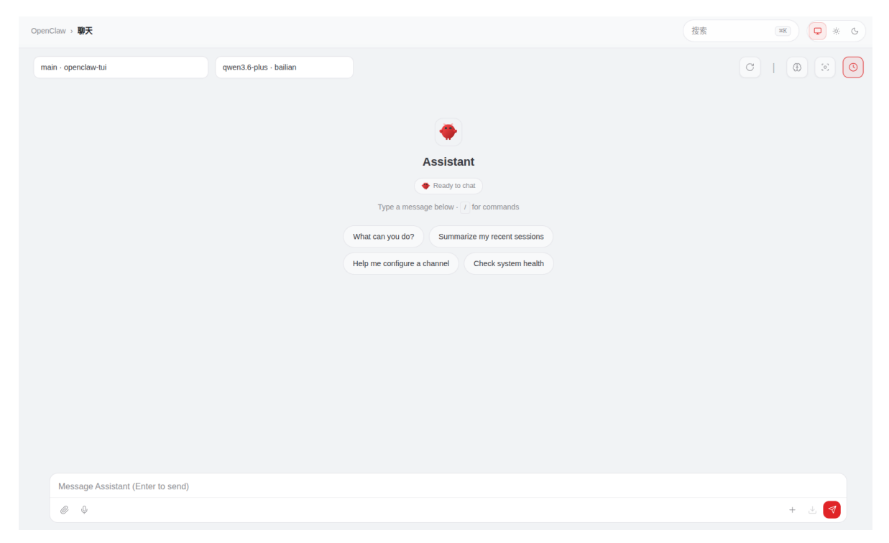
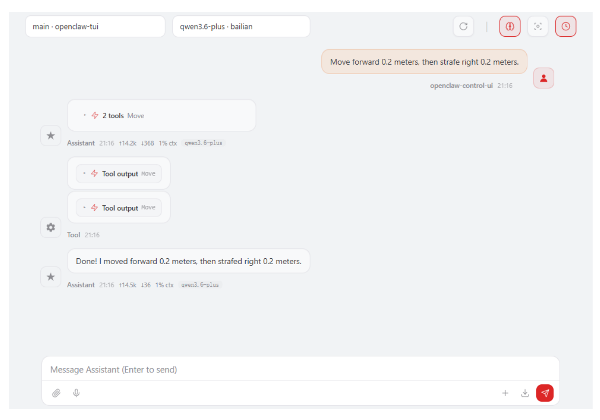
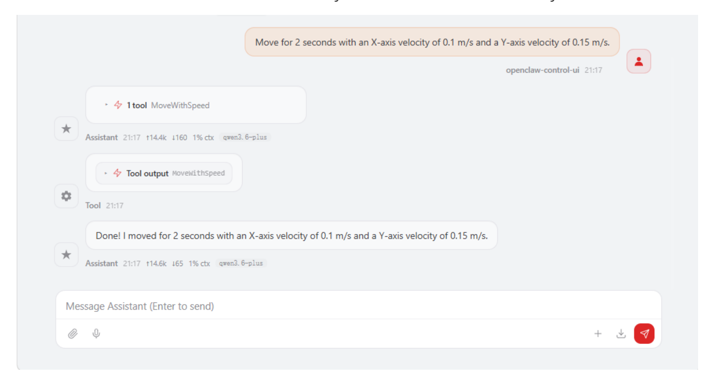
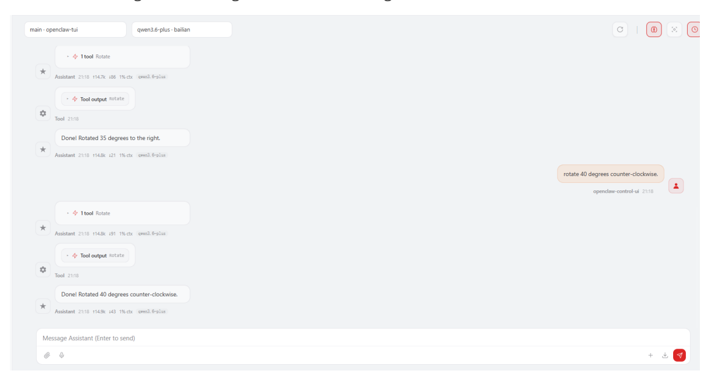

# **OpenClaw Chassis Control**

#### **[OpenClaw](#page-0-0) Chassis Control**

- <span id="page-0-0"></span>[1. Course](#page-0-1) Content
  - Course [Overview](#page-0-2)
  - Learning [Objectives](#page-0-3)
  - [2. Preparation](#page-0-4)
  - 3. Chassis Control [Interfaces](#page-1-0)
  - [4. Demonstration](#page-1-1)
    - 4.1 Initiating OpenClaw [Interaction](#page-1-2)
    - 4.2 Chassis [Movement](#page-2-0) Control
    - 4.3 Chassis [Omnidirectional](#page-2-1) Movement Control
    - 4.4 Chassis In-Place [Rotation](#page-3-0)
  - [5. Source](#page-3-1) Code Analysis
    - 5.1 set\_cmdvel() Setting Chassis Movement Velocity (Underlying [Implementation](#page-3-2) for MoveWithSpeed )
    - 5.2 move\_by\_odom() Precise Distance Movement Based on Odometry (Low-Level [Implementation](#page-4-0) of Move )
    - 5.3 [rotate\\_by\\_odom\(\)](#page-5-0) Precise Angle Rotation Based on Odometry (Underlying Implementation for Rotate )
    - 5.4 Explanation of the Underlying [Implementation](#page-6-0) Architecture
  - 6. Common Issues [and Solutions](#page-7-0)

### **1. Course Content**

### **Course Overview**

- <span id="page-0-2"></span><span id="page-0-1"></span>OpenClaw Chassis Control serves as a foundational function for robot motion control. Through the MCP interface, it provides three chassis control tools: MoveWithSpeed (velocity control), Move (distance-based movement), and Rotate (in-place rotation).
- It supports omnidirectional chassis control, allowing for simultaneous control of linear velocities in the X and Y directions, as well as angular velocity around the Z-axis, thereby enabling forward/backward movement, lateral translation, and in-place rotation.
- Precise distance and angle control are achieved through Odometry (Odom) feedback, ensuring high motion accuracy.

### **Learning Objectives**

- <span id="page-0-3"></span>1. Understand the functions and applications of the three chassis control interfaces provided by OpenClaw.
- <span id="page-0-4"></span>2. Master the interactive methods—specifically via WebChat—for controlling chassis movement, omnidirectional motion, and turning.

## **2. Preparation**

Launch the MicroROS Chassis Agent (if already running, do not launch again).

sh start\_agent.sh

Launch the Odometry, TF, Manipulator Assist, Camera, and other relevant nodes.

ros2 launch m3pro\_bringup car\_base.launch.py

Launch the MCP Service.

ros2 launch m3pro\_bringup mcp\_service.launch.py

If you require voice feedback/replies, you must additionally launch the openclaw\_bridge ; otherwise, this step may be skipped.

ros2 run multi\_brains\_pre openclaw\_bridge

### **3. Chassis Control Interfaces**

#### [!NOTE]

<span id="page-1-0"></span>For detailed information regarding the functions, parameters, and usage of these interfaces, please refer to the tutorials: [01-Integrating OpenClaw with the Robot MCP Interface] and [02-Robot CLI Command Tools].

| No. | Tool Name     | Function Description                                 |
|-----|---------------|------------------------------------------------------|
| 1   | MoveWithSpeed | Control the robot's omnidirectional chassis velocity |
| 2   | Move          | Move the robot's chassis a specified distance        |
| 3   | Rotate        | Rotate in-place by a specified angle                 |

## **4. Demonstration**

### **4.1 Initiating OpenClaw Interaction**

<span id="page-1-2"></span><span id="page-1-1"></span>Interact with OpenClaw using any available interaction method. Initiating a conversation this section demonstrates the process using Web Chat.


[Image details](images/img_001.md)

[!TIP]

<span id="page-2-0"></span>You can formulate the conversational prompts according to your specific requirements; the following serves as a demonstration example.

### **4.2 Chassis Movement Control**

Move forward 0.2 meters, then strafe right 0.2 meters.


[Image details](images/img_002.md)

### **4.3 Chassis Omnidirectional Movement Control**

- <span id="page-2-1"></span>The MoveWithSpeed tool provides lower-level velocity control, enabling complex movements through the vector composition of velocities. For example:
- Move for 2 seconds with an X-axis velocity of 0.1 m/s and a Y-axis velocity of 0.15 m/s.


[Image details](images/img_003.md)

### **4.4 Chassis In-Place Rotation**

<span id="page-3-0"></span>Rotate 35 degrees to the right, then rotate 40 degrees counter-clockwise.


[Image details](images/img_004.md)

### **5. Source Code Analysis**

<span id="page-3-1"></span>Source Code Path:

```
$HOME/M3Pro_ws/src/multi_brains_pre/multi_brains_pre/action_controller.py
```

The following section provides an explanation of the source code for three core chassis control functions within the ActionController class. These three functions constitute the underlying ROS2 implementations invoked by the MCP tools ( MoveWithSpeed , Move , and Rotate ).

## <span id="page-3-2"></span>**5.1** set\_cmdvel() **— Setting Chassis Movement Velocity (Underlying Implementation for** MoveWithSpeed **)**

```
def set_cmdvel(self, linear_x:float, linear_y:float, angular_z:float,
duration:float)->bool:
    """
    Set robot movement speed and duration
    """
    twist = Twist()
    twist.linear.x = linear_x
    twist.linear.y = linear_y
    twist.angular.z = angular_z
    self.cmd_pub.publish(twist)
    time.sleep(duration)
    self.cmd_pub.publish(Twist())
    return True
```

#### **Code Explanation:**

1. **Message Construction:** Create a Twist() velocity message, setting the values for linear.x (forward/backward linear velocity), linear.y (left/right linear velocity), and angular.z (angular velocity).

- 2. **Publishing and Stopping:** Publish the message to the cmd\_vel topic via cmd\_pub ; after maintaining this state for a specified duration using time.sleep() , publish an empty Twist() message to bring the robot to a halt.
- <span id="page-4-0"></span>3. **Omnidirectional Control:** By simultaneously setting the linear velocities (x and y) and the angular velocity (z), movement in any arbitrary direction is achieved through the vector composition of these velocities.

## **5.2** move\_by\_odom() **— Precise Distance Movement Based on Odometry (Low-Level Implementation of** Move **)**

```
def move_by_odom(self, distance: float, direction: str = 'forward') -> bool:
    '''Move a specified distance based on odometer'''
    linear_speed = self.odom_linear_speed
    timeout = self.odom_timeout
    start_pose = self._get_current_odom_pose()
    if start_pose is None:
        self.get_logger().error("Failed to get current odometry position")
        return False
    twist = Twist()
    if direction == 'forward':
        twist.linear.x = abs(linear_speed) if distance >= 0 else -
abs(linear_speed)
    elif direction == 'backward':
        twist.linear.x = -abs(linear_speed) if distance >= 0 else
abs(linear_speed)
    elif direction == 'left':
        twist.linear.y = abs(linear_speed) if distance >= 0 else -
abs(linear_speed)
    elif direction == 'right':
        twist.linear.y = -abs(linear_speed) if distance >= 0 else
abs(linear_speed)
    else:
        self.get_logger().error(f"Unknown direction: {direction}")
        return False
    start_time = time.time()
    while rclpy.ok():
        current_time = time.time()
        if current_time - start_time > timeout:
            self.get_logger().warn("Movement timeout")
            self.cmd_pub.publish(Twist())
            return False
        current_pose = self._get_current_odom_pose()
        if current_pose is None:
            time.sleep(0.1)
            continue
        moved_distance = calculate_distance(start_pose, current_pose)
        if moved_distance >= abs(distance) - self.odom_position_tolerance:
            self.cmd_pub.publish(Twist())
```

```
self.get_logger().info(f"Movement complete! Total distance:
{moved_distance:.3f}m")
            break
        self.cmd_pub.publish(twist)
        time.sleep(0.1)
    self.cmd_pub.publish(Twist())
    return True
```

#### **Code Explanation:**

- 1. **Direction Mapping:** Maps the four directions— forward , backward , left , and right —to either twist.linear.x (forward/backward) or twist.linear.y (left/right).
- 2. **Odometry Loop Control:** Retrieves the current pose using \_get\_current\_odom\_pose() and calculates the distance traveled— calculate\_distance(start\_pose, current\_pose) during each loop iteration.
- 3. **Precision Control:** The operation terminates once the target distance is reached within the specified odom\_position\_tolerance (default: 0.005m).
- <span id="page-5-0"></span>4. **Timeout Protection:** If the target is not reached within the odom\_timeout duration (default: 30s), the operation terminates and returns a failure status.

## **5.3** rotate\_by\_odom() **— Precise Angle Rotation Based on Odometry (Underlying Implementation for** Rotate **)**

```
def rotate_by_odom(self, angle: float, angular_speed: float = None, timeout:
float = None) -> bool:
    '''Based on the odometer rotating at a specified angle (angle unit:
degrees)'''
    if angular_speed is None:
        angular_speed = self.odom_angular_speed
    if timeout is None:
        timeout = self.odom_timeout
    angle_rad = math.radians(angle)
    start_pose = self._get_current_odom_pose()
    if start_pose is None:
        self.get_logger().error("Failed to get current odometry position")
        return False
    start_yaw = get_yaw_from_quaternion(start_pose.orientation)
    target_yaw = start_yaw + angle_rad
    target_yaw = normalize_angle(target_yaw)
    twist = Twist()
    twist.angular.z = abs(angular_speed) if angle >= 0 else -abs(angular_speed)
    start_time = time.time()
    while rclpy.ok():
        current_time = time.time()
        if current_time - start_time > timeout:
            self.get_logger().warn("Rotation timeout")
            self.cmd_pub.publish(Twist())
            return False
```

```
current_pose = self._get_current_odom_pose()
    if current_pose is None:
        time.sleep(0.1)
        continue
    current_yaw = get_yaw_from_quaternion(current_pose.orientation)
    angle_diff = calculate_angle_diff(target_yaw, current_yaw)
    if abs(angle_diff) <= self.odom_angle_tolerance:
        self.cmd_pub.publish(Twist())
        return True
    self.cmd_pub.publish(twist)
    time.sleep(0.1)
self.cmd_pub.publish(Twist())
return False
```

#### **Code Explanation:**

- 1. **Angle Conversion:** math.radians(angle) converts degrees to radians; get\_yaw\_from\_quaternion() extracts the yaw angle from a quaternion.
- 2. **Target Calculation:** target\_yaw = start\_yaw + angle\_rad calculates the target angle; a positive value indicates a clockwise rotation, while a negative value indicates a counterclockwise rotation.
- 3. **Closed-Loop Control:** In each loop iteration, calculate\_angle\_diff() computes the difference between the current angle and the target angle; the process terminates once the difference falls within the odom\_angle\_tolerance (default: 0.05 rad ≈ 2.86°).
- <span id="page-6-0"></span>4. **Direction Determination:** abs(angular\_speed) if angle >= 0 else abs(angular\_speed) determines the direction of rotation based on the sign of the angle variable.

### **5.4 Explanation of the Underlying Implementation Architecture**

| MCP Tool      | Underlying<br>Function | Control<br>Method                   | Precision Mechanism                                      |
|---------------|------------------------|-------------------------------------|----------------------------------------------------------|
| MoveWithSpeed | set_cmdvel()           | Open-loop<br>velocity control       | No feedback; suitable for<br>rapid start/stop operations |
| Move          | move_by_odom()         | Closed-loop<br>odometry<br>feedback | Position tolerance: ±0.005<br>m                          |
| Rotate        | rotate_by_odom()       | Closed-loop<br>odometry<br>feedback | Angle tolerance: ±0.05 rad                               |

- The three functions listed above are defined within the ActionController class and publish velocity commands via cmd\_pub (on the cmd\_vel topic).
- <span id="page-7-0"></span>The MCP Tool Layer ( mcp\_action.py ) wraps these underlying functions as MCP tools making them accessible to OpenClaw and the CLI—by registering the @mcp.tool() decorator.

## **6. Common Issues and Solutions**

For details, please refer to the "Summary of Common Issues and Solutions" section within this tutorial chapter.

#### [!TIP]

For more detailed operational procedures regarding chassis control, please refer to the "Navigation & Transport" and "Waste Sorting" case studies found in *OpenClaw Embodied AI in Action*.