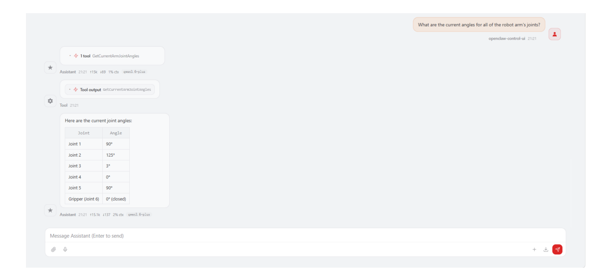
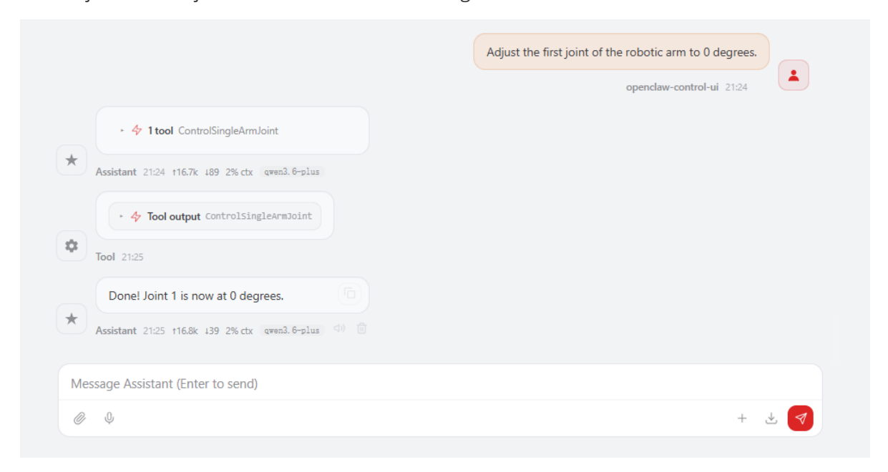
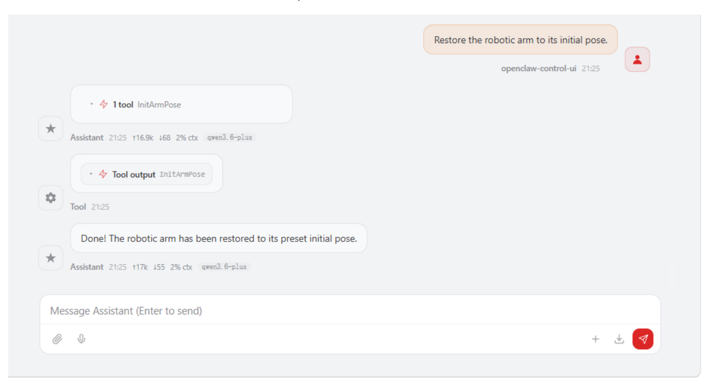
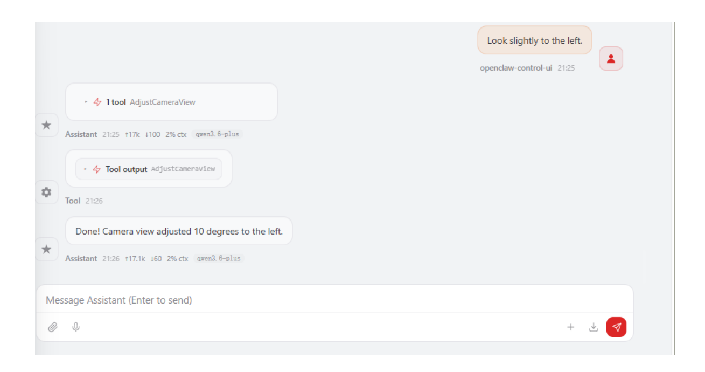

# **OpenClaw Robotic Arm Control**

#### **[OpenClaw](#page-0-0) Robotic Arm Control**

[1. Course](#page-0-1) Content

<span id="page-0-0"></span>Course [Overview](#page-0-2) Learning [Objectives](#page-0-3)

- [2. Preparation](#page-0-4)
- [3. Robotic Arm Related Control](#page-1-0) Interfaces
- 4. Case [Demonstrations](#page-1-1)
  - 4.1 Initiating OpenClaw [Interaction](#page-1-2)
  - 4.2 [Retrieving](#page-1-3) Current Robot Arm Joint Angles
  - 4.3 Retrieving [End-Effector](#page-2-0) Pose
  - 4.4 [Simultaneously](#page-2-1) Controlling All 6 Robot Arm Joints
  - 4.5 Controlling Individual [Robotic Arm Joints](#page-2-2)
  - 4.6 Restoring the [Robotic Arm to](#page-3-0) its Preset Initial Pose
  - 4.7 Adjusting the Camera [Viewpoint](#page-3-1)
- [5. Source](#page-4-0) Code Analysis

```
ControlArmJointAngles() — Control 6 Joints Simultaneously
AdjustCameraView() — Adjust Camera View
InitArmPose() — Initialize Robot Arm Pose
ControlSingleArmJointAngle() — Control Single Joint Angle
```

6. Common Issues [and Solutions](#page-7-0)

## **1. Course Content**

### **Course Overview**

- OpenClaw robotic arm control is one of the core functions of the OpenClaw platform, translating AI natural language commands into robotic arm control operations via the MCP protocol.
- Covers 8 robotic arm control interfaces: joint angle acquisition, end-effector pose acquisition, simultaneous multi-joint control, single-joint control, camera view adjustment, and initial pose recovery.

## **Learning Objectives**

- <span id="page-0-3"></span>1. Understand the interface functions of OpenClaw for controlling robotic arms.
- 2. Master the practical methods and application scenarios of each robotic arm control interface.
- <span id="page-0-4"></span>3. Be able to optimize grasping and placement accuracy by adjusting configuration file parameters.

# **2. Preparation**

- The API-KEY of the model provider in Dify has been configured.
- The Dify service has been started and can be accessed normally.
- Start the MicroROS chassis agent (if it is already started, no need to start it again).

Start nodes such as odometer, TF, robotic arm assistance, and camera nodes

ros2 launch m3pro\_bringup car\_base.launch.py

Start the MCP service

ros2 launch m3pro\_bringup mcp\_service.launch.py

If you need voice response, you need to start openclaw\_bridge separately; otherwise, you can omit this step.

ros2 run multi\_brains\_pre openclaw\_bridge

## **3. Robotic Arm Related Control Interfaces**

[!NOTE]

<span id="page-1-0"></span>For detailed information regarding interface functions, parameters, and usage, please refer to the tutorials: [01-OpenClaw Robot MCP Interface Integration] and [02-Robot CLI Command Tool].

| No. | Tool Name                                                                      | Function Description                          |
|-----|--------------------------------------------------------------------------------|-----------------------------------------------|
| 1   | GetCurrentArmJointAngles                                                       | Retrieve current robot arm joint angles       |
| 2   | GetEndEffectorPose                                                             | Retrieve end-effector pose                    |
| 3   | ControlSixArmJoint                                                             | Simultaneously control all 6 robot arm joints |
| 4   | ControlSingleArmJoint<br>Control a single robot arm joint to a specified angle |                                               |
| 5   | AdjustCameraView                                                               | Adjust camera view                            |
| 6   | InitArmPose                                                                    | Restore robot arm to preset initial pose      |

# **4. Case Demonstrations**

## **4.1 Initiating OpenClaw Interaction**

<span id="page-1-1"></span>Use any available interaction method to converse with OpenClaw; the Web Chat interface is used for this demonstration.

[!TIP]

<span id="page-1-3"></span><span id="page-1-2"></span>You may formulate commands according to your specific needs; the following serves as a case demonstration.

## **4.2 Retrieving Current Robot Arm Joint Angles**

"What are the current angles for all of the robot arm's joints?"


[Image details](images/img_001.md)

## **4.3 Retrieving End-Effector Pose**

<span id="page-2-1"></span><span id="page-2-0"></span>"Tell me the current pose of the robot arm's gripper."

## **4.4 Simultaneously Controlling All 6 Robot Arm Joints**

- "Have the robot arm perform a dance for me."
- Openclaw autonomously decides and choreographs robotic arm dance movements; actual results may vary, as output content differs depending on the specific model used.

## **4.5 Controlling Individual Robotic Arm Joints**

<span id="page-2-2"></span>Adjust the first joint of the robotic arm to 0 degrees.


[Image details](images/img_002.md)

### **4.6 Restoring the Robotic Arm to its Preset Initial Pose**

<span id="page-3-0"></span>Restore the robotic arm to its initial pose.


[Image details](images/img_003.md)

The initial pose can be modified via the configuration file.

```
nano $HOME/M3Pro_ws/src/m3pro_bringup/config/common.yaml
```

Within this file, mcp\_service—InitArmPose specifies the values for the initial pose.

```
...
mcp_service:
ros__parameters:
#action_controller——Arm
InitArmPose: [90,125,3,0,90,0] # Robotic arm initial pose
GraspKeepPose: [90,125,3,0,90,140] # Robotic arm grasp-holding pose
...
```

# **4.7 Adjusting the Camera Viewpoint**

<span id="page-3-1"></span>Look slightly to the left.


[Image details](images/img_004.md)

# **5. Source Code Analysis**

<span id="page-4-0"></span>Source code path:

<span id="page-4-1"></span>\$HOME/M3Pro\_ws/src/multi\_brains\_pre/multi\_brains\_pre/action\_controller.py

### ControlArmJointAngles() **— Control 6 Joints Simultaneously**

```
def ControlArmJointAngles(self, arm_joint_1:int, arm_joint_2:int,
arm_joint_3:int,
                         arm_joint_4:int, arm_joint_5:int, arm_joint_6:int,
                         runtime:int=2000) -> bool:
   arm_joint = ArmJoints()
   arm_joint.joint1 = arm_joint_1
   arm_joint.joint2 = arm_joint_2
   arm_joint.joint3 = arm_joint_3
   arm_joint.joint4 = arm_joint_4
   arm_joint.joint5 = arm_joint_5
   arm_joint.joint6 = 180 - arm_joint_6 # Joint 6 Special Handling
   arm_joint.time = runtime # Movement Duration (ms)
   self.SixJoint_pub.publish(arm_joint)
   return True
```

### **Code Explanation**:

- Constructs an ArmJoints ROS2 message to set the target angles for all six joints simultaneously, then publishes it to the arm6\_joints topic.
- A 180 angle conversion is applied to Joint 6 (the gripper), as the gripper's mechanical zero point and its angle definition follow opposite conventions.
- The runtime parameter controls the duration of the movement (in milliseconds); a higher value results in a slower and smoother motion.

### <span id="page-5-0"></span>AdjustCameraView() **— Adjust Camera View**

```
def AdjustCameraView(self, pitch:int=0, yaw:int=0) -> list[bool, str]:
    """Quickly adjust the camera view"""
    self._get_joints() # Get the current joint angles of 1, 2, and 4 joints
    if yaw != 0: # Horizontal Adjustment (Joint 1 — Left/Right Rotation)
        self.joint_1 += yaw
        self.SingleJoint_pub.publish(ArmJoint(id=1, joint=self.joint_1,
time=200))
    if pitch != 0: # Pitch Adjustment (Joint 4 — Up/Down Tilt)
        temp_joint = self.joint_4 + pitch
        if temp_joint <= -5: # Joint 4 has reached its lower limit; using Joint
2 for pitch compensation.
            self.joint_2 += pitch
            self.SingleJoint_pub.publish(ArmJoint(id=2, joint=self.joint_2,
time=200))
        else:
            self.SingleJoint_pub.publish(ArmJoint(id=4, joint=temp_joint,
time=200))
    self._reset_joints()
    res = self.SeeWhat() # Automatically Refresh Images
    return [True, res[1]] if res[0] else [False, res[1]]
```

### **Code Description**:

- **yaw**: Adjusts Joint 1 to rotate the camera left or right; positive values rotate to the right, while negative values rotate to the left.
- **pitch**: Primarily adjusts Joint 4 to tilt the camera up or down; when Joint 4 reaches its lower limit (-5°), it automatically switches to Joint 2 to provide pitch compensation.
- <span id="page-5-1"></span>Upon completion of the adjustment, SeeWhat() is automatically called to refresh the image, returning the file path of the new image.

### InitArmPose() **— Initialize Robot Arm Pose**

```
def InitArmPose(self) -> bool:
    '''Initialize the robotic arm to a safe pose.'''
    # Step 1: Create Joint Message Object
    arm_joint = ArmJoints()
    # Step 2: Set the target angles for the 6 joints.
    arm_joint.joint1 = self.init_arm_pose[0]
    arm_joint.joint2 = self.init_arm_pose[1]
    arm_joint.joint3 = self.init_arm_pose[2]
    arm_joint.joint4 = self.init_arm_pose[3]
    arm_joint.joint5 = self.init_arm_pose[4]
    arm_joint.joint6 = self.init_arm_pose[5]
    # Step 3: Set movement duration (2000ms = 2 seconds)
    arm_joint.time = 2000
    # Step 4: Publish Joint Angles to a Topic
```

```
self.SixJoint_pub.publish(arm_joint)
# Step 5: Wait for the robotic arm movement to complete.
time.sleep(1.0)
return True
```

#### **Function Description**:

- 1. **Safe Pose Initialization**: Restores the robotic arm to a preset safe initial pose, preventing it from occupying hazardous or interfering positions.
- 2. **6-Joint Synchronous Control**: Simultaneously controls the arm's 6 joints (joint1 through joint6) to move to their respective target angles.
- 3. **Motion Duration Control**: Sets the motion duration to 2 seconds via the parameter time=2000 , ensuring a smooth transition to the initial pose.
- 4. **Blocking Wait**: Uses time.sleep(1.0) to pause execution until the robotic arm has substantially reached its target position before returning.

#### **Use Cases**:

- Ensure the robotic arm is in a standard starting pose prior to commencing a grasping task.
- Restore the robotic arm to a safe position upon completion of a grasping task to avoid interfering with the chassis's movement.
- Reset the robotic arm's pose following a program exception or emergency stop.

### **Configuration Parameters**:

The init\_arm\_pose parameter defines the initial angles for the 6 joints (in degrees) and is typically configured within the configuration file. The typical initial pose for the M3Pro robot is as follows:

- joint1 (Base Rotation): 0°
- joint2 (Shoulder Joint): 0°
- joint3 (Elbow Joint): 0°
- joint4 (Wrist Pitch): 0°
- joint5 (Wrist Yaw): 0°
- <span id="page-6-0"></span>joint6 (Gripper Open/Close): 0° (Closed State)

### ControlSingleArmJointAngle() **— Control Single Joint Angle**

```
def ControlSingleArmJointAngle(self, arm_joint_id: int, angle: int, runtime: int
= 1500) -> bool:
    """ Control a single joint of the robotic arm"""
    # Step 1: Special Handling for Joint 6 (Gripper)
    if arm_joint_id == 6:
        angle = 180 - angle # Gripper Angle Inversion
    # Step 2: Publish Single-Joint Control Commands
    self.SingleJoint_pub.publish(
        ArmJoint(id=arm_joint_id, joint=angle, time=runtime)
    )
    return True
```

#### **Function Description:**

- 1. **Independent Joint Control:** Allows for the individual control of a specific joint on the robotic arm without affecting the state of the other joints.
- 2. **Gripper Angle Inversion:** The 6th joint (the gripper) undergoes special processing: angle = 180 - angle . This is because the 0° and 180° positions of the gripper correspond to the closed and open states, respectively; therefore, an angle inversion is required to ensure intuitive control.
- 3. **Configurable Movement Duration:** The runtime parameter defaults to 1500ms (1.5 seconds) and can be adjusted as needed to modify the movement speed.

#### **Parameter Description:**

| Parameter    | Type | Description               | Range                                         |
|--------------|------|---------------------------|-----------------------------------------------|
| arm_joint_id | int  | Joint ID (1–6)            |                                               |
| angle        | int  | Target Angle (°)          | Varies by joint type; typically 0–180°        |
| runtime      | int  | Movement Duration<br>(ms) | Default: 1500; Recommended Range:<br>500–3000 |

#### **Use Cases:**

- **Fine-Tuning:** During grasping or placement operations, when only a specific joint requires minor adjustment (e.g., adjusting only the opening/closing of the gripper).
- **Posture Recovery:** After a task is completed, individually returning a specific joint to a safe angle.

# **6. Common Issues and Solutions**

<span id="page-7-0"></span>Please refer to the appendix lesson within this section: [Summary of Common Errors and Solutions].