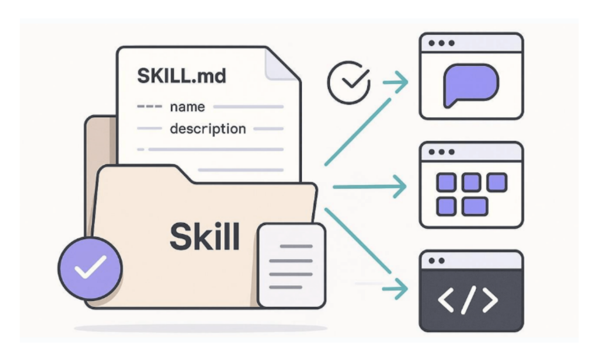
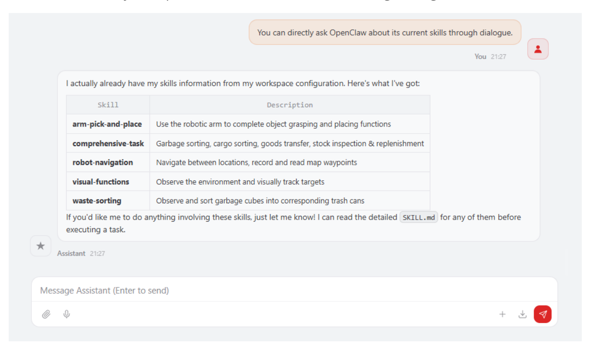
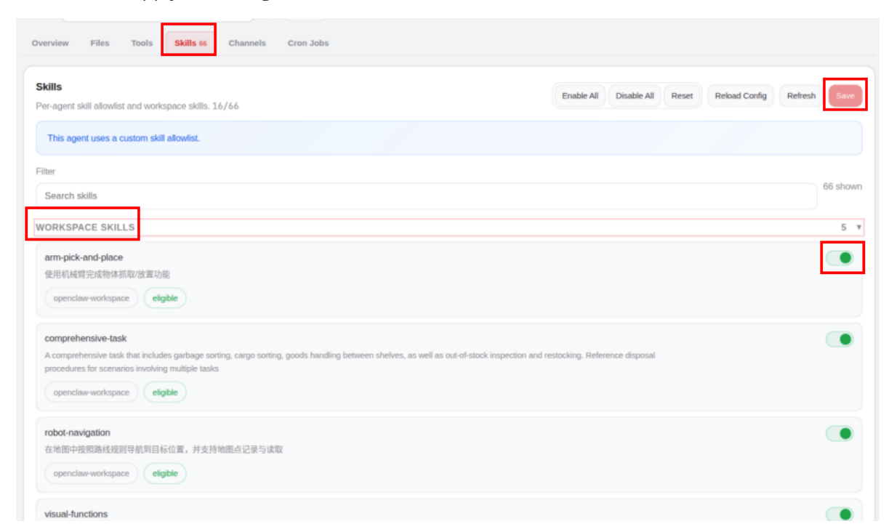

# **OpenClaw Skills Development**

#### **OpenClaw Skills [Development](#page-0-0)**

- <span id="page-0-0"></span>[1. Course](#page-0-1) Content
  - Course [Overview](#page-0-2)
  - Learning [Objectives](#page-0-3)
- [2. Introduction](#page-0-4) to Skills
- 3. Robot's [factory-preset](#page-1-0) skills
  - ① arm-pick-and-place [\(Robotic Arm Grasp &](#page-2-0) Place)
  - ♻ ② [waste-sorting](#page-2-1) (Waste Sorting)
  - ③ [robot-navigation](#page-2-2) (Navigation & Localization)
  - ④ [visual-functions](#page-2-3) (Visual Functions)
  - ⚙ ⑤ [comprehensive-task \(Comprehensive](#page-2-4) Task)
- 4. Agent Skill [Management](#page-2-5)
- [5. Custom Skill](#page-3-0) Development
  - 5.1 How to [Develop Your](#page-3-1) Own Skills
  - 5.2 Skill [Creation](#page-3-2)
  - 5.3 Skill [Documentation](#page-3-3) Format
  - 5.4 Writing Skill [Content](#page-4-0)
  - 5.5 Enabling Skills in [OpenClaw](#page-4-1)

## **1. Course Content**

### **Course Overview**

- <span id="page-0-2"></span><span id="page-0-1"></span>OpenClaw Skills is a set of advanced task instructions for developers. It orchestrates multiple MCP Tools into a complete workflow according to business logic, guiding the AI model to call the right tool at the right time to complete complex tasks.
- The robot comes pre-installed with 5 core skills: robotic arm grasping and placement, waste sorting, navigation and positioning, visual tracking, and integrated tasks, covering the robot's main application scenarios.

## **Learning Objectives**

- <span id="page-0-3"></span>1. Understand the concept, principles, and functions of OpenClaw Skills.
- <span id="page-0-4"></span>2. Be familiar with the functions and usage of the 5 core skills pre-installed on the robot.
- 3. Master the operation of enabling and disabling skills in the Agent.

## **2. Introduction to Skills**

- Skills are a **task-level workflow instruction set**.
- Each Skill includes complete information such as: trigger keywords, tool dependencies, coordinate system description, step-by-step operation process, and exception handling rules.
- The AI model, based on the workflow defined in the skill files, calls the MCP Tool step by step to complete the entire closed loop from environmental perception → decision planning → action execution → result verification.
- Skill files are stored in the \$HOME/.openclaw/workspace/skills directory, with each skill corresponding to a subdirectory. The SKILL.md file within defines the complete skill instructions.


[Image details](images/img_001.md)

## **3. Robot's factory-preset skills**

<span id="page-1-0"></span>You can directly ask OpenClaw about its current skills through dialogue.


[Image details](images/img_002.md)

Skills File Path:

\$HOME/.openclaw/workspace/skills

The robot comes pre-installed with the following 5 core skills:

#### **① arm-pick-and-place (Robotic Arm Grasp & Place)**

- <span id="page-2-0"></span>**Function:** Uses the robotic arm to perform object grasping and placing operations.
- **Trigger Keywords:** grasp / pick / place / grab / move
- **Core Tools:** Pick / Place / SeeWhat / AdjustCameraView / GetPlacePoint / GetBbox
- <span id="page-2-1"></span>**Workflow:** Observe scene → Locate target → Execute grasp → Verify result → Place at target point.

#### ♻ **② waste-sorting (Waste Sorting)**

- **Function:** Uses visual recognition to identify waste types and sort them into corresponding bins; navigates to each bin location to complete the disposal.
- **Trigger Keywords:** sort / grasp / pick up / collect waste / waste classification / observe waste
- **Core Tools:** GetWasteRecognitionResults / GraspWaste / Navigation / PlaceWaste
- <span id="page-2-2"></span>**Workflow:** Retrieve recognition results → Grasp waste → Navigate to corresponding bin → Place waste into bin.

#### **③ robot-navigation (Navigation & Localization)**

- **Function:** Navigates to a target location within a map according to defined route rules; supports recording and retrieving specific map locations.
- **Core Tools:** Navigation / GetMapMapping / RecordMapLocation
- **Workflow:** Retrieve map mapping → Locate target destination → Execute navigation (supports up to 3 retries).
- **Additional Function:** Use RecordMapLocation to save the current position to the map mapping.

### **④ visual-functions (Visual Functions)**

- <span id="page-2-3"></span>**Function:** Observes the environment and performs visual tracking of target objects.
- **Trigger Keywords:** Observe the environment / Visual tracking target
- **Core Tools:** SeeWhat / AdjustCameraView / GetBbox / TargetTrack
- <span id="page-2-4"></span>**Workflow:** Capture Image → Locate Target → Invoke TargetTrack to Track Target

## ⚙ **⑤ comprehensive-task (Comprehensive Task)**

- **Functionality:** Covers a variety of comprehensive scenarios, including waste sorting, cargo sorting, inter-shelf transfer, and cargo inspection & replenishment.
- **Trigger Keywords:** Cargo Sorting / Replenishment / Waste Disposal / Shelf Operations / Cargo Inspection & Replenishment
- **Sub-processes:** Waste Sorting → Refer to waste-sorting ; Cargo Sorting → Navigation + Grasping + Transport + Placement; Shelf Transfer → Navigation → Grasping → Navigation → Placement; Cargo Inspection & Replenishment → Inspection → Navigation → Grasping → Return → Placement.

The Skill files mentioned above are stored in the \$HOME/.openclaw/workspace/skills directory. Each skill resides in its own subdirectory; you can directly view or modify the SKILL.md file located within each subdirectory.

## **4. Agent Skill Management**

- <span id="page-2-5"></span>Log in to the OpenClaw WebChat interface, then navigate to **Agent → Skills**.
- Under the **Workspace Skills** tab, you can view the factory-preset skills available in the workspace. To enable or disable an individual skill, simply toggle the switch and then click

**Save** to apply the changes.


[Image details](images/img_003.md)

## **5. Custom Skill Development**

## **5.1 How to Develop Your Own Skills**

- <span id="page-3-1"></span><span id="page-3-0"></span>Developing a custom Skill essentially involves creating a SKILL.md file that adheres to specific formatting guidelines, and then placing it in the \$HOME/.openclaw/workspace/skills directory.
- Developing a skill requires completing the following steps:
- 1. **Create a Skill Directory:** Create a new subdirectory within the skills directory. The name of this directory will serve as the name of the skill (it is recommended to use lowercase English letters separated by hyphens).
- 2. **Write** SKILL.md **:** Create a SKILL.md file inside the subdirectory and write the skill's content according to the specified format.
- 3. **Restart OpenClaw:** Restart the OpenClaw application. Gateway activates new skills
- <span id="page-3-2"></span>4. **Enable in Agent**: Activate the new skill within the Agent Skills management section of WebChat.

#### **5.2 Skill Creation**

#### **Step 1: Create the Skill Directory and Files**

```
mkdir -p $HOME/.openclaw/workspace/skills/my-custom-skill
touch $HOME/.openclaw/workspace/skills/my-custom-skill/SKILL.md
```

**Step 2: Write the** SKILL.md **Content** (Refer to Section 5.3 for formatting guidelines)

#### <span id="page-3-3"></span>**5.3 Skill Documentation Format**

Each SKILL.md file consists of two parts:

**① YAML Metadata Header (Frontmatter)**

```
---
name: my-custom-skill # Skill Name (Unique Identifier)
description: Skill Function Description # A brief explanation of the skill's
purpose
version: 1.0.0 # Version Number
author: "Your Name" # Author Information
trigger_keywords: # Trigger Keywords (The AI ••uses these words to
invoke the skill)
- keyword1
- keyword2
---
```

#### **② Markdown Body**

The body section uses Markdown format to describe the skill's workflow. It typically includes:

- **Related Tools**: A list of the MCP Tools required by this skill.
- **Rule Specifications**: Any necessary constraints and rules.
- **Workflow**: A step-by-step definition of the operational process, including specific commandline examples.
- <span id="page-4-0"></span>**Exception Handling**: Strategies for addressing common errors.

### **5.4 Writing Skill Content**

When writing skill content, the following principles should be observed:

- **Clear Step Segmentation**: Break down tasks into distinct steps (Step 1 / Step 2 / ...); each step should have a clear execution objective and specific criteria for completion.
- **Complete Tool Invocation Examples**: For any MCP Tool invoked within a step, provide the complete command syntax and parameter descriptions.
- **Exception Handling Mechanisms**: Provide clear strategies for handling potential error scenarios (e.g., target not found, tool invocation failure, etc.).
- **Conditional Logic and Loops**: For steps requiring iterative operations, clearly define the termination conditions; for steps requiring conditional logic, specify the decision criteria.

When writing, you may refer to the SKILL.md file of the factory-preset skills as a template. The path is:

```
$HOME/.openclaw/workspace/skills/<skill-name>/SKILL.md
```

## **5.5 Enabling Skills in OpenClaw**

Refer to **4. Agent Skill Management** to enable and disable skills.