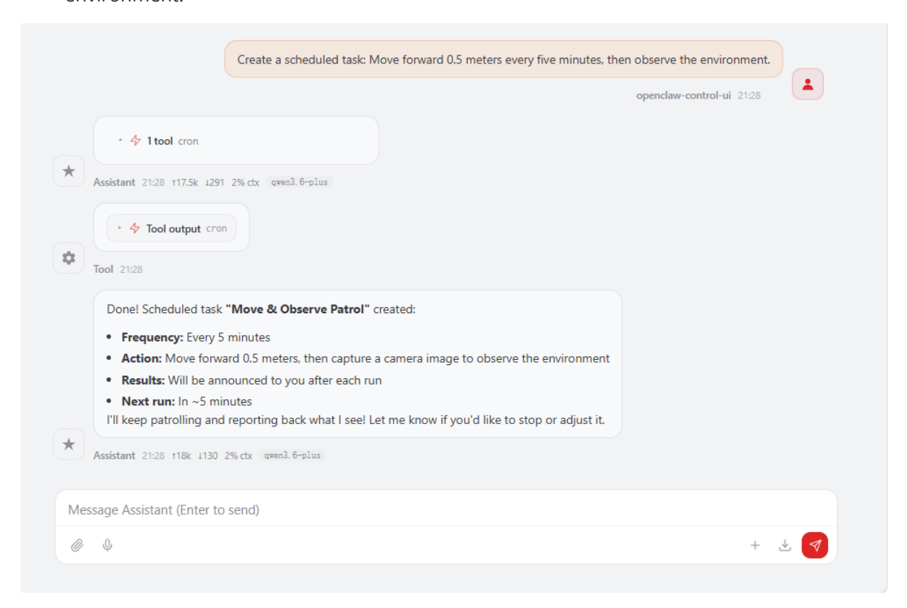
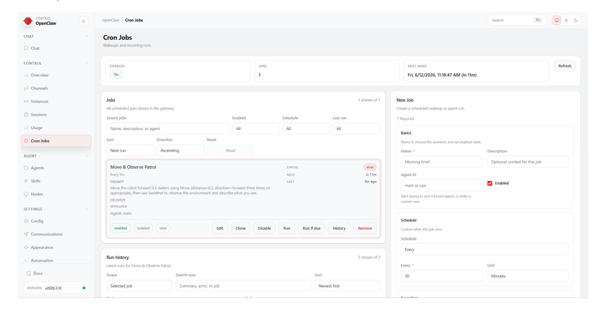
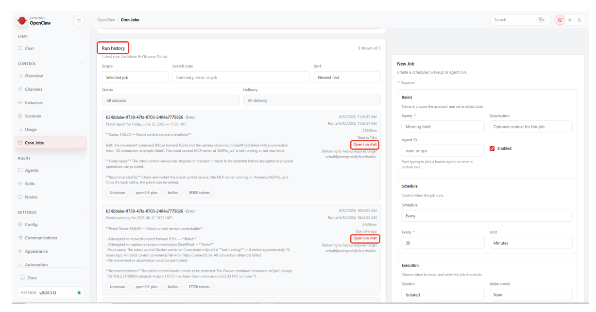

# **OpenClaw Scheduled Tasks**

#### **OpenClaw [Scheduled](#page-0-0) Tasks**

- <span id="page-0-0"></span>[1. Course](#page-0-1) Content Course [Overview](#page-0-2)
  - Learning [Objectives](#page-0-3)
- 2. Introduction to OpenClaw [Scheduled Tasks](#page-0-4)
- [3. Preparation](#page-0-5)
- 4. Creating [Scheduled Tasks](#page-1-0)
- <span id="page-0-2"></span><span id="page-0-1"></span>5. Viewing and Managing [Scheduled Tasks](#page-2-0)

# **1. Course Content**

### **Course Overview**

- OpenClaw scheduled tasks are the task automation scheduling function of the OpenClaw platform, allowing users to create timed robot tasks to achieve unattended automated operations.
- Scheduled tasks support periodic execution (e.g., every N minutes) and single execution, and can program any sequence of robot control instructions.

### **Learning Objectives**

- <span id="page-0-3"></span>1. Understand the functions and application scenarios of OpenClaw scheduled tasks.
- 2. Master the method of creating scheduled tasks using natural language.
- <span id="page-0-4"></span>3. Master the operation of viewing, managing, and maintaining scheduled tasks.

# **2. Introduction to OpenClaw Scheduled Tasks**

- Scheduled tasks are OpenClaw's intelligent scheduling function. Users can create scheduled tasks to allow robots to automatically perform specific operations at specified times or periods.
- After creating a scheduled task, OpenClaw will automatically execute the task instructions according to the set time and record the execution log for each execution.

# **3. Preparation**

<span id="page-0-5"></span>Start the MicroROS chassis agent (if it's already running, no need to repeat the process)

sh start\_agent.sh

Start the odometer, tf, robotic arm assistance, camera nodes, etc.

```
ros2 launch m3pro_bringup mcp_service.launch.py
```

Start the MCP service

```
ros2 launch m3pro_bringup mcp_service.launch.py
```

If you require voice responses, you must additionally launch openclaw\_bridge ; otherwise, this step can be omitted.

```
ros2 run multi_brains_pre openclaw_bridge
```

# **4. Creating Scheduled Tasks**

<span id="page-1-0"></span>The simplest method is to issue commands directly to OpenClaw. For example:

Create a scheduled task: Move forward 0.5 meters every five minutes, then observe the environment.


[Image details](images/img_001.md)

#### [!TIP]

- If you have configured SeeWhat\_channels within the **[OpenClaw Multimodal Vision]** settings, the robot's visual observations will also be automatically sent to the corresponding channels.
- <span id="page-2-0"></span>If you have enabled voice tags and launched the openclaw\_bridge node, the robot will provide voice responses.

# **5. Viewing and Managing Scheduled Tasks**

Open WebChat and click on **Scheduled Tasks** to view a list of all created tasks.


[Image details](images/img_002.md)

- The scheduled task list supports the following management operations:
- **Enable/Disable**: Use the toggle switch to control whether a scheduled task is active; once disabled, the task will no longer execute according to its schedule.

- **Run Now**: Manually trigger a scheduled task once, useful for quickly verifying that the task is functioning correctly.
- **Delete**: Remove scheduled tasks that are no longer needed.
- Click on a scheduled task to view and edit its details, including the task description and execution schedule.
- Under **Run History**, you can view the execution records for every time the scheduled task was triggered, including the execution time, status, and results.


[Image details](images/img_003.md)

If you need to view detailed logs for a specific execution, you can use **Open Run Chat** to review the AI's complete reasoning process and tool call records during the task execution, facilitating troubleshooting.