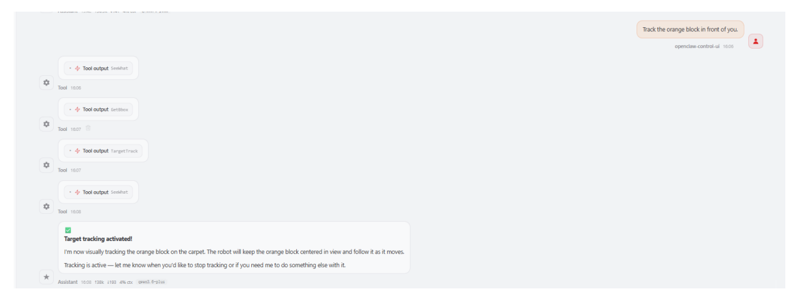
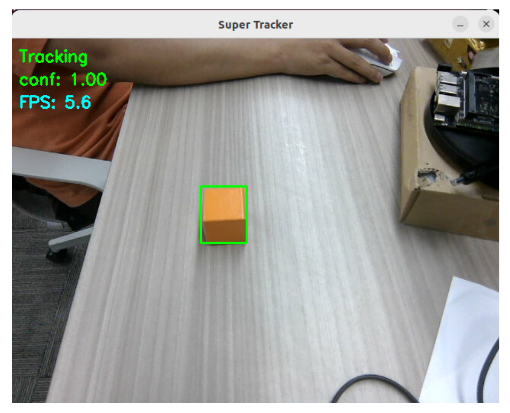
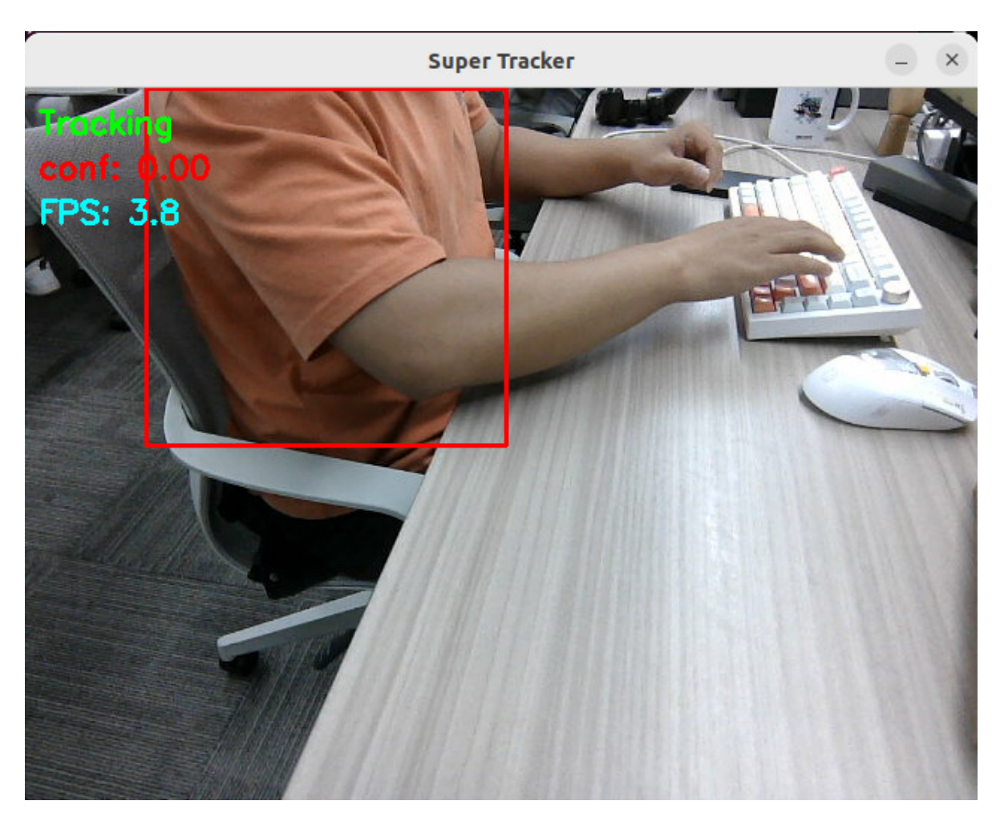
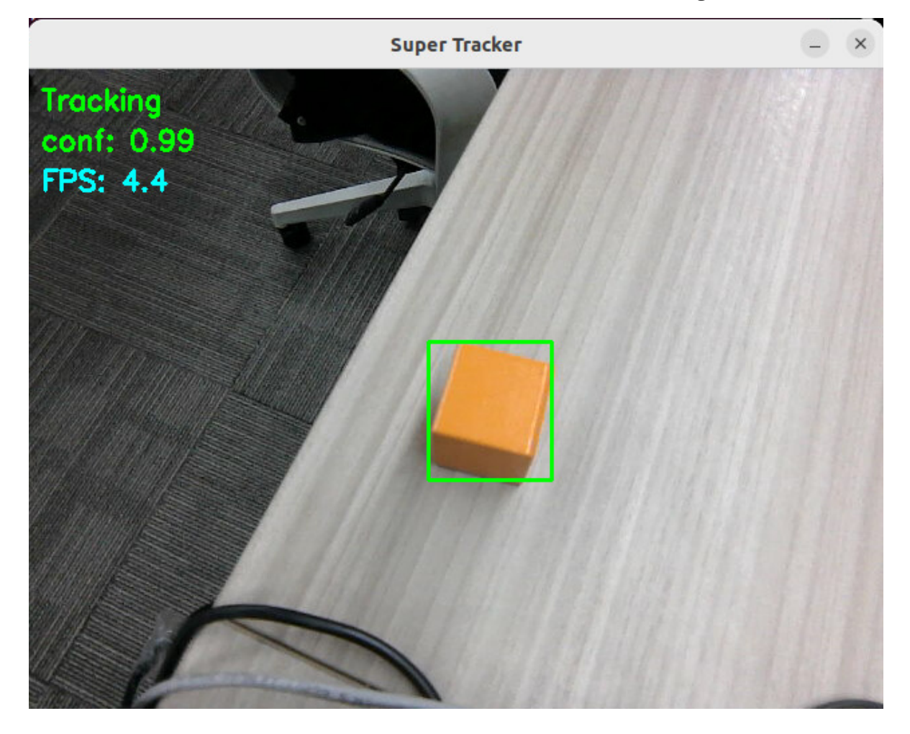
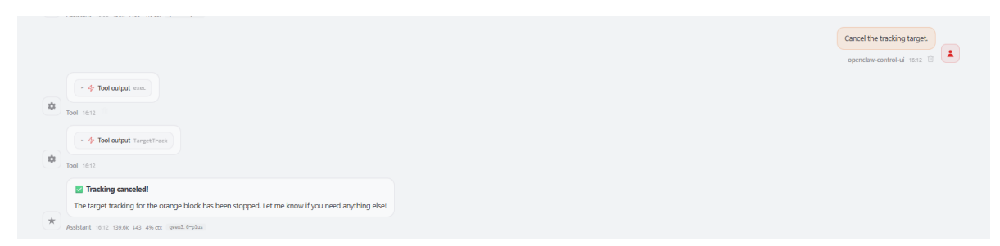
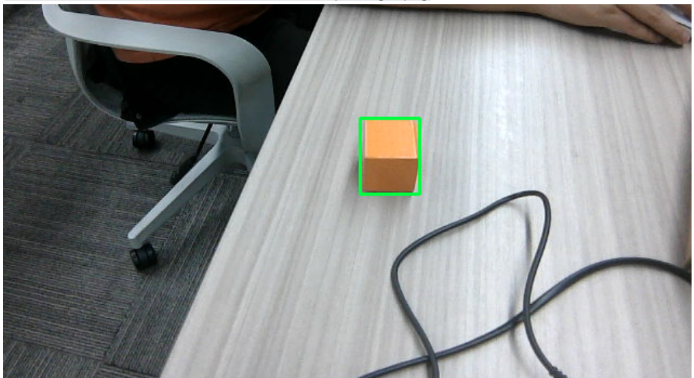
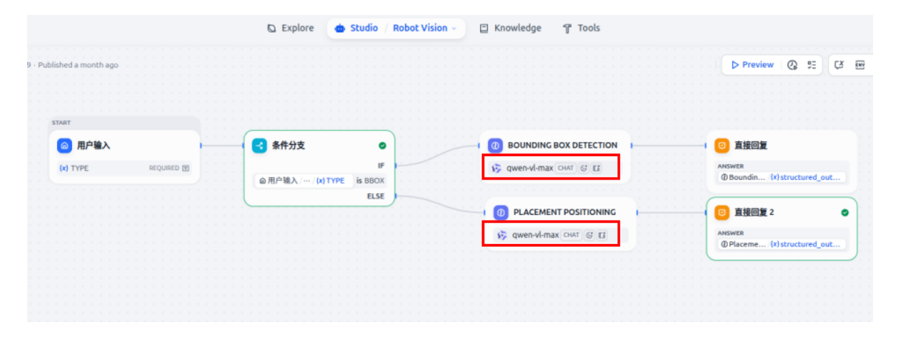

# **OpenClaw Target Tracking**

#### **[OpenClaw](#page-0-0) Target Tracking**

- <span id="page-0-0"></span>[1. Course](#page-0-1) Content Course [Overview](#page-0-2)
  - Learning [Objectives](#page-0-3)
- [2. Preparation](#page-0-4)
- [3. Target](#page-1-0) Tracking Case
- [4. Source](#page-4-0) Code Analysis
  - 4.1 TargetTrack() Entry Point for [Starting/Canceling](#page-4-1) Tracking
  - 4.2 \_gaze\_track\_loop() [Background Tracking](#page-5-0) Thread Loop
  - 4.3 [\\_get\\_bbox\(\)](#page-6-0) Retrieving the Target Bounding Box Center
  - 4.4 [\\_gaze\\_control\(\)](#page-6-1) Gaze Control (Single-Joint Adjustment)
- <span id="page-0-1"></span>[5. Parameter](#page-7-0) Tuning
- <span id="page-0-2"></span>6. Common Issues [and Solutions](#page-8-0)

### **1. Course Content**

### **Course Overview**

- OpenClaw target tracking is the core function of robot vision servo control. It tracks target objects in real time using a camera and controls the robotic arm joints to adjust the camera angle, keeping the target centered in the frame.
- The target tracking function relies on the preceding GetBbox (target detection) to obtain the initial ROI bounding box, and then starts the tracking thread to continuously correct the robotic arm joint angles.
- The tracking function supports both starting and canceling tracking. It automatically pauses when the target confidence is too low or the target is lost, and automatically resumes tracking when the target reappears.

### **Learning Objectives**

<span id="page-0-4"></span><span id="page-0-3"></span>1. Master the methods for starting and canceling target tracking using OpenClaw.

### **2. Preparation**

Start the MicroROS chassis agent (if it's already started, no need to start it again)

sh start\_agent.sh

Start nodes such as odometer, TF, robotic arm assistance, and camera nodes

```
ros2 launch m3pro_bringup car_base.launch.py
```

Start MCP service

```
ros2 launch m3pro_bringup mcp_service.launch.py
```

If you need voice response, you need to start openclaw\_bridge separately; otherwise, you can omit this step.

```
ros2 run multi_brains_pre openclaw_bridge
```

### **3. Target Tracking Case**

Choose any method to interact with OpenClaw. The following demonstration uses... WebChat


[Image details](images/img_001.md)

As the target object moves, the robotic arm adjusts its joint angles to ensure the camera remains continuously focused on the object.


[Image details](images/img_002.md)

If the target's confidence score drops too low or the target is lost from the field of view, the robotic arm will cease movement.


[Image details](images/img_003.md)

When the target reappears within the field of view, the tracker automatically searches for it; once the confidence score exceeds 0.1, the robotic arm resumes tracking.


[Image details](images/img_004.md)

To stop tracking the target, you can issue a new command to OpenClaw.


[Image details](images/img_005.md)

The MCP server logs a message indicating that tracking of the target has been terminated.

#### [!IMPORTANT]

<span id="page-4-0"></span>In the [02-OpenClaw Robotic Arm Tracking and Grasping] module, OpenClaw must first successfully track the target before it can proceed to grasp it.

### **4. Source Code Analysis**

Source Code Path

```
$HOME/M3Pro_ws/src/multi_brains_pre/multi_brains_pre/action_controller.py
```

The following section provides an explanation of the source code for the core target tracking functions within the ActionController class—specifically TargetTrack() and the internal functions it invokes.

## <span id="page-4-1"></span>**4.1** TargetTrack() **— Entry Point for Starting/Canceling Tracking**

```
def TargetTrack(self, x1_or_cmd, y1:int=None, x2:int=None, y2:int=None):
    # Cancel tracking mode
    if isinstance(x1_or_cmd, str):
        if x1_or_cmd != "cancel":
            return [False, "Invalid command for TargetTrack. Use 'cancel' to
stop tracking."]
        # Stop gaze thread first
        if hasattr(self, '_gaze_stop_event'):
            self._gaze_stop_event.set()
        if hasattr(self, '_gaze_thread') and self._gaze_thread is not None and
self._gaze_thread.is_alive():
            self._gaze_thread.join(timeout=2.0)
            self._gaze_thread = None
        # Cancel tracker service
        if not self.cancel_track_client.wait_for_service(timeout_sec=5.0):
            return [False, "CancelTrack service not available"]
        self.cancel_track_client.call(CancelTrack.Request())
        # Reset arm to initial pose
        self._reset_joints()
        self.InitArmPose()
        return [True, "Tracking cancelled and arm reset"]
```

```
# Start tracking mode
    x1: int = x1_or_cmd
    if not self.start_track_client.wait_for_service(timeout_sec=5.0):
        return [False, "Tracking service not available"]
    result = self.start_track_client.call(StartTrack.Request(x1=x1, y1=y1,
x2=x2, y2=y2))
    if not result.success:
        return [False, "Tracking failed"]
    # Start gaze control thread
    self._gaze_stop_event = threading.Event()
    self._gaze_thread = threading.Thread(target=self._gaze_track_loop,
daemon=True)
    self._gaze_thread.start()
    return [True, "Tracking started"]
```

#### **Code Explanation:**

- 1. **Cancel Tracking:** If the input parameter is the string "cancel" , the following steps are executed sequentially: stop the gaze-tracking thread → cancel the tracking service → restore the robotic arm to its initial pose.
- 2. **Start Tracking:** Calls start\_track\_client (a ROS2 Service Client) to initiate the target tracking service, passing the target ROI bounding box coordinates (x1, y1, x2, y2) .
- 3. **Background Thread:** Launches a separate thread, \_gaze\_track\_loop , to continuously execute visual servo control without interfering with the main thread's ability to respond to other commands.
- <span id="page-5-0"></span>4. **Parameter Validation:** The "start" mode requires a complete set of coordinate parameters; if any coordinate is missing, an error is returned.

### **4.2** \_gaze\_track\_loop() **— Background Tracking Thread Loop**

```
def _gaze_track_loop(self):
    '''Background thread: continuously call _gaze_control to follow the tracked
target.'''
    self._get_joints()
    while not self._gaze_stop_event.is_set() and rclpy.ok():
        box = self._get_bbox()
        if box[2] < 0.08:
            # confidence too low, wait for next frame
            time.sleep(0.1)
            continue
        error_x = box[0] - 320
        error_y = box[1] - 240
        self._gaze_control(error_x, error_y)
        time.sleep(0.25)
```

#### **Code Explanation:**

- 1. **Joint Initialization:** Calls \_get\_joints() to retrieve the current angle values for robot arm joints 1, 2, and 4.
- 2. **Loop Conditions:** Uses \_gaze\_stop\_event and rclpy.ok() as termination conditions to ensure the thread can be safely stopped.

- 3. **Confidence Filtering:** If the target confidence score ( box[2] ) falls below 0.08, the current loop iteration is skipped to wait for the next frame; this corresponds to the behavior described in the documentation as "the robot arm stops moving when the target is lost."
- 4. **Error Calculation:** error\_x = center\_x 320 and error\_y = center\_y 240 calculate the pixel deviation using the image center (320, 240) as the reference point.
- <span id="page-6-0"></span>5. **Gaze Control:** Calls \_gaze\_control() to adjust the joint angles based on the calculated errors, thereby centering the target within the frame.

### **4.3** \_get\_bbox() **— Retrieving the Target Bounding Box Center**

```
def _get_bbox(self)-> list:
    with self._track_lock:
        center_x=(self.track_box.bbox[0]+self.track_box.bbox[2])/2
        center_y=(self.track_box.bbox[1]+self.track_box.bbox[3])/2
        msg_stamp_sec = self.track_box.timestamp.sec +
self.track_box.timestamp.nanosec * 1e-9
        now_sec = self.get_clock().now().nanoseconds * 1e-9
        confidence = self.track_box.confidence if (now_sec - msg_stamp_sec) <
0.5 else 0.0
        return [center_x, center_y, confidence]
```

#### **Code Explanation:**

- 1. **Bounding Box Center Calculation:** (bbox[0]+bbox[2])/2 calculates the center along the X-axis, while (bbox[1]+bbox[3])/2 calculates the center along the Y-axis.
- 2. **Thread Safety:** Access to the track\_box data is protected by the \_track\_lock mutex.
- <span id="page-6-1"></span>3. **Confidence Timeliness:** If a message timestamp exceeds the current system time by more than 0.5 seconds, the confidence score is forcibly set to 0 to prevent the use of stale tracking data.

### **4.4** \_gaze\_control() **— Gaze Control (Single-Joint Adjustment)**

```
def _gaze_control(self, error_x, error_y):
    '''Eye gaze follows the target object'''
    if self.joint_1 is None or self.joint_2 is None or self.joint_4 is None:
        return
    if abs(error_x) > self.gaze_threshold:
        if error_x > self.gaze_threshold:
            self.joint_1 += self.step
        elif error_x < -self.gaze_threshold:
            self.joint_1 -= self.step
        self.SingleJoint_pub.publish(ArmJoint(id=1, joint=self.joint_1,
time=100))
    if abs(error_y) > self.gaze_threshold:
        if error_y > self.gaze_threshold:
            self.joint_4 -= self.step
        elif error_y < -self.gaze_threshold:
```

```
self.joint_4 += self.step
        # Limit joint_4 to prevent damage
        if self.joint_4 > -5:
            self.SingleJoint_pub.publish(ArmJoint(id=4, joint=self.joint_4,
time=100))
        else:
            # joint_4 at lower limit, adjust joint_2 to continue gaze control
            self.joint_2 -= self.step
            self.SingleJoint_pub.publish(ArmJoint(id=2, joint=self.joint_2,
time=100))
```

#### **Code Explanation:**

- 1. **X-Direction Control (Joint 1):** When the error exceeds gaze\_threshold , Joint 1 (horizontal rotation) is used to adjust the camera's left-right field of view.
- 2. **Y-Direction Control (Joint 4):** When the error exceeds the threshold, Joint 4 (pitch) is used to adjust the camera's up-down field of view.
- 3. **Joint Limit Protection:** When Joint 4 reaches its lower limit ( < -5° ), the system automatically switches to Joint 2 for compensation to prevent damage to the robotic arm.
- 4. **Single-Joint Publishing:** Single-joint control commands are published via the SingleJoint\_pub topic, adjusting the joint by step degrees with each command.

### **5. Parameter Tuning**

<span id="page-7-0"></span>Parameter file path:

```
$HOME/M3Pro_ws/src/m3pro_bringup/config/common.yaml
```

Parameters related to the tracking function:

```
...
#gaze control
gaze_threshold: 55.0 # Error threshold for gaze control (units:
pixels)
gaze_step: 2 # Step size for gaze control (units: joint
degrees)
...
```

| Parameter      | Effect of Increasing Value                                                                                                            | Effect of Decreasing Value                                                                                                                                                 |
|----------------|---------------------------------------------------------------------------------------------------------------------------------------|----------------------------------------------------------------------------------------------------------------------------------------------------------------------------|
| gaze_threshold | Allows for larger deviations;<br>adjustments are more<br>lenient; no adjustments are<br>made if the deviation is<br>below this value. | Requires more precise alignment;<br>adjustments occur more frequently;<br>setting this value too low may cause<br>the robotic arm to exhibit steady-state<br>oscillations. |
| gaze_step      | Increases the adjustment<br>step size.                                                                                                | Smoothes the adjustment process,<br>but increases the risk of overshoot.                                                                                                   |

### **6. Common Issues and Solutions**

- **Inaccurate Target ROI Box During Tracking**
- <span id="page-8-0"></span>Check whether the ROI box—generated by the GetBbox function during the initial selection of the target object—is accurate. For detailed steps, refer to: [03-openclaw Development] — [05-openclaw Multimodal Vision] — [4.4 Obtaining Target Bounding Box Coordinates].
- The verification image can be found at:

\$HOME/M3Pro\_ws/multi\_brains\_file/verify\_image.png


[Image details](images/img_006.md)

If the visual model's bounding box selections are inaccurate, you need to change the visual model within Dify. Log in to the Dify Admin Console and update the visual model configured for "Robot Vision."


[Image details](images/img_007.md)