# **OpenClaw Robotic Arm Tracking And Grasping**

#### **[OpenClaw](#page-0-0) Robotic Arm Tracking And Grasping**

- <span id="page-0-0"></span>[1. Course](#page-0-1) Content
  - Learning [Objectives](#page-0-2)
- [2. Preparation](#page-0-3)
- [3. Robotic Arm Grasping](#page-0-4) Target Object Case
- [4. Source](#page-2-0) Code Analysis
  - ① pick() [Grasp Object](#page-2-1)
  - ② [\\_get\\_grasp\\_point\(\)](#page-3-0) Get Grasp Point Coordinates (Internal Method)
- [5. Parameter](#page-4-0) Debugging
- <span id="page-0-1"></span>[6. FAQ](#page-6-0)
  - 6.1 How to Adjust When the [Grasp Position](#page-6-1) Is Inaccurate and Deviates from the Ideal Grasp Point?
  - 6.2 How to Adjust [grasp\\_offset](#page-7-0)
  - 6.3 How to Replace and Test the Vision Model If Positioning Is [Inaccurate?](#page-8-0)

# **1. Course Content**

# **Learning Objectives**

- <span id="page-0-2"></span>Learn to adjust key parameters such as grasp\_offset and place\_offset to optimize grasping accuracy and stability
- <span id="page-0-3"></span>Develop the ability to analyze the causes of grasping deviations, and diagnose and resolve visual recognition and depth loss issues

# **2. Preparation**

Start the MicroROS chassis agent (skip if already started)

```
sh start_agent.sh
```

Start odometry, tf, robotic arm assistant, camera node and other nodes

ros2 launch m3pro\_bringup car\_base.launch.py

Start the MCP service

ros2 launch m3pro\_bringup mcp\_service.launch.py

If you need voice reply, you need to additionally start openclaw\_bridge, otherwise you can skip

<span id="page-0-4"></span>ros2 run multi\_brains\_pre openclaw\_bridge

# **3. Robotic Arm Grasping Target Object Case**

### [!TIP]

You can write commands according to your own needs. The following is a case demonstration. Choose any interaction method. Here we use the web page WebChat as an example.

### [!IMPORTANT]

- The block demonstrated here for grasping is a 4x4x4cm wooden block. Tracking and grasping can pick up any target object. Since the servo has no torque feedback, the grasping closure angle of the gripper needs to be specified through parameters. If the gripper grasps too loosely or too tightly, fine-tuning can be done through parameters.
- Grasp the orange block in front of you

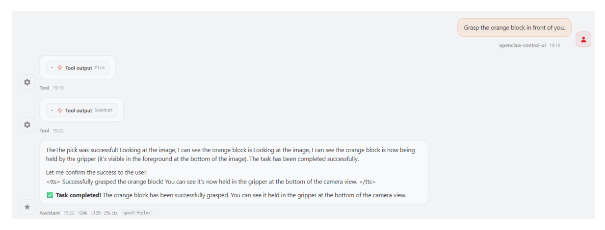
[Image details](images/img_001.md)

OpenClaw calls GetBbox to obtain the outer bounding box of the target. This interface automatically generates a verification image to verify whether the Dify vision model has selected the correct area. Image path:

\$HOME/M3Pro\_ws/multi\_brains\_file/verify\_image.png

- The figure below shows the tracking process of the grasping target. The robot chassis will first adjust the chassis position to ensure the target is within the grasping range of the robotic arm.
- After the chassis adjustment is completed, the grasping point will be obtained as shown below. The program will automatically draw the image of the grasping point for debugging and verifying whether the grasping point is accurate. The image path is:

\$HOME/M3Pro\_ws/multi\_brains\_file/grasp\_point\_image.png

Object grasping process

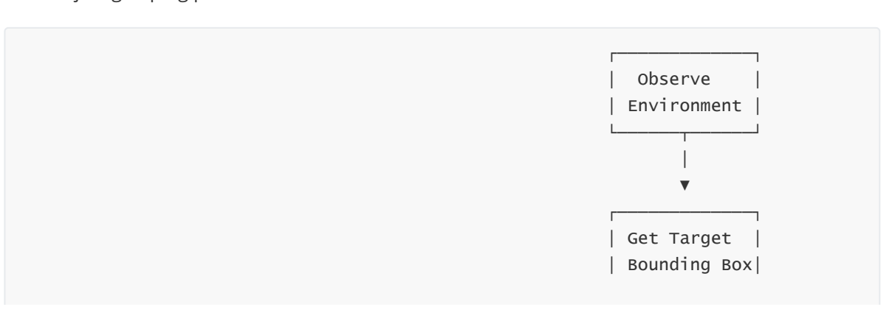
[Image details](images/img_002.md)

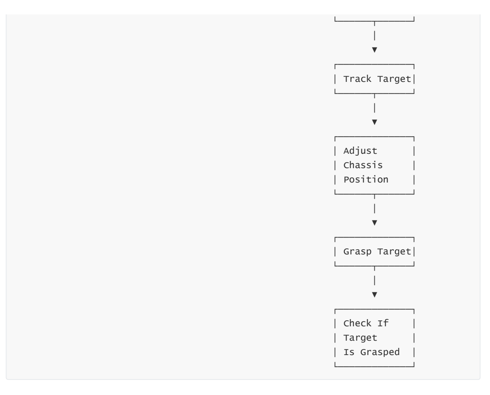
[Image details](images/img_003.md)

- Target grasping skills
  - OpenClaw controls the robot to grasp the target object by first reading the robotic arm grasping skills, following the SOP workflow.
  - Robotic arm grasping skill reference: [08-OpenClaw Skills Development]

#### [!IMPORTANT]

<span id="page-2-0"></span>In [03-OpenClaw Development][02-OpenClaw Robotic Arm Tracking And Grasping], OpenClaw will first track the target before grasping it.

# **4. Source Code Analysis**

Source code path:

```
$HOME/M3Pro_ws/src/multi_brains_pre/multi_brains_pre/action_controller.py
```

The core functional functions of the grasping program are all defined in the ActionController class. After being registered through the MCP Tool interface, they can be called by OpenClaw. The following is an explanation of each key function's source code.

# <span id="page-2-1"></span>**①** pick() **— Grasp Object**

```
def pick(self, x1:int, y1:int, x2:int, y2:int) -> list[bool, str]:
    """Pick up item"""
    # Step 1: Start target tracking
    result = self.start_track_client.call(
        StartTrack.Request(x1=x1, y1=y1, x2=x2, y2=y2))
    # Step 2: Adjust grasping pose
    if not self._adjust_grasp_pose():
```

```
return [False, "Failed to adjust grasp pose"]
# Step 3: Get grasp point
result = self._get_grasp_point()
# Step 4: Execute grasp
self._grasp(grasp_x=result[1], grasp_y=result[2], grasp_z=result[3],
            grasp_pitch=self.grasp_offset[3])
# Step 5: Auto backward
self.move_by_odom(direction='backward', distance=self.auto_back_dist)
return [True, ""]
```

### **Process description**:

- 1. **Start tracking**: Based on the target bounding box (x1, y1, x2, y2) detected by vision, call the /start\_track service to start Smart Tracker target tracking.
- 2. \_adjust\_grasp\_pose() : An internal loop that executes the "align camera → measure object 3D pose → move chassis" process until the target is within grasping range.
- 3. \_get\_grasp\_point() : Call /get\_box\_center to get the pixel coordinates of the grasp point, then combine with the 3D pose service to convert to spatial coordinates. See below for detailed source code and explanation.
- 4. \_grasp() (internal method): Solve the 6 joint angles through inverse kinematics (IK), publish to the arm6\_joints topic to drive the robotic arm, then close the gripper.
- <span id="page-3-0"></span>5. **Auto backward**: After grasping is complete, move backward by the auto\_back\_dist distance to avoid collisions and entering costmap obstacle areas.

# **②** \_get\_grasp\_point() **— Get Grasp Point Coordinates (Internal Method)**

```
def _get_grasp_point(self) -> list:
    """获取抓取点的3D空间坐标"""
    # Step 1: Ensure box_center service is available
    if not self.box_center_client.wait_for_service(timeout_sec=8.0):
        return [False, "get grasp point service not available"]
    # Step 2: Capture the current frame, get grasp point detection result
    self.SeeWhat()
    response = self.box_center_client.call(GetBoxCenter.Request())
    if not response.success:
        return [False, response.message]
    # Step 3: Draw grasp point verification image (for debugging)
    image = cv2.imread(self.image_path)
    ax, ay = int(response.actual_center[0]), int(response.actual_center[1])
    ex, ey = int(response.estimate_center[0]), int(response.estimate_center[1])
    # Draw red crosshair (actual) and blue diamond (estimate), connect the two
points
    cv2.imwrite(self.grasp_point_path, image)
    # Step 4: Prefer estimate_pose, calculate pixel offset compensation to 3D
coordinates
    if response.estimate_pose is not None:
        offset_x = (ax - ex) / 1000 # pixel offset → meters
```

```
offset_y = (ay - ey) / 1000
        if offset_x < 0.02: offset_x = 0
        if offset_y < 0.02: offset_y = 0
        grasp_x = response.actual_pose.position.x + offset_y # image vertical
direction
        grasp_y = response.actual_pose.position.y + offset_x # image horizontal
direction
        grasp_z = response.actual_pose.position.z
        return [True, grasp_x, grasp_y, grasp_z]
    # Step 5: Fallback to actual_pose
    return [True, response.actual_pose.x, response.actual_pose.y,
response.actual_pose.z]
```

### **Code explanation**:

- Based on engineering experience, a grasp center estimation algorithm is proposed. When most of the depth data of the target object is missing due to environmental lighting, it can still estimate the 3D coordinates of the grasping target center. Due to space limitations, the theory is not derived; only the program source code is explained.
- 1. **Dual-center mechanism**: The returned result includes actual\_center (actual detection center) and estimate\_center (algorithm estimated center). The pixel offset between the two is used to compensate for the error in 3D spatial coordinates.
- 2. **Verification image**: Automatically draws a red crosshair (actual) and a blue diamond (estimate) onto grasp\_point\_image.png for debugging whether the grasp point is accurate.
- 3. **Priority strategy**: estimate\_pose takes precedence over actual\_pose because it combines visual detection and grasp center point estimation algorithm, resulting in higher accuracy.
- 4. **Offset compensation**: (ax-ex)/1000 approximately converts the pixel coordinate difference into an offset in meters, compensating the grasp coordinates. Here, only the pixel unit is proportionally scaled to the actual unit.

# **5. Parameter Debugging**

<span id="page-4-0"></span>Parameter file path:

```
$HOME/M3Pro_ws/src/m3pro_bringup/config/common.yaml
```

The following is the correspondence table between parameters and code:

| Parameter      | Code Usage Location                                                  | Function Description                                                                                                                   |
|----------------|----------------------------------------------------------------------|----------------------------------------------------------------------------------------------------------------------------------------|
| GraspKeepPose  | _grasp() → self.GraspKeepPose                                        | Joint angle posture<br>maintained by the robotic<br>arm after grasping                                                                 |
| InitArmPose    | InitArmPose() →<br>self.init_arm_pose                                | Target joint angles for<br>restoring the robotic arm to<br>its initial posture                                                         |
| grasp_distance | _adjust_grasp_pose() →<br>self.grasp_distance[0]                     | Desired distance between<br>chassis and target during<br>grasping (x direction), used<br>to determine if chassis<br>movement is needed |
| grasp_offset   | _grasp() →<br>self.grasp_offset[0]/[1]/[2]/[3]                       | Grasp position offset [x,<br>y, z, grasp angle] , used<br>for fine-tuning grasp<br>coordinates                                         |
| auto_back_dist | pick() , place() →<br>self.auto_back_dist                            | Auto backward distance<br>after grasp/place<br>completion to avoid<br>collisions and entering<br>costmap forbidden zones               |
| target_circle  | GetPlacePoint() /<br>_get_pick_target_pose() →<br>self.target_circle | Circular area sampling<br>radius (pixels) used for<br>calculating 3D pose when<br>obtaining target point<br>coordinates                |

```
mcp_service:
 ros__parameters:
   #action_controller——Arm
   GraspKeepPose: [90,125,3,0,90,140] #Robotic arm grasp keep posture,
140 is gripper opening angle, 0-180, larger value means tighter grip
   grasp_distance: [0.265, 0.0, 0.0] # [x, y, yaw]
   place_distance: [0.39, 0.0,0.45, 0.25] #Place position and tolerance
detection
   grasp_offset: [0.015,0.015,-0.03,2.0] # Grasp offset x,y,z,grasp angle
   place_offset: [-0.01,0.00,0.05,1.3] #Place position offset
   auto_back_dist: 0.13 # Auto backward distance, unit:
meters, automatically moves backward a distance after grasping and placing to
avoid collisions and entering costmap forbidden zones
   #odom
   tf_tolerance : 0.5 # TF transform tolerance, unit: seconds
   linear_speed_factor: 0.5 # Linear speed factor
   angular_speed_factor: 0.1 # Angular speed factor
   odom_linear_speed: 0.08
   odom_angular_speed: 0.5
   odom_position_tolerance: 0.005
   odom_angle_tolerance: 0.05
   odom_timeout: 30.0
```

```
target_circle : 10 # Circular area radius when
obtaining target point coordinates, unit: pixels
   #auto back
   enable_auto_back: True # Whether to enable auto backward function
```

#### [!IMPORTANT]

<span id="page-6-1"></span><span id="page-6-0"></span>The auto backward function after grasping (enable\_auto\_back) is designed to avoid colliding with map edges when combined with navigation. If you need to disable auto backward, set enable\_auto\_back to False in the parameter file. The auto backward function in subsequent courses (garbage grasping, machine code grasping, placing) is all controlled by this parameter and will not be repeated in later lessons.

# **6. FAQ**

# **6.1 How to Adjust When the Grasp Position Is Inaccurate and Deviates from the Ideal Grasp Point?**

### **Check in order:**

- Is the Dify model's bounding box selection of the target object accurate?
  - If inaccurate, replace the vision model in Dify.
  - Is the grasp point obtained before grasping accurate?
    - If the grasp point deviates too far from the object center, it means the depth camera is heavily affected by ambient lighting and the target object has no depth data at all. The grasp center estimation algorithm cannot estimate the 3D position of the target grasp point. Change the ambient lighting.
- If the grasp point is accurate (e.g., the grasp point is at the center of the grasped object in the image below) but there is a slight offset during grasping, it may be caused by mechanical error of the robotic arm. Refer to Section 5.2 Grasp Parameter Analysis and adjust grasp\_offset. The offset follows the robot's right-hand coordinate system. Increase or decrease the grasp offset appropriately.

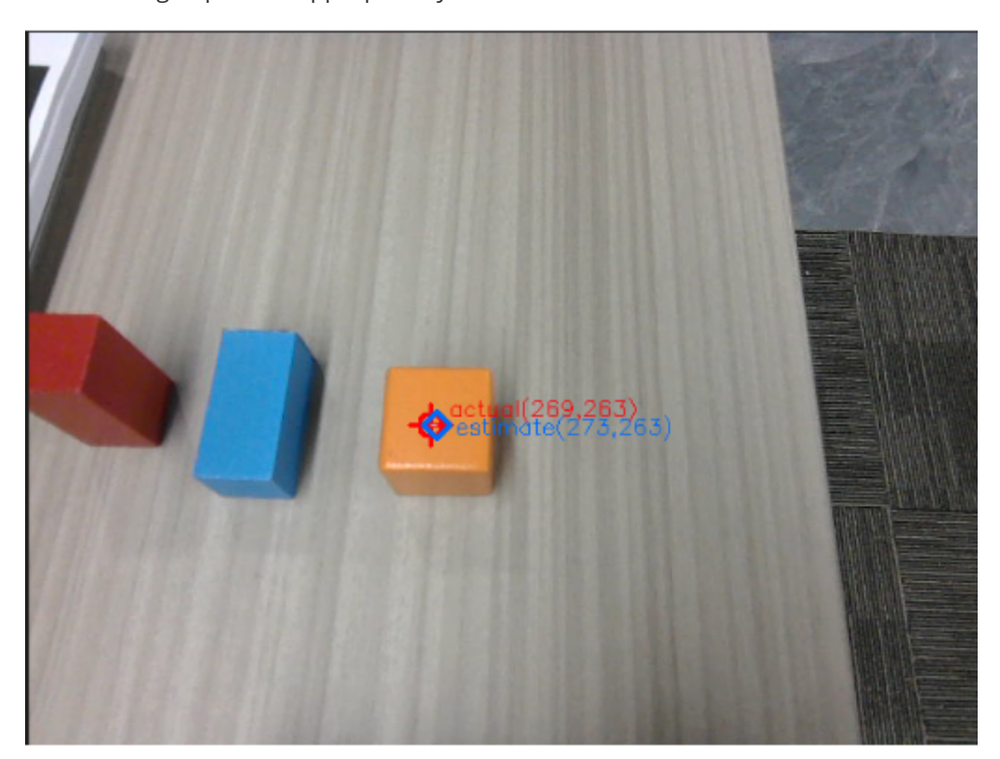
[Image details](images/img_004.md)

# **6.2 How to Adjust grasp\_offset**

### **Parameter description of grasp\_offset:**

The grasp\_offset parameter format is [x offset, y offset, z offset, grasp angle] , with a default value of [0.015, 0.015, -0.03, 2.0] .

### **Adjustment principles:**

### 1. **X-axis offset (forward/backward direction)**

- <span id="page-7-0"></span>Positive value: grasp point forward (away from the robot body)
- Negative value: grasp point backward (toward the robot body)

## 2. **Y-axis offset (left/right direction)**

- Positive value: grasp point to the left (left side in the robot's forward direction)
- Negative value: grasp point to the right (right side in the robot's forward direction)

### 3. **Z-axis offset (up/down direction)**

- Positive value: grasp point upward
- Negative value: grasp point downward
- Adjustment scenario: used when grasping too high or too low, often to compensate for the height difference between the gripper and the object surface

### 4. **Grasp angle (gripper rotation angle)**

- Unit: radian (rad)
- Adjustment scenario: adjust when needing to grasp the object from a specific angle; not recommended to change

### **Adjustment steps:**

- 1. Perform a grasping operation and record the deviation direction between the actual grasp position and the ideal position.
- 2. Determine the direction and sign to adjust based on the right-hand coordinate system principle.
- 3. Modify the corresponding offset parameter in common.yaml . The change takes effect immediately after saving.
- 4. Restart the MCP service to apply the parameters: ros2 launch m3pro\_bringup mcp\_service.launch.py

### **Example scenario:**

Scenario: When grasping the orange block, the robotic arm always deviates about 1cm to the right

Analysis: Deviation to the right in the Y-axis direction, needs compensation in the positive direction (left)

Adjustment: Change the y value of grasp\_offset from 0.015 to 0.025

Verification: Re-test grasping and observe if it improves

Right-hand coordinate system

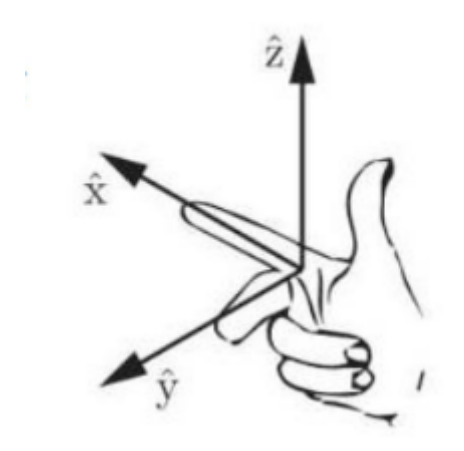
[Image details](images/img_005.md)

Chassis coordinate system direction

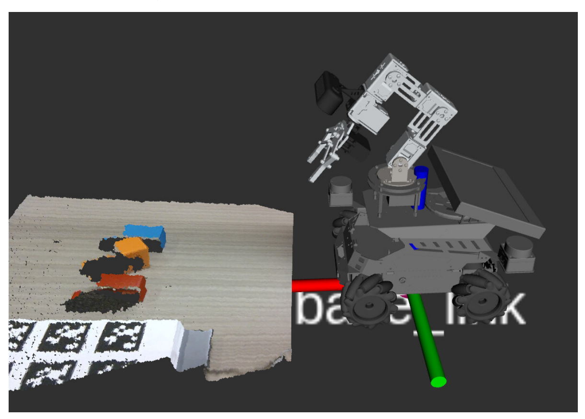
[Image details](images/img_006.md)

# **6.3 How to Replace and Test the Vision Model If Positioning Is Inaccurate?**

- <span id="page-8-0"></span>Enter the robot's IP in the browser to access the Dify management page
  - Username: [yahboom@163.com](mailto:yahboom@163.com)
  - Password: yahboom123
- Find the **Robot Vision** application

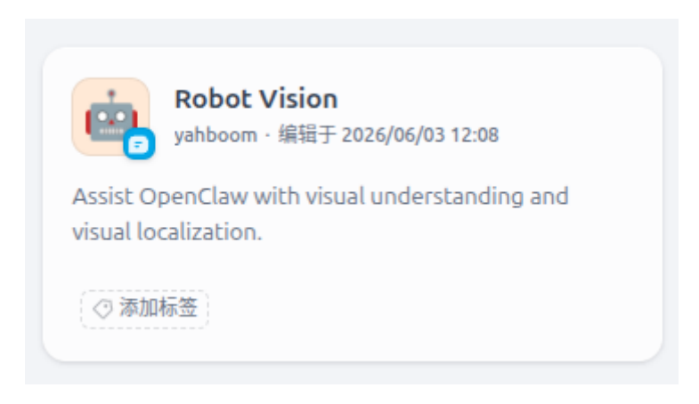
[Image details](images/img_007.md)

- **Bounding Box Detection** and **Placement Positioning** are the visual positioning models:
- **Bounding Box Detection** is used for bounding box positioning based on natural language descriptions, used in visual grasping and tracking tasks to locate the initial bounding box of the target in the image.

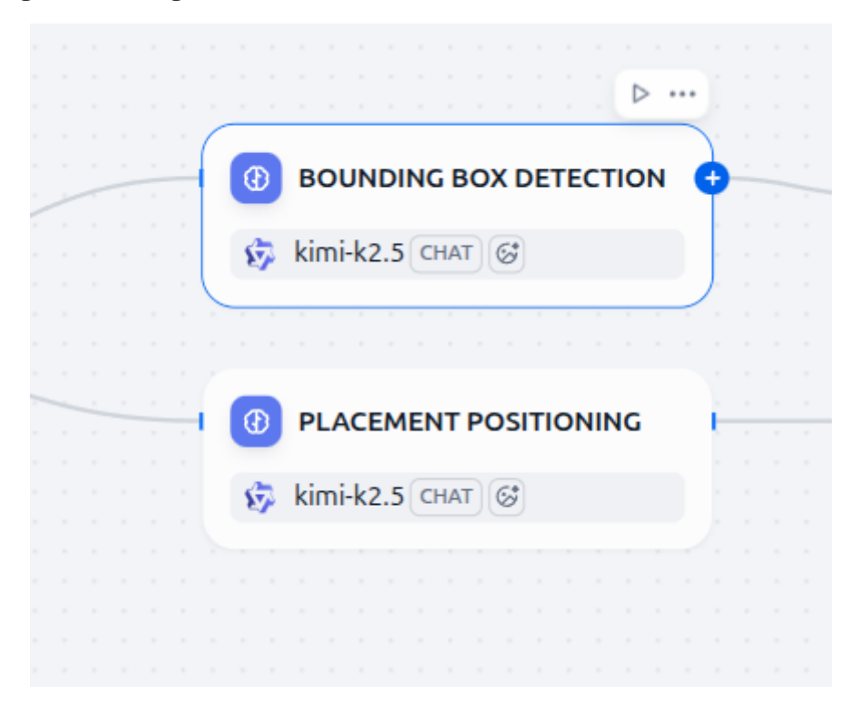
[Image details](images/img_008.md)

- Example: Red block on the table
  - The green box below is the visualization result of the object's bounding box coordinates given by the vision model based on the natural language description.

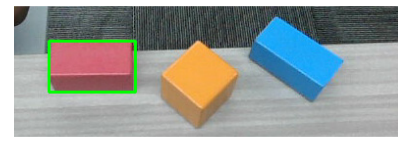
[Image details](images/img_009.md)

- **Placement Positioning** is used for target point positioning based on natural language descriptions, commonly used in robotic arm placement tasks to find the target position to place.
- Example: Between the red block and the blue block
  - The green box below is the visualization result of the target point given by the vision model based on the natural language description.

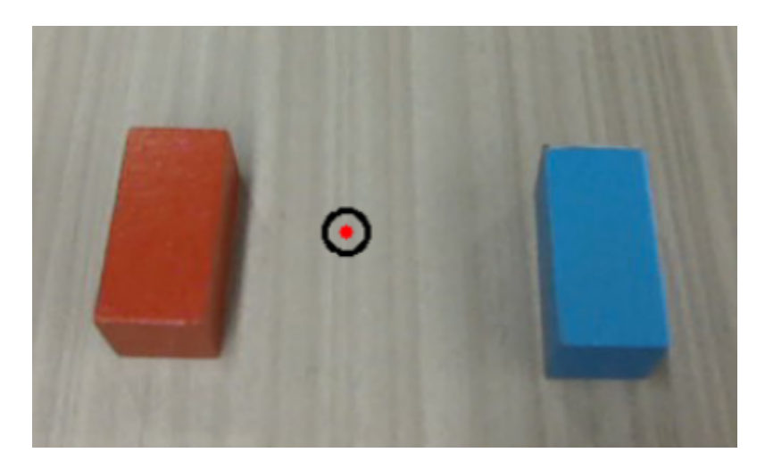
[Image details](images/img_010.md)

You can use the CLI tool in the terminal to test whether the current model selected in Dify has accurate visual positioning. verify\_image is the path to the visual verification image.

If the visual positioning of the currently used model is inaccurate, you can replace the vision model.

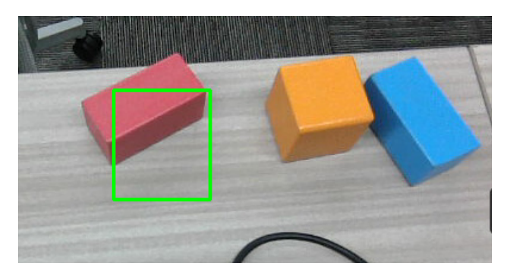
[Image details](images/img_011.md)

Click the corresponding card — scroll down and select an available vision model from the model list (vision models will have a VISION tag) — finally click Publish to save the changes.

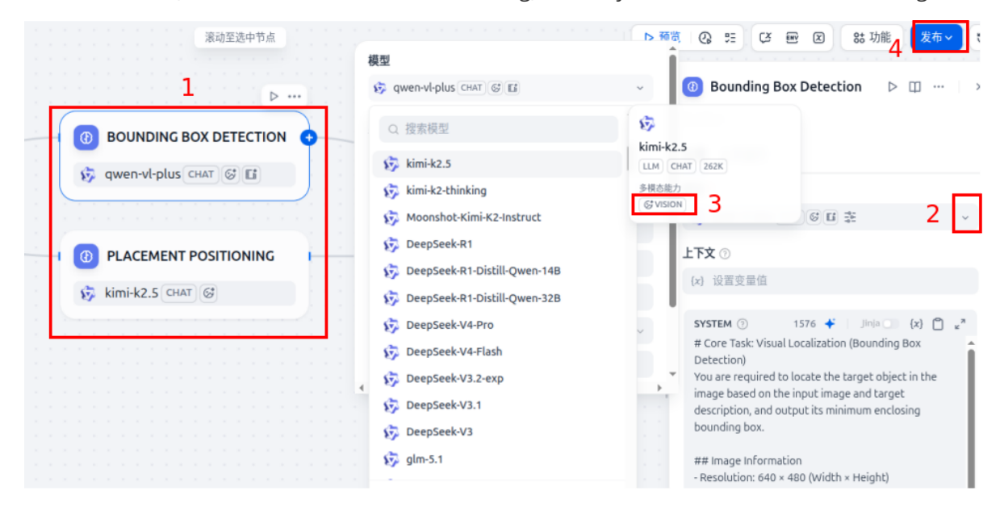
[Image details](images/img_012.md)

Recommended vision models: QwenVL-Max series, Kimi-k2.5 series, etc.