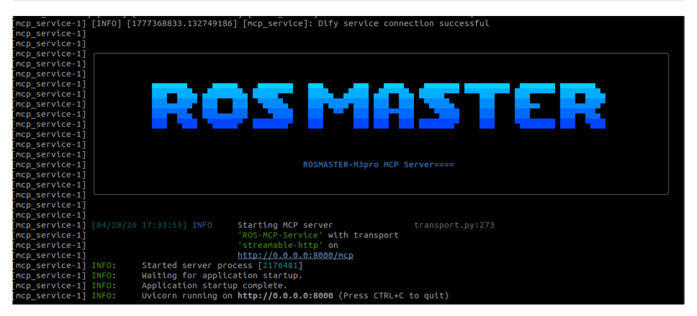
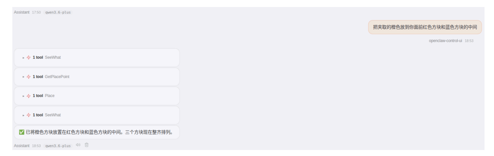
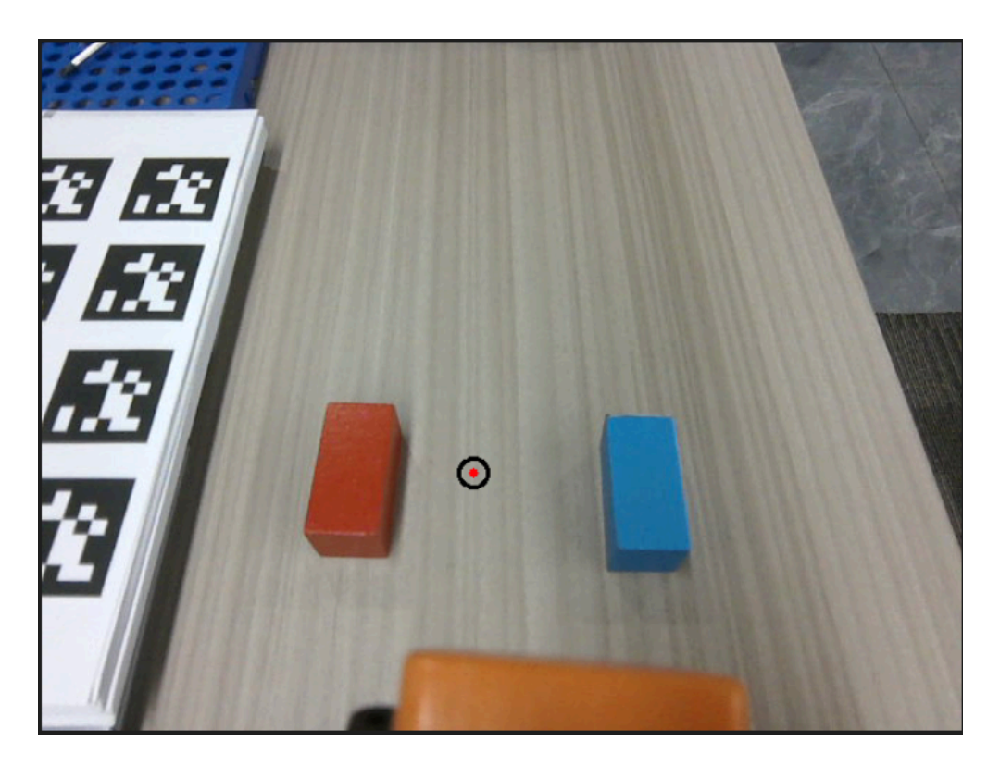

# **OpenClaw Robotic Arm Precision Placement**

#### **OpenClaw Robotic Arm Precision [Placement](#page-0-0)**

[1. Course](#page-0-1) Content

<span id="page-0-0"></span>Course [Overview](#page-0-2) Learning [Objectives](#page-0-3)

- [2. Preparation](#page-0-4)
- [3. Robotic Arm Precise](#page-2-0) Placement Use Case
- [4. Source](#page-3-0) Code Analysis
  - 4.1 [GetPlacePoint\(\)](#page-3-1) Obtaining Placement Point Coordinates
  - 4.3 \_place() Execute [Placement](#page-5-0) Action (Internal Method)
- [5. Parameter](#page-6-0) Debugging
- <span id="page-0-2"></span><span id="page-0-1"></span>[6. Functionality](#page-7-0) Q&A
  - 6.1 How do I adjust the distance between the robot chassis and the target [placement](#page-7-1) point?
  - 6.2 How do I adjust the placement position if it is [inaccurate?](#page-8-0) **Checklist (in order):**

# **1. Course Content**

### **Course Overview**

<span id="page-0-3"></span>This course explains the complete technical process of using OpenClaw to control an M3Pro robot to achieve precise placement of the robotic arm. The course covers all aspects from natural language understanding, visual point recognition, 3D coordinate transformation to precise robotic arm placement, including Dify visual agent invocation and inverse kinematics (IK) solving.

### **Learning Objectives**

- Master the technical workflow for using OpenClaw to control a robotic arm for precise object placement via natural language instructions.
- Understand the role of the Dify Vision Agent in identifying target locations and how to invoke it.
- <span id="page-0-4"></span>Learn how to use the GetPlacePoint tool to retrieve the 3D coordinates of a placement target and verify if it falls within the robotic arm's reachable workspace.

# **2. Preparation**

Start the MicroROS chassis agent (skip this step if it is already running).

sh start\_agent.sh

Launch the odometry, TF, robotic arm auxiliary, camera, and other relevant nodes.

```
ros2 launch m3pro_bringup car_base.launch.py
```

Start the MCP service.

ros2 launch m3pro\_bringup mcp\_service.launch.py


[Image details](images/img_001.md)

If you require voice feedback, you must additionally launch the openclaw\_bridge ; otherwise, this step can be skipped.

# **3. Robotic Arm Precise Placement Use Case**

### **Tip**

<span id="page-2-0"></span>You may formulate commands according to your specific needs; the following serves as a demonstration. You may choose any interaction method you prefer; this example uses the WebChat interface for the demonstration.

| Command       | Parameters                   | Function                                                                                                             |
|---------------|------------------------------|----------------------------------------------------------------------------------------------------------------------|
| GetPlacePoint | query                        | Locates the coordinates of a placement target and checks<br>if it lies within the robotic arm's reachable workspace. |
| Place         | place-x ,place<br>y ,place-z | Places an object at the specified coordinate position.                                                               |

The Place tool provides the capability to place an object at a specific location within the robot's camera field of view, based on a natural language description. For example: Place the grasped orange block between the red and blue blocks located in front of you.


[Image details](images/img_002.md)

When obtaining a placement point, a verification image is automatically generated to facilitate debugging and to verify the accuracy of the placement coordinates. The image path is:

\$HOME/M3Pro\_ws/multi\_brains\_file/place\_verify\_image.png


[Image details](images/img_003.md)

# **4. Source Code Analysis**

<span id="page-3-1"></span><span id="page-3-0"></span>Source Code Path

\$HOME/M3Pro\_ws/src/multi\_brains\_pre/multi\_brains\_pre/action\_controller.py

### **4.1** GetPlacePoint() **— Obtaining Placement Point Coordinates**

```
def GetPlacePoint(self, query: str) -> list[bool, str]:
    """Retrieve the 3D spatial coordinates of the placement point"""
# Step 1: Capture the current scene
    save_result = self.SeeWhat()
    if not save_result[0]:
        return [False, f"SeeWhat error:{save_result[1]}", ""]
   # Step 2: Apply Grid Overlay and Invoke Dify Vision Agent for Analysis
    img = draw_grid_overlay(image=cv2.imread(self.image_path), grid_size=20)
    cv2.imwrite(self.grid_images_path, img)
    agent_result = self._request_dify_agent(query, self.grid_images_path, TYPE="POINT")
    if not agent_result[0]:
        return [False, f"Dify Agent error:{agent_result[1]}", ""]
   # Step 3: Retrieve pixel coordinates and check for the presence of the target.
    point_data = agent_result[1].get("point", {})
    x, y = point_data.get("x"), point_data.get("y")
    if x == -1 and y == -1:
        return [False, "目标点不存在于画面中", ""]
    # Step 4: Draw point verification image (for debugging purposes)
    img = cv2.imread(self.image_path)
    cv2.circle(img, (x, y), self.target_circle, (0, 0, 0), 2) # Circular Marker
```

```
cv2.circle(img, (x, y), 3, (0, 0, 255), -1) # Center Red Dot
cv2.imwrite(self.place_verify_image_path, img)
# Step 5: Convert pixel coordinates to spatial coordinates using the 3D Pose Service.
request = GetTargetPose.Request(x=float(x), y=float(y), radius=self.target_circle)
result = self.get_pose_client.call(request)
if not result.success:
    return [False, str(result.message), ""]
point = str({"x": round(result.pose.position.x, 2),
             "y": round(result.pose.position.y, 2),
             "z": round(result.pose.position.z, 2)})
# Step 6: Check if within the robotic arm's workspace
if result.pose.position.x <= self.place_distance[2] and \
   result.pose.position.y <= self.place_distance[3]:
    msg = "✅ 目标点在工作范围内"
else:
    msg = "❌ 目标点超出工作范围"
return [True, msg, point]
```

### **Process Description:**

- 1. First, capture the current scene and overlay a 20px grid reference (to facilitate positioning by the Dify Vision Model).
- 2. Invoke the Dify Vision Agent to parse natural language instructions and return the pixel coordinates (x, y) for the placement location.
- 3. If (-1, -1) is returned, it indicates that the target is not present in the scene; an error is returned immediately.
- 4. Generate a point verification image saved as place\_verify\_image.png , using a black circle to mark the target area and a red dot to mark its center, to aid in debugging.
- 5. Convert the pixel coordinates into 3D spatial coordinates using the get\_target\_pose service.
- 6. Use place\_distance[2] (x-axis upper limit) and place\_distance[3] (y-axis upper limit) to determine whether the target point lies within the robotic arm's workspace.

### **4.2** place() **— Placing Items**

```
def place(self, place_x: float, place_y: float, place_z: float) -> list[bool, str]:
    """The robotic arm places the object to the target position."""
    # Step 1: Execute placement action
    self._place(place_x, place_y, place_z, place_pitch=self.place_offset[3])
    # Step 2: Automatic Backtrack
    self.move_by_odom(direction='backward', distance=self.auto_back_dist)
    self.get_logger().info("Place object complete")
    return [True, ""]
```

### **Process Description:**

- 1. **Invoke Internal Placement Method:** Pass the target placement coordinates ( place\_x , place\_y , place\_z ) to the \_place() method, along with the configured placement angle place\_offset[3] (pitch angle).
- <span id="page-5-0"></span>2. **Automatic Retraction:** Upon completion of the placement, retract by a distance of auto\_back\_dist to prevent collisions between the robotic arm and the placement platform.

### **4.3** \_place() **— Execute Placement Action (Internal Method)**

```
def _place(self, place_x, place_y, place_z,
           place_roll=0.0, place_pitch=0.0, place_yaw=0.0):
   # Step 1: Construct the inverse kinematics solve request, applying the placement offset.
    request = ArmKinemarics.Request()
    request.tar_x = place_x + self.place_offset[0]
    request.tar_y = -(place_y + self.place_offset[1]) # Invert Y-Axis (Coordinate System
Transformation)
    request.tar_z = place_z + self.place_offset[2]
    request.kin_name = "ik"
    request.roll = place_roll
    request.pitch = place_pitch
    request.yaw = place_yaw
    # Step 2: Call the Inverse Kinematics Solver
    response: ArmKinemarics.Response = self.arm_kin_client.call(request)
    self.get_logger().info(f"place IK-pose: {response}")
    # Step 3: Extract Joint Angles and Control Robot Arm Movement
    joints = [0, 0, 0, 0, 0, 0]
    joints[0] = int(response.joint1)
    joints[1] = int(response.joint2)
    joints[2] = int(response.joint3)
    joints[3] = int(response.joint4)
    joints[4] = int(response.joint5)
    joints[5] = self.GraspKeepPose[5] # Joint 6 maintains the gripping posture angle.
    self._pubSix_Arm(joints)
    time.sleep(4.0) # Waiting for the robotic arm to reach the target position
    # Step 4: Release the Gripper Jaws
    self.SingleJoint_pub.publish(ArmJoint(id=6, joint=0, time=1500))
    time.sleep(2.0) # Wait for Object Release
    # Step 5: Restore the robotic arm to its initial pose.
    self._pubSix_Arm(self.init_arm_pose)
```

### **Code Explanation:**

- 1. **Offset Superposition:** The place\_offset (x/y/z) is superimposed onto the target placement coordinates to fine-tune the exact placement position.
- 2. **Inverse Kinematics Solution:** Calls the /get\_kinematics service (with kin\_name="ik" ) to calculate the six joint angles required to achieve the target pose.

- 3. **Joint Control:** Publishes the six joint angles to the arm6\_joints topic via \_pubSix\_Arm() , driving the robotic arm to move to the designated placement location.
- 4. **Object Release:** Controls the 6th joint (the gripper) to open (joint=0), thereby releasing the grasped object.
- 5. **Pose Recovery:** Upon completion of the placement task, \_pubSix\_Arm(self.init\_arm\_pose) is called to restore the robotic arm to its initial pose, preventing interference with subsequent operations.

### **Key Parameter Descriptions:**

- place\_offset[0] : X-axis offset; adjusts the forward/backward position of the placement point.
- place\_offset[1] : Y-axis offset; adjusts the left/right position of the placement point.
- place\_offset[2] : Z-axis offset; typically set to a positive value (e.g., 0.05m) to ensure the object is released slightly above the target surface during placement.
- <span id="page-6-0"></span>place\_offset[3] : Placement pitch angle; controls the orientation of the gripper during placement (default: 1.3 rad).

# **5. Parameter Debugging**

Parameter File Path:

\$HOME/M3Pro\_ws/src/m3pro\_bringup/config/common.yaml

The following table outlines the correspondence between the parameters and the code:

| Parameter      | Location in Code                                                     | Function Description                                                                                                                                             |
|----------------|----------------------------------------------------------------------|------------------------------------------------------------------------------------------------------------------------------------------------------------------|
| place_distance | GetPlacePoint() →<br>self.place_distance[2]/[3]                      | XYZ coordinates for the placement<br>position, and tolerance check for<br>the robot arm's workspace ( [2] is<br>the X upper limit; [3] is the Y<br>upper limit). |
| place_offset   | _place() →<br>self.place_offset[0]/[1]/[2]/[3]                       | Placement position offset, used for<br>fine-tuning the placement<br>coordinates.                                                                                 |
| auto_back_dist | pick() , place() →<br>self.auto_back_dist                            | Automatic retreat distance after<br>completing a pick/place operation,<br>to avoid collisions and prevent<br>entry into restricted zones within<br>the costmap.  |
| target_circle  | GetPlacePoint() /<br>_get_pick_target_pose() →<br>self.target_circle | The sampling radius (in pixels) of<br>the circular region used to calculate<br>the 3D pose when determining<br>target point coordinates.                         |

```
mcp_service:
 ros__parameters:
  #action_controller——Arm
   GraspKeepPose: [90,125,3,0,90,140] #Robotic Arm: Maintain Grasping Posture. 140
represents the gripper opening/closing angle (range: 0–180); a higher value indicates a
tighter grip.
   grasp_distance: [0.265, 0.0, 0.0] # [x, y, yaw]
   place_distance: [0.39, 0.0,0.45, 0.25] #Placement Position and Tolerance Detection
   grasp_offset: [0.015,0.015,-0.03,2.0] # Grasping Offset (x, y, z), Grasping Angle
   place_offset: [-0.01,0.00,0.05,1.3] Placement Offset
   auto_back_dist: 0.13 # Automatic Retreat Distance (Unit: Meters):
After a grasping or placing operation is completed, the robot automatically retreats a
certain distance to avoid collisions and prevent entry into restricted zones within the
costmap.
   #odom
   tf_tolerance : 0.5 # TF Transform Tolerance (Unit: seconds)
   linear_speed_factor: 0.5 # Linear Velocity Scale Factor
   angular_speed_factor: 0.1 # Angular Velocity Scale Factor
   odom_linear_speed: 0.08
   odom_angular_speed: 0.5
   odom_position_tolerance: 0.005
   odom_angle_tolerance: 0.05
   odom_timeout: 30.0
   target_circle : 10 # When obtaining target point coordinates, the
radius of the circular region (in pixels).
```

# **6. Functionality Q&A**

# **6.1 How do I adjust the distance between the robot chassis and the target placement point?**

<span id="page-7-1"></span><span id="page-7-0"></span>Use AdjustChassisFitArmRange to adjust the chassis position.

If the target point falls outside the robotic arm's working range, OpenClaw will call AdjustChassisFitArmRange to adjust the chassis position, thereby bringing the target point within the arm's reachable range:

```
# Source Code Location: AdjustChassisFitArmRange()
def AdjustChassisFitArmRange(self, x: float, y: float, z: float) -> bool:
delta_x = x - self.place_distance[0] # Calculate deviation in the x-direction
delta_y = y - self.place_distance[1] # Calculate deviation in the y-direction
self.move_by_odom(distance=abs(delta_x), direction='forward')
direction = 'left' if delta_y > 0 else 'right'
self.move_by_odom(distance=abs(delta_y), direction=direction)
return True
```

#### **Adjustment Method**:

1. Modify the reference coordinates [x\_ref, y\_ref] within the place\_distance parameter.

<span id="page-8-0"></span>2. Increasing the values of place\_distance[2] and place\_distance[3] can extend the robotic arm's working range.

# **6.2 How do I adjust the placement position if it is inaccurate? Checklist (in order):**

### 1. **Is the Dify model recognition accurate?**

- Inspect the place\_verify\_image.png verification image to confirm that the designated point markers are located at the expected positions.
- If the recognition is inaccurate, refine the natural language description or switch to a different Dify vision model.

### 2. **Is the placement offset appropriate?**

- If the designated point is accurate but the actual placement is misaligned, adjust the place\_offset parameters.
- X/Y-axis offsets follow the robot's right-hand coordinate system; for the Z-axis, it is recommended to maintain a positive value.

### 3. **Is ambient lighting interfering with the depth camera?**

- Missing depth data will result in inaccurate 3D coordinate transformations.
- Improve the ambient lighting conditions or adjust the position of the object.
- Parameter Configuration Example

```
mcp_service:
ros__parameters:
place_distance: [0.39, 0.0, 0.45, 0.25] # [x_base, y_base, x_upper_limit, y_upper_limit]
place_offset: [-0.01, 0.00, 0.05, 1.3] # [x_offset, y_offset, z_offset,
placement_pitch_angle]
```

#### **Important Notes:**

⚠️ When adjusting offsets, adhere to the principle of **small increments and iterative testing** to avoid large, sudden adjustments that could lead to collisions.

⚠️ Adjust parameters for only one axis/direction at a time to accurately assess the impact of each adjustment.

⚠️ Record the parameter values and test results for every adjustment to build a comprehensive parameter tuning log.