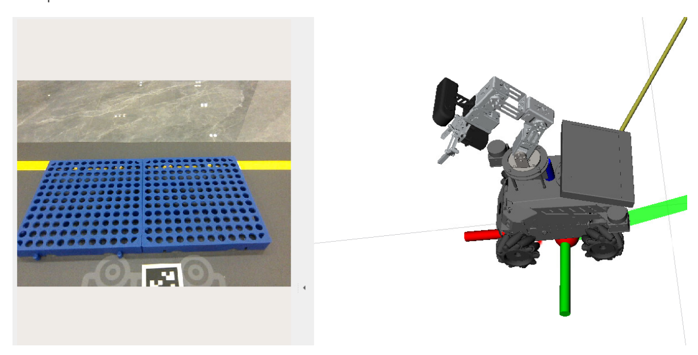

# **OpenClaw Navigation Transfer**

#### **OpenClaw [Navigation](#page-0-0) Transfer**

- <span id="page-0-0"></span>[1. Course](#page-0-1) Content Learning [Objectives](#page-0-2)
- [2. Preparation](#page-0-3)
- [3. Demonstration](#page-1-0) Case
- <span id="page-0-2"></span><span id="page-0-1"></span>[4. Parameter](#page-2-0) Tuning and Source Code Analysis

### **1. Course Content**

#### **Learning Objectives**

This section is a comprehensive course that combines robotic arm visual grasping and intelligent navigation functions for complex long-flow tasks. Please complete the basic courses [02-OpenClaw Robotic Arm Tracking Grasp], [05-OpenClaw Slam Mapping and Navigation], and [Road Network Planning Navigation] first.

# **2. Preparation**

- <span id="page-0-3"></span>Complete grid map construction, pose map construction, and road network file annotation. For details, refer to the tutorial [Road Network Planning Navigation - Building Pose Maps and Road Network Annotation]
- Complete the prerequisite tutorials, mastering map construction, road network annotation, and map mapping marking functions in advance.
- Start the MicroROS chassis agent (no need to restart if already started)

```
sh start_agent.sh
```

- Start odometry, tf, robotic arm assistance, camera nodes, etc. If you need to enable visual relocalization, add the startup parameter relocation:=True
- Start with relocalization (start from host)

```
ros2 launch m3pro_bringup car_base.launch.py relocation:=True
```

Start road network navigation (start inside roadnet container)

```
ros2 launch road_net_route roadnet_nav2.launch.py
rviz_config_file:=/root/volumes/code_ws/src/road_net_route/rviz/nav2_relocaton.r
viz
```

Start the MCP service

```
ros2 launch m3pro_bringup mcp_service.launch.py
```

If you need voice reply, you need to start openclaw\_bridge additionally, otherwise it can be omitted

```
ros2 run multi_brains_pre openclaw_bridge
```

### **3. Demonstration Case**

[!TIP]

- <span id="page-1-0"></span>You can freely edit commands based on actual conditions. The following is a reference case.
- **Transport a purple block from the raw material warehouse to the blue shelf area of the processing center**
- Use the robot\_control CLI to pre-mark the map mapping for "raw material warehouse" and "processing center"

- Then assign a specific task to OpenClaw, choose any interaction method
- Transport a purple cube from the raw material warehouse to the blue shelf area of the processing center.

OpenClaw will call tools to first grasp the color block and then navigate to the location for placement


[Image details](images/img_001.md)

# **4. Parameter Tuning and Source Code Analysis**

<span id="page-2-0"></span>This section is a comprehensive course. Debugging parameters and functional source code are detailed in [02-OpenClaw Robotic Arm Tracking Grasp] and [05-OpenClaw Slam Mapping and Navigation].