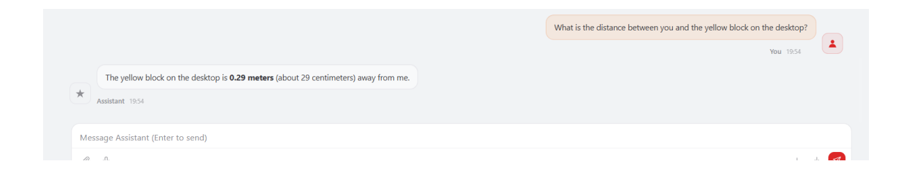

# **OpenClaw Visual Distance Measurement**

#### **OpenClaw [Visual Distance Measurement](#page-0-0)**

- <span id="page-0-0"></span>[1. Course](#page-0-1) Content Learning [Objectives](#page-0-2)
- [2. Preparation](#page-0-3)
- [3. Demonstration](#page-1-0) Case
- <span id="page-0-1"></span>[4. Source](#page-2-0) Code Analysis [GetTargetDist](#page-2-1)

# **1. Course Content**

### **Learning Objectives**

- <span id="page-0-2"></span>**Master the** GetTargetDist **Tool Invocation**: Learn to describe a target object using natural language and obtain its relative distance to the robot body through the MCP tool.
- **Familiarize with Pose Calculation Flow**: Understand the complete logic from extracting the bounding box center point, calling the GetTargetPose service, to finally calculating the Euclidean distance.
- **Gain Debugging and Verification Ability**: Be able to confirm the accuracy of the detected target through the generated verification image ( verify\_image.png ) and optimize the query description based on the actual environment.

# **2. Preparation**

<span id="page-0-3"></span>Start the MicroROS chassis agent (no need to restart if already started)

sh start\_agent.sh

Start odometry, tf, robotic arm assistance, camera nodes, etc.

ros2 launch m3pro\_bringup car\_base.launch.py

Start the MCP service

ros2 launch m3pro\_bringup mcp\_service.launch.py

If you need voice reply, you need to start openclaw\_bridge additionally, otherwise it can be omitted

ros2 run multi\_brains\_pre openclaw\_bridge

# **3. Demonstration Case**

[!TIP]

- <span id="page-1-0"></span>You can write commands according to your own needs. The following is a case demonstration. Choose any interaction method. Here we take the web-based WebChat as an example.
- OpenClaw can use the GetTargetDist tool to automatically identify the target in the frame based on the user's natural language description (e.g., "the red cup in front") and calculate its distance to the robot.

| Command       | Parameters | Function                                                                                    |
|---------------|------------|---------------------------------------------------------------------------------------------|
| GetTargetDist | query      | Calculate the distance between the target and the robot<br>body based on object description |


[Image details](images/img_001.md)

When the GetTargetDist tool is called, the system automatically generates a verification image and marks the distance-measured target object in the image. The image save path is:

\$HOME/M3Pro\_ws/multi\_brains\_file/verify\_image.png

Similarly, when you need to debug and test the MCP tool, you can also call it via CLI:

robot\_control call-tool GetTargetDist --query "the red block on the desktop"

# **4. Source Code Analysis**

<span id="page-2-0"></span>Source path

```
$HOME/M3Pro_ws/src/multi_brains_pre/multi_brains_pre/action_controller.py
```

### **GetTargetDist**

This function implements the visual distance measurement function based on natural language description.

```
def GetTargetDist(self, query:str):
        '''Get the distance to the target object'''
        # 1. Call the target detection service to get the bounding box of the
specified object
        res=self.GetBbox(query)
        if not res[0]:
            return [False, res[1]]
        # 2. Parse the bounding box string and calculate the center pixel
coordinates of the target in the image
        import ast
        bounding_box = ast.literal_eval(res[1])
        target_center_x = (bounding_box['x2'] + bounding_box['x1']) / 2
        target_center_y = (bounding_box['y2'] + bounding_box['y1']) / 2
        # 3. Check if the pose calculation service is available
        if not self.get_pose_client.wait_for_service(timeout_sec=8.0) :
            msg = "GetTargetPose service not available"
            self.get_logger().error(Fore.YELLOW + msg + Fore.RESET)
            return [False, msg]
        # 4. Call the GetTargetPose service to convert pixel coordinates to 3D
pose in the robot coordinate system
        request = GetTargetPose.Request(x=float(target_center_x),
y=float(target_center_y), radius=self.target_circle)
        result:GetTargetPose.Response = self.get_pose_client.call(request)
        if not result.success:
            error_msg=result.message
            self.get_logger().error(error_msg)
            return [False, error_msg]
        # 5. Calculate the horizontal Euclidean distance from the target point
to the robot origin
        import math
```

```
distance = round(math.sqrt((result.pose.position.x ** 2) +
(result.pose.position.y ** 2)), 2)
        return [True, distance]
```

#### **Core Logic Description:**

- 1. **Semantic Localization**: First, use the GetBbox interface to locate the target in the image based on the text description query .
- 2. **Coordinate Transformation**: Extract the center point (center\_x, center\_y) of the Bounding Box as the reference point for visual distance measurement.
- 3. **Spatial Calculation**: Through the GetTargetPose service, combined with camera intrinsic and extrinsic calibration information, back-project the 2D pixel point into 3D space to obtain the target's displacement relative to the camera.
- 4. **Distance Calculation**: Finally, use the Pythagorean theorem to calculate the straight-line distance of the target on the horizontal plane, providing data support for navigation or approach tasks.