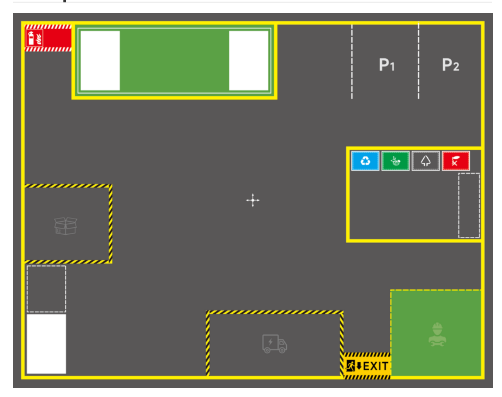
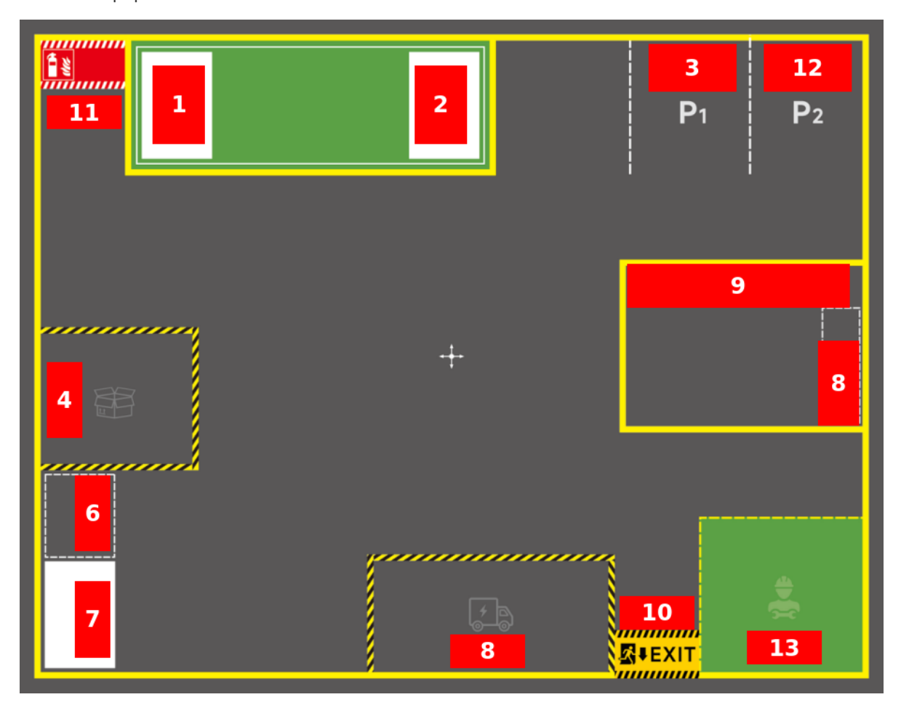
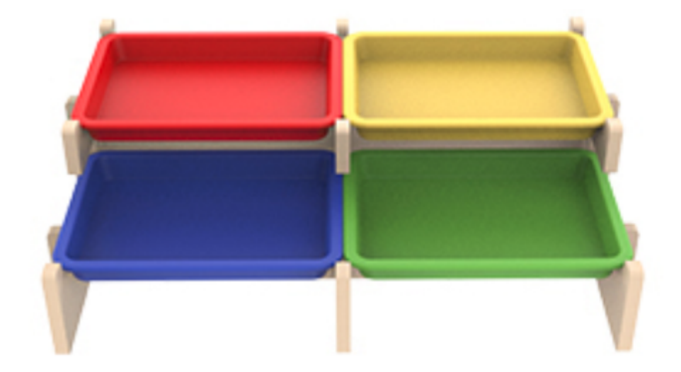
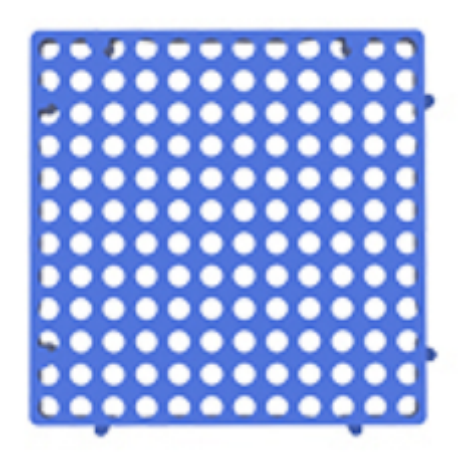
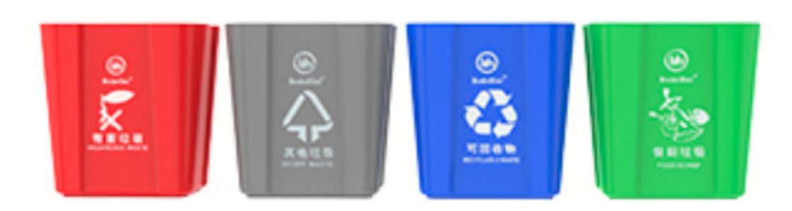

# **Map Description And Prop Placement**

#### **Map [Description](#page-0-0) And Prop Placement**

- [1. Map Overview](#page-0-1)
- 2. Area [Description](#page-0-2)
- [3. Prop Description](#page-1-0)
  - 3.1 Tag [Code](#page-1-1)
  - 3.2 Shelves [& Pallets](#page-1-2)
  - 3.3 [Blue](#page-2-0) Pad
  - 3.4 [Trash](#page-2-1) Bin
  - 3.5 Color [Block](#page-2-2)

# **1. Map Overview**

[Image details](images/img_001.md)

# **2. Area Description**

- Area naming is arbitrary, **you can define them according to actual needs**. The following area naming and placement are for reference only
- 1, 2, 7: Shelf area (place shelves & pallets)
- 3: Parking lot 1
- 12: Parking lot 2
- 4: Cargo warehouse (place blue pads, color blocks)
- 6: Cargo sorting area (place blue pads, color blocks)
- 8: Garbage sorting area (place garbage blocks)
- 9: Trash bin area (place trash bins)

- 10: Exit
- 11: Fire equipment area
- 13: Equipment maintenance area

[Image details](images/img_002.md)

# **3. Prop Description**

### **3.1 Tag Code**

Used for visual relocation enhancement, correcting positioning errors caused by various reasons, providing robustness for robot global localization

[Image details](images/img_003.md)

#### **3.2 Shelves & Pallets**

Used for placing cargo blocks

[Image details](images/img_004.md)

#### **3.3 Blue Pad**

Used to simulate cargo pallets in a real warehouse

[Image details](images/img_005.md)

#### **3.4 Trash Bin**

Used in garbage sorting tasks where the robot sorts garbage into corresponding trash bins

[Image details](images/img_006.md)

## **3.5 Color Block**

Used to simulate cargo of various colors, for robotic arm grasping tasks such as cargo sorting and cargo transport

[Image details](images/img_007.md)