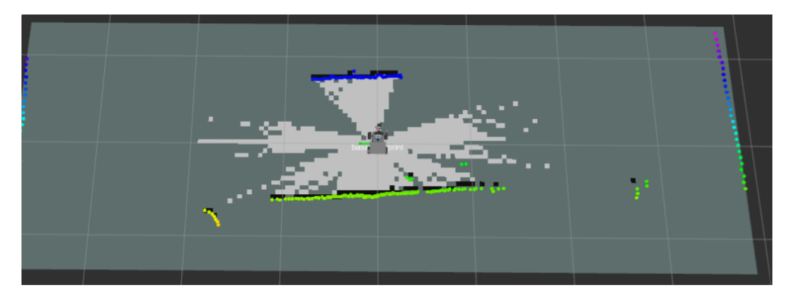
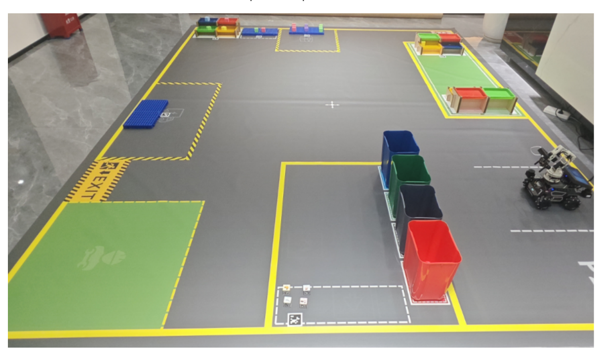
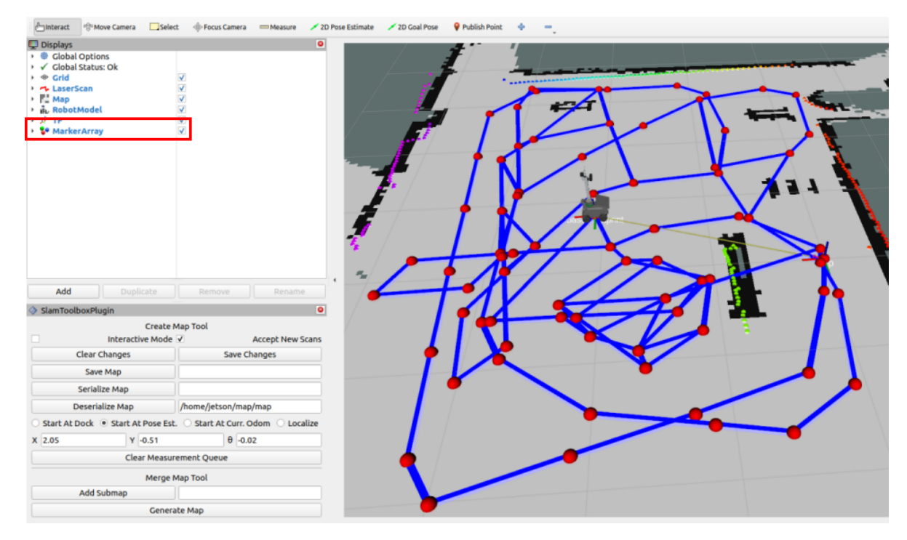
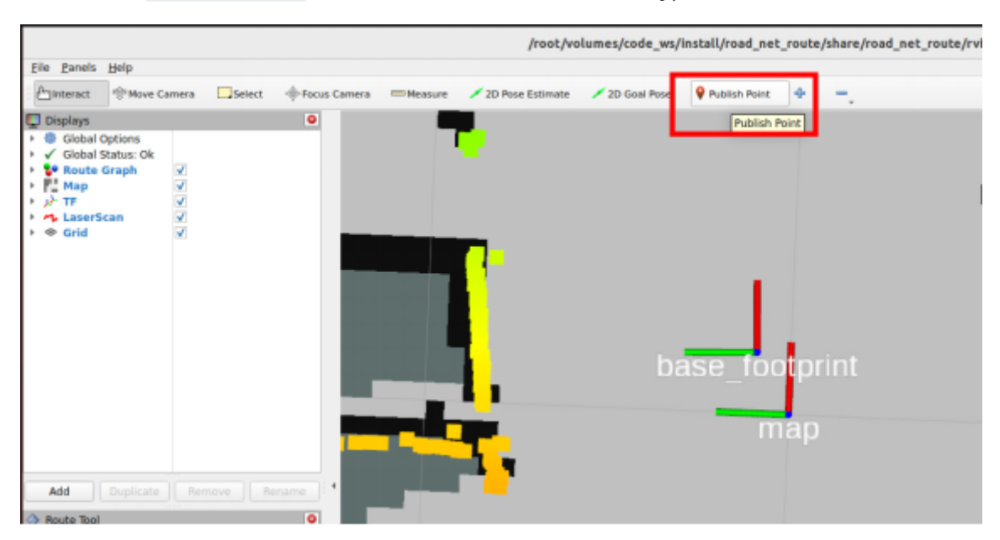
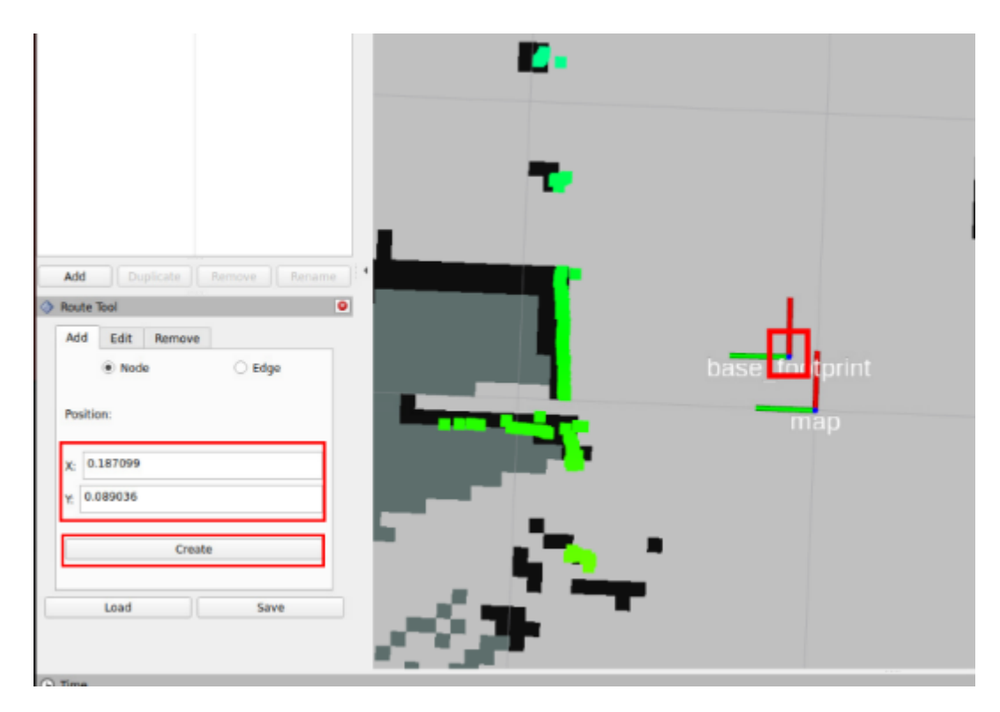
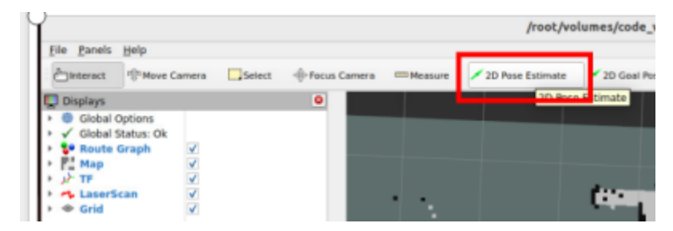
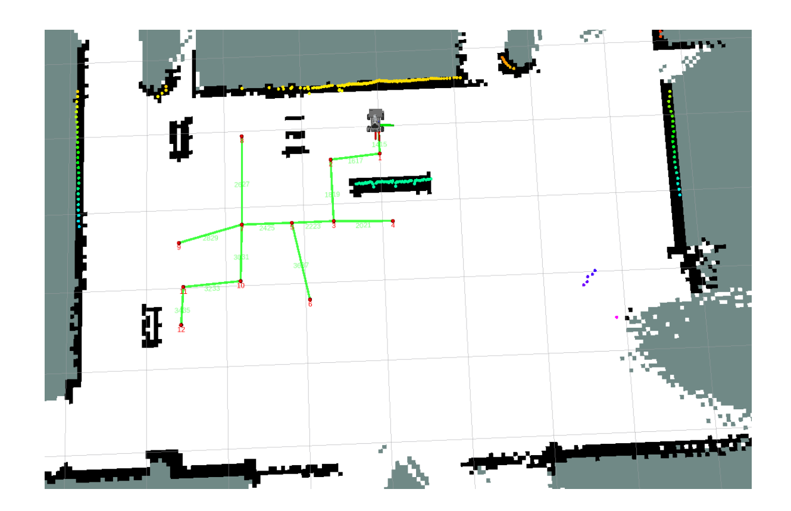

# **Build Sand Table Map**

#### **Build Sand [Table Map](#page-0-0)**

- <span id="page-0-0"></span>[1. Course](#page-0-1) Content Learning [Objectives](#page-0-2)
- [2. Preparation](#page-0-3)
- [3. Build Grid Map](#page-0-4)
- <span id="page-0-2"></span><span id="page-0-1"></span>[4. Build Road Network Description](#page-3-0) File

### **1. Course Content**

### **Learning Objectives**

- Master the complete process of building a sand table grid map using slam\_toolbox
- Learn to use the Publish Point tool to create waypoints, and use the 2D Pose Estimate tool for relocation
- Understand the basic principles of road network planning and annotation strategies for sand table maps

#### [!IMPORTANT]

<span id="page-0-3"></span>This section is a comprehensive course on sand table maps, introducing the complete process of building a sand table map. For detailed principles, parameter debugging, etc., refer to [04-OpenClaw Embodied AI Practice - OpenClaw SLAM Mapping Navigation] and [Road Network Planning Navigation 1-6] chapters.

# **2. Preparation**

Start the road network container

Start the MicroROS chassis agent (skip if already started)

sh start\_agent.sh

## **3. Build Grid Map**

<span id="page-0-4"></span>Start SLAM mapping

ros2 launch slam\_mapping slam\_toolbox.launch.py


[Image details](images/img_001.md)

Control the robot to move and complete map construction


[Image details](images/img_002.md)

#### **Check the number of pose points (important)**

Click the MarkerArray option in the Rviz Display panel to view the pose points of the pose map. Ensure there are enough pose points in the map area. If an area has too few or no pose points, the positioning effect in that area will be poor during navigation.


[Image details](images/img_003.md)

Save the grid map

ros2 launch slam\_mapping save\_slamtoolbox\_map.launch.py

Save the pose constraint map

ros2 launch slam\_mapping save\_slamtoolbox\_map.launch.py map\_type:=posegraph

# **4. Build Road Network Description File**

<span id="page-3-0"></span>Start slam\_toolbox localization and navigation (start on host)

```
ros2 launch M3Pro_navigation toolbox_location_nav.launch.py gui:=False
```

Annotate the road network file (start inside roadnet container)

```
roadnet bash
ros2 launch road_net_route route_tool.launch.py
```

Click the Publish Point tool in the rviz toolbar to enter waypoint selection mode


[Image details](images/img_004.md)

Then click the left mouse button on the small blue dot at the center of the base\_footprint coordinate system. The position field in the Route Tool tab on the lower left will automatically fill in the coordinates of the current point. Then click Create to create a waypoint.


[Image details](images/img_005.md)

Move the robot to the next waypoint that needs to be marked, then click the 2D Pose Estimate tool to give an estimated position near the approximate location of the robot for relocation.


[Image details](images/img_006.md)

- Repeat the above process until all required waypoints are marked and the road network is connected (annotate according to actual needs. For detailed marking process, refer to the [Road Network Planning Navigation] chapter tutorial).
- The reference sand table map road network is as follows:
- Here, waypoints are marked on the main roads and important areas of the sand table map. You can annotate the road network according to the tasks you actually need to perform.


[Image details](images/img_007.md)