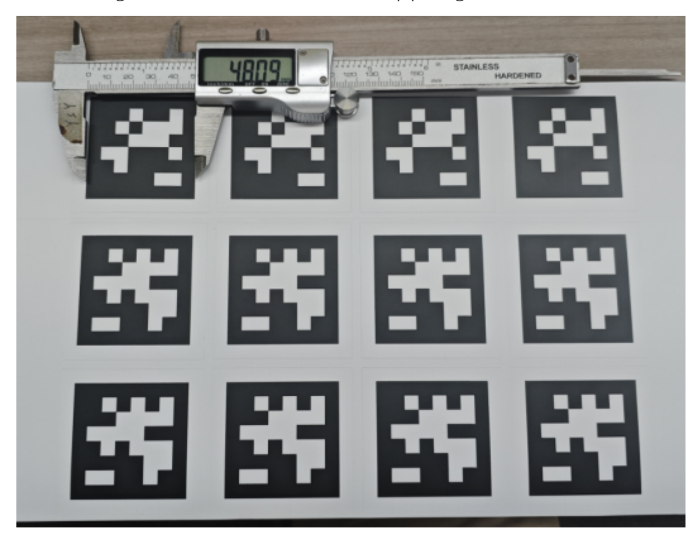
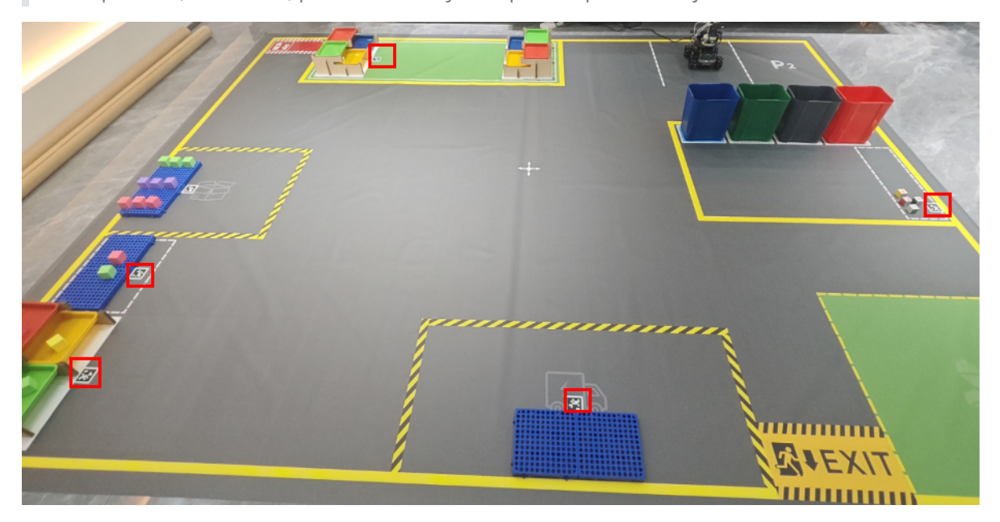
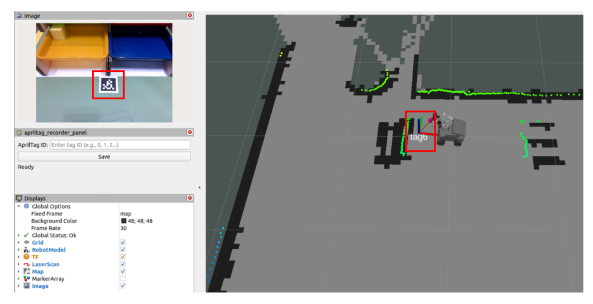
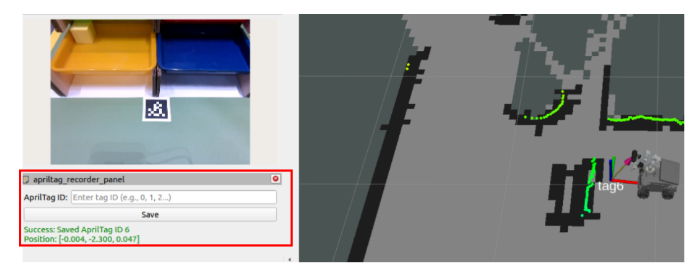
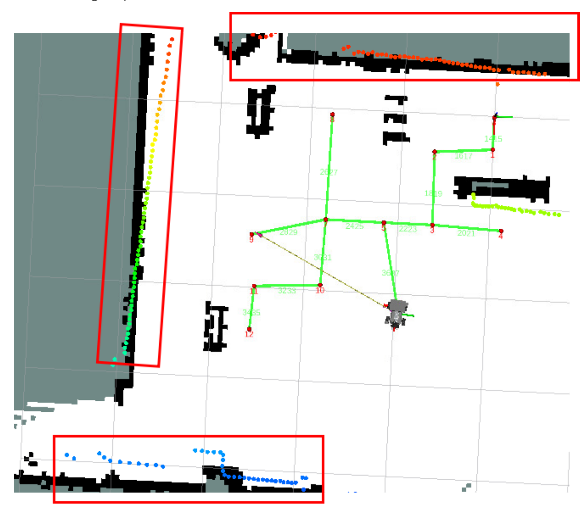

# **Visual Relocation Markers**

#### **[Visual Relocation](#page-0-0) Markers**

- <span id="page-0-0"></span>[1. Course](#page-0-1) Content Learning [Objectives](#page-0-2)
- [2. Preparation](#page-0-3)
  - 2.1 [Map Preparation](#page-0-4)
  - 2.2 Start the [MicroROS](#page-0-5) Chassis Agent
  - 2.3 [ArUco](#page-1-0) Tag Code
- [3. Place](#page-1-1) ArUco Tag Codes in the Map
- <span id="page-0-2"></span><span id="page-0-1"></span>4. Record ArUco Global [Map Coordinates](#page-2-0)

### **1. Course Content**

### **Learning Objectives**

After completing this course, you will be able to:

- Understand the working principle of ArUco tag codes in robot visual relocation
- Master the process of using the apriltag\_recorder\_panel tool to record tag code global coordinates
- Understand the data structure and application of the apriltag\_relocation.yaml configuration file

#### [!IMPORTANT]

- This section is a comprehensive course on sand table maps, introducing the complete process of building a sand table map. For detailed principles, parameter debugging, and operation steps, refer to the [Pose Constraint Combined with Visual Relocation Navigation] chapter.
- <span id="page-0-4"></span><span id="page-0-3"></span>Visual relocation here is a redundant mechanism and is not mandatory, but it can provide more stable positioning in various environments, used to solve issues such as odometry errors, degradation, and confusion in similar scenes.

## **2. Preparation**

#### **2.1 Map Preparation**

<span id="page-0-5"></span>First, complete the construction of the sand table grid map, pose map, and road network file according to the previous course.

### **2.2 Start the MicroROS Chassis Agent**

Skip if already started

sh start\_agent.sh

#### **2.3 ArUco Tag Code**

- <span id="page-1-0"></span>Prepare ArUco tag codes, which can be obtained in the following ways:
  - Tag codes from the sand table map package
  - Download and print the tag codes from the attachment materials
- Determine the tag code size
  - Use a measuring tool to measure the actual side length of the tag code. The side length of the tag code included in the sand table map package is 0.048m.


[Image details](images/img_001.md)

Modify the aritag detection configuration file

\$HOME/M3Pro\_ws/src/m3pro\_bringup/config/common.yaml

Modify the size to the actual size. If you are using the tag codes that come with the sand table map, the default size is 0.048 and no modification is needed.

```
...
apriltag: # node name
 ros__parameters:
   image_transport: raw # image format: "raw" or "compressed"
   family: 36h11 # tag family name: 16h5, 25h9, 36h11
   size: 0.048 # default tag edge size in meter
...
```

## **3. Place ArUco Tag Codes in the Map**

- <span id="page-1-1"></span>The placement position depends on your actual needs. They can be placed anywhere the camera can observe, such as on the ground, walls, or any other location.
- The following is a reference for tag code placement.

The relocation function occurs after navigating to the target location. If a tag code is within the field of view, perform global relocation to calibrate the robot's global position; otherwise, proceed directly with precise position adjustment.


[Image details](images/img_002.md)

## **4. Record ArUco Global Map Coordinates**

<span id="page-2-0"></span>Start the function to record ArUco code positions on the map

ros2 launch m3pro\_bringup record\_tag.launch.py

- After starting, the interface is as shown below. The **aritag\_recorder\_panel** panel will appear on the left.
- When a tag code appears in the camera's field of view, the tf coordinates and ID of the tag code will appear on the map.


[Image details](images/img_003.md)

In the **aritag\_recorder\_panel** panel, enter the tag code ID to be recorded in the **ArUco ID** field, then click **Save** (check whether the robot positioning is accurate before recording).


[Image details](images/img_004.md)

#### **Note**:

Before recording the tag code position, if you find that the laser contour deviates significantly from the environmental edge features, as shown in the figure below, it indicates a positioning error. In this case, use the **2D Estimate** tool for manual relocation before recording the position.


[Image details](images/img_005.md)

- The figure below shows accurate positioning where the laser contour matches the environmental edge features well.
- Repeat the above steps to complete the recording of all tag code positions. The recording file path is:

```
jetson@yahboom:~$ cat $HOME/M3Pro_ws/src/m3pro_bringup/config/aritag_relocation.yaml
1:
  position:
    x: 1.3833717985981973
    y: -2.9026189336934531
    z: 0.070413284960177638
  orientation:
    x: -0.031926243949601252
   y: 0.027068465461099932
    z: 0.68934845181831572
    w: 0.72321969352371984
  frame_id: map
2:
  position:
    x: 2.4373529681362194
    y: -0.99629315797510354
    z: 0.049999209624494431
  orientation:
    x: -0.037269485364327393
    y: -0.0049939957295554258
   z: 0.99925024383731553
   w: 0.0092193089977999805
  frame_id: map
```