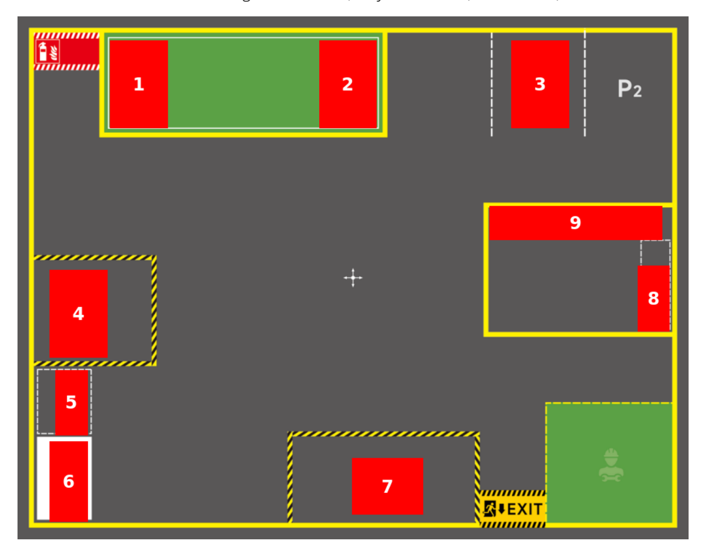
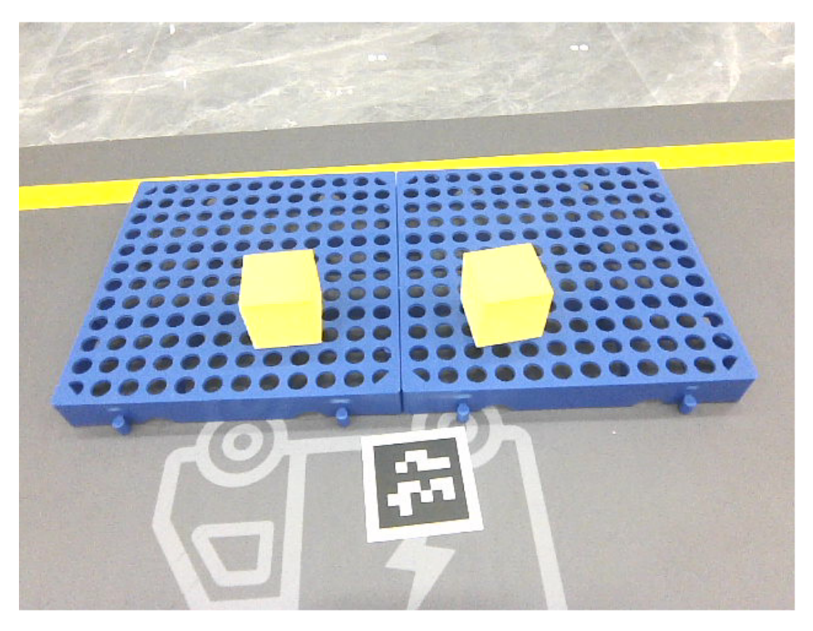
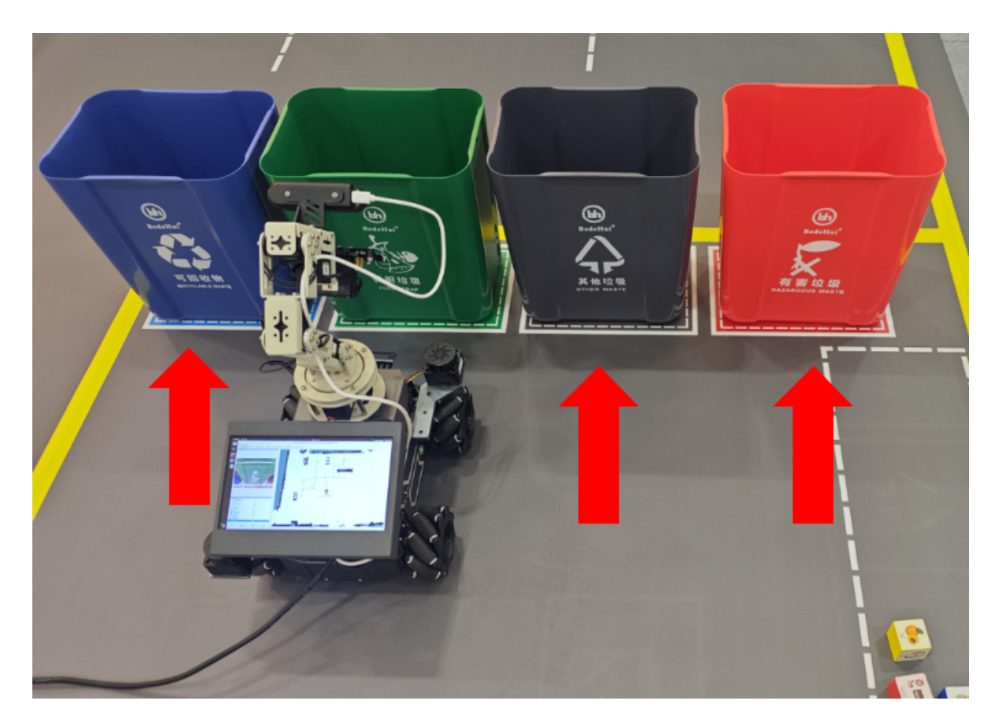

# **Map Mapping Markers**

#### **Map [Mapping](#page-0-0) Markers**

- <span id="page-0-0"></span>[1. Course](#page-0-1) Content
- [2. Preparation](#page-0-2)
  - 2.1 [Map Preparation](#page-0-3)
  - 2.2 Start the [MicroROS](#page-0-4) Chassis Agent
  - 2.3 Start the [Road Network Container](#page-0-5)
  - 2.4 Start Odometry, tf, [Robotic Arm Assistant,](#page-0-6) Camera, Aritag Detection Nodes
  - 2.5 Start the MCP [Service](#page-1-0)
  - 2.6 Start [Road Network Navigation](#page-1-1)
- [3. Record Map Mapping](#page-1-2)

## **1. Course Content**

#### [!IMPORTANT]

- <span id="page-0-2"></span><span id="page-0-1"></span>This section is a comprehensive course that demonstrates and explains the use and operation steps of the sand table map. For detailed parameter debugging and source code explanation, refer to the prerequisite course: [05-OpenClaw SLAM Mapping Navigation]
- Mark map mapping for target locations that need to be used in the sand table map.

## **2. Preparation**

### **2.1 Map Preparation**

<span id="page-0-3"></span>First, complete the construction of the sand table map and pose map according to the [Build Sand Table Map] course.

### **2.2 Start the MicroROS Chassis Agent**

<span id="page-0-4"></span>Skip if already started

<span id="page-0-5"></span>sh start\_agent.sh

#### **2.3 Start the Road Network Container**

<span id="page-0-6"></span>roadnet start

## **2.4 Start Odometry, tf, Robotic Arm Assistant, Camera, Aritag Detection Nodes**

ros2 launch m3pro\_bringup car\_base.launch.py relocation:=True

### **2.5 Start the MCP Service**

<span id="page-1-0"></span>ros2 launch m3pro\_bringup mcp\_service.launch.py

#### **2.6 Start Road Network Navigation**

<span id="page-1-1"></span>Start inside the roadnet container

ros2 launch road\_net\_route roadnet\_nav2.launch.py rviz\_config\_file:=/root/volumes/code\_ws/src/road\_net\_route/rviz/nav2\_relocaton.r viz

### **3. Record Map Mapping**

- <span id="page-1-2"></span>The layout and area naming of the map site are arbitrary and can be modified according to needs. The following reference area naming cases refer to:
- 1. Shelf 1
- 2. Shelf 2
- 3. Parking lot 1
- 4. Cargo warehouse
- 5. Cargo sorting area
- 6. Shelf 3
- 7. Shipping area
- 8. Garbage sorting area
- 9. Trash bin locations: including kitchen waste, recyclable waste, other waste, hazardous waste


[Image details](images/img_001.md)

Move the robot to the location that needs to be recorded, and use the robot\_control CLI tool to record the map mapping.

**Important**: Before recording a location, always check whether the laser contour matches the environmental edge features. If there is a deviation, use the **2D Estimate** tool for manual relocation before recording the position.

#### **Recording example:**

- Record the shipping area. Move the robot to the location near the shipping area that needs to be recorded.
- Ensure that the cargo in the area is fully visible in the field of view.


[Image details](images/img_002.md)

Use the robot\_control CLI tool to record the position of the robot's **base\_link** in the **map** coordinate system.

robot\_control call-tool RecordMapLocation --name 发货区 --symbol B

- --name specifies the name of the recording point
- --symbol specifies the symbol of the recording point, used by OpenClaw for identification and differentiation.

The positions of different types of trash bins need to be recorded separately. Place the robot in front of the trash bin to be recorded, then perform the recording.


[Image details](images/img_003.md)

Check the map mapping file map\_mapping.yaml. The file path is:

\$HOME/M3Pro\_ws/src/m3pro\_bringup/config/map\_mapping.yaml

Check whether all required locations have been recorded.

```
jetson@yahboom:~$ cat $HOME/M3Pro_ws/src/m3pro_bringup/config/map_mapping.yaml
  name: OtherWaste
  position:
    x: 1.033
    y: 0.483
    z: 0.0
  orientation:
    x: 0.0
    y: 0.0
    z: 1.0
    w: 0.008
В:
  name: 发货区
  position:
    x: 2.078
    y: -0.96
    z: 0.0
  orientation:
    x: 0.0
    y: 0.0
    z: -0.025
    w: 1.0
D:
  name: RecyclableWaste
  position:
    x: 1.09
    y: -0.259
    z: 0.0
  orientation:
    x: 0.0
    y: 0.0
    z: 1.0
    w: 0.009
```