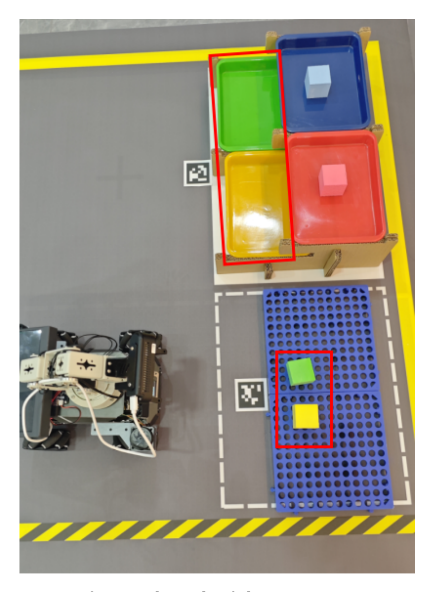
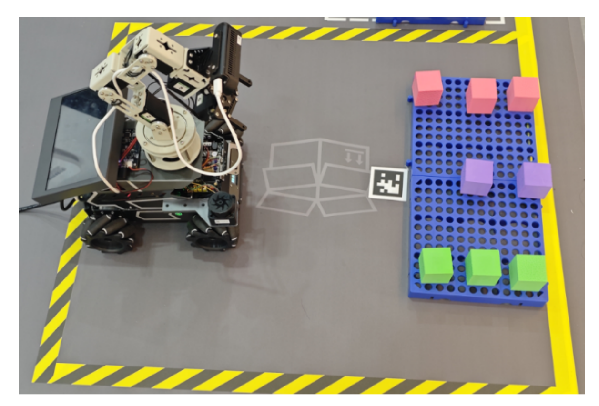
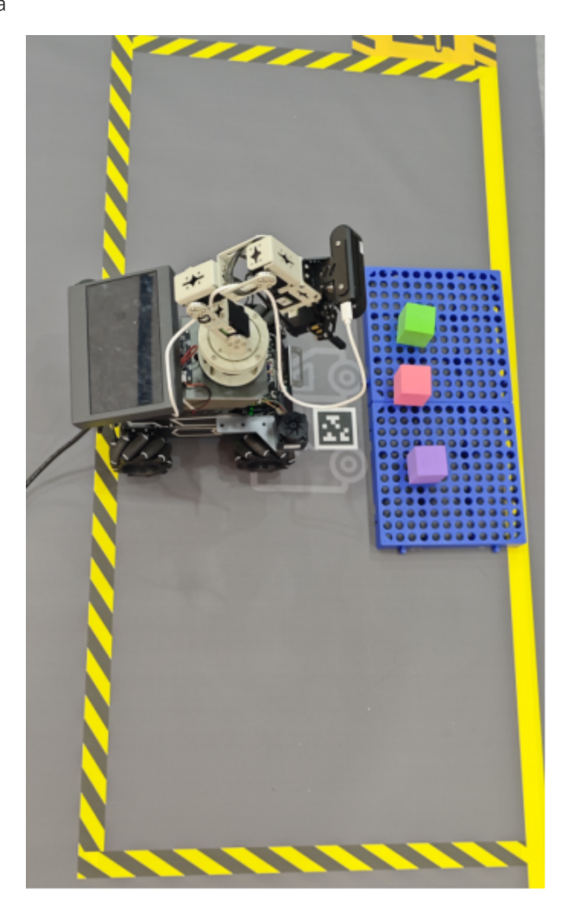
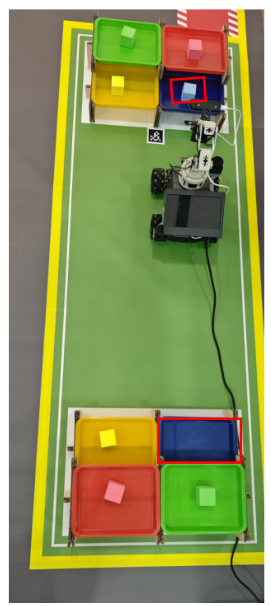

# **OpenClaw Scenario Sandbox Comprehensive Case**

#### **OpenClaw Scenario Sandbox [Comprehensive](#page-0-0) Case**

- [1. Course](#page-0-1) Content
- [2. Preparation](#page-0-2)
  - 2.1 Complete [Prerequisite](#page-0-3) Courses
  - 2.2 Start the [MicroROS](#page-0-4) Chassis Agent
  - 2.3 Start the [Road Network Container](#page-0-5)
  - 2.4 Start Odometry, tf, [Robotic Arm Assistant,](#page-1-0) Camera, ArUco Detection Nodes
  - 2.5 Start the MCP [Service](#page-1-1)
  - 2.6 Start [Road Network Navigation](#page-1-2)
  - 2.7 Voice [Function](#page-1-3) Nodes
- [3. Reference](#page-1-4) Cases
  - 3.1 [Garbage](#page-1-5) Sorting
  - 3.2 Cargo [Sorting](#page-1-6)
  - 3.3 Cargo Inspection [and Replenishment](#page-2-0)
  - 3.4 Inter-Shelf Object [Transportation](#page-4-0)
- [4. Comprehensive](#page-4-1) Case

# **1. Course Content**

This section uses OpenClaw to control the robot in the sand table map scenario to complete complex long-flow tasks.

# **2. Preparation**

# **2.1 Complete Prerequisite Courses**

Complete the [02-Build Sand Table Map], [03-Visual Relocation Markers], and [04-Map Mapping Markers] courses.

# **2.2 Start the MicroROS Chassis Agent**

Skip if already started

sh start\_agent.sh

### **2.3 Start the Road Network Container**

roadnet start

# **2.4 Start Odometry, tf, Robotic Arm Assistant, Camera, ArUco Detection Nodes**

ros2 launch m3pro\_bringup car\_base.launch.py relocation:=True

#### **2.5 Start the MCP Service**

ros2 launch m3pro\_bringup mcp\_service.launch.py

#### **2.6 Start Road Network Navigation**

Start inside the roadnet container

roadnet bash

ros2 launch road\_net\_route roadnet\_nav2.launch.py rviz\_config\_file:=/root/volumes/code\_ws/src/road\_net\_route/rviz/nav2\_relocaton.r viz

#### **2.7 Voice Function Nodes**

- If you need to use voice interaction, you need to additionally start the following nodes, otherwise you can ignore them.
- Voice recognition node

ros2 run multi\_brains\_pre asr\_detect

Voice reply node

ros2 run multi\_brains\_pre openclaw\_bridge

# **3. Reference Cases**

[!TIP]

You can customize your own command cases and gameplay features according to actual needs. The following are some reference cases.

## **3.1 Garbage Sorting**

Sort specified garbage from the garbage sorting area into corresponding trash bins.

### **3.2 Cargo Sorting**

Sort all colors of cargo from the cargo sorting area to the designated shelves.

[Image details](images/img_001.md)

### **3.3 Cargo Inspection and Replenishment**

- Check for missing cargo in the shipping area and replenish from the cargo warehouse.
- Cargo center

[Image details](images/img_002.md)

Shipping area

[Image details](images/img_003.md)

#### **3.4 Inter-Shelf Object Transportation**

Transport cargo from a designated shelf to a designated position on another shelf.

[Image details](images/img_004.md)

# **4. Comprehensive Case**

- **You can arbitrarily combine the above cases**, or customize command cases according to actual needs. The following is a reference comprehensive case:
- Factory comprehensive case 1

#### [!IMPORTANT]

The example long-flow task here takes a long time, approximately 25-40 minutes.

Start today's factory inspection. First, sort all garbage in the garbage area into the corresponding trash bins. Then go to the cargo sorting area and sort the cargo into the corresponding color areas on shelf 3. After that, go to the shipping area to check if any cargo is missing. If cargo is missing, replenish from the cargo warehouse. Finally, take a blue cargo from shelf 1 and deliver it to the corresponding color tray on shelf 2. After completing the task, return to parking lot 1.

Choose any interaction method to send the command.