# **Register a Model Service Account**

#### **Register a [Model Service Account](#page-0-0)**

- [1. Course](#page-0-1) Content
- 2. Register Alibaba Cloud Model Studio [Platform Account](#page-0-2)
  - 2.1 Alibaba [Cloud Model](#page-0-3) Studio Platform
  - 2.2 Free Quota [Description](#page-4-0)
- 3. Openrouter [Platform Account](#page-5-0)
  - 3.1 [Register](#page-6-0) an Account
  - 3.2 Create [API-KEY](#page-6-1)

### **1. Course Content**

Register an account and API key with a model service provider using your email or mobile phone number to gain access to cloud-based models.

## **2. Register Alibaba Cloud Model Studio Platform Account**

#### **2.1 Alibaba Cloud Model Studio Platform**

[International Site Address: https://modelstudio.console.alibabacloud.com/ap-southeast-1/?tab=d](https://modelstudio.console.alibabacloud.com/ap-southeast-1/?tab=doc#/doc/?type=model&url=2840914) oc#/doc/?type=model&url=2840914

Click Log in to register an account

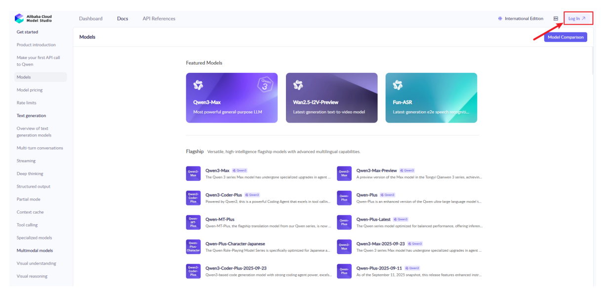
[Image details](images/img_001.md)

If you don't have an account, you need to register first

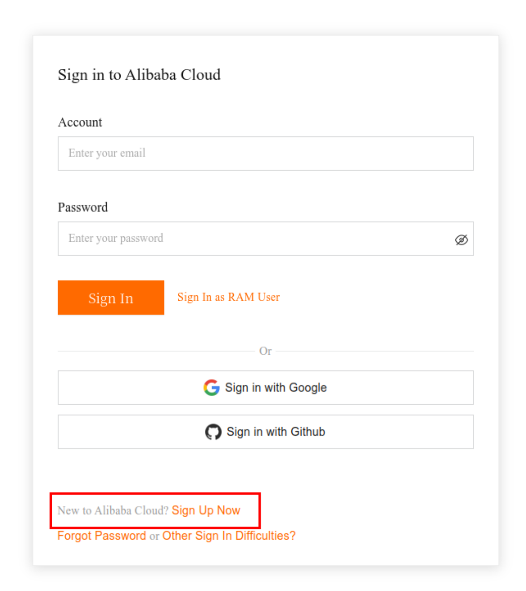
[Image details](images/img_002.md)

Choose individual Account to register

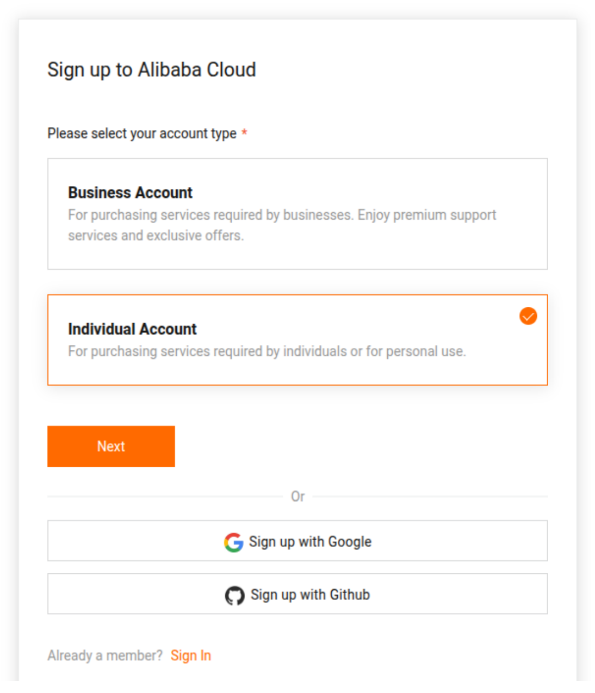
[Image details](images/img_003.md)

Return to the Alibaba Cloud Model Studio homepage, refresh and click "Agree" to complete the registration of the Alibaba Cloud Model Studio Platform.

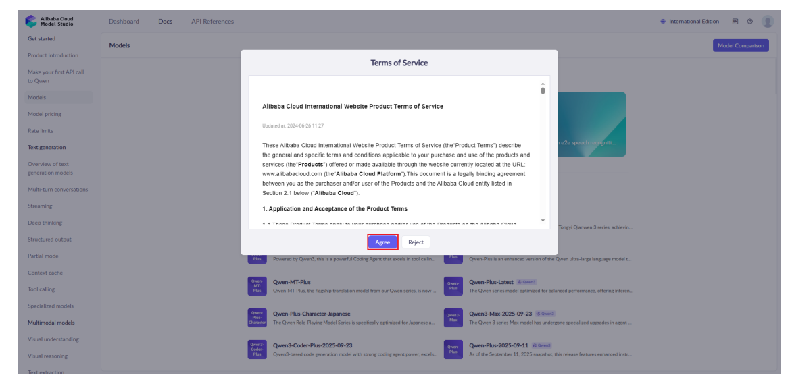
[Image details](images/img_004.md)

In API References, click [Singapore](https://modelstudio.console.alibabacloud.com/?tab=playground#/api-key) on the page to jump to the create API-key page

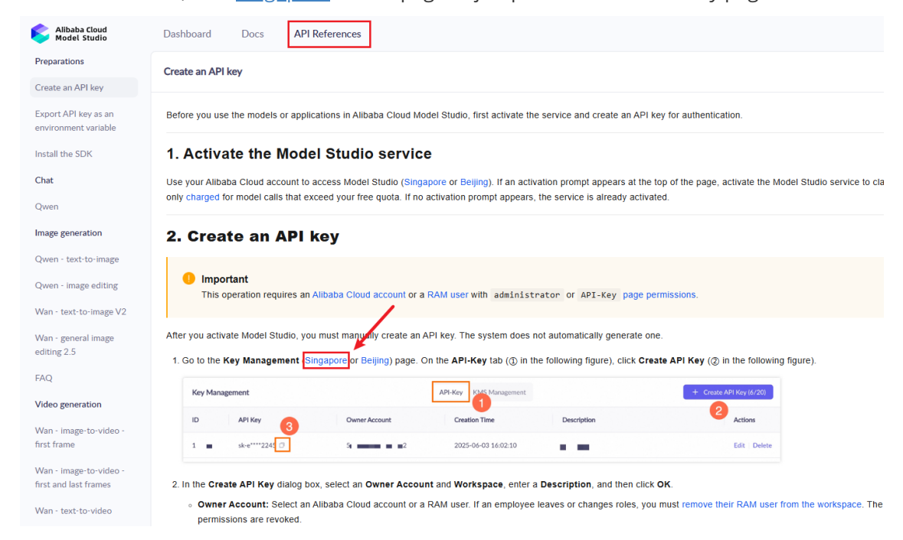
[Image details](images/img_005.md)

Click "Create API Key", select the account, and click "OK" to complete the creation

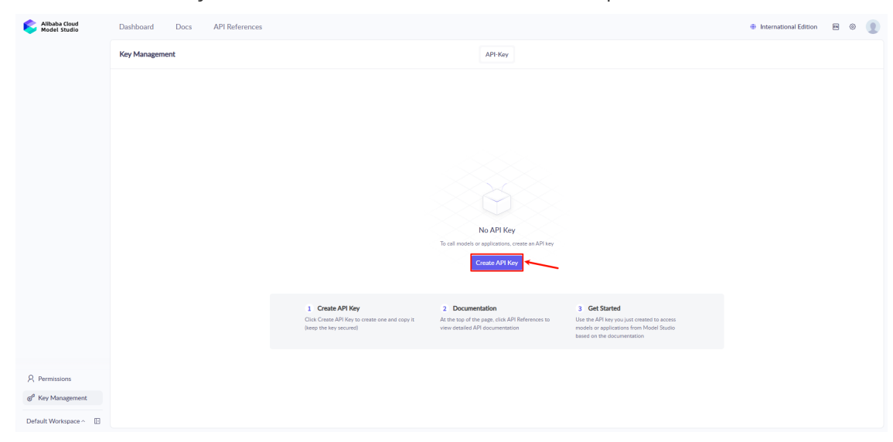
[Image details](images/img_006.md)

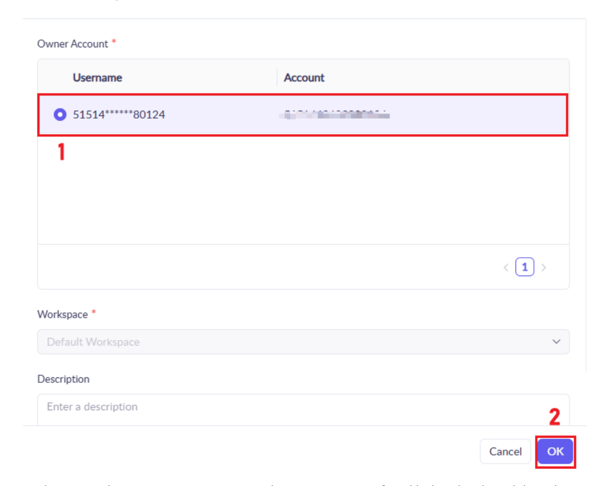
[Image details](images/img_007.md)

At this point, the account registration and API-KEY creation for Alibaba Cloud Model Studio Platform are completed

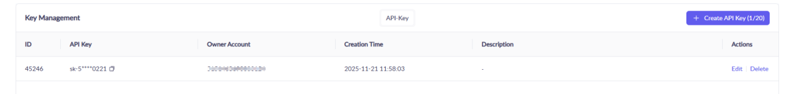
[Image details](images/img_008.md)

#### **2.2 Free Quota Description**

When you activate Alibaba Cloud Model Studio(Singapore region) for the first time, each model will automatically receive a free quota.

You can query the remaining quota for each model and select model versions in the "Models" section. For example, for the model Qwen-Plus, click the model to view details.

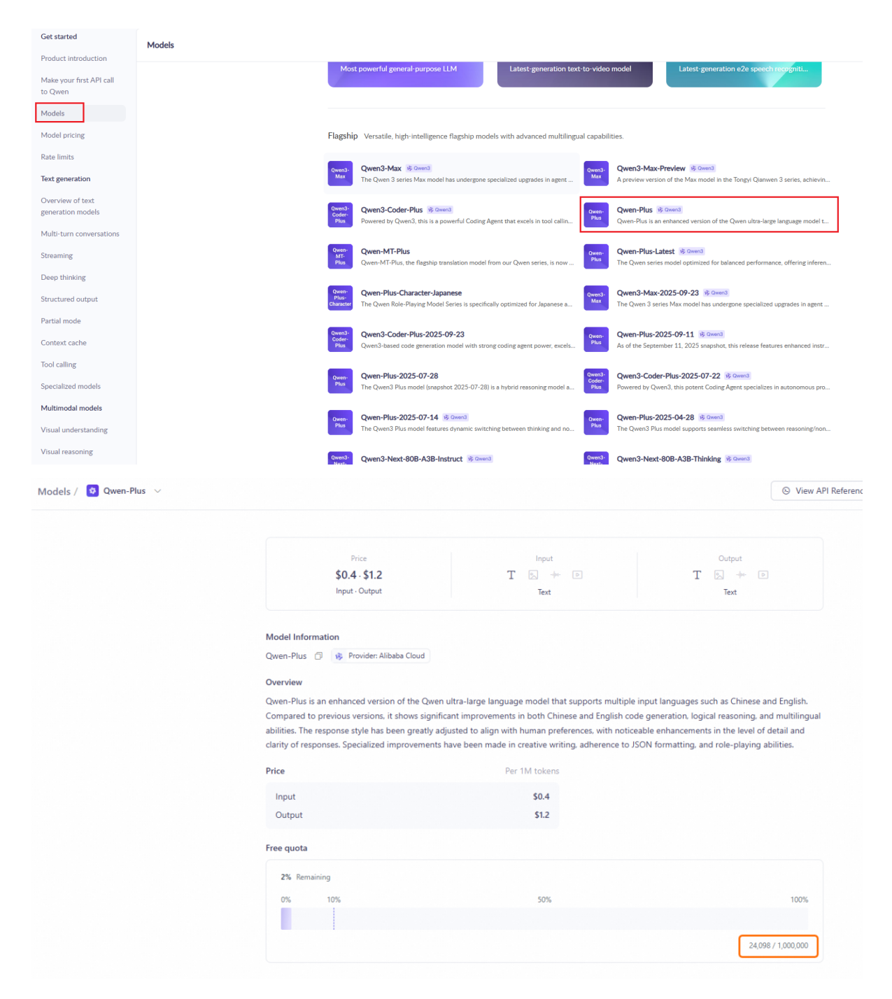
[Image details](images/img_009.md)

The free quota for new users is typically valid for 30 to 90 days, starting from the date you activate Model Studio or your model request is approved. After the validity period expires or the free quota is exhausted, continued use of the model inference service will incur fees.

For more detailed instructions, please refer to [Free quota for new users](https://modelstudio.console.alibabacloud.com/?tab=doc#/doc/?type=model&url=2766612)

### **3. Openrouter Platform Account**

#### [!NOTE]

Openrouter offers many free model services, but there are access frequency limits and the understanding capabilities of free models vary greatly. To ensure a better user experience, it is recommended to prioritize using Alibaba's Bailian model service. This section is for reference only for users who need to use Openrouter services.

#### **3.1 Register an Account**

Open the [openrouter](https://openrouter.ai/) link, click the avatar in the upper right corner to register an account. Registering an account using an email address is similar to the process described above and will not be repeated here.

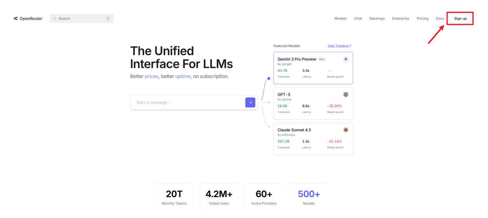
[Image details](images/img_010.md)

#### **3.2 Create API-KEY**

Click on Keys in the upper right corner to create an API

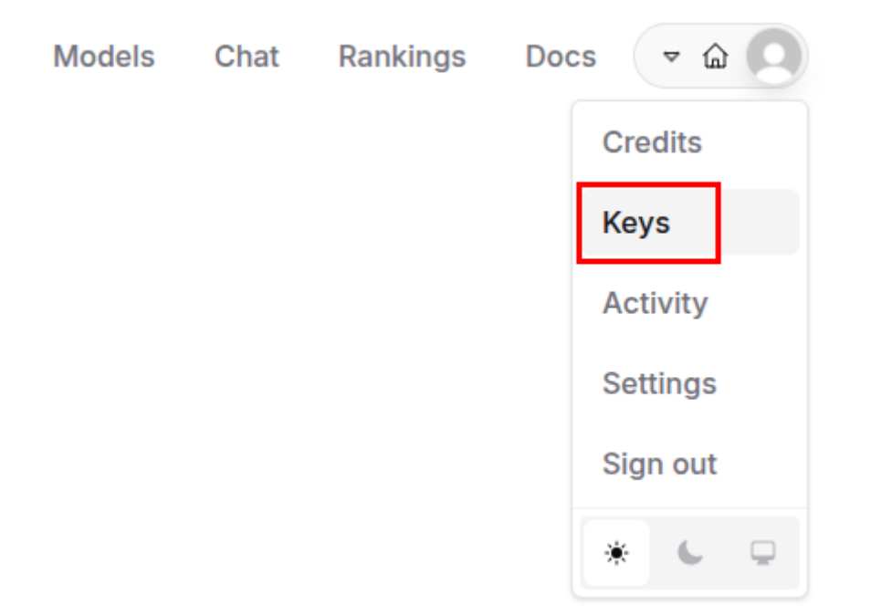
[Image details](images/img_011.md)

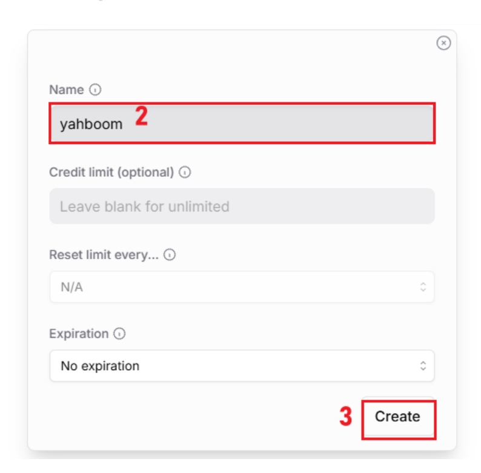
[Image details](images/img_012.md)

You will then get an API key. **You need to copy this key, because you won't be able to view it again after closing this page.**

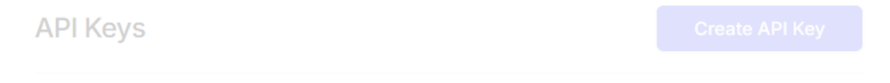
[Image details](images/img_013.md)

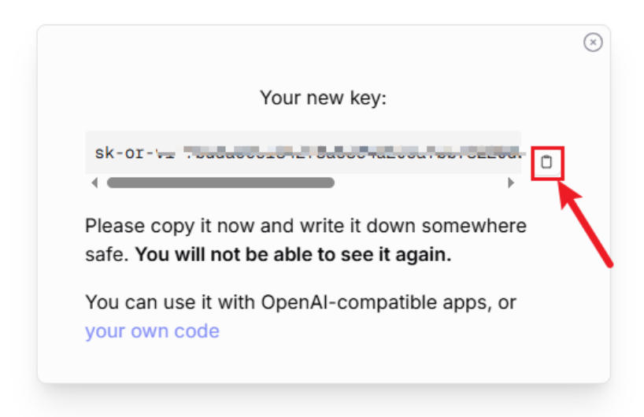
[Image details](images/img_014.md)