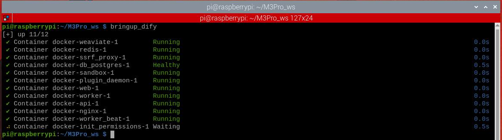
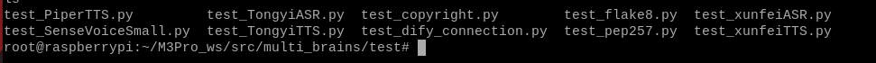
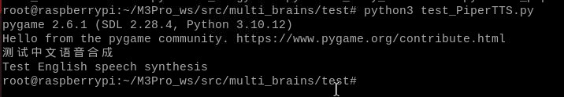
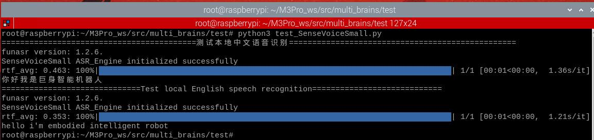
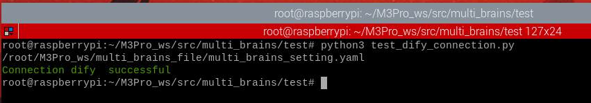
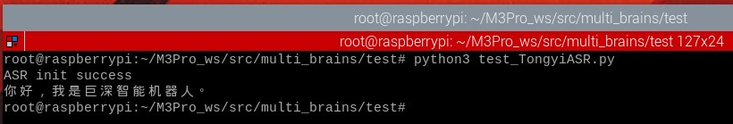
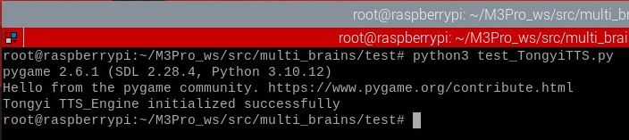
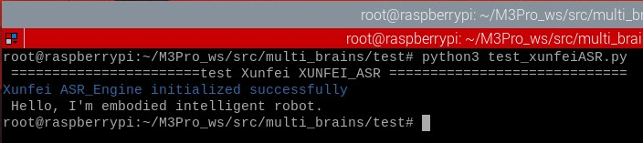

# **Core Module Testing Tools**

#### **[Core Module Testing](#page-0-0) Tools**

- <span id="page-0-0"></span>[1. Course](#page-0-1) Content
- [2. Start](#page-0-2) the Dify service
- [3. Navigate](#page-0-3) to the test tool path
- 4. Test local speech [synthesis](#page-0-4) function
- 5. Test Local Speech Recognition [Functionality](#page-1-0)
- [6. Testing](#page-1-1) Whether the Robot Can Access Dify Normally
- 7. Online Voice Services for Users in [Mainland China](#page-1-2)
  - 7.1 Bailian Speech [Recognition](#page-2-0) (ASR)
  - 7.2 Bailian Speech [Synthesis](#page-2-1) (TTS)
  - 7.3 Baidu Qianfan Speech [Synthesis](#page-2-2) (TTS)
- <span id="page-0-1"></span>8. Online Voice Services for [International](#page-2-3) Users
  - 8.1 iFLYTEK Speech [Recognition](#page-3-0) Service
  - 8.2 iFLYTEK Speech [Synthesis](#page-3-1) Service

### **1. Course Content**

<span id="page-0-2"></span>multi\_brains provides minimal test programs for testing the core modules of a large model, used to quickly locate problems in abnormal situations.

# **2. Start the Dify service**

## **3. Navigate to the test tool path**

```
cd ~/M3Pro_ws/src/multi_brains/test
ls
```

<span id="page-0-3"></span>Test tools are as follows:

### **4. Test local speech synthesis function**

<span id="page-0-4"></span>Test the local speech synthesis function for Chinese and English in sequence

```
python3 test_PiperTTS.py
```

After running, it will play the Chinese and English speech synthesis results sequentially.

### **5. Test Local Speech Recognition Functionality**

<span id="page-1-0"></span>After running, it will test the preset Chinese and English audio recordings sequentially.

```
python3 test_SenseVoiceSmall.py
```

After running, it will print the speech recognition results of the test audio.

# **6. Testing Whether the Robot Can Access Dify Normally**

<span id="page-1-1"></span>If the program indicates that the model service is unavailable—and you are unsure whether this is due to an incorrect network address preventing the robot/vehicle system from accessing Dify—you can perform the following test:

```
python3 test_dify_connection.py
```

If the robot successfully displays the information shown below, it confirms that the connection to Dify is functioning correctly. Otherwise, Dify may not have started, or the Dify program may have crashed and requires a restart.

# <span id="page-1-2"></span>**7. Online Voice Services for Users in Mainland China**

### **7.1 Bailian Speech Recognition (ASR)**

<span id="page-2-0"></span>If errors occur with the online speech recognition service, you can independently test the Bailian speech recognition service:

```
python3 test_TongyiASR.py
```

Upon execution, the script will perform a speech recognition test using a preset audio sample.

### **7.2 Bailian Speech Synthesis (TTS)**

<span id="page-2-1"></span>If errors occur with the online speech synthesis service, you can independently test the Bailian speech synthesis service:

```
python3 test_TongyiTTS.py
```

Upon execution, the script will first synthesize speech from a default text sample, and then play the corresponding audio.

### **7.3 Baidu Qianfan Speech Synthesis (TTS)**

<span id="page-2-2"></span>If errors occur while using Baidu's speech synthesis service, you can independently test the Baidu speech synthesis service:

```
python3 test_baiduTTS.py
```

Upon execution, the script will first synthesize speech from a default text sample, and then play the corresponding audio.

# <span id="page-2-3"></span>**8. Online Voice Services for International Users**

### **8.1 iFLYTEK Speech Recognition Service**

<span id="page-3-0"></span>If international users encounter errors with online speech recognition, they can test the iFLYTEK speech recognition service independently.

```
python3 test_xunfeiASR.py
```

Upon execution, the script will perform a speech recognition test on a pre-configured test audio file.

### **8.2 iFLYTEK Speech Synthesis Service**

<span id="page-3-1"></span>If international users encounter errors with online speech synthesis, they can test the iFLYTEK speech synthesis service independently.

```
python3 test_xunfeiTTS.py
```

Upon execution, the script will first synthesize speech from a default text sample, and then play the corresponding audio.

---

## Extracted Images


### Page 1


[Image details](images/img_001.md)


[Image details](images/img_002.md)


### Page 2


[Image details](images/img_003.md)


[Image details](images/img_004.md)


[Image details](images/img_005.md)


### Page 3


[Image details](images/img_006.md)


[Image details](images/img_007.md)


### Page 4


[Image details](images/img_008.md)

