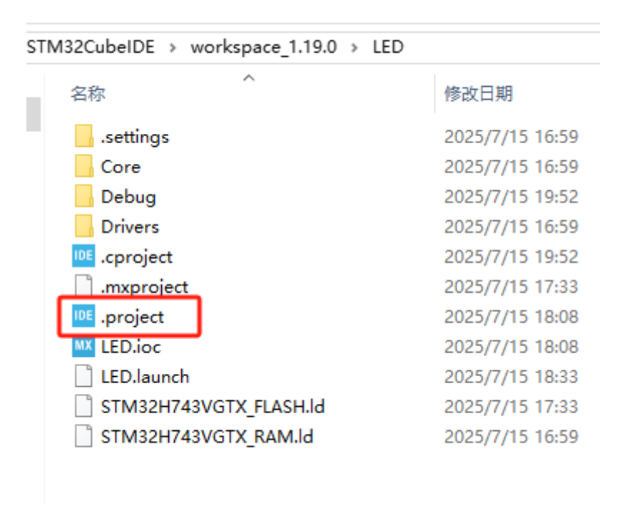
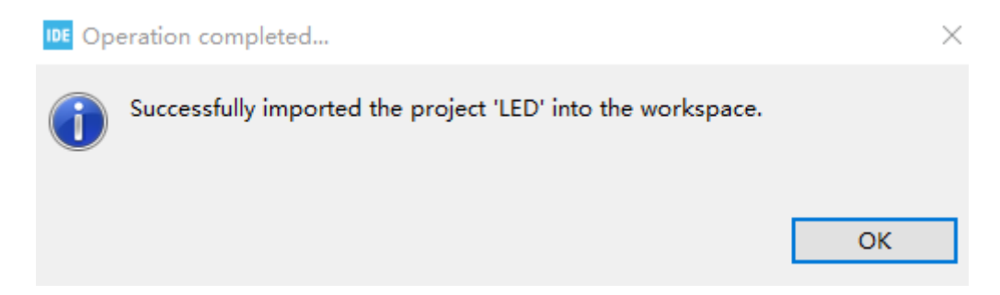
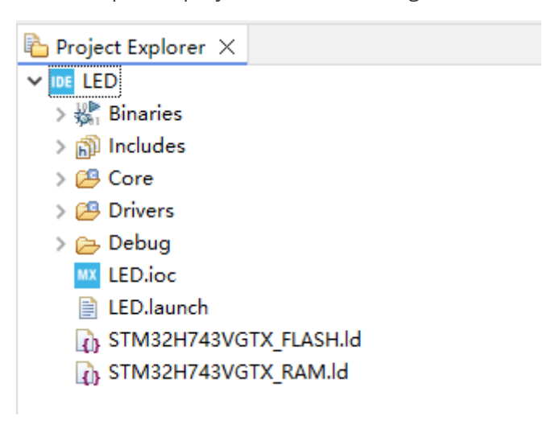

## **Import Project**

Open STM32CUBEIDE and select a workspace, or create a new one.

Then find the project directory. Here we take the LED project as an example. Double-click the .project file.

[Image details](images/img_001.md)

The system will prompt that the import is successful, just click OK.

[Image details](images/img_002.md)

At this point, you can see the imported project in the file management column of STM32CUBEIDE.

[Image details](images/img_003.md)