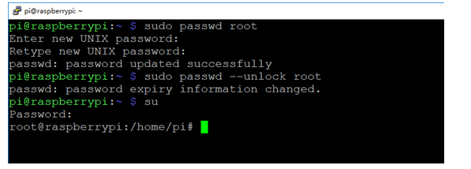

## **15.Set root user password**

Input following command:

```
sudo passwd root
```

After executing this command, the system will prompt you to enter the root password twice. Just enter the password you want to set, and then execute

```
sudo passwd --unlock root
```

After executing this command, the system will prompt you to enter the root password twice. Just enter the password you want to set, and then execute

su

The root user is successfully unlocked.

---

## Extracted Images


### Page 1


[Image details](images/img_001.md)

