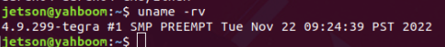
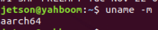
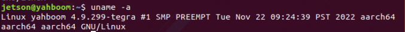
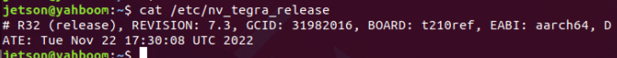
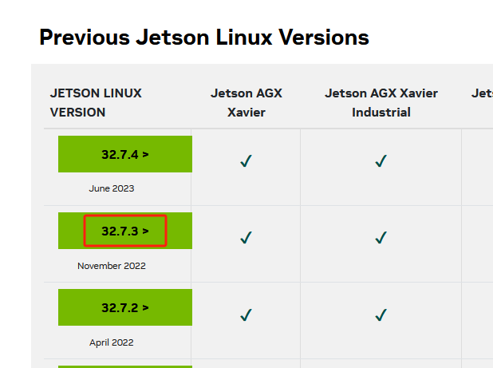
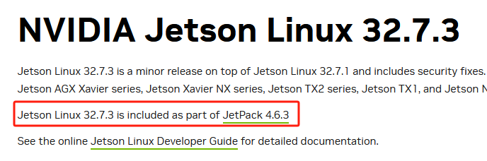

# **18.View system version**

18.View [system version](#page-0-0)

- <span id="page-0-0"></span>1. View [system version](#page-0-1) information
- <span id="page-0-1"></span>2. jetson nano [Check jetpack version](#page-0-2)

The following content takes the jetson nano system version as an example to display the system version information.

#### **1. View system version information**

Check system kernel version

```
uname -rv
```

View machine hardware platform

```
uname -m
```

View all system version information

```
uname -a
```

### <span id="page-0-2"></span>**2. jetson nano Check jetpack version**

Enter the following command in the jetson nano system terminal to check that the system version is R32.7.3

```
cat /etc/nv_tegra_release
```

Open the Jetson Linux Archive website in your browser to check the corresponding version.

```
https://developer.nvidia.com/embedded/jetson-linux-archive
```

Find the corresponding version, click to enter the 32.7.3 version information, and you can see that R32.7.3 corresponds to the Jetpack 4.6.3 version.

# **Previous Jetson Linux Versions**

| JETSON LINUX<br>VERSION | Jetson AGX<br>Xavier | Jetson AGX Xavier<br>Industrial | Jet |
|-------------------------|----------------------|---------------------------------|-----|
| 32.7.4 >                | <b>√</b>             | <b>√</b>                        |     |
| June 2023               |                      |                                 |     |
| 32.7.3 >                | ✓                    | ✓                               |     |
| November 2022           |                      |                                 |     |
| 32.7.2 >                | ✓                    | ✓                               |     |
| April 2022              |                      |                                 |     |

# **NVIDIA Jetson Linux 32.7.3**

Jetson Linux 32.7.3 is a minor release on top of Jetson Linux 32.7.1 and includes security fixes. Jetson AGX Xavier series, Jetson Xavier NX series, Jetson TX2 series, Jetson TX1, and Jetson N

Jetson Linux 32.7.3 is included as part of JetPack 4.6.3

See the online Jetson Linux Developer Guide for detailed documentation.

---

## Extracted Images


### Page 1


[Image details](images/img_001.md)


[Image details](images/img_002.md)


[Image details](images/img_003.md)


[Image details](images/img_004.md)


### Page 2


[Image details](images/img_005.md)


[Image details](images/img_006.md)

