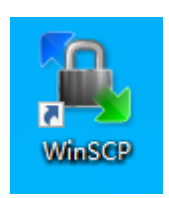
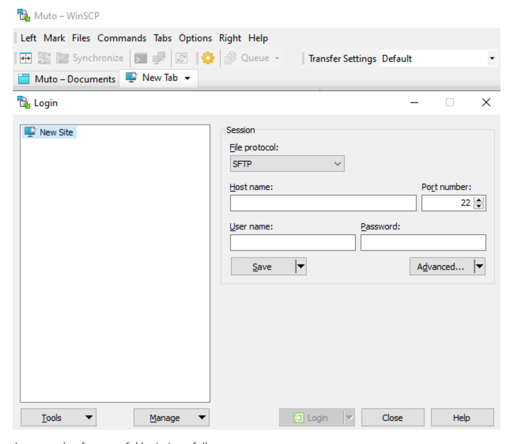
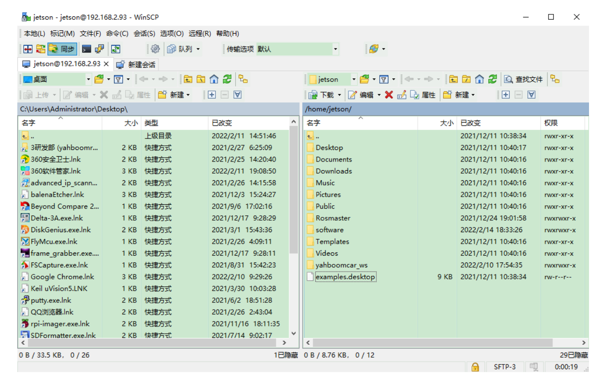

## **9.Transfer files remotely**

## [9.Transfer](#page-0-0) files remotely

WinSCP download link:<https://winscp.net/eng/download.php>

Enter the relevant link above, download the installation file, and double-click the [.exe] file to install.

Double-click the icon below to open the WinSCP software

[Image details](images/img_001.md)

This time the robot IP [192.168.2.93], username [jetson], password [yahboom].

If the login dialog box does not pop up, click [New Session] in the upper left part, enter the host name (IP address), user name, and password in order, and click to log in.

[Image details](images/img_002.md)

An example of successful login is as follows

[Image details](images/img_003.md)

Transfer files from computer to robot [jetson nano]

Just select the files (folders) that need to be transferred and drag them to the right, [/home/jetson] column.

The robot [jetson nano] transfers files to the computer

Just select the files (folders) that need to be transferred and drag them to the left, [C:] column, or you can drag them directly to the desktop.