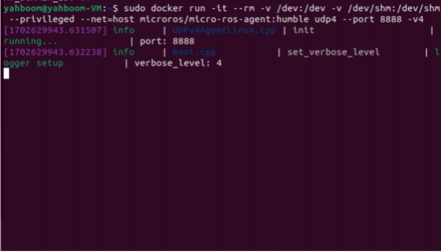
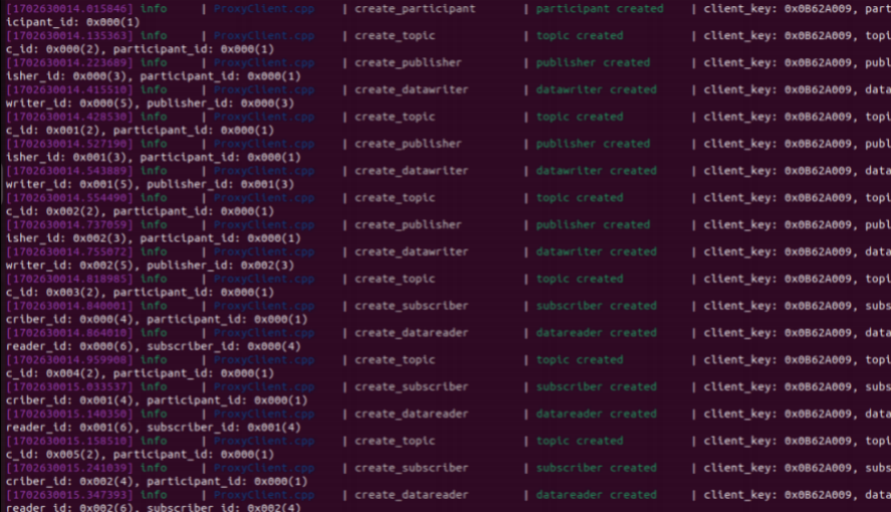
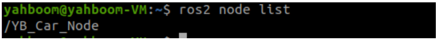

## **Enter the robot's docker container**

Note: The virtual machine needs to be in the same LAN as the car, and the ROS\_DOMAIN\_ID must be the same. You can refer to [Read Before Use] to set the IP and ROS\_DOMAIN\_ID on the board.

Taking the matching virtual machine as an example, enter the following command to enter the docker container:

```
sudo docker run -it --rm -v /dev:/dev -v /dev/shm:/dev/shm --privileged --net
= host microros/micro-ros-agent:humble udp4 --port 8888 -v4
```

After starting the container, the proxy will be turned on, the car switch will be turned on, and the car will be connected to the proxy. The connection is successful as shown in the figure below.

After the car is connected, a node named /YB\_Car\_Node will be started. Enter the following command in the terminal of the matching virtual machine to query:

ros2 node list

---

## Extracted Images


### Page 1


[Image details](images/img_001.md)


[Image details](images/img_002.md)


### Page 2


[Image details](images/img_003.md)

