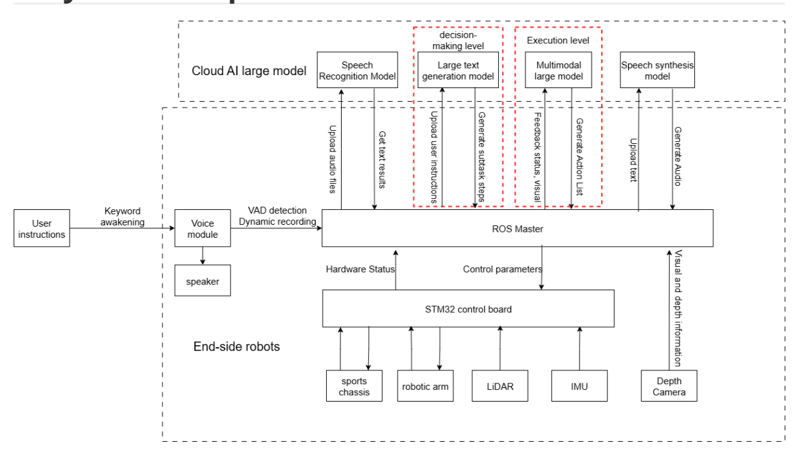
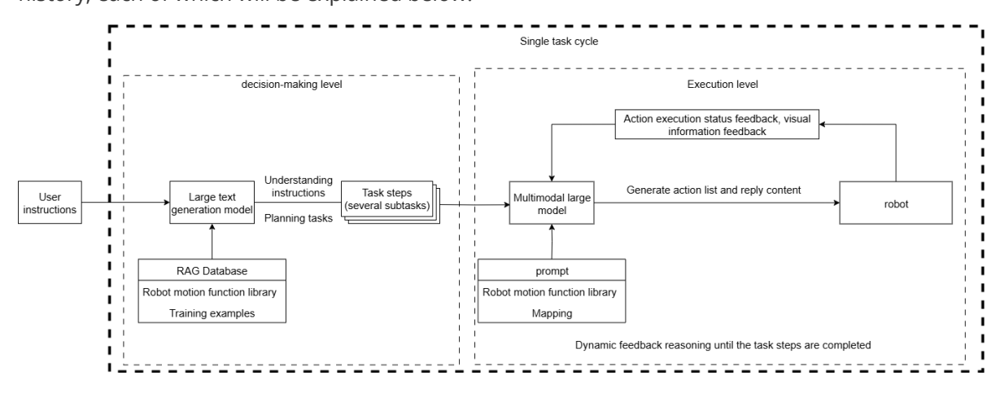
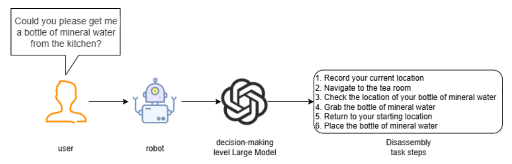
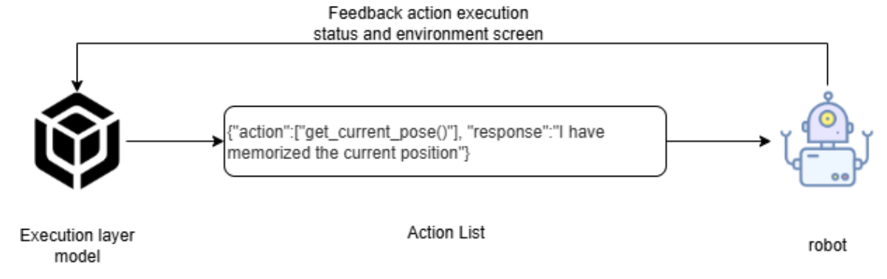
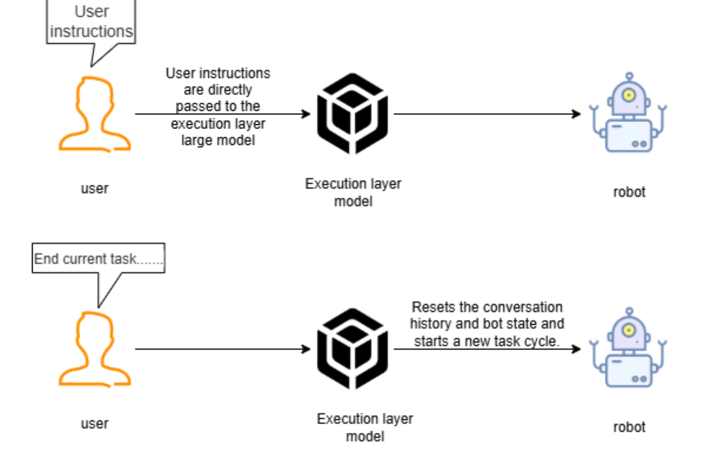
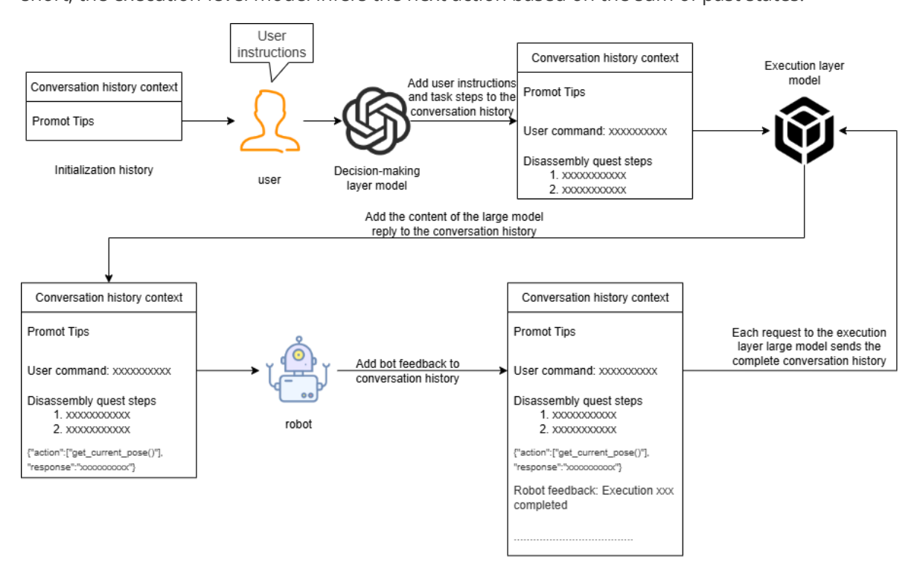
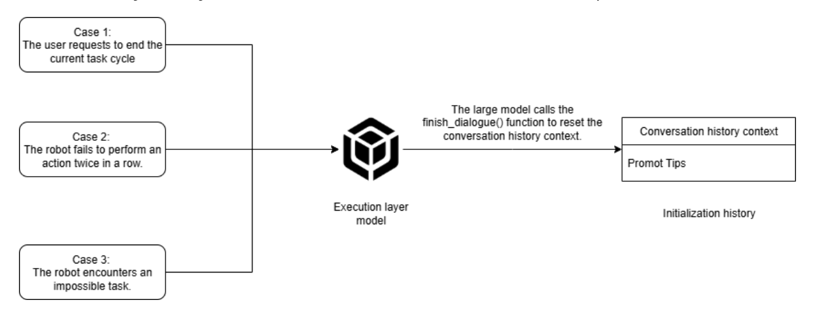
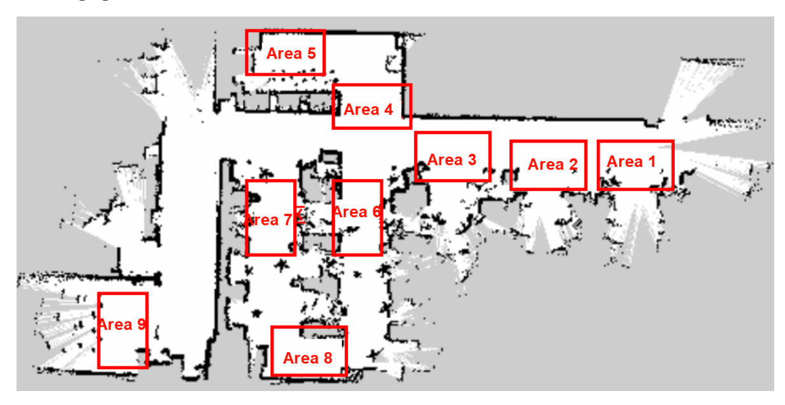
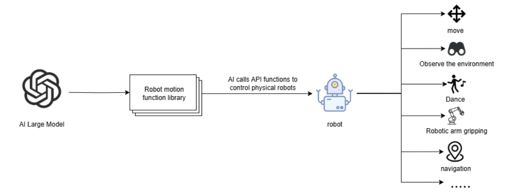
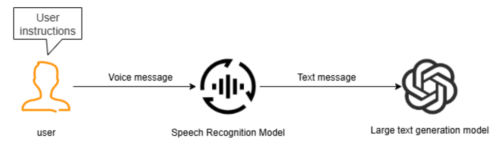

# **Embodied Intelligent Robot System Architecture**

## **1. Course Content**

- 1. Explain the Large Model Reasoning Architecture of the AI Embodied Intelligent Robot
- 2. Explain the basic concepts of the system to lay the foundation for practical application in subsequent courses

## **2. System Components**


[Image details](images/img_001.md)

## **3. AI Large Model Reasoning Architecture Diagram**

The robot's programming utilizes dual-model reasoning and dynamic feedback i-reasoning, improving its processing capabilities for long, complex tasks and achieving greater system robustness compared to single-model architectures. Several key concepts are discussed: the decision-layer Large model, the execution-layer Large model, the task cycle, and the conversation history, each of which will be explained below.


[Image details](images/img_002.md)

## **4. Explanation of the Large Model Inference Architecture**

## **4.1 Principles of the Dual-Model Architecture**

- The robot's large model control system is designed based on a text-generated large model and a multimodal large model. The text-generated large model serves as the **decision layer**, acting as a high-level task planner and decomposing complex, abstract human instructions.
- The multimodal large model serves as the execution layer, receiving task steps generated by the **decision layer** and temporary user instructions (typically simple instructions instructing the robot to end a task or rest). It monitors the robot's progress and adjusts its execution in real time, generating a list of action functions that the robot can interpret and responding to the user.
- The action function list contains pre-programmed basic action functions that directly output parameters for controlling the robot's motion.

## **4.2 Advantages of the Dual-Model Inference Architecture**

### **4.2.1 Decoupling Decision Logic and Action Control**

Large multimodal models lag behind large text-generated models in their ability to understand natural language semantics and perform logical reasoning. They are also prone to modal interference when performing complex tasks. Therefore, the system design decouples decision logic from action control.

- The large text generation model focuses on semantic understanding and task planning (for example, parsing the sentence "Can you help me get the blue block in room A?" by breaking it down into the following steps: "Record current location → Navigate to room A → Obtain the current robot-view image → Locate the blue block's coordinates → Grab the blue block → Return to the starting position → Drop the blue block"). This avoids the complexity of action details that traditional single models must handle during semantic parsing.
- The large multimodal model is responsible for action generation and environment interaction (for example, acquiring visual images to locate object coordinates and outputting action functions and parameters). This reduces the confusion in action logic and large deviations that can occur in single models due to task complexity.

### **4.2.2 Reducing Model Training Sample Complexity**

When using a single model for inference, the large multimodal model must simultaneously perform "natural language understanding + environmental perception + process decomposition + action function output," which can easily lead to modal interference (misinterpretation due to ambiguous language or overly long instructions). The dual model uses phased processing, allowing the decision layer to focus on language-space mapping and the execution layer to focus on vision-motor space mapping.

### **4.2.3 Flexible Expansion**

The decision-making and execution-layer Large models can be flexibly combined using a variety of Large models on the Alibaba Bailian Large Model Platform (sometimes also known as the Tongyi Qianwen Platform). Through customized training samples and RAG knowledge bases, the models can be adapted to tasks in different scenarios, significantly improving the generalization capabilities of AI embodied intelligent robots in different scenarios.

## **4.3 Decision-Layer Large Model**

### **4.3.1 Function of the Decision-Layer Model**

- The robot's decision-layer Large model uses the Tongyi Qianwen-Max series model by default.
- The decision-layer Large model is primarily responsible for task planning. It can understand complex human instructions and break them down into specific task steps. For example, when receiving the instruction "Can you get me a bottle of mineral water from the kitchen?" The large language model breaks it down into several tasks, as shown in the figure below.
- Each task step corresponds to the minimum action that the robot can perform. The execution-level large model then implements the specific robot movement by calling API functions in the robot's action library.


[Image details](images/img_003.md)

### **4.3.2 Robot Action Library (Simplified)**

The robot action library specifies the minimum actions that all robots can actually perform. When planning task steps, the decision-making model selects appropriate actions from this library and arranges them.

#### Basic Action Class

- Turn left x degrees
- Turn right x degrees
- Dance
- Drift
- Forward
- Backward
- Translation left
- Translation right

#### Navigation Movement Class

- Navigate to point x
- Return to initial position
- Record current position

#### Robot Arm Class

- Robot Arm Move Up
- Robot Arm Move Down
- Robot Arm Nod
- Robotic arm shakes its head
- Robotic arm claps
- Robotic arm grasps and picks up objects
- Robotic arm places down objects

- Sorts machine codes with number x
- Tracks objects
- Removes machine codes at a specified height
- Removes colored blocks at a specified height
- Patrolles and clears obstacles

#### Gets image class

Gets the current viewpoint image

## **4.4 Execution layer model**

- The robot's execution layer model uses the Tongyi Qianwen-VL series model by default.
- The execution layer model is primarily responsible for generating the action list that controls the robot's movements and responding to user requests. As the robot executes the action list, it continuously receives feedback (success/failure) and visual images from the robot's action results. Based on the success or failure of the action, it infers the next action to be performed.
- The execution layer model acts as a supervisor, continuously monitoring the robot's progress in executing task steps. It uses feedback from the robot's actions and environmental information to determine the next action to perform, until the task is successfully completed or terminated prematurely due to special circumstances.


[Image details](images/img_004.md)

### **4.4.1 Task Cycle**

- In a new task cycle, user commands first pass through the decision-making model and then the execution model. If the execution model determines that the robot has completed all task steps, it enters a **waiting state**. Subsequent user commands are then passed directly to the execution model.
- For example, if the user requests to end the current task and have the robot rest, the robot resets the conversation history and arm state, and begins a new task cycle. The user's commands are then executed by the decision-making model. The following is an illustration of the waiting state:


[Image details](images/img_005.md)

### **4.4.2 History Context**

The robot maintains a conversation history context in its local program. This context includes user commands, task steps generated by the decision-level model, the action list generated by the execution-level model, and status information provided by the robot. Each time the robot requests the execution-level model, it sends the entire conversation history. This allows the execution-level model to understand the robot's progress in executing tasks. The execution-level model then uses the conversation history context to infer the next action to be performed. In short, the execution-level model infers the next action based on the sum of past states.


[Image details](images/img_006.md)

Under normal circumstances, the execution-level model determines the progress of the task based on the conversation history. When it determines that the robot has completed all task steps, it enters a waiting state, awaiting interim commands from the user. Interim commands are passed directly to the execution-level model without passing through the decision-level model. There are three situations in which the robot clears the conversation history context, ends the current task cycle, and begins a new one.

- Case 1: The user proactively requests to end a task cycle. While in the **waiting state**, if the user says something like "Take a break" or "Leave," indicating they no longer need the robot, the execution layer model calls the finish\_dialogue() function to end the current task cycle, allowing the robot to reset its conversation history and start a new one. The same applies to the following cases.
- Case 2: The robot fails twice consecutively while performing an action. If an action fails, the execution layer model instructs the robot to retry at most once. If it fails again, the execution layer model instructs the robot to end the task cycle early and start a new one.
- Case 3: If the robot encounters an impossible task, such as when the user asks the robot to go to a location not mentioned in the "Map Mapping" section, the robot will request to end the task cycle early and inform the user that the task cannot be completed.


[Image details](images/img_007.md)

### **4.4.3 Map Mapping**

Robots use grid maps for navigation. If the robot needs to understand real-world locations, a mapping relationship must be established between the grid map and the real-world areas. This relationship is called a **map mapping**. Suppose a robot uses SLAM to generate a **grid map** in a factory environment. The real factory has several artificially divided areas, as shown in the following figure.


[Image details](images/img_008.md)

We establish a one-to-one correspondence between these real-world areas and alphabetical symbols.

A: "Area 1", B: "Area 2", C: "Area 3", D: "Area 4", E: "Area 5", F: "Area 6", G: "Area 7", H: "Area 8", I: "Area 9"

Then, in a YAML file, write the map coordinates for the alphabetical symbols. For example:

```
A:
name: 'Area 1'
position:
x: 4.4034953117370605
y: 0.4879316985607147
orientation:
x: 0.0
y: 0.0
z: 0.701498621044694
w: 0.7126708108744126
```

When we instruct the robot to go to a specific physical area, we simply need to have the large model convert the location into the corresponding alphabetic symbols. This way, the robot can understand the location of the area in the real world.

### **4.4.4 Robot Action Function Library**

The API functions in the robot action function library serve as a bridge between the large model and the real world. These API functions define the minimum actions that the physical robot can perform in the physical world. The API functions work by controlling the underlying hardware of the physical robot through the ROS2 system to perform various functions.


[Image details](images/img_009.md)

All action functions and their corresponding functions are shown in the following table:

| Function Name                                             | Parameters                                                                                                                          | Functionality                                                                    | Calling<br>Instructions                                |
|-----------------------------------------------------------|-------------------------------------------------------------------------------------------------------------------------------------|----------------------------------------------------------------------------------|--------------------------------------------------------|
| move_left(x,<br>angular_speed)                            | x: rotation angle,<br>angular_speed:<br>rotation angular<br>speed                                                                   | Turn left x degrees                                                              | Turn left x<br>degrees                                 |
| move_right(x,<br>angular_speed)                           | x: rotation angle,<br>angular_speed:<br>rotation angular<br>speed                                                                   | Turn right x<br>degrees                                                          | Turn right x<br>degrees                                |
| dance()                                                   | -                                                                                                                                   | Triggers the robot's<br>preset dance moves                                       | Dancing,<br>performing<br>dances, etc.                 |
| set_cmdvel(linear_x,<br>linear_y, angular_z,<br>duration) | linear_x: x-axis<br>speed, linear_y: y<br>axis speed,<br>angular_z: z-axis<br>angular speed,<br>duration: topic<br>posting duration | Control the robot<br>chassis movement<br>by setting linear<br>and angular speeds | Forward,<br>backward,<br>left and right<br>translation |
| navigation(x)                                             | x: The symbol<br>corresponding to<br>the target point in<br>the map                                                                 | Control the robot to<br>navigate to the<br>target point                          | Navigate to<br>a certain<br>location                   |
| navigation(zero)                                          | zero: The recorded<br>coordinate point                                                                                              | Navigate back to<br>the last recorded<br>coordinate point                        | Return to<br>the origin,<br>starting<br>position       |
| get_current_pose()                                        | -                                                                                                                                   | Record the current<br>coordinate in the<br>global map to the<br>zero parameter   | Remember<br>the current<br>position                    |
| arm_up()                                                  | -                                                                                                                                   | Raise the robot arm                                                              | Robotic arm<br>up                                      |
| arm_down()                                                | -                                                                                                                                   | Move the robot arm<br>down                                                       | Robotic arm<br>down                                    |
| arm_nod()                                                 | -                                                                                                                                   | Nod the robot arm                                                                | Nod                                                    |
| arm_shake()                                               | -                                                                                                                                   | The robot shakes its<br>head                                                     | Shakes its<br>head                                     |
| arm_applaud()                                             | -                                                                                                                                   | The robot applauds                                                               | Applauds                                               |

| Function Name                              | Parameters                                                                                                                            | Functionality                                                                                               | Calling<br>Instructions                                             |
|--------------------------------------------|---------------------------------------------------------------------------------------------------------------------------------------|-------------------------------------------------------------------------------------------------------------|---------------------------------------------------------------------|
| grasp_obj(x1, y1, x2, y2)                  | (x1, y1, x2, y2) The<br>coordinates of the<br>upper left and<br>lower right points<br>of the target<br>object's outer<br>bounding box | The robot grasps an<br>object                                                                               | Grab xxx                                                            |
| putdown()                                  | -                                                                                                                                     | The robot puts<br>down the grasped<br>object                                                                | Puts down<br>xxx                                                    |
| apriltag_sort(x)                           | x: Machine code<br>number                                                                                                             | Sorts out the<br>machine code with<br>the specified<br>number                                               | Sorts out the<br>machine<br>code with<br>number x                   |
| track(x1, y1, x2, y2)                      | (x1, y1, x2, y2) The<br>coordinates of the<br>upper left and<br>lower right points<br>of the target<br>object's outer<br>bounding box | Tracks the specified<br>object in the field of<br>view                                                      | Tracks xx                                                           |
| apriltag_remove_higher(x)                  | x: Height                                                                                                                             | Removes the<br>machine code with<br>the specified height                                                    | Remove<br>machine<br>code blocks<br>higher than<br>x<br>centimeters |
| color_remove_higher(color,<br>target_high) | color: color<br>target_high: height                                                                                                   | Remove color<br>blocks at a specified<br>height                                                             | Remove<br>color blocks<br>higher than<br>target_high<br>centimeters |
| seewhat()                                  | -                                                                                                                                     | Capture an image<br>of the robot's<br>current viewpoint<br>and upload it to the<br>execution layer<br>model | Observe the<br>environment                                          |
| follow_line_clear()                        | -                                                                                                                                     | Move along the<br>patrol line and clear<br>machine code<br>obstacles along the<br>path                      | Start patrol<br>and obstacle<br>clearing                            |

| Function Name     | Parameters          | Functionality                                                                                                                           | Calling<br>Instructions |
|-------------------|---------------------|-----------------------------------------------------------------------------------------------------------------------------------------|-------------------------|
| finish_dialogue() | -                   | Reset the historical<br>context and start a<br>new task cycle                                                                           | -                       |
| wait(x)           | x: time, in seconds | Wait for a period of<br>time without<br>performing any<br>operation                                                                     | Wait x<br>seconds       |
| finishtask()      | -                   | Automatically called<br>after the robot<br>completes a task to<br>stop feeding status<br>information to the<br>execution layer<br>model | -                       |

## **5. Application of the Voice Model in the System**

## **5.1 Speech Recognition**

Since the decision-layer and execution-layer models are text generation and visual multimodal models, respectively, they cannot directly receive user voice information. Therefore, a speech recognition model is required to convert user voice commands into text before passing it to the AI model.


[Image details](images/img_010.md)

## **5.2 VAD Voice Activity Detection**

**VAD (Voice Activity Detection)** is a technology that automatically distinguishes speech segments from non-speech segments (such as silence and noise) in speech signals. It locates the start and end points of speech in the audio stream and filters out invalid background sounds.

In subsequent practical courses, when the user wakes up the robot using the wake-up word "Hello Xiaoya," VAD voice activity detection will begin. The system automatically detects the user's speaking duration, saves valid audio segments as WAV audio files, and then converts the audio files into text for the speech recognition model.

### **5.3 Speech Synthesis**

The large model converts user-generated text responses into audio via the speech synthesis model, which is then played back through the hardware speakers.

[Speech Synthesis drawio](file:///D:/111/2.%20AI%20Large%20Model%20Basics/3.%20Embodied%20Intelligent%20Robot%20System%20Architecture/Speech%20Synthesis.drawio.png)