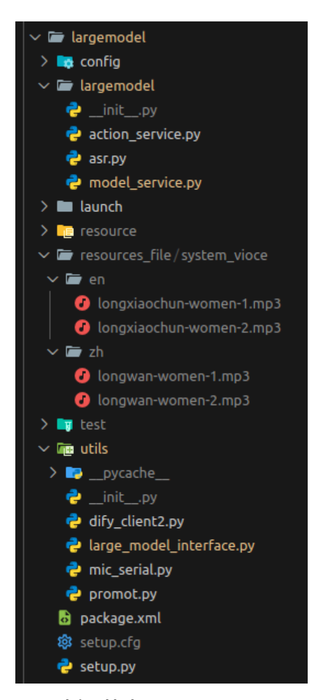
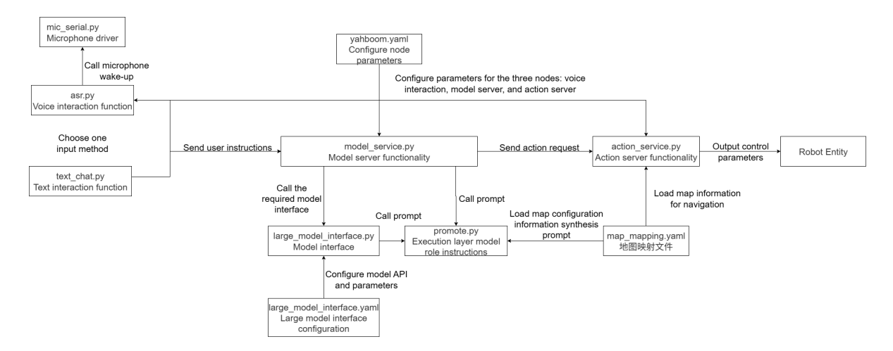
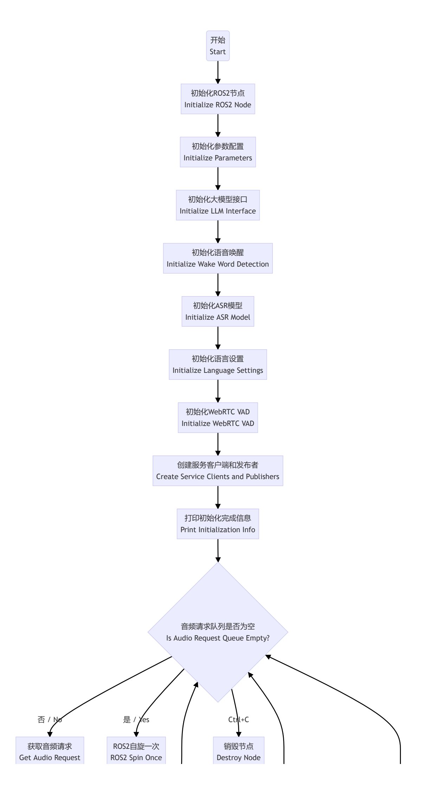
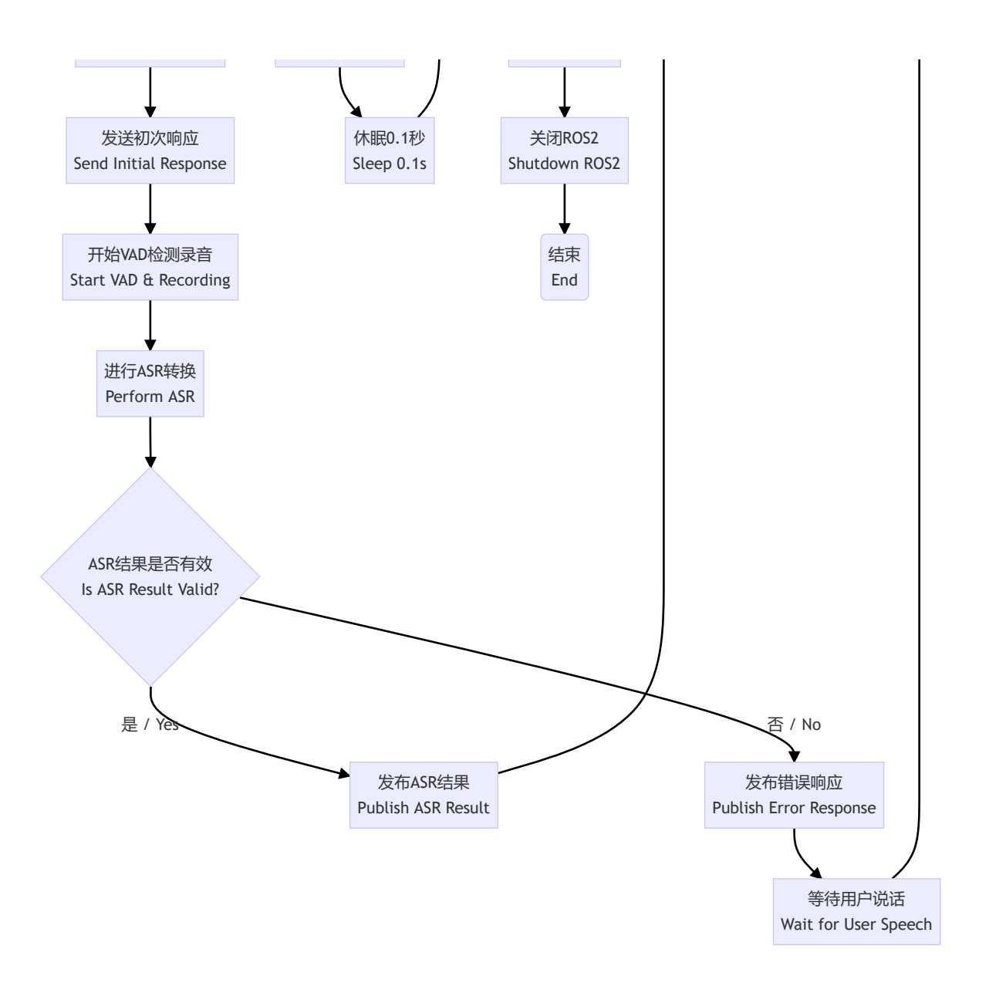
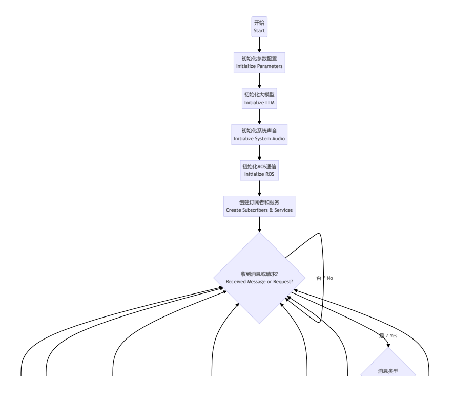
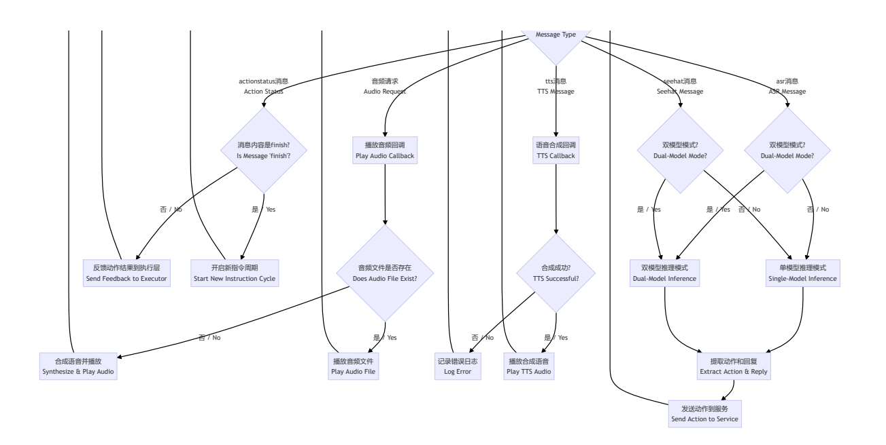
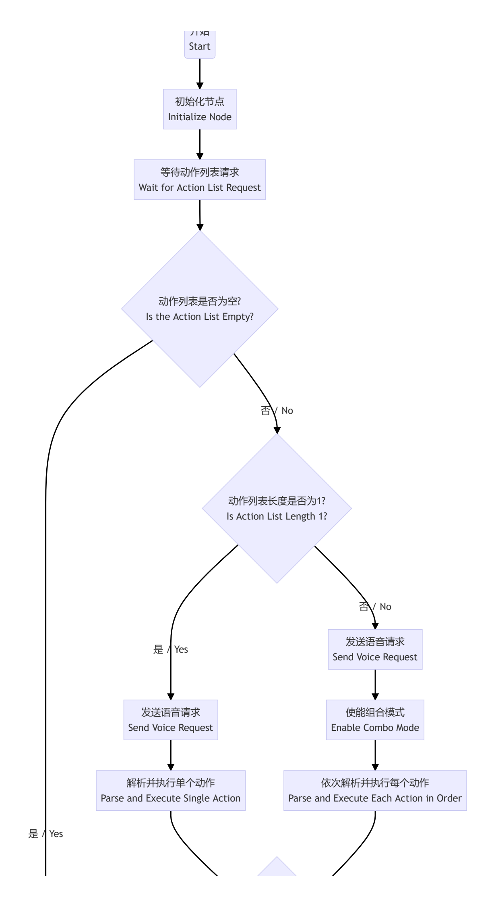
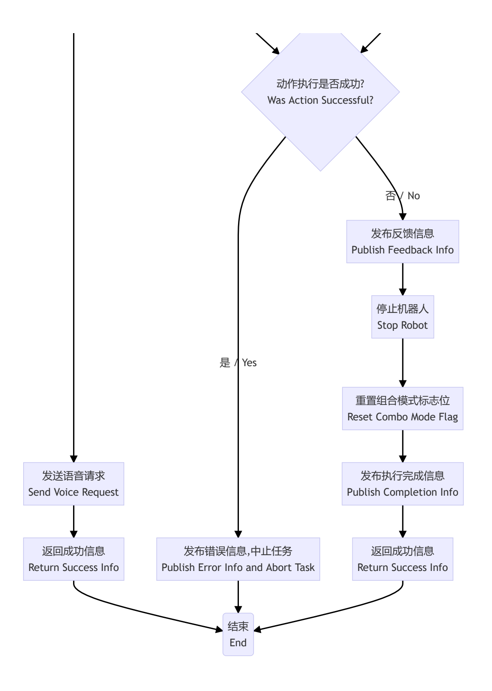

# **Embodied Intelligent Gameplay Core Source Code Interpretation**

## **1. Course Content**

1. Embodied Intelligent Gameplay for large AI models is a complex function that involves the coordinated implementation of multiple node programs. This course explains the core code.

## **2. Source Code Package Structure**

## **2.1 Package File Structure**

The ROS package for the AI large model embodied intelligence is called largemodel. The package path is:

Jetson Orin Nano, Jetson Orin NX Host:

/home/jetson/M3Pro\_ws/src/largemodel

Jetson Nano, Raspberry Pi Host:

You need to first enter Docker.

root/jetson/M3Pro\_ws/src/largemodel

The package file structure is as follows:


[Image details](images/img_001.md)

**Folder and file functions are explained below:**

## **2.1.1 config**

Configuration folder, storing configuration files

large\_model\_interface.yaml

Large model interface configuration file, used to configure the API keys and large model parameters for each platform.

map\_mapping.yaml

Map mapping file, used to map the raster map to real-world regions.

yahboom.yaml

Node configuration file: used to configure core node parameters.

#### **2.1.2 largemodel**

Source code folder, core program for the AI large model embodying intelligent gameplay.

asr.py

Speech recognition program file, used to run the speech recognition model and interact with the user.

model\_service.py

Model server program file, used to call various model interfaces to implement the model inference architecture.

action\_service.py

Action server program file, used to receive action lists requested by the model server, control robot movements, and play sounds.

### **2.1.3 launch**

Startup file folder, used to store ROS2 node startup files.

largemodel\_control.launch.py

The startup file for the AI large model embodying intelligent gameplay: starts multiple nodes, with two startup modes: voice interaction mode and text interaction mode.

#### **2.1.4 resources\_file**

Stores audio files for system sounds

#### **2.1.5 utils**

Component folder, stores program files for non-core functions

large\_model\_interface.py

The large model interface program file contains the underlying interface for calling the large model on various platforms. The calling procedures vary between different platforms and models, so the interface file manages the calling methods uniformly.

mic\_serial.py

The voice module driver file is used to drive the voice module's wake-up word function.

promot.py

The large model prompt word file: used to generate prompt words for the execution layer large model.

dify\_client2.py

The dify API function is used by the international version of dify to request the local dify application.

## **2.2 Inter-program call diagram**


[Image details](images/img_002.md)

## **3. Speech Recognition Function**

The speech recognition function includes two parts: VAD voice activity detection and speech-totext conversion. Source code path:

Jetson Orin Nano, Jetson Orin NX host:

```
/home/jetson/M3Pro_ws/src/largemodel/largemodel/asr.py
```

Jetson Nano, Raspberry Pi host:

You need to enter Docker first.

root/M3Pro\_ws/src/largemodel/largemodel/asr.py

## **3.1 Program Flowchart**

asr program flowchart


[Image details](images/img_003.md)


[Image details](images/img_004.md)

## **3.2 VAD Voice Activity Detection**

**Implementation:** The listen\_for\_speech method in the ASRNode class

**Program Explanation:** Records real-time audio from a specified microphone and uses VAD (Voice Activity Detection) to determine whether speech is currently occurring. When a segment of speech is detected (continuous silence exceeds a set number of frames), recording stops and the valid speech content is saved to a file.

#### **Detailed logic is as follows:**

- 1. Initialize the audio stream and configure parameters (such as sampling rate and number of channels).
- 2. Continuously read audio frames and perform voice activity detection.
- 3. If speech starts, add the audio frame to the buffer. If continuous silence exceeds a threshold (90 frames, approximately 1 second), recording ends.
- 4. After recording is complete, remove the trailing silence and save the valid speech content as a WAV file.
- 5. If no valid speech is detected, the file is not saved.

```
def listen_for_speech(self, mic_index=0):
       p = pyaudio.PyAudio()
       audio_buffer = []
       silence_counter = 0
       MAX_SILENCE_FRAMES = 90 # 30帧*30ms=900ms静音后停止 / Stop after 900ms of
silence (30 frames * 30ms)
       speaking = False # 语音活动标志 / Flag indicating speech activity
       frame_counter = 0 # 计数器 / Frame counter
       stream_kwargs = {
           "format": pyaudio.paInt16,
           "channels": 1,
           "rate": self.sample_rate,
           "input": True,
           "frames_per_buffer": self.frame_bytes,
       }
       if mic_index != 0:
           stream_kwargs["input_device_index"] = mic_index
       # 通过蜂鸣器提示用户讲话 / Prompt the user to speak via the buzzer
       self.pub_beep.publish(UInt16(data=1))
       time.sleep(0.5)
       self.pub_beep.publish(UInt16(data=0))
       try:
           # 打开音频流 / Open audio stream
           stream = p.open(**stream_kwargs)
           while True:
               if self.stop_event.is_set():
                   return False
               frame = stream.read(
                   self.frame_bytes, exception_on_overflow=False
               ) # 读取音频数据 / Read audio data
               is_speech = self.vad.is_speech(
                   frame, self.sample_rate
```

```
) # VAD检测 / VAD detection
               if is_speech:
                   # 检测到语音活动 / Detected speech activity
                   speaking = True
                   audio_buffer.append(frame)
                   silence_counter = 0
               else:
                   if speaking:
                       # 在语音活动后检测静音 / Detect silence after speech
activity
                       silence_counter += 1
                       audio_buffer.append(
                           frame
                       ) # 持续记录缓冲 / Continue recording buffer
                       # 静音持续时间达标时结束录音 / End recording when silence
duration meets the threshold
                       if silence_counter >= MAX_SILENCE_FRAMES:
                           break
               frame_counter += 1
               if frame_counter % 2 == 0:
                   self.get_logger().info("1" if is_speech else "-")
                   # print('1-' if is_speech else '0-', end='', flush=True) #
实时状态显示方式 / Real-time status display
       finally:
           stream.stop_stream()
           stream.close()
           p.terminate()
       # 保存有效录音(去除尾部静音) / Save valid recording (remove trailing
silence)
       if speaking and len(audio_buffer) > 0:
           # 裁剪最后静音部分 / Trim the last silent part
           clean_buffer = (
               audio_buffer[:-MAX_SILENCE_FRAMES]
               if len(audio_buffer) > MAX_SILENCE_FRAMES
               else audio_buffer
           )
           with wave.open(self.user_speechdir, "wb") as wf:
               wf.setnchannels(1)
               wf.setsampwidth(p.get_sample_size(pyaudio.paInt16))
               wf.setframerate(self.sample_rate)
               wf.writeframes(b"".join(clean_buffer))
               return True
```

## **3.3 ASR Speech Recognition**

**Implementation:** The ASR\_conversion method in the ASRNode class converts the recording file into text.

Call the speech recognition model interface function in the large\_model\_interface.py large model interface file.

**Note: Text recognized by speech recognition with less than 4 characters is considered invalid. This is to prevent the content after false activation from being mistaken for valid content.**

#### **Program Explanation:**

- 1. If using oline\_asr, call the corresponding method and check whether the result is valid text (length greater than 4). If successful, return the recognized content; otherwise, log the error and return 'error'.
- 2. Otherwise, use SenseVoiceSmall\_ASR for recognition and perform the same result judgment and processing.

SenseVoiceSmall\_ASR is a local model speech recognition method and is only available on Jetson Orin Nano and Jetson Orin NX hosts.

```
def ASR_conversion(self, input_file):
    if self.use_oline_asr:
        result=self.modelinterface.oline_asr(input_file)
        if result[0] == 'ok' and len(result[1]) > 4:
            return result[1]
        else:
            self.get_logger().error(f'ASR Error:{result[1]}')
            return 'error'
    else:
        result=self.modelinterface.SenseVoiceSmall_ASR(input_file)
        if result[0] == 'ok' and len(result[1]) > 4:
            return result[1]
        else:
            self.get_logger().error(f'ASR Error:{result[1]}')
            return 'error'
```

## **4. Model Server Functionality**

The implementation program is model\_service.py, which receives voice recognition results in voice interaction mode or terminal input in text interaction mode, and implements the large model inference logic. Source code path:

Jetson Orin Nano, Jetson Orin NX host:

```
/home/jetson/M3Pro_ws/src/largemodel/largemodel/model_service.py
```

Jetson Nano, Raspberry Pi host:

You need to enter Docker first.

```
root/M3Pro_ws/src/largemodel/largemodel/model_service.py
```

## **4.1 Program Flowchart**

model\_service program flowchart


[Image details](images/img_005.md)


[Image details](images/img_006.md)

## **4.2 Dual-Model Inference (Domestic Version)**

Dual-model inference mode is used by default. The implementation program is the dual\_large\_model\_mode and instruction\_process methods in the LargeModelService class.

Program Explanation:

- 1. If this is a new instruction cycle (self.new\_order\_cycle is True):
- Initialize the multimodal history context;
- Use the task decision model to perform task planning based on the user input prompt;
- Pass the planning results to the instruction execution layer model for processing;
- Set new\_order\_cycle to False, indicating that execution of the current instruction cycle has begun.
- 2. Otherwise (not a new cycle):
- Directly pass the input prompt and type to the instruction execution layer model for processing.

```
def dual_large_model_mode(self, type, prompt=""):
   """
   此函数实现了双模型推理模式,即先由文本生成模型进行任务规划,然后由多模态大模型生成动作列表
   This function implements the dual model inference mode, where the text
generation model first plans the task, and then the multimodal large model
generates the action list.
   """
   if (
       self.new_order_cycle
   ): # 判断是否是新任务周期 / Determine if it is a new task cycle
       # 判断上一轮对话指令是否完成如果完成就清空历史上下文,开启新的上下文 / Determine if
the previous round of dialogue instructions are completed. If completed, clear
the historical context and start a new context
       self.model_client.init_Multimodal_history(
           get_prompt()
       ) # 初始化执行层上下文历史 / Initialize execution layer context history
       execute_instructions = self.model_client.TaskDecision(
           prompt
       ) # 调用决策层大模型进行任务规划 / Call the decision layer large model for
task planning
       if not execute_instructions == "error":
           if self.text_chat_mode:
               msg = String(
                  data=f"The upcoming task to be carried out:
{execute_instructions}"
               )
               self.text_pub.publish(msg)
           else:
               self.get_logger().info(
                  f"The upcoming task to be carried out:
{execute_instructions}"
               ) # 即将执行的任务:...
           self.instruction_process(
```

```
type="text",
               prompt=f"用户:{prompt},决策层AI规划:{execute_instructions}",
           ) # 传递决策层模型规划好的执行步骤给执行层模型 / Pass the planned execution
steps from the decision layer model to the execution layer model
           self.new_order_cycle = (
               False # 重置指令周期标志位 / Reset the instruction cycle flag
           )
       else:
           self.get_logger().info(
               "The model service is abnormal. Check the large model account or
configuration options"
           ) # 模型推理失败,请检查模型配额和账户是否正常!!!
   else:
       self.instruction_process(
           prompt, type
       ) # 调用执行层大模型生成成动作列表并执行 / Call the execution layer large
model to generate an action list and execute
def instruction_process(self, prompt, type, conversation_id=None):
   """
   根据输入信息的类型(文字/图片),构建不同的请求体进行推理,并返回结果)
   Based on the type of input information (text/image), construct different
request bodies for inference and return the result.
   """
   if self.regional_setting == "China": # 国内版
       if type == "text":
           raw_content = self.model_client.multimodalinfer(prompt)
       elif type == "image":
           self.save_single_image()
           raw_content = self.model_client.multimodalinfer(
               "机器人反馈:执行seewhat()完成", image_path=self.image_save_path
           )
       json_str = self.extract_json_content(raw_content)
   elif self.regional_setting == "international": # 国际版
       if type == "text":
           result = self.model_client.TaskExecution(
               input=prompt,
               map_mapping=self.map_mapping,
               language=self.language_dict[self.language],
               conversation_id=conversation_id,
           )
           if result[0]:
               json_str = self.extract_json_content(result[1])
               self.conversation_id = result[2]
           else:
               self.get_logger().info(f"ERROR:{result[1]}")
       elif type == "image":
           self.save_single_image()
           result = self.model_client.TaskExecution(
               input="机器人反馈:执行seewhat()完成",
               map_mapping=self.map_mapping,
               language=self.language_dict[self.language],
               image_path=self.image_save_path,
               conversation_id=conversation_id,
           )
           if result[0]:
               json_str = self.extract_json_content(result[1])
```

```
self.conversation_id = result[2]
            else:
                self.get_logger().info(f"ERROR:{result[1]}")
    if json_str is not None:
        # 解析JSON字符串,分离"action"、"response"字段 / Parse JSON string, separate
"action" and "response" fields
        action_plan_json = json.loads(json_str)
        action_list = action_plan_json.get("action", [])
        llm_response = action_plan_json.get("response", "")
    else:
        self.get_logger().info(
            f"LargeScaleModel return: {json_str},The format was unexpected. The
output format of the AI model at the execution layer did not meet the
requirements"
        )
        return
    if self.text_chat_mode:
        msg = String(data=f'"action": {action_list}, "response":
{llm_response}')
        self.text_pub.publish(msg)
    else:
        self.get_logger().info(
            f'"action": {action_list}, "response": {llm_response}'
        )
    self.send_action_service(
        action_list, llm_response
    ) # 异步发送动作列表、回复内容给ActionServer / Asynchronously send action list
and response content to ActionServer
```

## **4.3 Dual-Model Inference (International Version)**

7. The program implementation logic is the same as the domestic version. The difference is that the international version requests the local Dify application, which then requests the large cloud model.

```
def dual_large_model_international_model(self, type, prompt=""):
   """
   此函数适用于国际版双模型推理模式,使用dify作为中间件
   """
   if (
       self.new_order_cycle
   ): # 判断是否是新任务周期 / Determine if it is a new task cycle
       self.conversation_id = None
       result = self.model_client.TaskDecision(prompt)
       if result[0]:
           if self.text_chat_mode: # 文字交互模式 / Text interaction mode
               msg = String(
                   data=f"The upcoming task to be carried out:{result[1]}"
               )
               self.text_pub.publish(msg)
           else: # 语音交互模式 / Voice interaction mode
               self.get_logger().info(
```

```
f"The upcoming task to be carried out:{result[1]}"
               )
           self.instruction_process(
               type="text", prompt=f"用户:{prompt},决策层AI规划:{result[1]}"
           )
           self.new_order_cycle = (
               False # 重置指令周期标志位 / Reset the instruction cycle flag
           )
       else:
           self.get_logger().info(f"ERROR: {result[1]}")
   else:
       self.instruction_process(
           prompt, type, conversation_id=self.conversation_id
       ) # 调用执行层大模型生成成动作列表并执行 / Call the execution layer large
model to generate an action list and execute
```

## **5. Action Server Functionality**

The implementation program is action\_service.py, which receives the action list requested by the model server, parses the action list, and executes it. Source code path:

Jetson Orin Nano, Jetson Orin NX host:

```
/home/jetson/M3Pro_ws/src/largemodel/largemodel/action_service.py
```

Jetson Nano, Raspberry Pi host:

You need to enter Docker first.

```
root/M3Pro_ws/src/largemodel/largemodel/action_service.py
```

## **5.1 Program Flowchart**

action\_service program flowchart


[Image details](images/img_007.md)


[Image details](images/img_008.md)

## **5.2 Action Function Library**

The robot's action functions are derived from methods in the CustomActionServer class, which contains functions for various sub-actions. Here, we'll use the action function that controls the robot's chassis movement as an example. Other action functions will be explained in subsequent chapters when they first appear.

Program Explanation:

- 1. Convert the input string parameter to a floating-point number.
- 2. Create and set a Twist-type motion command.
- 3. Publish the corresponding speed topic and stop when finished.
- 4. Determine whether to publish a completion message based on the mode.

```
def set_cmdvel(self,linear_x,linear_y, angular_z,duration):#发布cmd_vel
   # 将参数从字符串转换为浮点数 Converts the argument from a string to a floating
point number
   linear_x = float(linear_x)
   linear_y = float(linear_y)
   angular_z = float(angular_z)
   duration = float(duration)
   twist = Twist()
   twist.linear.x = linear_x
   twist.linear.y = linear_y
   twist.angular.z = angular_z
   self._execute_action(twist,durationtime=duration)
   self.stop()
   if self.combination_mode:#是否为组合模式,组合模型需要执行完 Is it a combination
mode? The combination model needs to be executed
       return
   else:
       self.action_status_pub(f'机器人反馈:执行set_cmdvel({linear_x},{linear_y},
{angular_z},{duration})完成')
```

## **5.3 Parsing the Action List to Control Robot Functions**

Parse the action list generated by the large model into functions that control the robot entity and execute them. This is implemented in the execute\_callback method of the CustomActionServer class.

Program Explanation:

- 1. Receive the action list (string format) sent by the client;
- 2. If the action list is empty, return a success result;
- 3. If there is only one action, parse and execute the corresponding method; abort if failure occurs;
- 4. If there are multiple actions, execute them sequentially in combined mode, logging and providing feedback as they occur;
- 5. After all actions are executed, call stop() to stop the robot;
- 6. Finally, return a successful result to the client.

```
def execute_callback(self, goal_handle):
    feedback_msg = Rot.Feedback()
```

```
stop = getattr(self, "stop") # 获取停止方法,通过发布话题的方法停止机器人运动
Get the stop method and stop the robot movement by publishing the topic
   actions=goal_handle.request.actions
   if not actions: # 如果动作列表为空,直接返回成功 If the action list is empty,
return success directly
       if not self.text_chat_mode:
          self.send_Audiorequest(goal_handle.request.llm_response)
       if self.use_double_llm:
           self.action_status_pub('机器人反馈:回复用户完成')
       goal_handle.succeed()
       result = Rot.Result()
       result.success = True
       return result
   elif len(actions) == 1:# 动作列表只有一个动作,正常执行流程 The action list has
only one action, and the execution process is normal
       # 情况2:列表只有一个元素 Case 2: The list has only one element
       action = actions[0]
       if not self.text_chat_mode:
          self.send_Audiorequest(goal_handle.request.llm_response)
       match = re.match(r"(\w+)\((.*)\)", action)
       if not match:
           self.get_logger().warning(f'action_service: {action} is invalid
action,skip execution')
           goal_handle.abort()
           result = Rot.Result()
           result.success = False
           return result
       else:
           action_name, args_str = match.groups()
           args = [arg.strip() for arg in args_str.split(",")] if args_str else
[]
           try:
               if hasattr(self, action_name):
                   method = getattr(self, action_name)
                   method(*args)
                   feedback_msg.status = f'action service execute {action}
successed'
                   # self.get_logger().info(feedback_msg.status) # 添加日志
                   goal_handle.publish_feedback(feedback_msg)
               else:
                   self.get_logger().warning(f'action_service:inviald:
{action_name},skip execution')
                   self.action_status_pub('机器人反馈:动作函数不存在,无法执行')
                   goal_handle.abort()
                   result = Rot.Result()
                   result.success = False
                   return result
           except Exception as e:
               self.get_logger().error(f'action_service:execute action:
{action} failed,error-log: {str(e)}')
               goal_handle.abort()
               result = Rot.Result()
               result.success = False
               return result
```

```
else:#如果动作列表有多个动作,使能组合模式 If the action list has multiple actions,
enable combination mode
       if not self.text_chat_mode:
          self.send_Audiorequest(goal_handle.request.llm_response)
       self.combination_mode=True
       for action in actions:
           # 使用正则表达式解析动作名称和参数 Parsing action names and parameters
using regular expressions
           match = re.match(r"(\w+)\((.*)\)", action)
           if not match:
               self.get_logger().warning(f'action_service: {action} is invalid
action,skip execution')
               continue
           action_name, args_str = match.groups()
           args = [arg.strip() for arg in args_str.split(",")] if args_str else
[]
           try:
               # 检查动作是否是 CustomActionServer 类中的方法 Check if the action is
a method in the CustomActionServer class
               if hasattr(self, action_name):
                   method = getattr(self, action_name)
                   # 动态调用方法并传递参数 Dynamically call methods and pass
parameters
                   method(*args)
                   # method(*converted_args)
                   feedback_msg.status = f'action service execute {action}
successed'
                   self.get_logger().info(feedback_msg.status) # 添加日志 Add
log
                   goal_handle.publish_feedback(feedback_msg)
               else:
                   self.get_logger().warning(f'action_service:inviald:
{action_name},skip execution')
           except Exception as e:
               self.get_logger().error(f'action_service:execute action:
{action} failed,error-log: {str(e)}')
               goal_handle.abort()
               result = Rot.Result()
               result.success = False
               return result
       self.action_status_pub(f'机器人反馈:执行{actions}完成')
       self.combination_mode=False#重置组合模式标志位 Reset the combination mode
flag
   stop() # 执行完全部动作停止机器人 Stop the robot after executing all actions
   # 返回成功信息给客户端 Return success information to the client
   goal_handle.succeed()
   result = Rot.Result()
   result.success = True
   return result
```

## **6. Interruption Functionality**

The robot supports interruptions at any stage, specifically during recording, conversation, and action. The principles for interruption in each stage are explained here.

## **6.1 Interruption During Recording**

If you notice a mistake during recording, or are dissatisfied with the content and need to rerecord, you can simply wake up the recording process, interrupt the previous recording, and restart the recording.

- The logic is implemented in the main\_loop method of the ASRNode class in the asr.py file:
- Each time the robot wakes up, if there is already a thread running to wake up the recording, it is interrupted via the stop\_event thread event and waits for it to complete.
- After clearing the stop event flag, a new recording thread is started.

```
def main_loop(self):
   while rclpy.ok():
       while (
           self.audio_request_queue.qsize() > 1
       ): # 只处理最近的一次唤醒请求,防止重复唤醒 / Process only the most recent
wake-up request to prevent duplicates
           self.audio_request_queue.get()
       if not self.audio_request_queue.empty():
           self.audio_request_queue.get()
           self.wakeup_pub.publish(
               Bool(data=True)
           ) # 发布唤醒信号 / Publish wake-up signal
           self.get_logger().info("I'm here")
           playsound(
               self.audio_dict[self.first_response]
           ) # 应答用户 / Respond to the user
           if (
               self.current_thread and self.current_thread.is_alive()
           ): # 打断上次的唤醒处理线程 / Interrupt the previous wake-up handling
thread
               self.stop_event.set()
               self.current_thread.join() # 等待当前线程结束 / Wait for the
current thread to finish
               self.stop_event.clear() # 清除事件 / Clear the event
           self.current_thread = threading.Thread(target=self.kws_handler)
           self.current_thread.daemon = True
           self.current_thread.start()
       rclpy.spin_once(self, timeout_sec=0.1)
       time.sleep(0.1)
```

## **6.2 Interrupting the Conversation Phase**

If you're dissatisfied with the robot's response or don't want it to continue, you can interrupt it using the wakeup word and start recording. At this point, you can give the robot new commands (while still in the current task cycle), or say "End current task" to end the current task and start a new one.

- The logic is implemented in the **wakeup\_callback** and **play\_audio** methods of the **CustomActionServer** class in the action\_service.py file:
- wakeup\_callback is the wakeup callback function. Each time the asr.py program wakes up, it publishes a wakeup signal via topic communication, which wakeup\_callback subscribes to and handles.
- Each time it wakes up, it checks whether **pygame.mixer** is playing audio. If so, it notifies the playback thread to stop playback via the thread event self.stop\_event.
- If the previous action is detected to be running after wakeup, the **self.interrupt\_flag** flag is set to interrupt subsequent actions.

```
def wakeup_callback(self, msg):
    if msg.data:
        if pygame.mixer.music.get_busy():
            self.stop_event.set()
        if self.action_runing:
            self.interrupt_flag = True
            self.stop()
            self.pubSix_Arm(self.init_joints)
```

When play\_audio plays audio, it will detect whether self.stop\_event is set. Once it detects that it is set, it will stop the currently playing audio immediately.

```
def play_audio(self, file_path: str, feedback: Bool = False) -> None:
   """
   同步方式播放音频函数The function for playing audio in synchronous mode
   """
   pygame.mixer.music.load(file_path)
   pygame.mixer.music.play()
   while pygame.mixer.music.get_busy():
       if self.stop_event.is_set():
           pygame.mixer.music.stop()
           self.stop_event.clear() # 清除事件
           return
       pygame.time.Clock().tick(10)
   if feedback:
       self.action_status_pub("机器人反馈:回复用户完成")
```

## **6.3 Action Phase Interruption**

If the robot is awakened during an action, it will stop the current action and resume its initial posture. This can be categorized as either a standard action interruption or an action interruption with a child process.

### **6.3.1 Standard Action Interruption**

The implementation is in the \_execute\_action and pubSix\_Arm methods in the CustomActionServer class in action\_service.py.

- The robot chassis and arm movements are controlled by publishing velocity topics and arm joint angle topics.
- The \_execute\_action chassis control function continuously checks the interrupt flag (self.interrupt\_flag). If it is set, the chassis stops immediately.

Similarly, the pubSix\_Arm arm control function checks the interrupt flag (self.interrupt\_flag). Only when it is not set will it publish the arm joint angle topic.

```
def _execute_action(self, twist, num=1, durationtime=3.0):
    for _ in range(num):
        start_time = time.time()
        while (time.time() - start_time) < durationtime:
            if self.interrupt_flag:
                self.stop()
                return
            self.publisher.publish(twist)
            time.sleep(0.1)
def pubSix_Arm(self, joints, id=6, angle=180.0, runtime=2000):
    arm_joint = ArmJoints()
    arm_joint.joint1 = joints[0]
    arm_joint.joint2 = joints[1]
    arm_joint.joint3 = joints[2]
    arm_joint.joint4 = joints[3]
    arm_joint.joint5 = joints[4]
    arm_joint.joint6 = joints[5]
    arm_joint.time = runtime
    if not self.interrupt_flag:
        self.TargetAngle_pub.publish(arm_joint)
```

#### **6.3.2 Interrupting Actions with Subprocesses**

For example, actions like robotic gripping and sorting machine code require launching an external program within a subprocess. Here, we use the robotic gripping action function grasp\_obj as an example:

When the robotic gripper is not completed, it waits in a while not self.grasp\_obj\_future.done(): loop. During this process, if the interrupt flag self.interrupt\_flag is set, it first calls the self.kill\_process\_tree function to recursively terminate the subprocess tree and then terminate the action.

```
def grasp_obj(self, x1, y1, x2, y2):
   process_1 = subprocess.Popen(["ros2", "run", "largemodel_arm",
"grasp_desktop"])
   time.sleep(2.0) # 睡眠2秒等待线程稳定
   process_2 = subprocess.Popen(["ros2", "run", "largemodel_arm",
"KCF_follow"])
   process_3 = subprocess.Popen(
       ["ros2", "run", "M3Pro_KCF", "ALM_KCF_Tracker_Node"]
   )
   time.sleep(3.0) # 睡眠3秒等待线程稳定
   x1 = int(x1)
   y1 = int(y1)
   x2 = int(x2)
   y2 = int(y2)
   self.object_position_pub.publish(Int16MultiArray(data=[x1, y1, x2, y2]))
   timeout = 180.0
   start_time = time.time()
   while not self.grasp_obj_future.done():
       if self.interrupt_flag:
           self.pubSix_Arm(self.init_joints)
```

```
break
       if time.time() - start_time > timeout:
           self.kill_process_tree(process_1.pid)
           self.kill_process_tree(process_2.pid)
           self.kill_process_tree(process_3.pid)
           self.grasp_obj_future = Future() # 复位Future对象
           self.pubSix_Arm(self.init_joints)
           self.get_logger().info(
               f"Robot feedback: The execution of grasp_obj({x1},{y1},{x2},{y2})
timed out"
           )
           self.action_status_pub(
               f"机器人反馈:执行grasp_obj({x1},{y1},{x2},{y2})失败"
           )
           break
       time.sleep(0.1)
   result = self.grasp_obj_future.result()
   if not self.interrupt_flag:
       if result.data == "grasp_obj_done":
           self.action_status_pub(
               f"机器人反馈:执行grasp_obj({x1},{y1},{x2},{y2})完成"
           )
       else:
           self.action_status_pub(
               f"机器人反馈:执行grasp_obj({x1},{y1},{x2},{y2})失败"
           )
   self.kill_process_tree(process_1.pid)
   self.kill_process_tree(process_2.pid)
   self.kill_process_tree(process_3.pid)
   self.grasp_obj_future = Future() # 复位Future对象
```