# **Configuring the AI Model**

# **0. Content Guide (Must Read Before Use)**

## **0.1 Mainland Chinese Users**

### **0.1.1 Required Configuration Items**

- **2.1 Registering an Alibaba Bailian Platform Account**: You must first register an account on the Bailian Platform and apply for the API before using the AI model service.
- **5.1 Configuring the Knowledge Base**: Configure the knowledge base for the decision layer to provide guidance for the AI model in open domains.
- **5.2 Configuring Training Examples**: Configure training examples for the decision layer to provide guidance for the AI model in open domains.
- **6 Configuring the Decision Layer and Execution Layer Models**: How to integrate the AI model into a local application.

#### **0.1.2 Optional Configuration Items**

- **2.2 Registering a Baidu Smart Cloud Large Model Platform Account**: If you need to use the Baidu platform's speech synthesis service, please refer to this section.
- **3. Switching the Speech Recognition Function and ASR Model**: If you have exhausted your speech recognition quota or want to proactively change the speech recognition model, please refer to this section.
- **4. Switching the Text-to-Speech (TTS) Model**: If you've used up your TTS quota or want to proactively change the TTS model, see this section.
- **5.3 Expanding the Knowledge Base and Training Examples**: If you need to expand intent recognition content or customize extended knowledge information, see this section.

## **0.2 International users**

#### **0.2.1 Required Configuration Items**

- **2.3 Registering an OpenRouter Platform Account**: Registering an account is required to use OpenRouter's AI model services.
- **2.4 Registering an Alibaba Bailian Large Model International Platform Account**: Registering an account is required to use Alibaba Bailian Large Model's AI model services.
- 7.1 **Accessing the Dify Configuration Page**: How to log in to the local Dify management page.
- **7.2 Entering the API Key**: Replace the API key with your own account's API key.
- **7.7 Using International Version Parameters**: To use the international version, comment out the domestic version parameters and then compile the feature package to take effect.

#### **0.2.2 Optional Configuration Items**

- **7.3 Configuring the Decision-Layer Model**: If you need to test the effectiveness of different models, please refer to this section.
- **7.4 Configuring the Execution-Layer Model**: If you need to test the effectiveness of different models, please refer to this section.
- **7.5 Extending the Knowledge Base**: If you need to expand intent recognition content or customize extended knowledge information, please refer to this section.

# **1. Course Content**

- 1. Learn to register a platform account for large AI models and configure a replacement API key.
- 2. Learn to configure the online large model RAG knowledge base and training examples.
- 3. Learn to customize the knowledge base and training examples.
- 4. Learn to switch and configure the speech recognition model, speech synthesis model, decision-making model, and execution model.
- 5. Learn to view the free credit for online models.

**Note:** All source code and configuration files mentioned in the tutorial are under the largemodel function. If using a Jetson Nano or Raspberry Pi , you must first enter Docker to view the files. This course uses the Jetson Origin NX as an example.

Feature package path:

Jetson Orin Nano, Jetson Orin NX :

/home/jetson/M3Pro\_ws/src/largemodel

Jetson Nano, Raspberry Pi :

You need to enter Docker first.

root/M3Pro\_ws/src/largemodel

# **2. Account Configuration**

# **2.1 Register an Ali Bailian Platform account**

The text generation model, multimodal model, and speech model used by the robot are defaulted to the **Ali Bailian Platform** (sometimes also called the Tongyi Qianwen Platform) when they leave the factory. This step is a necessary step for configuring the large model and cannot be omitted. Open the [Alibaba Cloud Official Website](https://www.aliyun.com/product/tongyi?utm_content=se_1020003559) link. If you do not have an Alibaba Cloud Platform account, click Register in the upper left corner to register an account

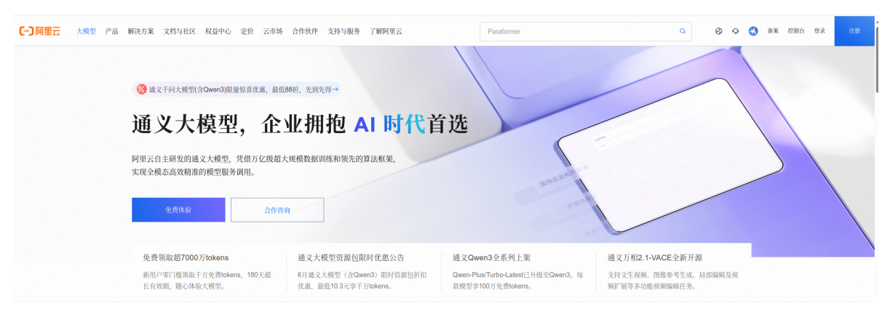
[Image details](images/img_001.md)

New registered users need to undergo real-name authentication before they can receive free credits. Click the account avatar in the upper right corner and click Deauthenticate to complete real-name authentication

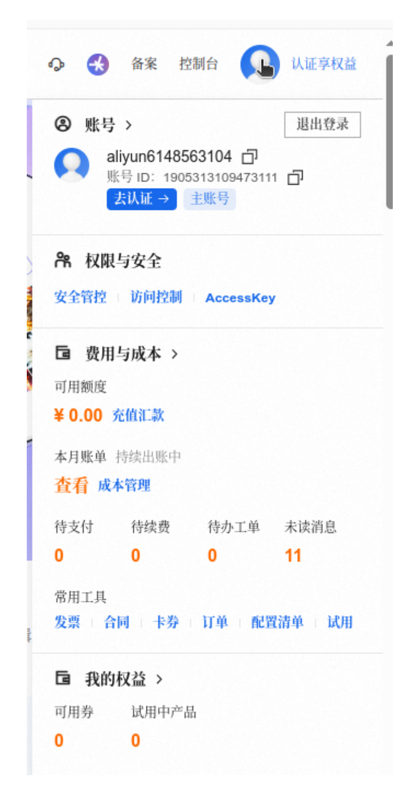
[Image details](images/img_002.md)

Then return to the official website page and click "Free Trial". After the jump, find the New User Gift Pack to receive free credits

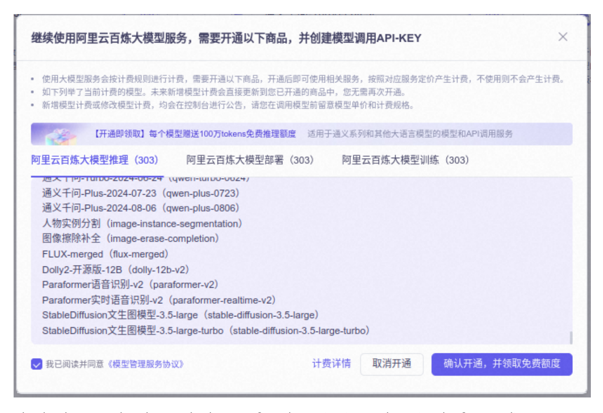
[Image details](images/img_003.md)

Check "I have read and agreed", then confirm the activation and receive the free credits

#### **2.1.1 Create an API-KEY**

Click the [Create API-KEY](https://bailian.console.aliyun.com/?spm=5176.29597918.J_SEsSjsNv72yRuRFS2VknO.2.1e8c7b08c29izR&tab=model#/api-key) link, then click Create My API-KEY, select the default business space, and click OK to complete the creation.

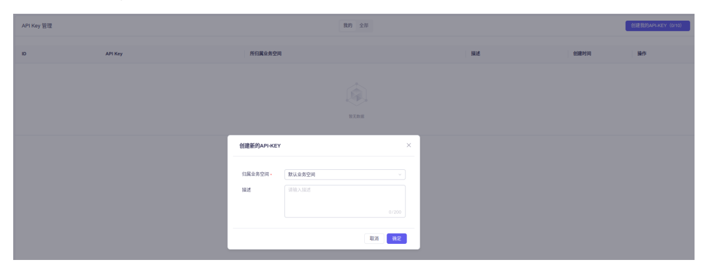
[Image details](images/img_004.md)

## **2.1.2 Replace Your Own API-KEY**

Click View API-KEY, then click Copy

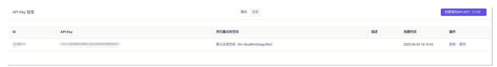
[Image details](images/img_005.md)

Open the large\_model\_interface.yaml configuration file, file path:

jetson orin nano, jetson orin NX:

/home/jetson/M3Pro\_ws/src/largemodel/config/large\_model\_interface.yaml

jetson nano, Raspberry Pi:

```
root/M3Pro_ws/src/largemodel/config/large_model_interface.yaml
```

Find the Tongyi Qianwen platform API configuration option and replace the tongyi\_api\_key parameter with your own API-KEY

# **2.2 Register a Baidu Smart Cloud Large Model Platform account**

Baidu Smart Cloud only uses the speech synthesis function. The factory default is to use the speech synthesis service of Alibaba Cloud Bailian Large Model Platform. **This step is selected as needed**. If you need to switch to Smart Cloud speech synthesis, refer to this step. Otherwise, you can skip registering a Baidu Smart Cloud Large Model Platform account.

Click the link [Baidu Smart Cloud Platform Official Website](https://cloud.baidu.com/campaign/bigevent/index.html?track=b0801c446f481f74302a6b970fcee47f5fbb53658f961e56), and click the avatar in the upper right corner to register an account and perform real-name authentication. The method is similar to (1) registering an account on the Bailian Large Model Platform, so I will not repeat it here.

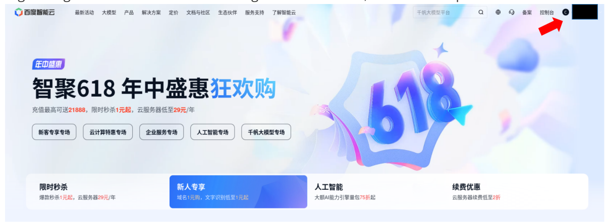
[Image details](images/img_006.md)

# **2.2.1 Create an application and API key**

Click the [Baidu Smart Cloud Application List](https://console.bce.baidu.com/ai-engine/old/#/ai/speech/app/list) link and click Create Application in the application list.

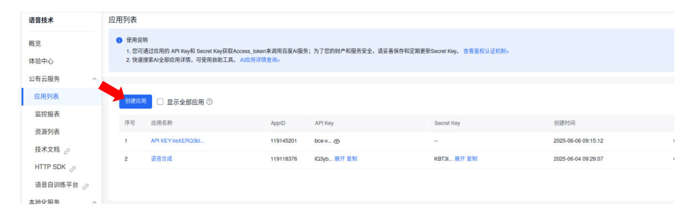
[Image details](images/img_007.md)

You can name the application anything you want. Here, we use "Speech Synthesis" as an example. Keep the other settings as default. Click Create Now. After the application is created, click Return to the application list. Do not close the application list page yet. You will need to copy and use the API Key and Secret here in the next step. Key

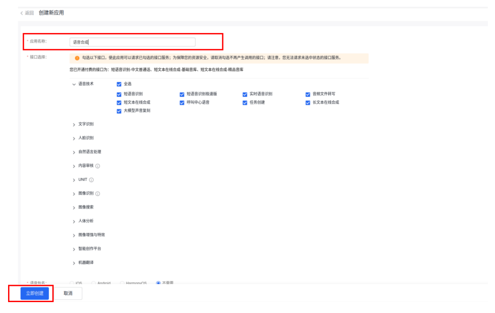
[Image details](images/img_008.md)

Open the [Speech Synthesis Online Debug](https://console.bce.baidu.com/support/?_=1749172819628&u=aiconsole×tamp=1749172821177#/api?product=AI&project=%E8%AF%AD%E9%9F%B3%E6%8A%80%E6%9C%AF&parent=%E8%AF%AD%E9%9F%B3%E5%90%88%E6%88%90&api=text2audio&method=post) link, enter the online debugging page of the speech synthesis function, and click "Authorization"

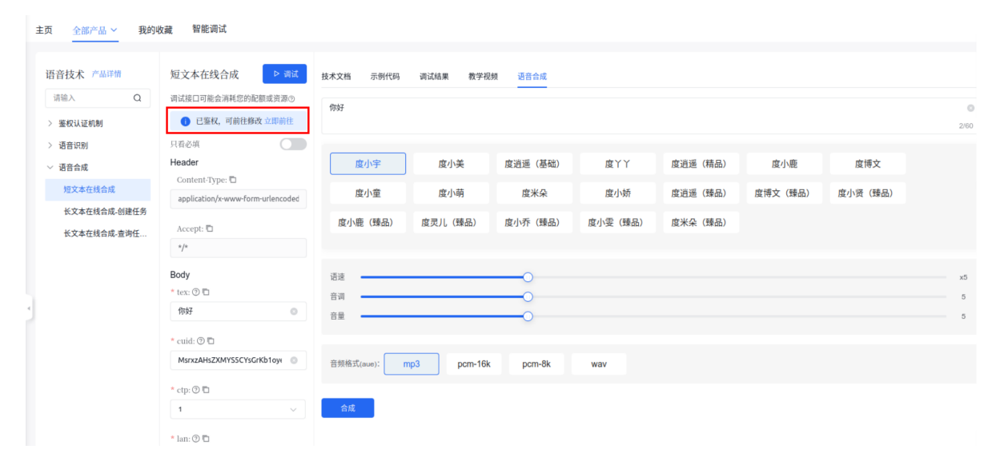
[Image details](images/img_009.md)

Select the application you just created in the application list, enter the API Key in the previous step in client\_id, and enter the Secret in the previous step in client\_secret. Key, then click OK.

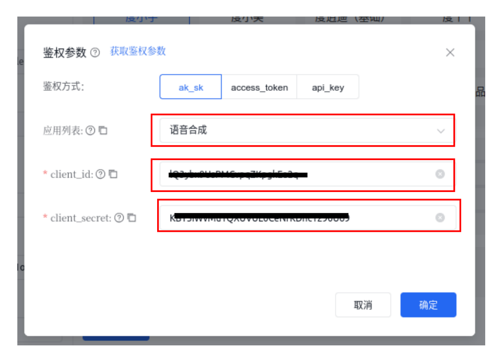
[Image details](images/img_010.md)

#### **2.2.2 Testing the API Key**

Enter test text in the text box and click Synthesize. If the audio output is normal, authentication is successful, and the account and API Key creation are complete. If you plan to use the Baidu Smart Cloud Platform's speech synthesis service later, follow 3. Configuring the Text-to-Speech (TTS) Large Model to modify the speech synthesis provider.

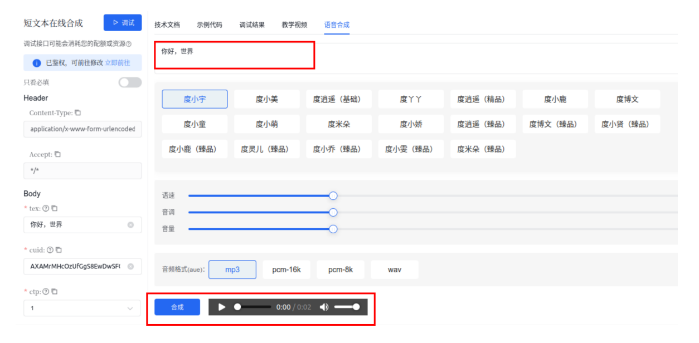
[Image details](images/img_011.md)

# **2.3 Register an OpenRouter platform account**

This step can be omitted and selected as needed. Domestic users use the model service of the Bailian large model platform by default. If you need to use the single model inference method, you can refer to this tutorial to register an OpenRouter account.

## **2.3.1 Register an account**

Open the [openrouter](https://openrouter.ai/) link and click the avatar in the upper right corner to register an account. Use your email address to register an account. The process is similar to the above and will not be repeated here.

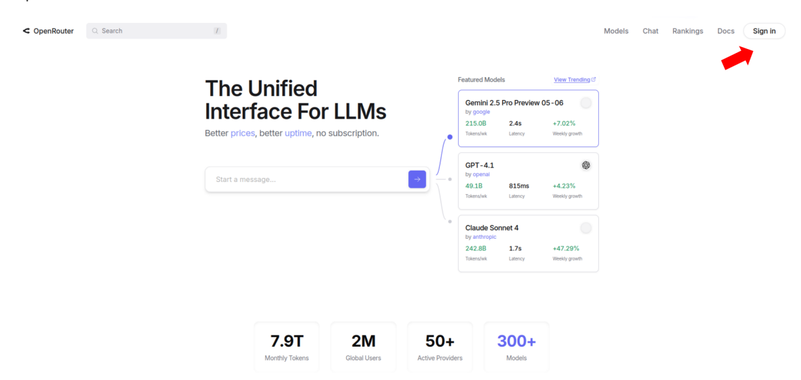
[Image details](images/img_012.md)

Click Keys in the upper right corner to create an API key.

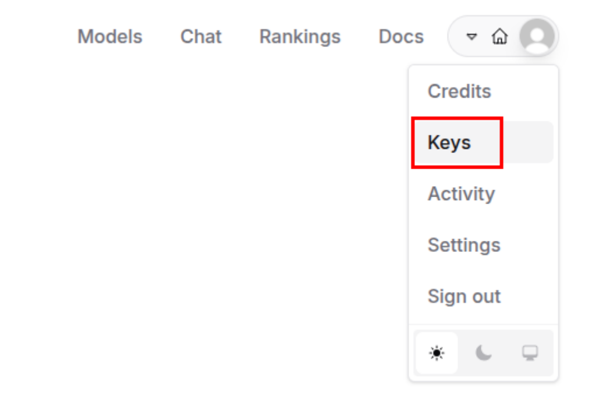
[Image details](images/img_013.md)

Click Create API Key, then enter a name (using "yahboom" as an example). Click Create to complete the OpenRouter platform account registration and API key application.

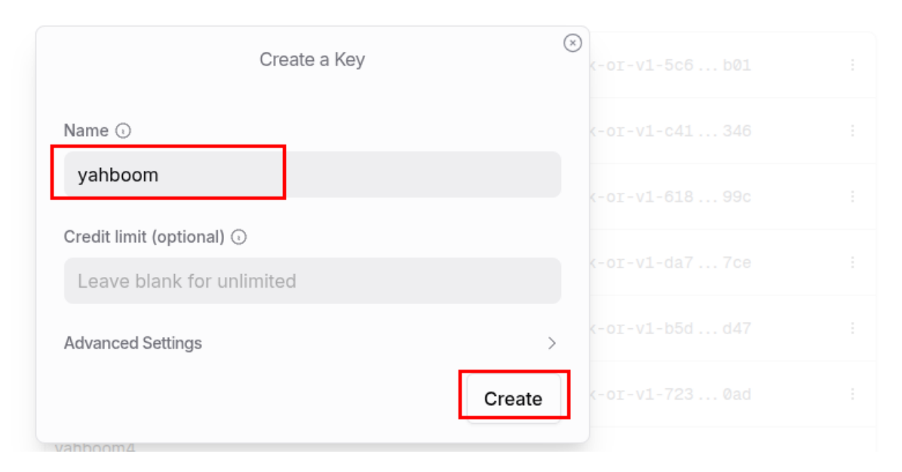
[Image details](images/img_014.md)

# **2.4 Register for an account on th e Alibaba Bailian Large Model International Platform**

Open the [Alibaba Cloud Model Studio](https://bailian.console.alibabacloud.com/?tab=doc#/doc/?type=model&url=https%3A%2F%2Fwww.alibabacloud.com%2Fhelp%2Fen%2Fdoc-detail%2F2840914.html&renderType=component) link, click Log in, and register your account.

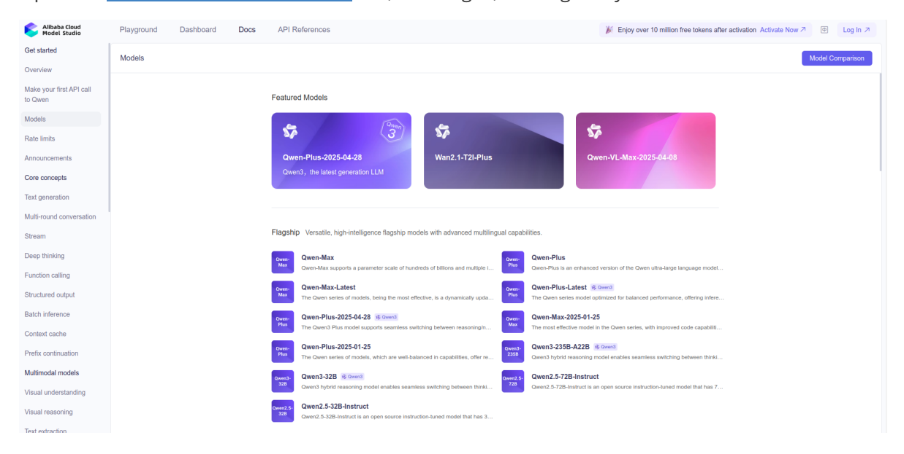
[Image details](images/img_015.md)

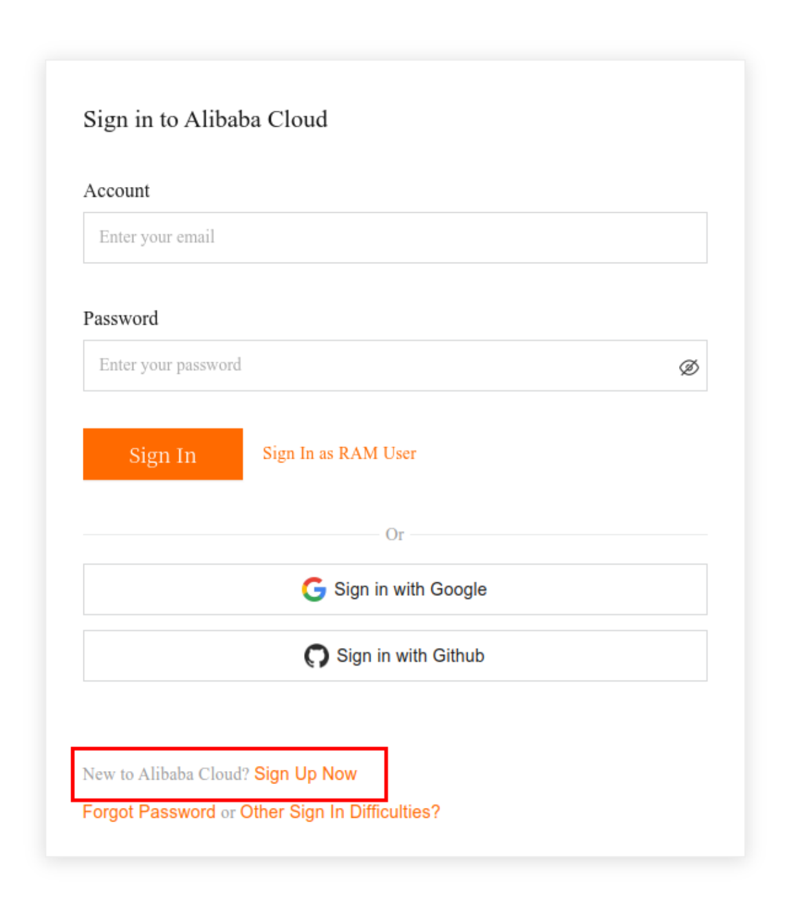
[Image details](images/img_016.md)

Select Individual Register using your account.


[Image details](images/img_017.md)

Return to the Bailian Model homepage and click "Get Free Credit" to complete your registration on the Bailian Model International site.

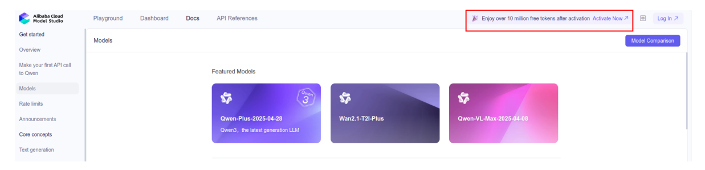
[Image details](images/img_018.md)

#### **2.3.2 Create an API Key**

After completing the first step of registration and logging in, click "Keys" in the list below your avatar in the upper right corner of the official website. On the API Keys page, click "Create API Key." Enter a name ("yahboom" is used as an example) and click "Create."

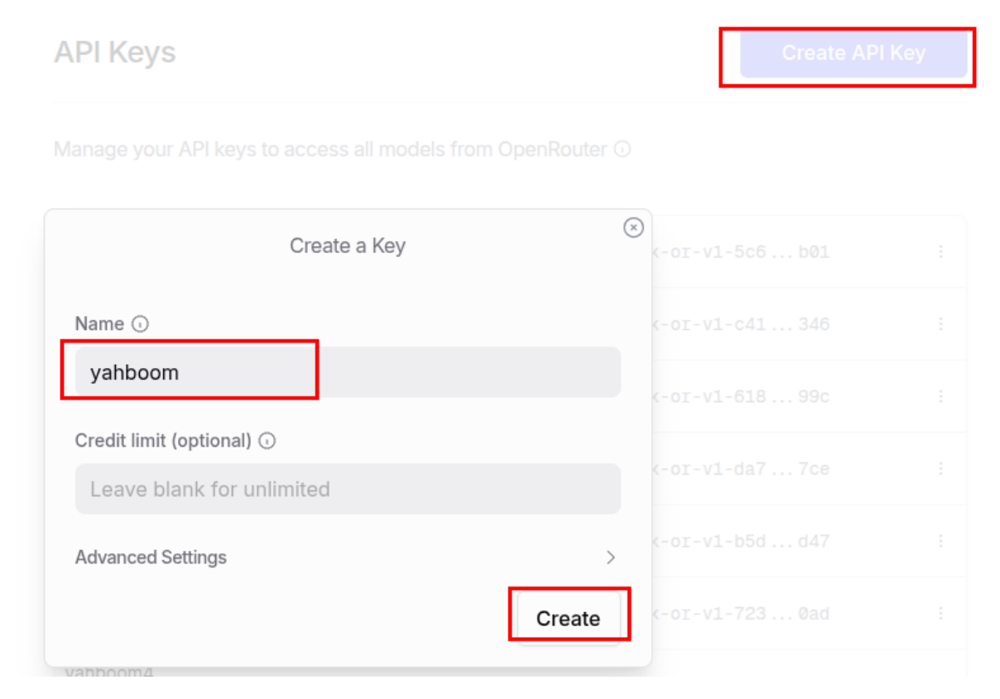
[Image details](images/img_019.md)

# **3. Switching the Speech Recognition Function and ASR Model**

The robot is pre-configured with the relevant parameters. To use the speech recognition function, users only need to update their API\_KEY in **2.1.2**; no additional configuration is required. If the free model quota has been used up or you want to change the speech recognition model, refer to this step.

# **3.1 Viewing the Speech Recognition Model List**

Speech recognition converts user voice input into text in a specified language. The speech recognition service uses the Paraformer and Gummy series models from the Alibaba Bailian Platform (Tongyi Qianwen Platform). Open the [Speech Recognition Model Plaza](https://bailian.console.aliyun.com/?spm=5176.29597918.J_SEsSjsNv72yRuRFS2VknO.2.1e8c7b08S6mAEv&tab=model#/model-market?capabilities=%5B%22ASR%22%5D&z_type_=%7B%22capabilities%22%3A%22array%22%7D) link to access the Tongyi Qianwen speech recognition model list.

Click the horizontal bar on the right to switch to list view. Click the '+' icon below each model on the left to view the remaining **free quota** for each model.

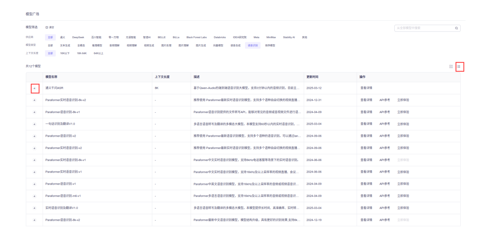
[Image details](images/img_020.md)

# **3.2 View Speech Model Details**

The default setting is the **paraformer-realtime-v2** online speech recognition model for speech recognition. The supported audio sampling rates vary depending on the model. If you need to modify the speech recognition model later, refer to the relationship between the model and the corresponding sampling rate:

## **3.2.1 Paraformer Series Models**

paraformer-realtime-v2 supports any sampling rate.

paraformer-realtime-v1 supports a 16kHz sampling rate.

paraformer-realtime-8k-v2 and paraformer-realtime-8k-v1 support an 8kHz sampling rate.

For more detailed information, see [Paraformer Series Speech Model Information](https://help.aliyun.com/zh/model-studio/paraformer-real-time-speech-recognition-python-api)

## **3.2.2 Gummy Series Models**

gummy-realtime-v1 supports sampling rates of 16kHz and above.

gummy-chat-v1 supports sampling rates of 16kHz.

For more detailed information, see [Gummy Series Voice Model Information](https://bailian.console.aliyun.com/?spm=5176.29597918.J_SEsSjsNv72yRuRFS2VknO.2.1e8c7b08S6mAEv&tab=api#/api/?type=model&url=https%3A%2F%2Fhelp.aliyun.com%2Fdocument_detail%2F2842554.html)

# **3.3 Free Quota**

All Paraformer series models share a free quota of 10 hours/month (cumulative usage).

Gummy series models are valid for 180 days from the date of registration and activation of the unified platform service, with a cumulative usage of 10 hours.

After the free quota for a model is exhausted, you can choose to change the model or change your account.

# **3.4 Switching Speech Recognition Models**

If the default speech recognition model quota is exhausted, refer to this step to switch the speech recognition model.

## **3.4.1 Online Speech Recognition**

Open the large\_model\_interface.yaml configuration file:

Jetson Orin Nano, Jetson Orin NX:

```
/home/jetson/M3Pro_ws/src/largemodel/config/large_model_interface.yaml
```

Jetson Nano, Raspberry Pi:

You need to first enter Docker.

```
root/M3Pro_ws/src/largemodel/config/large_model_interface.yaml
```

Find the oline\_asr configuration option and modify oline\_asr\_sample\_rate and oline\_asr\_model to change the model sampling rate and speech recognition model. The available model names are provided in the comments.

#### **Parameter Description:**

- oline\_asr\_sample\_rate: Speech recognition model sampling rate. Set according to the specific model used.
- oline\_asr\_model: Speech recognition model

## **3.4.2 Local Speech Recognition**

#### **3.4.2.1 Switching to the Local Speech Recognition Model**

\*\* Jetson Orin Nano, Jetson Orin The NX has a built-in local speech recognition model, SenseVoiceSmall, which can be used permanently without a limit. You can switch to using this local speech recognition model in the yahboom\_m3.yaml configuration file. The path to the yahboom\_m3.yaml configuration file is:

```
/home/jetson/M3Pro_ws/src/largemodel/config/yahboom_m3.yaml
```

Change the use\_oline\_asr parameter of the asr node to False .

Then, in the vehicle terminal, switch to the M3Pro\_ws/ workspace and recompile the largemodel package to take effect.

```
colcon build --packages-select largemodel
```

### **3.4.2.2 Introduction to SenseVoiceSmall**

SenseVoiceSmall is an open-source model released by Tongyi Labs. It is a multilingual audio understanding model with capabilities including speech recognition, language identification, and acoustic event detection.

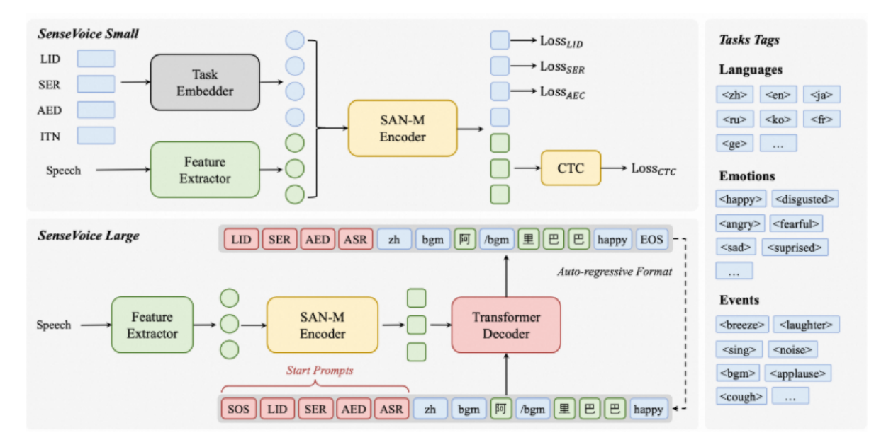
[Image details](images/img_021.md)

SenseVoiceSmall model file location:

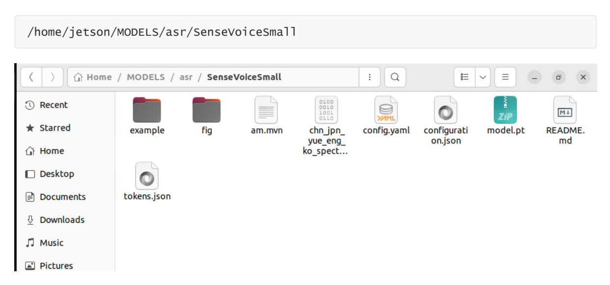
[Image details](images/img_022.md)

Model file address:<https://www.modelscope.cn/models/iic/SenseVoiceSmall>

GitHub repository: <https://github.com/FunAudioLLM/SenseVoice>

# **4. Switch the text-to-speech (TTS) model**

The factory default is the longwan\_v2 timbre of the cosyvoice-v2 model from the Tongyi Qianwen platform. If the free quota is used up or the user needs to change the model or timbre, refer to this tutorial. If you need to use the speech synthesis service of the Baidu Intelligent Cloud Platform, please first complete the Baidu Intelligent Cloud Platform account registration and API-KEY application in [2.2 Registering a Baidu Intelligent Cloud Large Model Platform Account].

## **4.1 Tongyi Qianwen Platform Speech Synthesis**

## **4.1.1 Modifying Speech Synthesis Configuration**

Open the large\_model\_interface.yaml configuration file and locate the **oline\_tts** configuration option. File path:

For Jetson Orin Nano and Jetson Orin NX:

/home/jetson/M3Pro\_ws/src/largemodel/config/large\_model\_interface.yaml

For Jetson Nano and Raspberry Pi:

You must first enter Docker.

```
root/M3Pro_ws/src/largemodel/config/large_model_interface.yaml
```

For the tts\_supplier parameter, select "aliyun" to indicate the Tongyi Qianwen platform is used as the supplier. oline\_tts\_model represents the model name, and voice\_tone represents the model's timbre:

#### Parameter Description:

- tts\_supplier : Speech synthesis model supplier: Baidu Smart Cloud and Alibaba Cloud Tongyi Qianwen are available.
- oline\_tts\_model : Voice model name. See the Model List and Tone List for details.
- voice\_tone : Voice model name. See the Model List and Tone List for details.

## **4.1.2 Model list and voice list**

Supported access models are cosyvoice-v1 and cosyvoice-v2. Open the [Model Voice List](https://help.aliyun.com/zh/model-studio/cosyvoice-java-api#722dd7ca66a6x) link. The model parameter is the model name, and the voice parameter is the optional voice. You can audition the voice on the right.

| 音色  | 音頻试听(右键保存音頻)            | model 参数     | voice 参数      | 适用场景                            | 语言       | 默认采样率<br>(Hz) | 默认音频格式 |
|-----|-------------------------|--------------|---------------|---------------------------------|----------|---------------|--------|
| 龙婉  | ▶ 0:00 / 0:13 <b>→</b>  | cosyvoice-v1 | longwan       | 语音助手、<br>导航播报、<br>聊天数字人         | 中文普通话    | 22050         | mp3    |
| 龙橙  | ► 0:00 / 0:03 <b></b>   | cosyvoice-v1 | longcheng     | 语音助手、<br>导航播报、<br>聊天数字人         | 中文普通话    | 22050         | mp3    |
| 龙华  | ▶ 0:00 / 0:14 <b>→</b>  | cosyvoice-v1 | longhua       | 语音助手、<br>导航播报、<br>聊天数字人         | 中文普通话    | 22050         | mp3    |
| 龙小淳 | ► 0:00 / 0:07 <b>—</b>  | cosyvoice-v1 | longxiaochun  | 语音助手、<br>导航播报、<br>聊天数字人         | 中文普通话+英文 | 22050         | mp3    |
| 龙小夏 | ► 0:00 / 0:08 <b>——</b> | cosyvoice-v1 | longxiaoxia   | 语音助手、聊天数<br>字人                  | 中文普通话    | 22050         | mp3    |
| 龙小诚 | ► 0:00 / 0:05 <b>→</b>  | cosyvoice-v1 | longxiaocheng | 语音助手、导航播<br>报、聊天数字人             | 中文普通话+英文 | 22050         | mp3    |
| 龙小白 | ► 0:00 / 0:08 <b>——</b> | cosyvoice-v1 | longxiaobai   | 聊天数字人、有声<br>书、语音助手              | 中文普通话    | 22050         | mp3    |
| 龙老铁 | ▶ 0:00 / 0:08           | cosyvoice-v1 | longlaotie    | 新闻播报、有声<br>书、语音助手、直<br>播带货、导航播报 | 中文东北口音   | 22050         | mp3    |
| 龙书  | ▶ 0:00 / 0:07 <b>→</b>  | cosyvoice-v1 | longshu       | 有声书、语音助<br>手、导航播报、新<br>闻播报、智能客服 | 中文普通话    | 22050         | mp3    |
|     |                         |              |               | 还立册工 已餘楼                        |          |               |        |

The cosyvoice-v2 series models only need to slightly modify the parameters according to the official website requirements.

| 升级前 voice 参数 | 升级后 voice 参数    |  |  |
|--------------|-----------------|--|--|
| longcheng    | longcheng_v2    |  |  |
| longhua      | longhua_v2      |  |  |
| longshu      | longshu_v2      |  |  |
| loongbella   | loongbella_v2   |  |  |
| longwan      | longwan_v2      |  |  |
| longxiaochun | longxiaochun_v2 |  |  |
| longxiaoxia  | longxiaoxia_v2  |  |  |

## **4.1.3 Free quota**

2000 characters/month per account

Starting from the first use, the monthly free quota will be automatically refreshed the next month after it is used up. If the free quota is used up, you can choose one of the following three methods to continue using it: 1. Change the model, 2. Change the Baidu platform speech synthesis service, 3. Change account and update API-KEY

To view the remaining quota of a model, select speech synthesis in the model square, click on the right to switch to list display, and click the "+" under the model to view the remaining free quota of each model

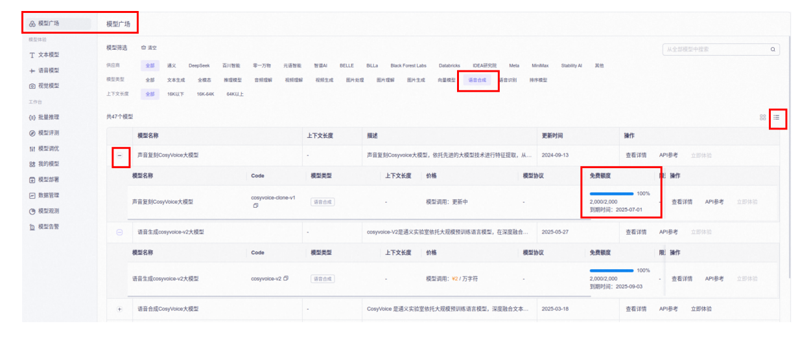
[Image details](images/img_023.md)

# **4.2 Speech Synthesis on Baidu Intelligent Cloud Platform**

If you need to modify the speech synthesis service using Baidu Intelligent Cloud Platform, refer to this tutorial. First, follow 1. Account Configuration to complete account registration and API-KEY application

## **4.2.1 Configure Baidu Intelligent Cloud Speech Synthesis Parameters**

Open the large\_model\_interface.yaml configuration file and find the **oline\_tts** configuration option. File path:

jetson orin nano, jetson orin NX:

```
/home/jetson/M3Pro_ws/src/largemodel/config/large_model_interface.yaml
```

jetson nano, Raspberry Pi:

You need to enter docker first

```
root/M3Pro_ws/src/largemodel/config/large_model_interface.yaml
```

Select "baidu" for the tts\_supplier parameter. Fill in the baidu\_API\_KEY and baidu\_SECRET\_KEY parameters with the API\_KEY and SECRET\_KEY requested in step "2.2 Registering a Baidu Smart Cloud Large Model Platform Account."

Open step "2.2 Registering a Baidu Smart Cloud Large Model Platform Account." On the Speech [Synthesis Online Debugging page in the steps, copy the device's CUID and replace it with the one](https://console.bce.baidu.com/support/?_=1749172819628&u=aiconsole×tamp=1749172821177#/api?product=AI&project=%E8%AF%AD%E9%9F%B3%E6%8A%80%E6%9C%AF&parent=%E8%AF%AD%E9%9F%B3%E5%90%88%E6%88%90&api=text2audio&method=post) configured above. This completes the configuration.

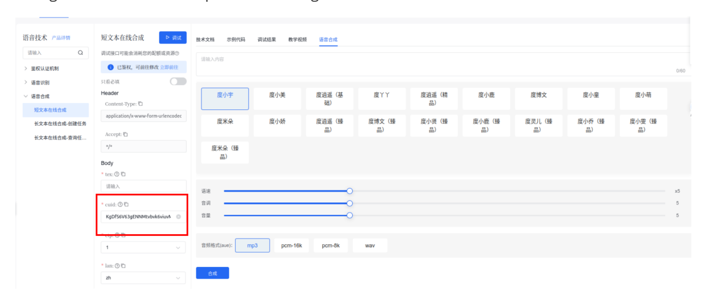
[Image details](images/img_024.md)

## **4.2.2 Other Baidu Smart Cloud Speech Synthesis Parameters**

- baidu\_API\_KEY : Baidu Platform Speech Synthesis API\_KEY
- baidu\_SECRET\_KEY : Baidu Platform Speech Synthesis SECRET\_KEY
- PER : 4 Speaker selection. Basic voice library: 0 for Du Xiaomei, 1 for Du Xiaoyu, 3 for Du Xiaoyao, 4 for Du Yaya. Premium voice library: 5 for Du Xiaojiao, 103 for Du Mido, 106 for Du Bowen, 110 for Du Xiaotong, 111 for Du Xiaomeng. Default is Du Xiaomei.
- SPD : 5 Speech speed, ranges from 0 to 15, defaults to medium speed 5.
- PIT : 5 Pitch, ranges from 0 to 15, defaults to medium pitch 5.
- VOL : 5 Volume, ranges from 0 to 9, defaults to medium volume 5.
- CUID : Device ID [Get Link](https://console.bce.baidu.com/support/?u=aiconsole×tamp=1749183108747#/api?product=AI&project=%E8%AF%AD%E9%9F%B3%E6%8A%80%E6%9C%AF&parent=%E8%AF%AD%E9%9F%B3%E5%90%88%E6%88%90&api=text2audio&method=post)

#### **3.2.2 Free Credit**

[Open Check the free quota balance for Baidu Intelligent Cloud Speech Synthesis Service \(https://c](https://console.bce.baidu.com/ai-engine/speech/overview/index) onsole.bce.baidu.com/ai-engine/speech/overview/index). Each account has a cumulative free quota of 50,000.

[image-20250623105642802](file:///D:/111/2.AI%20Large%20Model%20Basics%20Course/5.Configure%20AI%20large%20model/image-20250623105642802.png)

# **4.3 Local Speech Synthesis Model**

## **4.3.1 Switching to a Local Model**

Jetson Orin Nano, Jetson Orin The NX has a built-in local speech synthesis model, Piper, which can be used permanently without a limit. You can switch to using the local speech recognition model in the yahboom\_m3.yaml configuration file. Path to the yahboom\_m3.yaml configuration file:

```
/home/jetson/M3Pro_ws/src/largemodel/config/yahboom.yaml
```

Change the useolinetts parameter of the model\_service node to False.

Then, in the vehicle terminal, switch to the M3Pro\_ws/ workspace and recompile the largemodel feature package to take effect.

For Jetson Orin Nano and Jetson Orin NX:

```
cd /home/jetson/M3Pro_ws/
```

Jetson Nano, Raspberry Pi , first enter Docker:

```
cd root/M3Pro_ws/
colcon build --packages-select largemodel
```

## **4.3.2 Introduction to Piper**

A fast, localized neural text-to-speech system.

GitHub repository: [https://gitcode.com/gh\\_mirrors/pi/piper](https://gitcode.com/gh_mirrors/pi/piper)

The default setting is the Longwan\_v2 timbre of the cosyvoice-v2 model on the Tongyi Qianwen platform. If this free quota has been used up or you need to change the model or timbre, refer to this tutorial. If you wish to use the Baidu Smart Cloud platform's speech synthesis service, please [first apply for an API key at \[https://www.google.com/p/speechsynthesis/timbre/src/largemodel/c](https://www.google.com/p/speechsynthesis/timbre/src/largemodel/config/large_model_interface.yaml) onfig/large\_model\_interface.yaml].

# **4.1 Tongyi Qianwen Platform Speech Synthesis**

## **4.1.1 Modifying Speech Synthesis Configuration**

Open the large\_model\_interface.yaml configuration file and locate the **oline\_tts** configuration option. File path:

For Jetson Orin Nano and Jetson Orin NX:

```
/home/jetson/M3Pro_ws/src/largemodel/config/large_model_interface.yaml
```

For Jetson Nano and Raspberry Pi:

You must first enter Docker.

```
root/M3Pro_ws/src/largemodel/config/large_model_interface.yaml
```

For the tts\_supplier parameter, select "aliyun" to indicate the Tongyi Qianwen platform is used as the supplier. oline\_tts\_model represents the model name, and voice\_tone represents the model's timbre:

#### Parameter Description:

- tts\_supplier : Speech synthesis model supplier: Baidu Smart Cloud and Alibaba Cloud Tongyi Qianwen are available.
- oline\_tts\_model : Voice model name. See the Model List and Tone List for details.
- voice\_tone : Voice model name. See the Model List and Tone List for details.

#### **4.1.2 Model list and voice list**

Supported access models are cosyvoice-v1 and cosyvoice-v2. Open the [Model Voice List](https://help.aliyun.com/zh/model-studio/cosyvoice-java-api#722dd7ca66a6x) link. The model parameter is the model name, and the voice parameter is the optional voice. You can audition the voice on the right.

| 音色  | 音頻试听(右键保存音频)           | model 参数     | voice 参数      | 适用场景                            | 语言       | 默认采样率<br>(Hz) | 默认音频格式 |
|-----|------------------------|--------------|---------------|---------------------------------|----------|---------------|--------|
| 龙婉  | ► 0:00 / 0:13 <b>→</b> | cosyvoice-v1 | longwan       | 语音助手、<br>导航播报、<br>聊天数字人         | 中文普通话    | 22050         | mp3    |
| 龙橙  | ▶ 0:00 / 0:03 →        | cosyvoice-v1 | longcheng     | 语音助手、<br>导航播报、<br>聊天数字人         | 中文普通话    | 22050         | mp3    |
| 龙华  | ▶ 0:00 / 0:14 →        | cosyvoice-v1 | longhua       | 语音助手、<br>导航播报、<br>聊天数字人         | 中文普通话    | 22050         | mp3    |
| 龙小淳 | ► 0:00 / 0:07 <b>→</b> | cosyvoice-v1 | longxiaochun  | 语音助手、<br>导航播报、<br>聊天数字人         | 中文普通话+英文 | 22050         | mp3    |
| 龙小夏 | ▶ 0:00 / 0:08 <b>—</b> | cosyvoice-v1 | longxiaoxia   | 语音助手、聊天数<br>字人                  | 中文普通话    | 22050         | mp3    |
| 龙小诚 | ▶ 0:00 / 0:05 <b>→</b> | cosyvoice-v1 | longxiaocheng | 语音助手、导航播<br>报、聊天数字人             | 中文普通话+英文 | 22050         | mp3    |
| 龙小白 | ► 0:00 / 0:08 <b>—</b> | cosyvoice-v1 | longxiaobai   | 聊天数字人、有声<br>书、语音助手              | 中文普通话    | 22050         | mp3    |
| 龙老铁 | ▶ 0:00 / 0:08 →        | cosyvoice-v1 | longlaotie    | 新闻播报、有声<br>书、语音助手、直<br>播带货、导航播报 | 中文东北口音   | 22050         | mp3    |
| 龙书  | ▶ 0:00 / 0:07          | cosyvoice-v1 | longshu       | 有声书、语音助<br>手、导航播报、新<br>闻播报、智能客服 | 中文普通话    | 22050         | mp3    |
|     |                        |              |               | 汪立叶士 日齡楼                        |          |               |        |

The cosyvoice-v2 series models only need to slightly modify the parameters according to the official website requirements.

| 升级前 voice 参数 | 升级后 voice 参数    |
|--------------|-----------------|
| longcheng    | longcheng_v2    |
| longhua      | longhua_v2      |
| longshu      | longshu_v2      |
| loongbella   | loongbella_v2   |
| longwan      | longwan_v2      |
| longxiaochun | longxiaochun_v2 |
| longxiaoxia  | longxiaoxia_v2  |

## **4.1.3 Free quota**

2000 characters/month per account

Starting from the first use, the monthly free quota will be automatically refreshed the next month after it is used up. If the free quota is used up, you can choose one of the following three methods to continue using it: 1. Change the model, 2. Change the Baidu platform speech synthesis service, 3. Change account and update API-KEY

To view the remaining quota of a model, select speech synthesis in the model square, click on the right to switch to list display, and click the "+" under the model to view the remaining free quota of each model

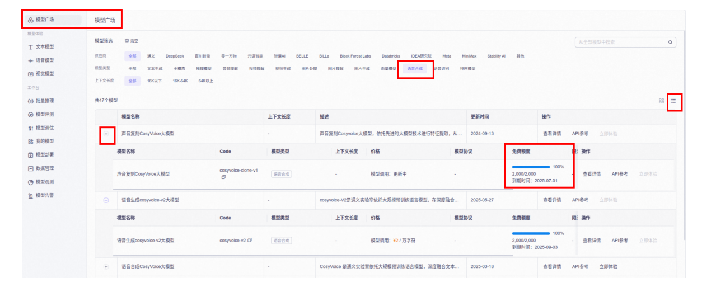
[Image details](images/img_025.md)

# **4.2 Speech Synthesis on Baidu Intelligent Cloud Platform**

If you need to modify the speech synthesis service using Baidu Intelligent Cloud Platform, refer to this tutorial. First, follow 1. Account Configuration to complete account registration and API-KEY application

## **4.2.1 Configure Baidu Intelligent Cloud Speech Synthesis Parameters**

Open the large\_model\_interface.yaml configuration file and find the **oline\_tts** configuration option. File path:

jetson orin nano, jetson orin NX :

```
/home/jetson/M3Pro_ws/src/largemodel/config/large_model_interface.yaml
```

jetson nano, Raspberry Pi :

You need to enter docker first

```
root/M3Pro_ws/src/largemodel/config/large_model_interface.yaml
```

Select "baidu" for the tts\_supplier parameter. Fill in the baidu\_API\_KEY and baidu\_SECRET\_KEY parameters with the API\_KEY and SECRET\_KEY requested in step 2.2 "Registering a Baidu Smart Cloud Large Model Platform Account."

Open step 2.2 "Registering a Baidu Smart Cloud Large Model Platform Account." On the Speech [Synthesis Online Debugging page in the steps, copy the device's CUID and replace it with the one](https://console.bce.baidu.com/support/?_=1749172819628&u=aiconsole×tamp=1749172821177#/api?product=AI&project=%E8%AF%AD%E9%9F%B3%E6%8A%80%E6%9C%AF&parent=%E8%AF%AD%E9%9F%B3%E5%90%88%E6%88%90&api=text2audio&method=post) configured above. This completes the configuration.

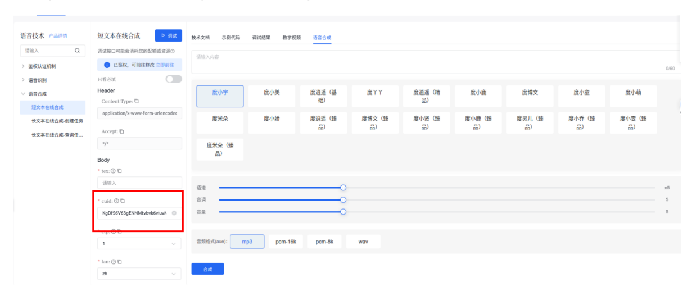
[Image details](images/img_026.md)

## **4.2.2 Other Baidu Smart Cloud Speech Synthesis Parameters**

- baidu\_API\_KEY : Baidu Platform Speech Synthesis API\_KEY
- baidu\_SECRET\_KEY : Baidu Platform Speech Synthesis SECRET\_KEY
- PER : 4 Speaker selection. Basic voice library: 0 for Du Xiaomei, 1 for Du Xiaoyu, 3 for Du Xiaoyao, 4 for Du Yaya. Premium voice library: 5 for Du Xiaojiao, 103 for Du Mido, 106 for Du Bowen, 110 for Du Xiaotong, 111 for Du Xiaomeng. Default is Du Xiaomei.
- SPD : 5 Speech speed, ranges from 0 to 15, defaults to medium speed 5.
- PIT : 5 Pitch, ranges from 0 to 15, defaults to medium pitch 5.
- VOL : 5 Volume, ranges from 0 to 9, defaults to medium volume 5.
- CUID : Device ID [Get Link](https://console.bce.baidu.com/support/?u=aiconsole×tamp=1749183108747#/api?product=AI&project=%E8%AF%AD%E9%9F%B3%E6%8A%80%E6%9C%AF&parent=%E8%AF%AD%E9%9F%B3%E5%90%88%E6%88%90&api=text2audio&method=post)

#### **3.2.2 Free Credit**

Open the [Baidu Intelligent Cloud Speech Synthesis Service](https://console.bce.baidu.com/ai-engine/speech/overview/index) link to view the free quota balance. Each account has 50,000 free quotas.

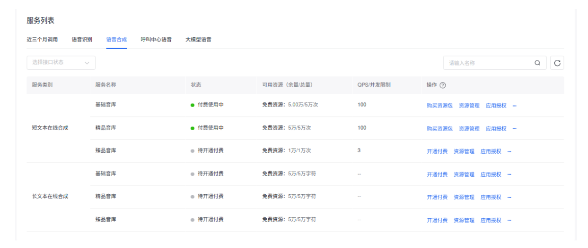
[Image details](images/img_027.md)

## **4.3 Local Speech Synthesis Model**

#### **4.3.1 Switching to a Local Model**

Jetson Orin Nano, Jetson Orin The NX has a built-in local speech synthesis model, Piper, which can be used permanently without a limit. You can switch to using the local speech recognition model in the yahboom\_m3.yaml configuration file. Path to the yahboom\_m3.yaml configuration file:

```
/home/jetson/M3Pro_ws/src/largemodel/config/yahboom.yaml
```

Change the useolinetts parameter of the model\_service node to False.

Then, in the vehicle terminal, switch to the M3Pro\_ws/ workspace and recompile the largemodel feature package to take effect.

For Jetson Orin Nano and Jetson Orin NX:

```
cd /home/jetson/M3Pro_ws/
```

Jetson Nano, Raspberry Pi , first enter Docker:

```
cd root/M3Pro_ws/
colcon build --packages-select largemodel
```

#### **4.3.2 Introduction to Piper**

A fast, localized neural text-to-speech system.

GitHub repository: [https://gitcode.com/gh\\_mirrors/pi/piper](https://gitcode.com/gh_mirrors/pi/piper)

# **6. Configuring the Decision-Layer and Execution-Layer Large Models**

# **6.1 Configuring the Decision-Layer Model**

This section requires you to complete "**2.1 Registering an Alibaba Bailian Platform Account**." For more information on the concepts and basics of the decision-layer model, see **[2. AI Large Model Basics - 3. Embodied Intelligent Robot System Architecture]**

Open the [Bailian Big Model Application Management Page,](https://bailian.console.aliyun.com/?spm=5176.29597918.J_SEsSjsNv72yRuRFS2VknO.2.1e8c7b08EgDlWE&tab=app#/app-center) click Add Application, select Agent Application, and click Create Now.

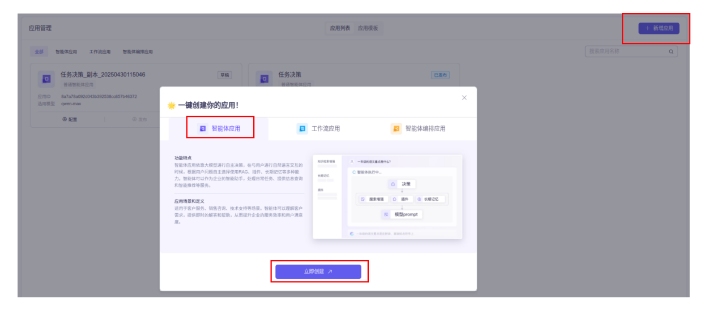
[Image details](images/img_028.md)

Under "API Configuration," click "API Configuration," then click "Select Model."

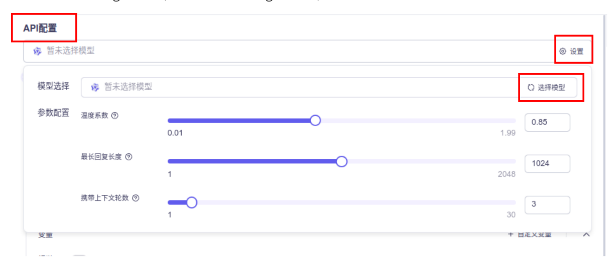
[Image details](images/img_029.md)

Here, the default decision-making model is used, using the Tongyi Qianwen-MAX model from Tongyi.

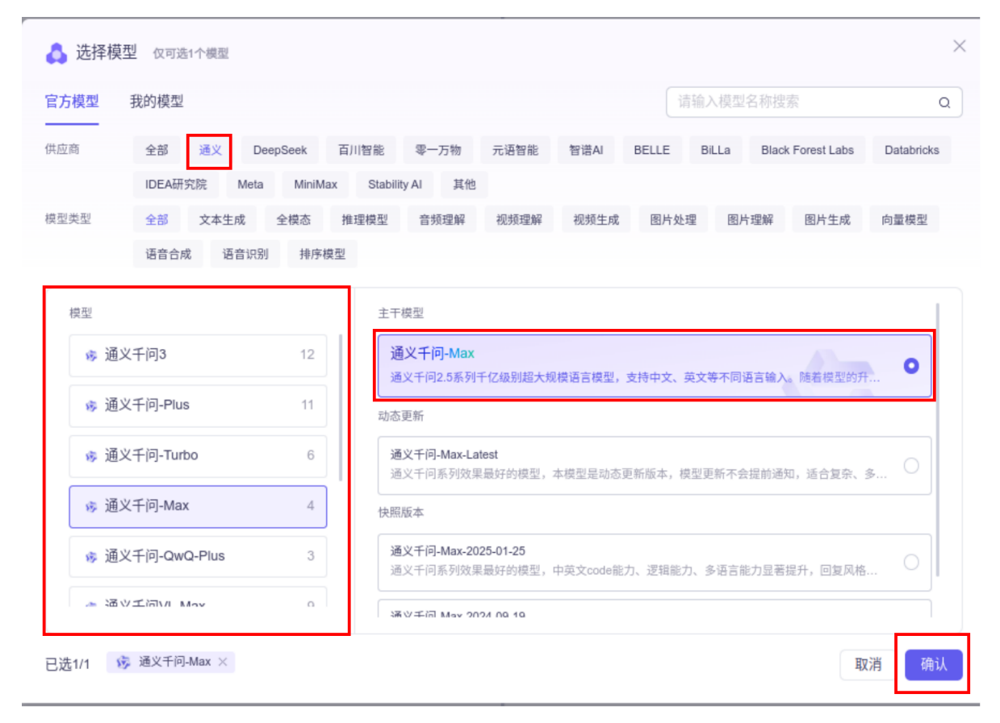
[Image details](images/img_030.md)

Parameter Configuration Instructions:

- Temperature Coefficient: A higher temperature coefficient indicates greater diversity in the model's thinking. A lower temperature coefficient indicates more conservative and stable responses. Generally, no changes are required; the default setting is sufficient.
- Maximum Response Length: The maximum length of a large model's response text. No changes are required; the default setting is sufficient.
- Carry context rounds: The model's response will reference the previous round count. Since each call to the decision-layer model is a new task cycle, there's no need to change it; leave it at the default of 1.

Open the **Decision-Layer Prompt.md** file in this course's folder and copy the prompt into the Instructions - Prompt field.

Then enable the **Knowledge Base** switch, click +, and add the action function library configured previously.

Then enable the **Sample Library** switch, click +, and add the decision-layer training examples configured previously.

In the input box below, you can test the model output. If not, simply click Publish.

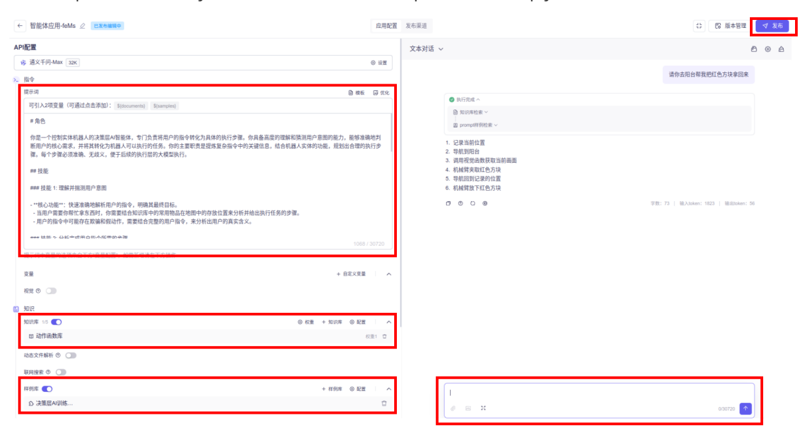
[Image details](images/img_031.md)

Return to the Application Management page to see the newly created application. Click More in the lower corner to modify the application name for easier management.

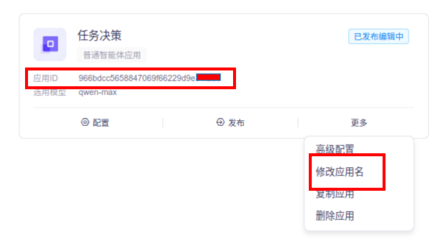
[Image details](images/img_032.md)

Copy the application ID and open the large\_model\_interface.yaml configuration file. File path:

Jetson Orin Nano, Jetson Orin NX :

```
/home/jetson/M3Pro_ws/src/largemodel/config/large_model_interface.yaml
```

Jetson Nano, Raspberry Pi :

You need to first enter Docker.

```
root/M3Pro_ws/src/largemodel/config/large_model_interface.yaml
```

Find the Tongyi Qianwen platform API configuration options and replace the **tongyi\_app\_id** parameter under the decision-level large model with your own application ID.

## **6.2 Using a Decision-Level Model from Another Vendor**

In the previous step, the **Tongyi Qianwen-MAX** model was used by default. You can also select models from other vendors. The available models from different vendors will vary depending on the official operation of Bailian Model.

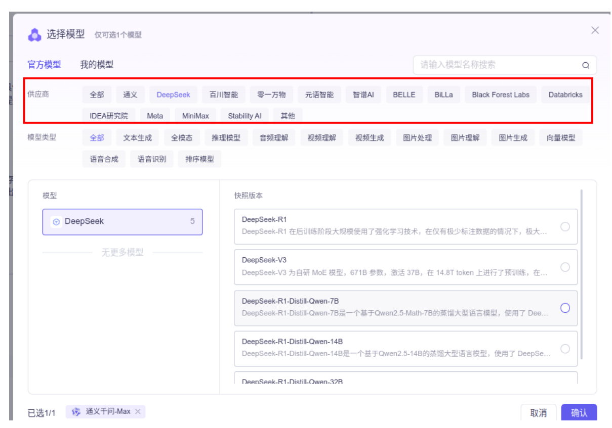
[Image details](images/img_033.md)

## **6.3 Execution Layer Large Model Configuration**

Note: The execution layer model must use a visual multimodal model. Different models vary in their ability to follow commands. Try to choose a new model for testing. If some models' responses do not meet the requirements, subsequent parsing errors will occur, and the robot will not be able to execute actions correctly.

For more information on the concepts and basic knowledge of the execution layer model, see \*\* [2. AI Large Model Basics - 3. Embodied Intelligent Robot System Architecture

Open the large\_model\_interface.yaml configuration file and find the execution layer large model configuration options:

In the **multimodel** parameter, you can modify the execution layer large model. Simply enter the model's **code name**. Note that you must use a multimodal vision model.

For a list of available models, refer to the Bailian Platform (Tongyi Qianwen Platform) - Model Plaza - Image Understanding Model: [Visual Model List](https://bailian.console.aliyun.com/?spm=517) (6.29597918.J\_SEsSjsNv72yRuRFS2VknO.2.55997b08jKDchF&tab=model#/model-market? capabilities=%5B%22IU%22%5D&z\_type\_=%7B%22capabilities%22%3A%22array%22%7D)

On this page, you can view the model's **code name** and **resource quota** (for decision-making models, you can view the remaining quota under the Text Generation tab).

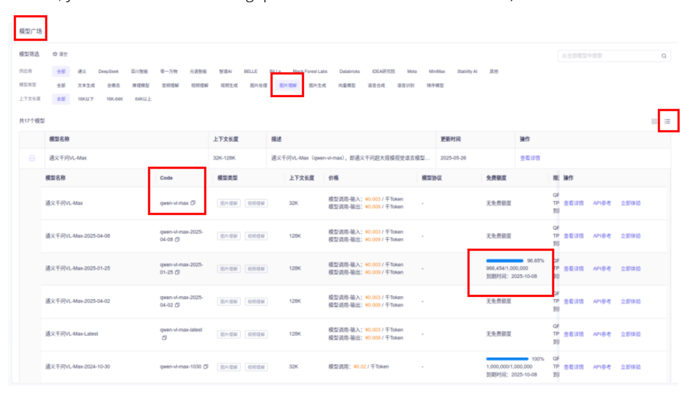
[Image details](images/img_034.md)

# **6.4 Saving the Configuration to Take Effect**

Each time you modify the large model's configuration parameters, you must recompile the package for the configuration to take effect. To do this:

On the vehicle terminal, switch to the M3Pro\_ws/ workspace and recompile the largemodel package to take effect.

```
colcon build --packages-select largemodel
```

# **7. International Version Configuration**

## **7.1 Enter the dify configuration page**

Since dify is not enabled by default in the factory image, we first need to enable it to configure the international version.

```
sh bringup_dify.sh
```

dify will automatically load at this point, allowing you to perform the following configurations.

Open a terminal on the car computer and check the current car computer IP: **IP\_Address\_1**

Open **Chromium Web directly on the car computer Open a browser** or on any computer on the same network segment as the car computer and enter the IP address + :80 in the address bar. For example:


[Image details](images/img_035.md)

The page after entering dify is as follows:

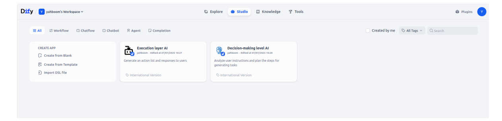
[Image details](images/img_036.md)

If you are accessing the website from an unfamiliar device, you will need to log in with your account:

Username: [yahboom@163.com](mailto:yahboom@163.com)

Password: yahboom123

## **7.2 Enter the API key.**

Click your profile picture in the upper right corner, then click Settings.

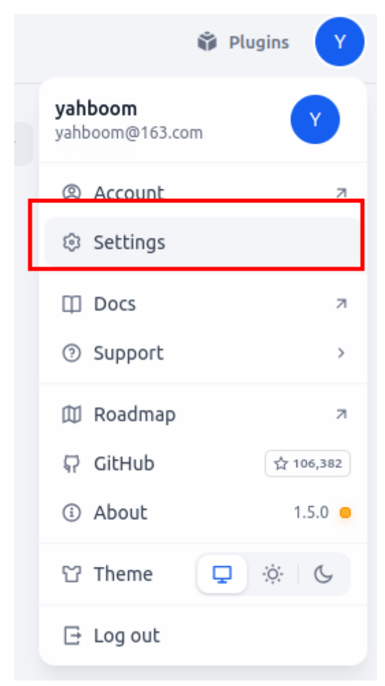
[Image details](images/img_037.md)

Click Model Provider, then click Setup for the corresponding model provider.

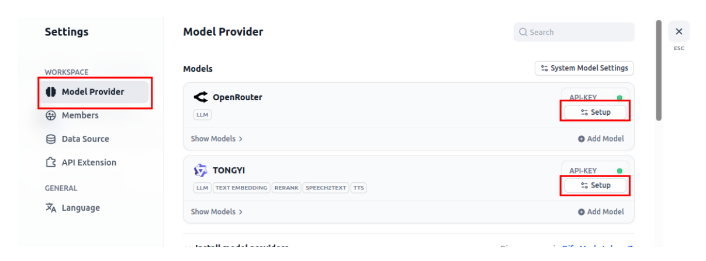
[Image details](images/img_038.md)

Enter the API key you applied for in [2.3 Registering an OpenRouter Platform Account], then click Save.

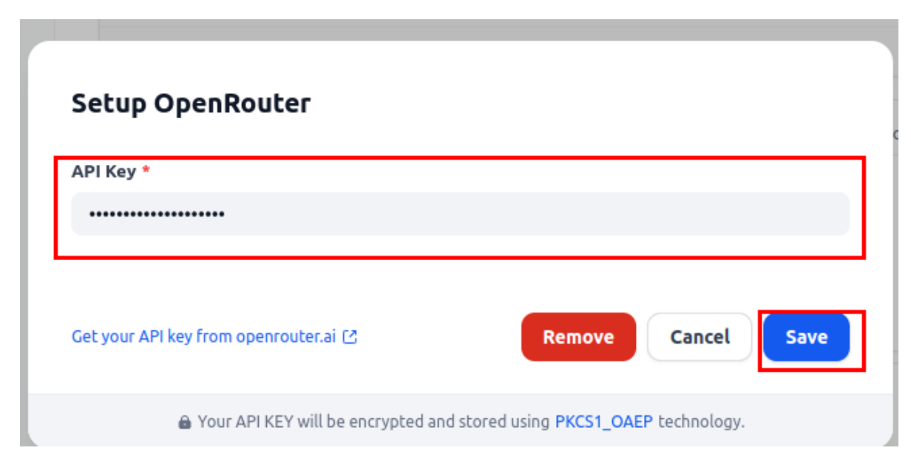
[Image details](images/img_039.md)

Click Setup for Tongyi, then enter the API key you applied for in [2.4 Registering an Alibaba Bailian Model International Platform Account], then select Use International. Endpoint, then click Save.

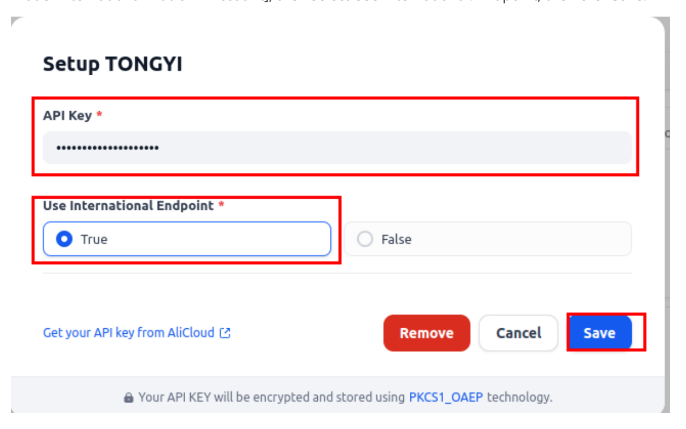
[Image details](images/img_040.md)

# **7.3 Configuring the Decision-Making Level Model**

#### **7.3.1 Switching the Decision-Making Level Model**

Return to the Studio interface and click Decision-Making Level AI Applications

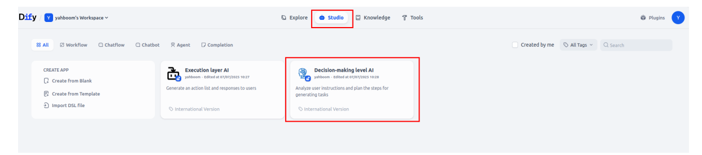
[Image details](images/img_041.md)

Click the Chat option in the upper-right corner and click the drop-down button to pop up a list of available models. This example uses the free model qwen2.5-72b-instruct, but other models are also available.

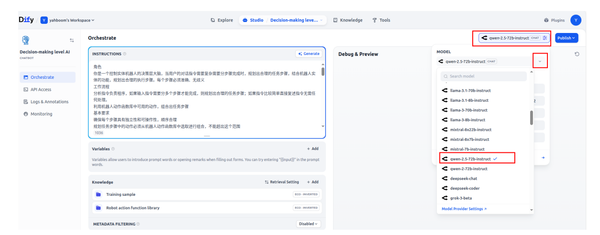
[Image details](images/img_042.md)

After selecting your model, click Publish, then Publish Update to complete the model switch configuration.

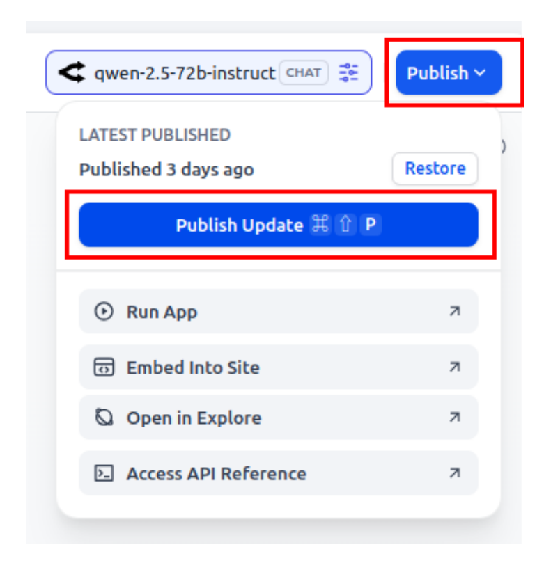
[Image details](images/img_043.md)

## **7.3.2 Configuring the Decision-Layer Knowledge Base**

If you need to customize your intent mappings or add other open-domain knowledge or customized training samples, you can enrich the capabilities of the large model by adding a decision-layer knowledge base.

Find the Knowledge tab and click +Add.

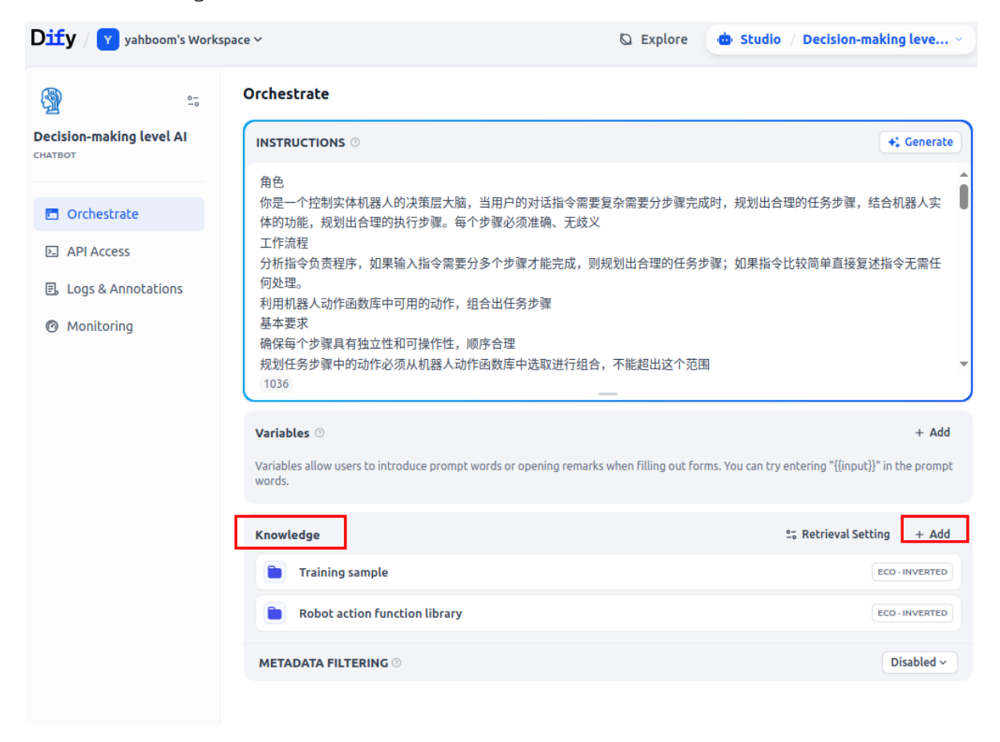
[Image details](images/img_044.md)

Select your created knowledge base and click Add.

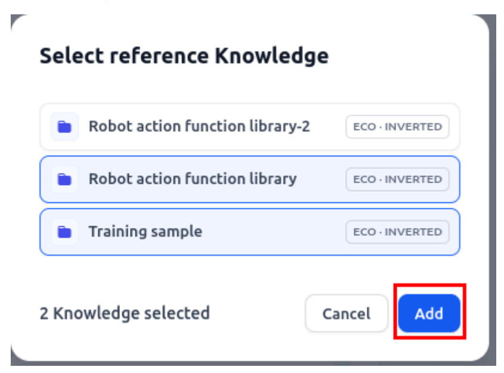
[Image details](images/img_045.md)

Then click Publish to complete the knowledge base configuration.

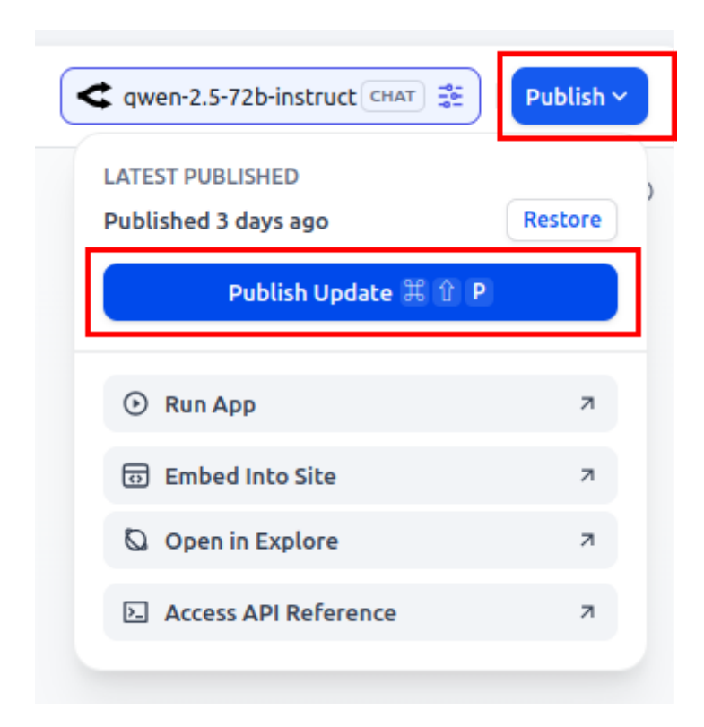
[Image details](images/img_046.md)

# **7.4 Configuring the Execution-Layer Model**

On the Studio page, click Execution layer. AI

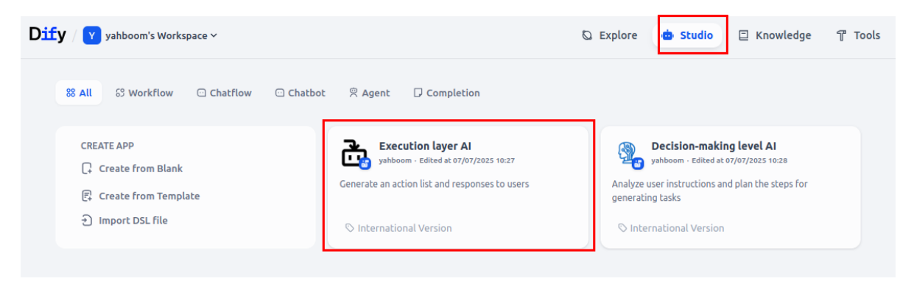
[Image details](images/img_047.md)

Select a model from the list in the Model Options bar on the right. Here, we use qwen-vl-latest as an example.

Note: The execution layer model must use a visual multimodal model. Different models vary in their ability to follow commands. Try to choose a new model for testing. If the model is weak, the output may not conform to the expected format, and the robot will fail to parse the model output.

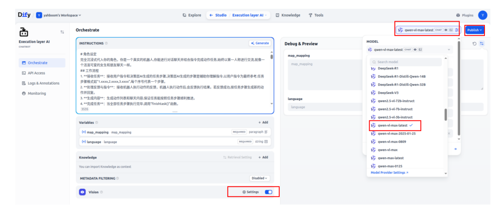
[Image details](images/img_048.md)

## **7.5 Expanding the Knowledge Base**

Click Knowledge on the main screen, then click Create knowledge to create a new knowledge base.

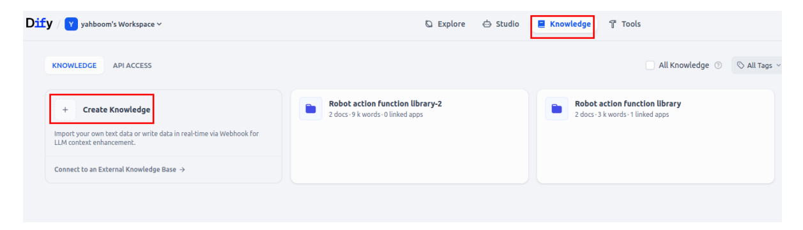
[Image details](images/img_049.md)

Select Import from file, then click Browse to browse for a local file and upload it. After uploading, click Next.

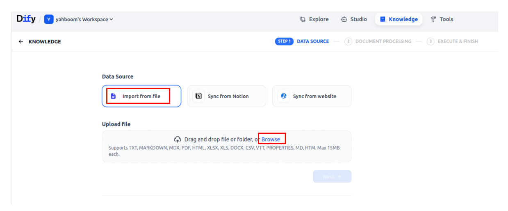
[Image details](images/img_050.md)

You can choose between High Quality and Economic Embedding. The differences between the two are as follows:

- High Quality:
- Advantages: Higher knowledge base recall accuracy
- Disadvantages: Requires the use of an additional embedding model. Alibaba Bailian International Station provides a certain amount of free usage, after which you must pay to continue using it.
- Economic:
- Advantages: Free, built-in embedding management in Dify
- Disadvantages: Average knowledge base recall.

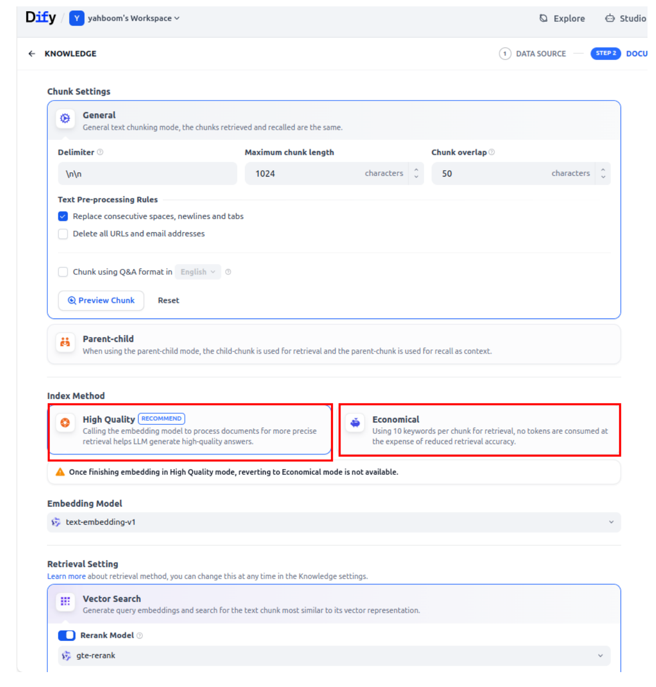
[Image details](images/img_051.md)

Click Save & Process at the bottom of the page to save.

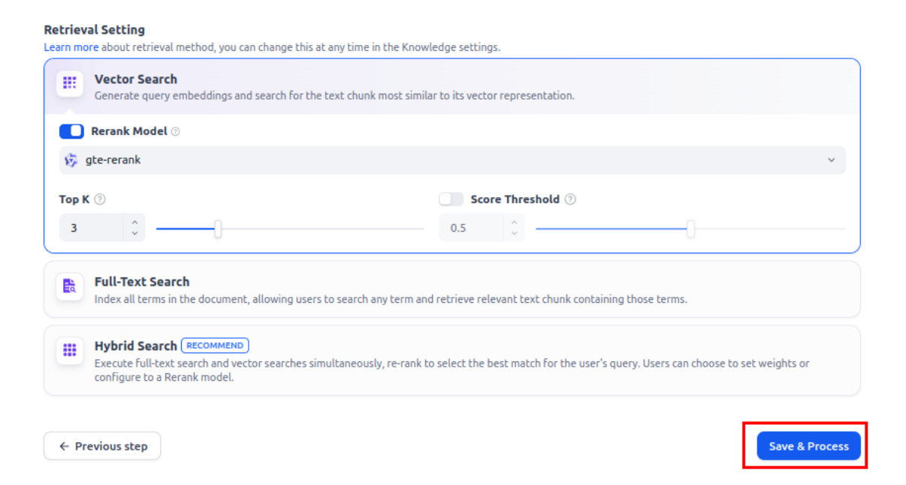
[Image details](images/img_052.md)

After the vector embedding is complete, the following display appears:


[Image details](images/img_053.md)

This completes the creation of a custom knowledge base.

For information on how to use this knowledge base, refer to **[7.3.2 Configuring the Decision-Layer Knowledge Base]**.

# **7.6 How to View Free Models on the OpenRouter Platform**

On the OpenRouter official website, click Model and select "free" in the Prompt pricing filter to display free models.


[Image details](images/img_054.md)

# **7.7 Using international version parameters**

International version users need to comment out the domestic version parameters in **yahboom.yaml**.

Jetson Orin Nano, Jetson Orin NX :

```
/home/jetson/M3Pro_ws/src/largemodel/config/yahboom.yaml
```

Jetson Nano, Raspberry Pi :

You need to first enter Docker

```
root/M3Pro_ws/src/largemodel/config/yahboom.yaml
```

The annotated content for the domestic version is shown below:

Then compile the function package and save the configuration:

Each time you modify the large model's configuration parameters, you need to recompile the function package for the configuration to take effect. The method is as follows:

Switch to the M3Pro\_ws/ workspace on the vehicle terminal: Recompile the largemodel function package to take effect.

```
colcon build --packages-select largemodel
```


[Image details](images/img_055.md)