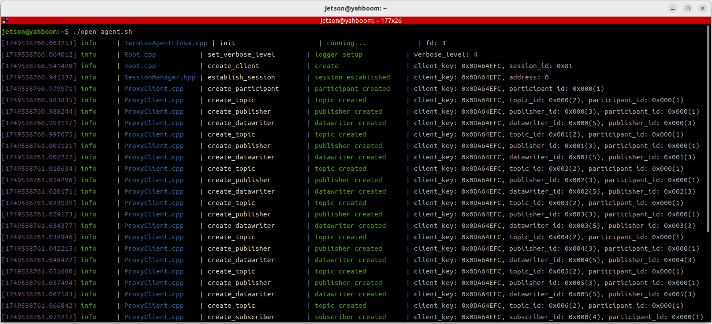
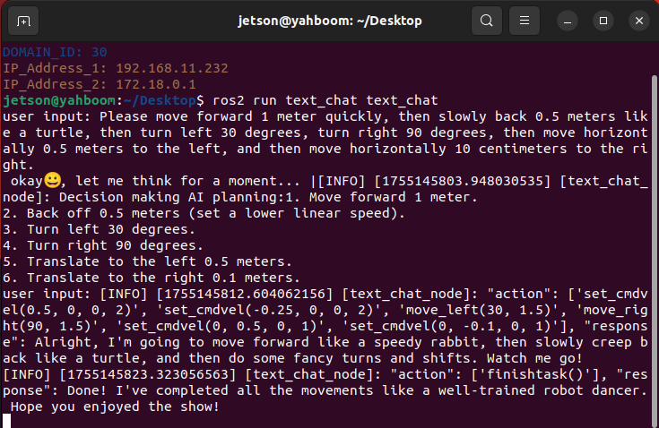
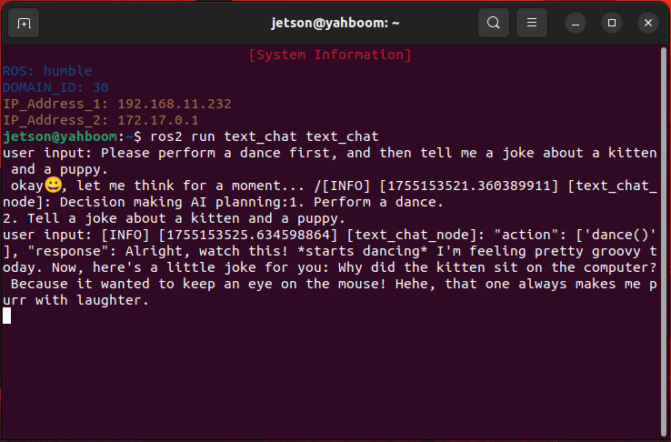

# **Semantic understanding of instructions following**

## **1. Course Content**

- 1. Learn the basics of how the large model understands user instructions
- 2. After running the large model program, users can interact with the robot through text. The text then generates a large model and uses multimodal visual processing to accurately understand user instructions and speech. Finally, the robot performs the specified actions and responds to the user according to the user's instructions.

## **2. Preparation**

#### **2.1 Content Description**

This course uses the Jetson Orin NX as an example. For Raspberry Pi and Jetson Nano boards, you need to open a terminal on the host computer and enter the command to enter the Docker container. Once inside the Docker container, enter the commands mentioned in this course in the terminal. For instructions on entering the Docker container from the host computer, refer to the **[Configuration and Operation Guide] -- [Enter the Docker (Jetson Nano and Raspberry Pi 5 users see here)]** section of this product tutorial. For Orin and NX boards, simply open a terminal and enter the commands mentioned in this course.

#### **2.2 Start the agent**

**Note: To test all cases, you must first start the docker agent. If it has already been started, you do not need to start it again**

Enter the command in the vehicle terminal:

```
sh start_agent.sh
```

The terminal prints the following information, indicating that the connection is successful

# **3. Run the case**

#### **3.1 Start the program**

Open the terminal on the vehicle and enter the command:

```
ros2 launch largemodel largemodel_control.launch.py text_chat_mode:=True
```

Start the text interactive terminal. You can start it on the vehicle or virtual machine. **Any** method can be used to start it. There is no need to start it repeatedly on the virtual machine and vehicle:

```
ros2 run text_chat text_chat
```

#### **3.2 Test case**

Here are the reference test cases. Users can write their own dialogue commands

- Please move forward quickly for 1 meter, then slowly back away 0.5 meters like a turtle. Then, turn left 30 degrees, turn right 90 degrees, then move horizontally 0.5 meters to the left, and then move horizontally 10 centimeters to the right.
- Please perform a dance, then tell me a joke about a kitten and a puppy.

#### **3.2.1 Example 1**

Open a terminal on the virtual machine and enter a test case. After the model has thought about it, it will respond to the user and execute the action according to the user's instructions.

#### **3.2.2 Example 2**

Similar to Example 1, enter Example 2 in the terminal. The model will respond and execute the action according to the instruction.

### **4. Code Analysis**

This course applies the basic programming framework for basic AI embodied intelligence gameplay. For code analysis, refer to the chapters [2. AI Large Model Basics - 4. Embodied Intelligence Gameplay Core Source Code Interpretation]

---

## Extracted Images


### Page 1


[Image details](images/img_001.md)


### Page 2


[Image details](images/img_002.md)


### Page 3


[Image details](images/img_003.md)

