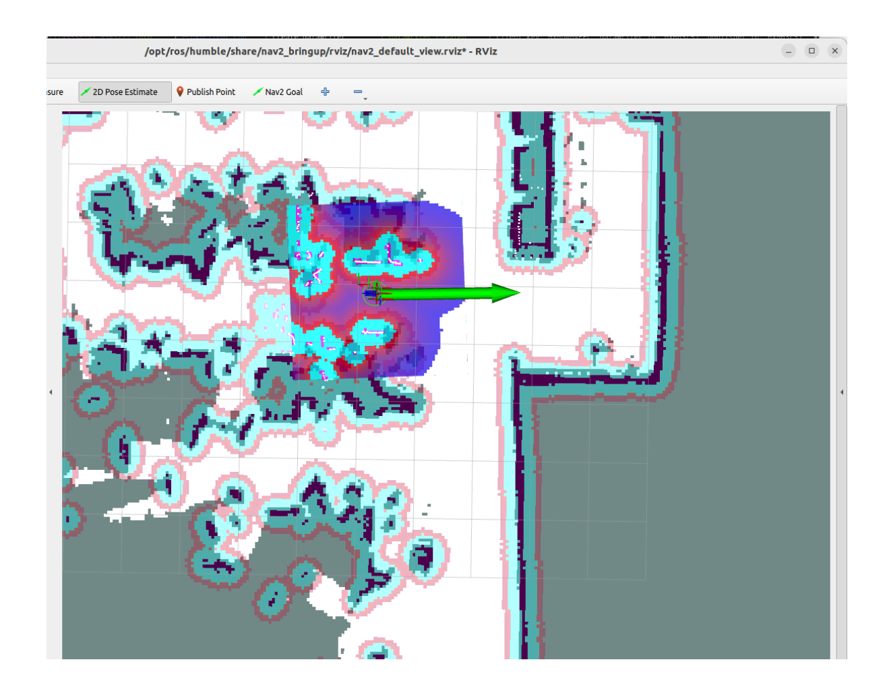
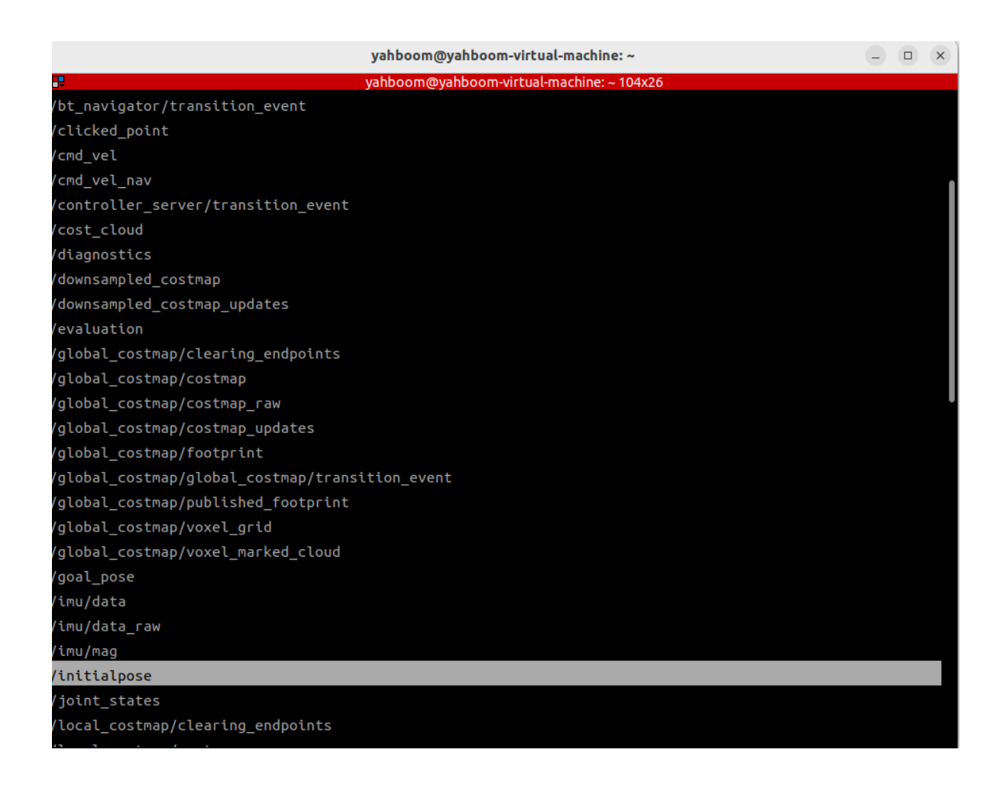
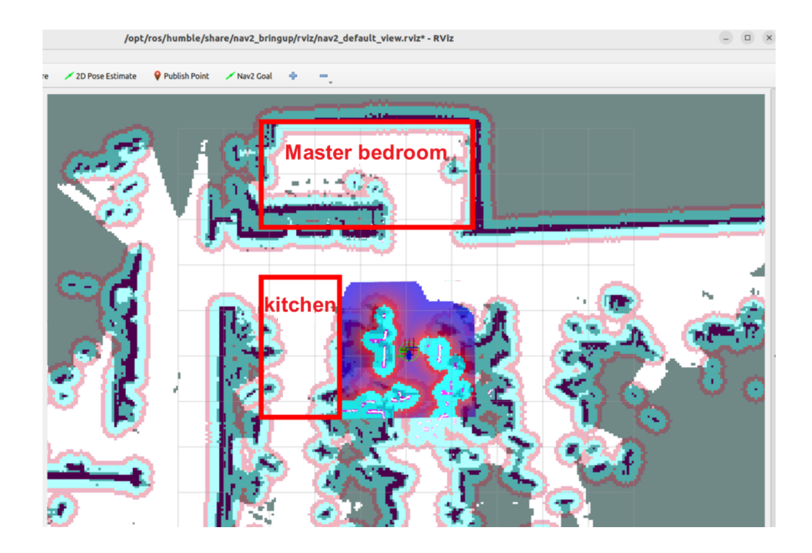
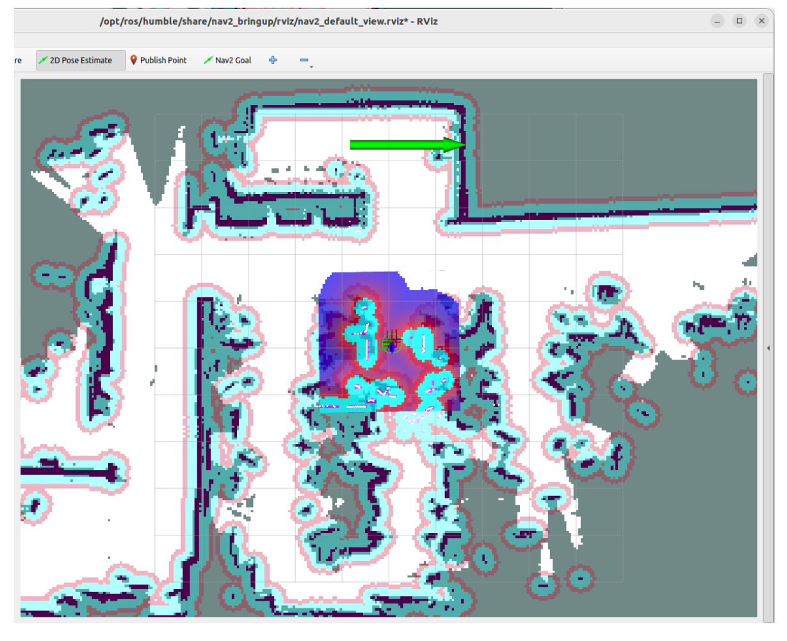
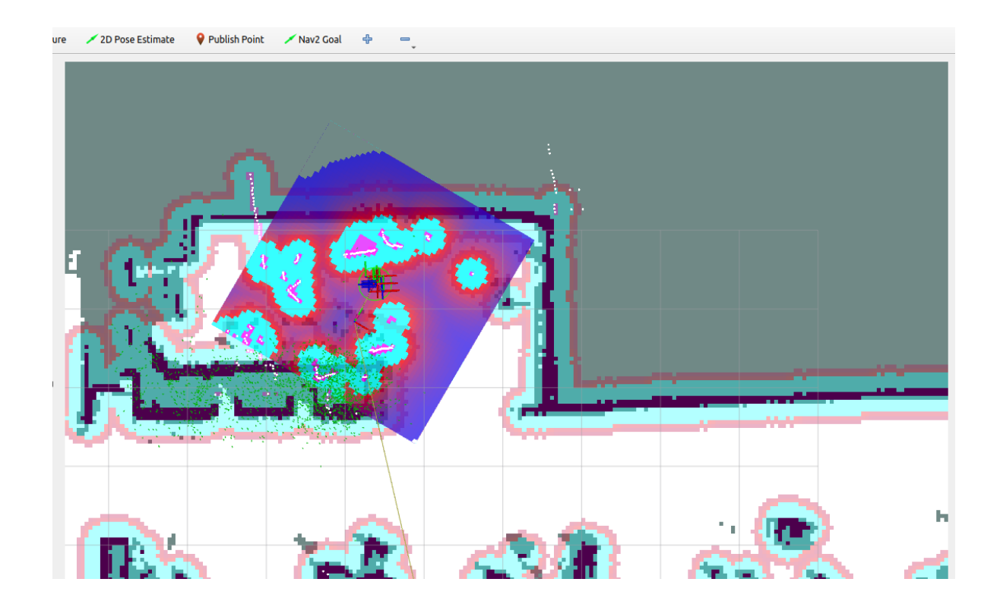
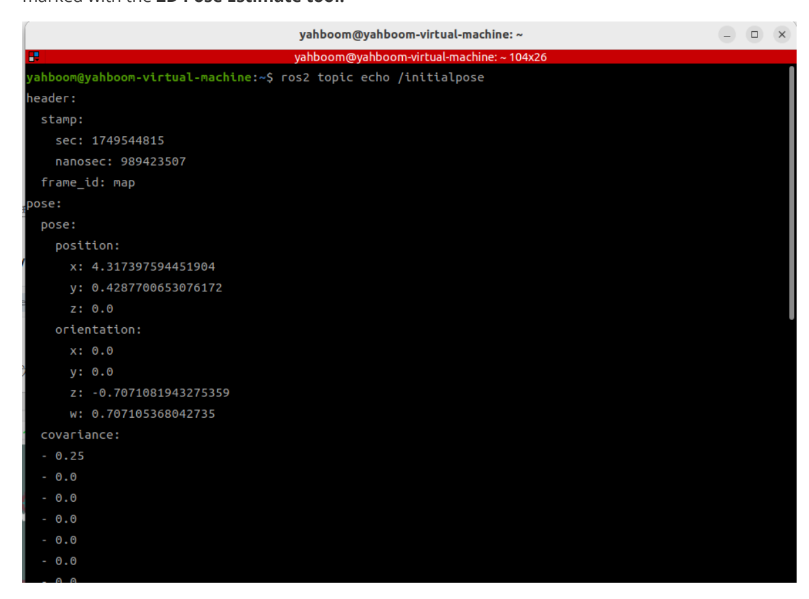
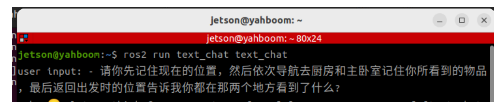

# **Multimodal visual understanding + SLAM navigation**

# **1. Course Content**

- 1. Learn to use the robot's visual understanding and SLAM navigation functions
- 2. Learn new key source codes

# **2. Preparation**

# **2.1 Content Description**

This course uses the Jetson Orin NX as an example. For Raspberry Pi and Jetson Nano boards, you need to open a terminal on the host computer and enter the command to enter the Docker container. Once inside the Docker container, enter the commands mentioned in this course in the terminal. For instructions on entering the Docker container from the host computer, refer to the **[Configuration and Operation Guide] -- [Enter the Docker (Jetson Nano and Raspberry Pi 5 users see here)]** section of this product tutorial. For Orin and NX boards, simply open a terminal and enter the commands mentioned in this course.

# **2.2 Start the Agent**

**Note: To test all cases, you must start the docker agent first. If it has already been started, you do not need to start it again.**

Enter the command in the vehicle terminal:

```
sh start_agent.sh
```

The terminal prints the following information, indicating that the connection is successful

**Note: This chapter requires you to complete at least one SLAM map according to the LiDAR chapter course.**

### **2.3 Configuring map mapping files**

For more details on the principles and concepts of map mapping, please refer to the course content of [2. Basic Knowledge of AI Large Model - 3. Embodied Intelligent Robot System Architecture]

Connect to the robot desktop via VNC, create two new terminals, and start the first terminal first.

ros2 launch M3Pro\_navigation base\_bringup.launch.py

Then start in the second terminal

ros2 launch M3Pro\_navigation navigation2.launch.py

Create a new terminal on the virtual side and start

ros2 launch slam\_view nav\_rviz.launch.py

Or display it in rviz on the car side

ros2 launch M3Pro\_navigation nav\_rviz.launch.py

The rviz2 visualization interface will then open. Click **2D Pose Estimate** in the upper toolbar to enter the selection state and roughly mark the robot's position and orientation on the map.

The robot's model will be displayed on the map as shown below:


[Image details](images/img_001.md)

Create a new terminal in the virtual machine again and enter the command

ros2 topic list


[Image details](images/img_002.md)

You can see the topic **/initialpose , which is the topic for using the 2D Pose Estimate** tool in rviz2 in the previous step . We can use this tool to publish coordinates to view the data of the **/initialpose** topic to obtain the coordinates and orientation angle of a certain point on the map.

Enter the following command in the terminal to observe the data on the **/initialpose topic:**

```
ros2 topic echo /initialpose
```

We can name any point on the map. Here we take "Master Bedroom" and "Kitchen" as examples.


[Image details](images/img_003.md)

As shown in the figure below, we first click the **2D Pose Estimate** tool, then click and hold the left button of the mouse anywhere in the "Master Bedroom" area to adjust the direction, and release it after confirming.


[Image details](images/img_004.md)

The robot position will be adjusted to the position and orientation just selected. You can preview the robot's expected position and orientation in rviz


[Image details](images/img_005.md)

In the last frame of the terminal window, you can see the coordinates of the target point we just marked with the **2D Pose Estimate tool.**


[Image details](images/img_006.md)

Open map\_mapping.yaml the map file, which is located at:

jetson orin nano, jetson orin NX host:

/home/jetson/M3Pro\_ws/src/largemodel/config/map\_mapping.yaml

Jetson Nano, Raspberry Pi host, you need to enter Docker first:

```
root/M3Pro_ws/src/largemodel/config/map_mapping.yaml
```

Replace the "name" in A with "master bedroom", and the "position" and "orientation" data with the data we just saw in the terminal **/initialpose topic**

```
#根据实际的场景环境,自定义地图中的区域,可以添加任意个区域,注意和大模型的地图映射保持一致即可
#According to the actual scene environment, customize the areas in the map. You
can add any number of areas, just make sure they are consistent with the map
mapping of the large model
#地图映射Map mapping
A:
 name: 'Master bedroom'
 position:
   x: 1.6878514289855957
   y: -0.32615160942077637
   z: 0.0
 orientation:
   x: 0.0
   y: 0.0
   z: 0.4503881236302555
   w: 0.8928328724306793
#此处可新增添加区域对应的栅格地图坐标点,注意和上面格式保持一致
#Here, you can add the raster map coordinate points corresponding to the added
area. Please note that the format should be consistent with the above
```

In the same way, we can add a map of the kitchen

```
#根据实际的场景环境,自定义地图中的区域,可以添加任意个区域,注意和大模型的地图映射保持一致即可
#According to the actual scene environment, customize the areas in the map. You
can add any number of areas, just make sure they are consistent with the map
mapping of the large model
#地图映射Map mapping
A:
 name: 'Master bedroom'
 position:
   x: 1.6878514289855957
   y: -0.32615160942077637
   z: 0.0
 orientation:
   x: 0.0
   y: 0.0
   z: 0.4503881236302555
   w: 0.8928328724306793
G:
 name: 'kitchen'
 position:
   x: 2.367471694946289
   y: -1.568994164466858
   z: 0.0
 orientation:
```

```
x: 0.0
   y: 0.0
   z: -0.3106425066197889
   w: 0.950526818706855
#此处可新增添加区域对应的栅格地图坐标点,注意和上面格式保持一致
#Here, you can add the raster map coordinate points corresponding to the added
area. Please note that the format should be consistent with the above
```

Then switch to the workspace in the vehicle terminal M3Pro\_ws/ : recompile the largemodel function package to take effect

jetson orin nano, jetson orin NX host:

```
cd /home/jetson/M3Pro_ws/
```

Jetson Nano, Raspberry Pi host, you need to enter Docker first:

```
cd root/M3Pro_ws/
```

Recompile the feature package:

```
colcon build --packages-select largemodel
```

# **3. Run the case**

#### **3.1 Startup Program**

Connect to the robot desktop via VNC, open a terminal, and start the command

```
ros2 launch largemodel largemodel_control.launch.py text_chat_mode: = True
```

After initialization is complete, the following content will be displayed

Open two terminals on the vehicle and enter the following commands to start the navigation function:

```
ros2 launch M3Pro_navigation base_bringup.launch.py
ros2 launch M3Pro_navigation navigation2.launch.py
```

Create a new terminal on the virtual end and enter the following command to start the rviz visualization window

```
ros2 launch slam_view nav_rviz.launch.py
```

Then follow the process of starting the navigation function to initialize the positioning. The rviz2 visualization interface will open. Click **2D Pose Estimate** in the upper toolbar to enter the selection state. Roughly mark the position and orientation of the robot on the map. After initialization positioning, the preparation work is completed.


[Image details](images/img_007.md)

The virtual machine opens a terminal and starts the text interaction program:

ros2 run text\_chat text\_chat

#### **3.2 Test Cases**

Here are some test cases for reference. Users can write their own dialogue commands.

Please remember your current location first, then navigate to the kitchen and master bedroom in turn and remember what you see. Finally, return to your starting location and tell me what you see in each of these two places.

#### **3.2.1 Case 1**

Copy and enter the above test case in the text interactive terminal:


[Image details](images/img_008.md)

The decision-making model outputs the planned task steps:

The execution layer model will then execute the task steps:

# **4. Source code analysis**

The source code is located at:

jetson orin nano, jetson orin NX host:

/home/jetson/M3Pro\_ws/src/largemodel/largemodel/src/largemodel/largemodel/action \_service.py

Jetson Nano, Raspberry Pi host, you need to enter Docker first:

```
root/M3Pro_ws/src/largemodel/largemodel/src/largemodel/largemodel/action_service
.py
```

#### **4.1 Case 1**

action\_service.py program:

**In Case 1, the seewhat** , **navigation** , **load\_target\_points** , and **get\_current\_pose** methods in **the CustomActionServer** class are used . **Seewhat** has been explained in **the Multimodal Visual Understanding + Robotic Arm Gripping** section. This section explains the two new functions: **navigation** , **load\_target\_points** , and **get\_current\_pose .**

In the **init\_ros\_comunication** initialization function, a nav2 navigation client is created to request the ros2 navigation action server for subsequent sending of navigation target point requests; a TF listener is created to monitor the coordinate transformation between map and basefootprint.

```
#Create a navigation function client and request the navigation action server
self . navclient = ActionClient ( self , NavigateToPose , 'navigate_to_pose' )
#Create tf listener to monitor coordinate transformation
self . tf_buffer = Buffer ()
self . tf_listener = TransformListener ( self . tf_buffer , self )
```

**The load\_target\_points** function is responsible for loading the target point coordinates in the map mapping file map\_mapping.yaml and creating a navigation dictionary to store characters and corresponding map coordinates, where each point coordinate is PoseStamped type data.

```
def load_target_points ( self ):
    with open ( self . map_mapping_config , 'r' ) as file :
        target_points = yaml . safe_load ( file )
    self . navpose_dict = {}
    for name , data in target_points . items ():
        pose = PoseStamped ()
        pose . header . frame_id = 'map'
        pose . pose . position . x = data [ 'position' ] [ 'x' ]
        pose . pose . position . y = data [ 'position' ] [ 'y' ]
        pose . pose . orientation . x = data [ 'orientation' ] [ 'x' ]
        pose . pose . orientation . y = data [ 'orientation' ] [ 'y' ]
        pose . pose . orientation . z = data [ 'orientation' ][ 'z' ]
        pose . pose . orientation . w = data [ 'orientation' ] [ 'w' ]
        self . navpose_dict [ name ] = pose
```

**Navigation** function: Receives a character parameter (corresponding to the character in the above map mapping), parses the coordinates of the corresponding character from the dictionary, and uses the self.navclient navigation client object to request the navigation action server of ros2. When the navigation action server returns a value of 4, it means that the navigation is successful, and other values represent failures (possibly due to obstacles, planning failures, etc.). After the navigation is completed, the results of the action execution are fed back to the large model.

```
def navigation ( self , point_name ):
```

```
#Get the target point coordinates
    if point_name == "zero" :
        target_pose = self . record_pose
    else :
        target_pose = self . navpose_dict . get ( point_name )
    goal_msg = NavigateToPose . Goal ()
    goal_msg . pose = target_pose
    send_goal_future = self . navclient . send_goal_async ( goal_msg )
    rclpy . spin_until_future_complete ( self , send_goal_future )
    goal_handle = send_goal_future . result ()
    if not goal_handle . accepted :
        self . get_logger () . info ( 'navigation Goal rejected' )
        return False
    self . get_logger () . info ( 'navigation Goal accepted' )
    get_result_future = goal_handle . get_result_async ()
    rclpy . spin_until_future_complete ( self , get_result_future )
    result = get_result_future . result ()
    if result . status == 4 : # 4 indicates successful navigation
        self . get_logger () . info ( 'Navigation succeeded!' )
        self . action_status_pub ( f'Robot feedback: Execution
navigation({point_name}) completed' )
    else :
        self . get_logger () . info ( f'Navigation failed with status:
{result.status}' )
        self . action_status_pub ( f'Robot feedback: Failed to execute
navigation({point_name})' )
```

**The get\_current\_pose** function is used to record the robot's current map coordinates in the global coordinate system map and put the coordinates into the dictionary for subsequent retrieval.

```
def get_current_pose ( self ): #Record the current coordinates in record_pose
    '''Get the current position in the global map coordinate system
    '''# Get the current target point coordinates
    transform = self . tf_buffer . lookup_transform (
        'map' ,
        'base_footprint' ,
        rclpy . time . Time ())
    # Extract position and posture
    pose = PoseStamped ()
    pose . header . frame_id = 'map'
    pose . pose . position . x = transform . transform . translation . x
    pose . pose . position . y = transform . transform . translation . y
    pose . pose . position . z = 0.0
    pose . pose . orientation = transform . transform . rotation
    self . navpose_dict [ 'zero' ] = pose
    # Print the recorded coordinates
    position = pose . pose . position
    orientation = pose . pose . orientation
```

```
self . get_logger (). info ( f'Recorded Pose - Position: x={position.x}, y=
{position.y}, z={position.z}' )
    self . get_logger (). info ( f'Recorded Pose - Orientation: x=
{orientation.x}, y={orientation.y}, z={orientation.z}, w={orientation.w}' )
    self . action_status_pub ( f'Robot feedback: get_current_pose() success' )
```